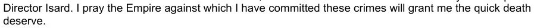

# Owner Material 037 — Star Wars D20 Drive folder (Core, Revised Core and Saga Edition): Locations/Planet Hoppers/Coruscant - Center of the Empire/Part 4 - Eyes of Red and Blue.pdf [Star Wars Roleplaying Game Revised Core (d20, 2002)]

- **Source:** Wizards of the Coast Star Wars Roleplaying Game books, web enhancements, Living Force campaign modules and articles (2000–2010), from the owner's "Star Wars D20" Drive folder (only the three edition subfolders; "General" was not read, as instructed). Secondary source (licensed Legends reference). Scan OCR'd on the box; the scan stays box-only and is **not** published.
- **Method:** every scanned page was OCR'd and machine-screened sentence by sentence for power-relevant statements (fights, kills, defeats, Force feats, rankings, superweapons) that name a character on our roster; each kept sentence is quoted verbatim from the OCR text and has a crop of the printed passage directly under it. Pages with nothing power-relevant are still listed with what is on them.
- **Citation:** "*Part 4 - Eyes of Red and Blue* (SWRPG d20 Revised Core), p.X" by printed page ("scan p.X" where no printed number applies). **Weight:** Licensed RPG material: a secondary source. Narrative text sums up Legends lore; game statistics are rules for players, not canon power levels, and rank lowest.

## scan p.1 (scan page 1)

Page contents: YI-5 tracked Willic through Coco Town and the Outlander; truth-serum confession; Isard endorses mass production of the YI-5; the droid faked holo evidence so Willic would accept his guilt; real conspirators executed in secret; termination order lifted on three design techs (hand-read)

- **No single roster character (rules/setting/general)** — entry/section: Vune Willic's confession: "I pray the Empire against which I have committed these crimes will grant me the quick death I deserve." Source: *Part 4 - Eyes of Red and Blue* (SWRPG d20 Revised Core), scan p.1
  

### Stat block notes (game mechanics, not feats)

- Willic frame-up done on the Emperor's direct orders: The "impartial" evidence gathered by the droid allows us to use Willic as a public scapegoat for the assassination attempt, while executing the actual conspirators in secret. Naturally, the public could not be allowed to learn that several of the Emperor's most valued officers had turned traitor. Instead, we have given the citizens a lone Rebel madman that can and will be punished for all to see. Of course, the Emperor was never in actual danger; our ruler himself saw to that. After all, I was acting on his direct orders. (Source: *Part 4 - Eyes of Red and Blue* (SWRPG d20 Revised Core), scan p.1)

## scan p.2 (scan page 2)

Page contents: YI-5 stats (Expert 5, stealth field +12 Hide, truth serum Will DC 26, CL C); May teaser (Spice Mines of Kessel); Reputation "Tips and Tactics" plug (hand-read)

