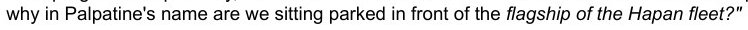

# Owner Material 037 — Star Wars D20 Drive folder (Core, Revised Core and Saga Edition): Locations/Planet Hoppers/Hapes - Ladies First/Part 1 - Planet of the Amazons.pdf [Star Wars Roleplaying Game Revised Core (d20, 2002)]

- **Source:** Wizards of the Coast Star Wars Roleplaying Game books, web enhancements, Living Force campaign modules and articles (2000–2010), from the owner's "Star Wars D20" Drive folder (only the three edition subfolders; "General" was not read, as instructed). Secondary source (licensed Legends reference). Scan OCR'd on the box; the scan stays box-only and is **not** published.
- **Method:** every scanned page was OCR'd and machine-screened sentence by sentence for power-relevant statements (fights, kills, defeats, Force feats, rankings, superweapons) that name a character on our roster; each kept sentence is quoted verbatim from the OCR text and has a crop of the printed passage directly under it. Pages with nothing power-relevant are still listed with what is on them.
- **Citation:** "*Part 1 - Planet of the Amazons* (SWRPG d20 Revised Core), p.X" by printed page ("scan p.X" where no printed number applies). **Weight:** Licensed RPG material: a secondary source. Narrative text sums up Legends lore; game statistics are rules for players, not canon power levels, and rank lowest.

## scan p.1 (scan page 1)

Page contents: Hapes Consortium history (Lorell Raiders, Jedi defeat them, matriarchy, Transitory Mists, Ta'a Chume's military buildup); the "amazon" pop image; Bricker memoir framing; Hapes stats (8 billion, hereditary matriarchy) (hand-read)

### Stat block notes (game mechanics, not feats)

- Emperor's fear of the Nightsisters isolated Dathomir: the latter a primitive place inhabited by Force-using witches and semi-intelligent domesticated rancors, isolated by the Emperor's fear of the Nightsisters (by sheer chance, Dathomir was also temporarily owned by Han Solo after a ridiculously high-stakes sabacc match). (Source: *Part 1 - Planet of the Amazons* (SWRPG d20 Revised Core), scan p.1)

## scan p.2 (scan page 2)

Page contents: Bricker and his Hapan first mate Kelan Faal parked in front of the Hapan flagship; Courtship sidebar; Hapan species notes (night blindness -1/-3, +2 Cha); Part Two teaser (Star Home); Z2-1B plug (hand-read)

- **No single roster character (rules/setting/general)** — entry/section: Grov Bricker (memoir): "why in Palpatine's name are we sitting parked in front of the flagship of the Hapan fleet?" Source: *Part 1 - Planet of the Amazons* (SWRPG d20 Revised Core), scan p.2
  
