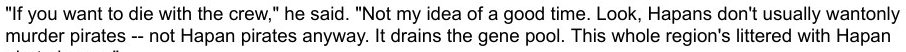
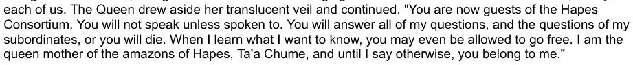

# Owner Material 037 — Star Wars D20 Drive folder (Core, Revised Core and Saga Edition): Locations/Planet Hoppers/Hapes - Ladies First/Part 2 - Return to the Planet of the Amazons.pdf [Star Wars Roleplaying Game Revised Core (d20, 2002)]

- **Source:** Wizards of the Coast Star Wars Roleplaying Game books, web enhancements, Living Force campaign modules and articles (2000–2010), from the owner's "Star Wars D20" Drive folder (only the three edition subfolders; "General" was not read, as instructed). Secondary source (licensed Legends reference). Scan OCR'd on the box; the scan stays box-only and is **not** published.
- **Method:** every scanned page was OCR'd and machine-screened sentence by sentence for power-relevant statements (fights, kills, defeats, Force feats, rankings, superweapons) that name a character on our roster; each kept sentence is quoted verbatim from the OCR text and has a crop of the printed passage directly under it. Pages with nothing power-relevant are still listed with what is on them.
- **Citation:** "*Part 2 - Return to the Planet of the Amazons* (SWRPG d20 Revised Core), p.X" by printed page ("scan p.X" where no printed number applies). **Weight:** Licensed RPG material: a secondary source. Narrative text sums up Legends lore; game statistics are rules for players, not canon power levels, and rank lowest.

## scan p.1 (scan page 1)

Page contents: Star Home seen from the cockpit; Kelan explains Hapan pirates and takes the "captain" role (hand-read)

- **No single roster character (rules/setting/general)** — entry/section: Kelan Faal: "Look, Hapans don't usually wantonly murder pirates -- not Hapan pirates anyway. It drains the gene pool." Source: *Part 2 - Return to the Planet of the Amazons* (SWRPG d20 Revised Core), scan p.1
  

## scan p.2 (scan page 2)

Page contents: Star Home cutaway labels; drawn into the belly hangar; Twi'lek engineer Xanai Sowan; the domed stone city inside; throne hall, Ta'a Chume (hand-read)

## scan p.3 (scan page 3)

Page contents: Ta'a Chume's welcome; GM notes: Star Home history (first Queen Mother, after the Mandalorian Wars), construction, engines, My'til squadrons; stats (Colossal 2,500 m, Def 26, SP 600 DR 40, HP 900 DR 15 from the image; 20 lasers, 20 turbolasers) (hand-read)

- **No single roster character (rules/setting/general)** — entry/section: Ta'a Chume to Bricker and Faal: "You are now guests of the Hapes Consortium. You will not speak unless spoken to. You will answer all of my questions, and the questions of my subordinates, or you will die. When I learn what I want to know, you may even be allowed to go free. I am the queen mother of the amazons of Hapes, Ta'a Chume, and until I say otherwise, you belong to me." Source: *Part 2 - Return to the Planet of the Amazons* (SWRPG d20 Revised Core), scan p.3
  

## scan p.4 (scan page 4)

Page contents: Six tractor beams; Part Three teaser; gorgodon (Ultimate Adversaries) plug (hand-read)

