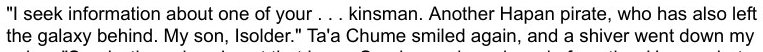
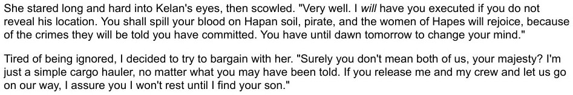

# Owner Material 037 — Star Wars D20 Drive folder (Core, Revised Core and Saga Edition): Locations/Planet Hoppers/Hapes - Ladies First/Part 3 - Beneath the Planet of the Amazons.pdf [Star Wars Roleplaying Game Revised Core (d20, 2002)]

- **Source:** Wizards of the Coast Star Wars Roleplaying Game books, web enhancements, Living Force campaign modules and articles (2000–2010), from the owner's "Star Wars D20" Drive folder (only the three edition subfolders; "General" was not read, as instructed). Secondary source (licensed Legends reference). Scan OCR'd on the box; the scan stays box-only and is **not** published.
- **Method:** every scanned page was OCR'd and machine-screened sentence by sentence for power-relevant statements (fights, kills, defeats, Force feats, rankings, superweapons) that name a character on our roster; each kept sentence is quoted verbatim from the OCR text and has a crop of the printed passage directly under it. Pages with nothing power-relevant are still listed with what is on them.
- **Citation:** "*Part 3 - Beneath the Planet of the Amazons* (SWRPG d20 Revised Core), p.X" by printed page ("scan p.X" where no printed number applies). **Weight:** Licensed RPG material: a secondary source. Narrative text sums up Legends lore; game statistics are rules for players, not canon power levels, and rank lowest.

## scan p.1 (scan page 1)

Page contents: The crew is sent to a prison moon; Bricker and Faal chained beneath the Fountain Palace; Ta'a Chume slaps Kelan and asks about her son Isolder (hand-read)

- **No single roster character (rules/setting/general)** — entry/section: Ta'a Chume to Kelan Faal: "I seek information about one of your . . . kinsman. Another Hapan pirate, who has also left the galaxy behind. My son, Isolder." Source: *Part 3 - Beneath the Planet of the Amazons* (SWRPG d20 Revised Core), scan p.1
  

## scan p.2 (scan page 2)

Page contents: Execution threatened at dawn; Kelan's assurance; GM notes: "Ta'a Chume" is a title; Isolder hunting his brother's killer; stats Noble 19, Cha 22, gun of command, CL H; Part Four teaser; "Jedi Counseling" plug (hand-read)

- **No single roster character (rules/setting/general)** — entry/section: Ta'a Chume to Kelan Faal: "Very well. I will have you executed if you do not reveal his location. You shall spill your blood on Hapan soil, pirate, and the women of Hapes will rejoice, because of the crimes they will be told you have committed. You have until dawn tomorrow to change your mind." Source: *Part 3 - Beneath the Planet of the Amazons* (SWRPG d20 Revised Core), scan p.2
  

## scan p.3 (scan page 3)

Page contents: Copyright line only (from the image; the OCR returned 0 words) (hand-read)

