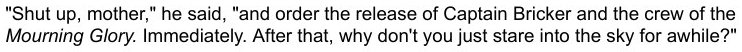
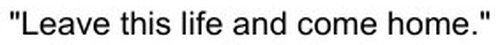
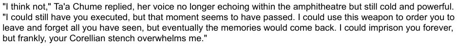
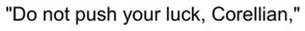

# Owner Material 037 — Star Wars D20 Drive folder (Core, Revised Core and Saga Edition): Locations/Planet Hoppers/Hapes - Ladies First/Part 4 - Escape from the Planet of the Amazons.pdf [Star Wars Roleplaying Game Revised Core (d20, 2002)]

- **Source:** Wizards of the Coast Star Wars Roleplaying Game books, web enhancements, Living Force campaign modules and articles (2000–2010), from the owner's "Star Wars D20" Drive folder (only the three edition subfolders; "General" was not read, as instructed). Secondary source (licensed Legends reference). Scan OCR'd on the box; the scan stays box-only and is **not** published.
- **Method:** every scanned page was OCR'd and machine-screened sentence by sentence for power-relevant statements (fights, kills, defeats, Force feats, rankings, superweapons) that name a character on our roster; each kept sentence is quoted verbatim from the OCR text and has a crop of the printed passage directly under it. Pages with nothing power-relevant are still listed with what is on them.
- **Citation:** "*Part 4 - Escape from the Planet of the Amazons* (SWRPG d20 Revised Core), p.X" by printed page ("scan p.X" where no printed number applies). **Weight:** Licensed RPG material: a secondary source. Narrative text sums up Legends lore; game statistics are rules for players, not canon power levels, and rank lowest.

## scan p.1 (scan page 1)

Page contents: Hapan law and the Queen Mother; the execution amphitheater by the Fountain Palace; how the gun of command works; Ta'a Chume's false charges; twelve noblewomen; Kelan's 15-minute plea (hand-read)

## scan p.2 (scan page 2)

Page contents: Lady Elliar throws Kelan a second gun of command; he stuns his mother; revealed as Isolder; Ta'a Chume shakes it off and recaptures him (hand-read)

- **No single roster character (rules/setting/general)** — entry/section: Isolder ("Kelan Faal") to Ta'a Chume: "Shut up, mother, and order the release of Captain Bricker and the crew of the Mourning Glory. Immediately. After that, why don't you just stare into the sky for awhile?" Source: *Part 4 - Escape from the Planet of the Amazons* (SWRPG d20 Revised Core), scan p.2
  
- **No single roster character (rules/setting/general)** — entry/section: Ta'a Chume to Isolder: "Chume'da, leave this life and come home." Source: *Part 4 - Escape from the Planet of the Amazons* (SWRPG d20 Revised Core), scan p.2
  
- **No single roster character (rules/setting/general)** — entry/section: Ta'a Chume to Bricker: "I could still have you executed, but that moment seems to have passed. I could use this weapon to order you to leave and forget all you have seen, but eventually the memories would come back. I could imprison you forever, but frankly, your Corellian stench overwhelms me." Source: *Part 4 - Escape from the Planet of the Amazons* (SWRPG d20 Revised Core), scan p.2
  

## scan p.3 (scan page 3)

Page contents: Bricker released under Battle Dragon escort; gun of command stats (25,000 cr, Will DC attack+10, 1d6 or 10d6 rounds); June teaser (Beheboth); "Jedi Counseling" plug (hand-read)

- **No single roster character (rules/setting/general)** — entry/section: Ta'a Chume to Bricker: "Do not push your luck, Corellian." Source: *Part 4 - Escape from the Planet of the Amazons* (SWRPG d20 Revised Core), scan p.3
  
