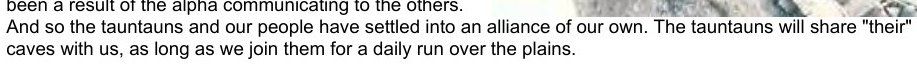

# Owner Material 037 — Star Wars D20 Drive folder (Core, Revised Core and Saga Edition): Locations/Planet Hoppers/Hoth - Under the Ice/Part 2 - Steady, Girl.pdf [Star Wars Roleplaying Game Revised Core (d20, 2002)]

- **Source:** Wizards of the Coast Star Wars Roleplaying Game books, web enhancements, Living Force campaign modules and articles (2000–2010), from the owner's "Star Wars D20" Drive folder (only the three edition subfolders; "General" was not read, as instructed). Secondary source (licensed Legends reference). Scan OCR'd on the box; the scan stays box-only and is **not** published.
- **Method:** every scanned page was OCR'd and machine-screened sentence by sentence for power-relevant statements (fights, kills, defeats, Force feats, rankings, superweapons) that name a character on our roster; each kept sentence is quoted verbatim from the OCR text and has a crop of the printed passage directly under it. Pages with nothing power-relevant are still listed with what is on them.
- **Citation:** "*Part 2 - Steady, Girl* (SWRPG d20 Revised Core), p.X" by printed page ("scan p.X" where no printed number applies). **Weight:** Licensed RPG material: a secondary source. Narrative text sums up Legends lore; game statistics are rules for players, not canon power levels, and rank lowest.

## scan p.1 (scan page 1)

Page contents: Rolado's log: baiting tauntauns with sedated ice scrabblers; Echo Base under construction; concussion indoors; rode the alpha 35 km outside; the pack's behavior changes; GM notes on the matriarchal pack (hand-read)

- **No single roster character (rules/setting/general)** — entry/section: Corporal Vyn Rolado's log: "And so the tauntauns and our people have settled into an alliance of our own. The tauntauns will share their caves with us, as long as we join them for a daily run over the plains." Source: *Part 2 - Steady, Girl* (SWRPG d20 Revised Core), scan p.1
  

## scan p.2 (scan page 2)

Page contents: Tauntaun species traits (Survival +4, Pack leader); Tauntaun Alpha stats (CL C); "Jedi Counseling" plug (hand-read)

