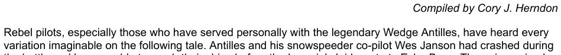
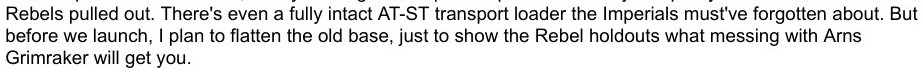
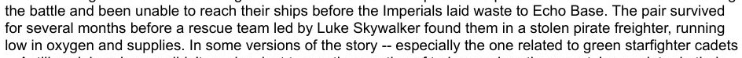

# Owner Material 037 — Star Wars D20 Drive folder (Core, Revised Core and Saga Edition): Locations/Planet Hoppers/Hoth - Under the Ice/Part 3 - Merchants of Death.pdf [Star Wars Roleplaying Game Revised Core (d20, 2002)]

- **Source:** Wizards of the Coast Star Wars Roleplaying Game books, web enhancements, Living Force campaign modules and articles (2000–2010), from the owner's "Star Wars D20" Drive folder (only the three edition subfolders; "General" was not read, as instructed). Secondary source (licensed Legends reference). Scan OCR'd on the box; the scan stays box-only and is **not** published.
- **Method:** every scanned page was OCR'd and machine-screened sentence by sentence for power-relevant statements (fights, kills, defeats, Force feats, rankings, superweapons) that name a character on our roster; each kept sentence is quoted verbatim from the OCR text and has a crop of the printed passage directly under it. Pages with nothing power-relevant are still listed with what is on them.
- **Citation:** "*Part 3 - Merchants of Death* (SWRPG d20 Revised Core), p.X" by printed page ("scan p.X" where no printed number applies). **Weight:** Licensed RPG material: a secondary source. Narrative text sums up Legends lore; game statistics are rules for players, not canon power levels, and rank lowest.

## scan p.1 (scan page 1)

Page contents: Wedge and Janson stranded after Hoth, rescued by Luke in a pirate freighter; Grimraker's expedition log salvaging the battlefield (enough parts for two AT-ATs, an AT-ST); plans to flatten the base; GM notes (hand-read)

- **Wedge Antilles** — entry/section: Part 3 - Merchants of Death: "Herndon Rebel pilots, especially those who have served personally with the legendary Wedge Antilles, have heard every variation imaginable on the following tale." Source: *Part 3 - Merchants of Death* (SWRPG d20 Revised Core), scan p.1
  
- **No single roster character (rules/setting/general)** — entry/section: Captain Arns Grimraker's log: "But before we launch, I plan to flatten the old base, just to show the Rebel holdouts what messing with Arns Grimraker will get you." Source: *Part 3 - Merchants of Death* (SWRPG d20 Revised Core), scan p.1
  
- **Luke Skywalker**: "The pair survived for several months before a rescue team led by Luke Skywalker found them in a stolen pirate freighter, running low in oxygen and supplies." Source: *Part 3 - Merchants of Death* (SWRPG d20 Revised Core), scan p.1
  

## scan p.2 (scan page 2)

Page contents: Grimraker cyborg description; killed through Wedge's efforts; stats Scoundrel 8/Noble 2/Crime Lord 5, DSP 37, CL E; cybernetics SQ; "Hoth Stuff, Comin' Through!" sidebar (Marvel #78); Part Four teaser (Jedi Academy at Echo Base); "The Wellspring" plug (hand-read)

