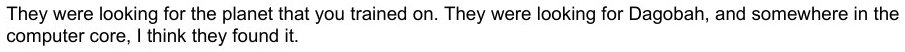

# Owner Material 037 — Star Wars D20 Drive folder (Core, Revised Core and Saga Edition): Locations/Planet Hoppers/Hoth - Under the Ice/Part 4 - A Brief Thaw.pdf [Star Wars Roleplaying Game Revised Core (d20, 2002)]

- **Source:** Wizards of the Coast Star Wars Roleplaying Game books, web enhancements, Living Force campaign modules and articles (2000–2010), from the owner's "Star Wars D20" Drive folder (only the three edition subfolders; "General" was not read, as instructed). Secondary source (licensed Legends reference). Scan OCR'd on the box; the scan stays box-only and is **not** published.
- **Method:** every scanned page was OCR'd and machine-screened sentence by sentence for power-relevant statements (fights, kills, defeats, Force feats, rankings, superweapons) that name a character on our roster; each kept sentence is quoted verbatim from the OCR text and has a crop of the printed passage directly under it. Pages with nothing power-relevant are still listed with what is on them.
- **Citation:** "*Part 4 - A Brief Thaw* (SWRPG d20 Revised Core), p.X" by printed page ("scan p.X" where no printed number applies). **Weight:** Licensed RPG material: a secondary source. Narrative text sums up Legends lore; game statistics are rules for players, not canon power levels, and rank lowest.

## scan p.1 (scan page 1)

Page contents: Katarn's transmission: Force disturbance; tauntaun ride; Imperial tunnel under a downed AT-AT; wampas; the command-center core left exposed by Wedge's jury-rig; Sith cult searching for Dagobah; GM notes: Secret Entrance (DC 12 Search, 2d4 hours), the Tunnel (hand-read)

- **No single roster character (rules/setting/general)** — entry/section: Kyle Katarn to Luke Skywalker: "They were looking for the planet that you trained on. They were looking for Dagobah, and somewhere in the computer core, I think they found it." Source: *Part 4 - A Brief Thaw* (SWRPG d20 Revised Core), scan p.1
  

## scan p.2 (scan page 2)

Page contents: Tunnel hazards (falling ice, ice scrabblers, wampas); Echo Base partly powered, computer and armory; January teaser (Zeltros); "Tips and Tactics" plug (hand-read)

