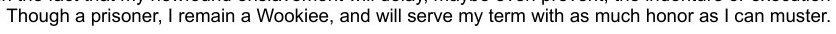

# Owner Material 037 — Star Wars D20 Drive folder (Core, Revised Core and Saga Edition): Locations/Planet Hoppers/Kessel - Hell in Space/Part 1 - Rotten to the Core.pdf [Star Wars Roleplaying Game Revised Core (d20, 2002)]

- **Source:** Wizards of the Coast Star Wars Roleplaying Game books, web enhancements, Living Force campaign modules and articles (2000–2010), from the owner's "Star Wars D20" Drive folder (only the three edition subfolders; "General" was not read, as instructed). Secondary source (licensed Legends reference). Scan OCR'd on the box; the scan stays box-only and is **not** published.
- **Method:** every scanned page was OCR'd and machine-screened sentence by sentence for power-relevant statements (fights, kills, defeats, Force feats, rankings, superweapons) that name a character on our roster; each kept sentence is quoted verbatim from the OCR text and has a crop of the printed passage directly under it. Pages with nothing power-relevant are still listed with what is on them.
- **Citation:** "*Part 1 - Rotten to the Core* (SWRPG d20 Revised Core), p.X" by printed page ("scan p.X" where no printed number applies). **Weight:** Licensed RPG material: a secondary source. Narrative text sums up Legends lore; game statistics are rules for players, not canon power levels, and rank lowest.

## scan p.1 (scan page 1)

Page contents: Archivist's note on Gyylghrard; Kessel stats (pop. 700 military, 10,400 prisoners; glitterstim); Day 1: slave ship, Sullustan black-market friend, decontamination, the Maw, barracks, thin air and gas masks (hand-read)

- **No single roster character (rules/setting/general)** — entry/section: Gyylghrard's journal: "Though a prisoner, I remain a Wookiee, and will serve my term with as much honor as I can muster." Source: *Part 1 - Rotten to the Core* (SWRPG d20 Revised Core), scan p.1
  

## scan p.2 (scan page 2)

Page contents: One mask and one oxygen recharge a day; mining glitterstim in darkness; spice spider scent; sidebar "The Spice Mines of Kessel" (Warden Commander Kluskine, Doole as trustee); Part Two teaser; Creature Feature plug (hand-read)

