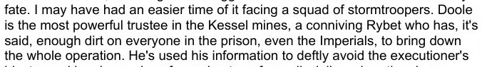
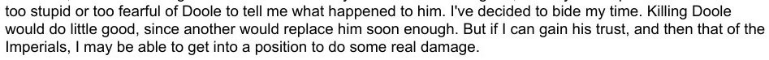
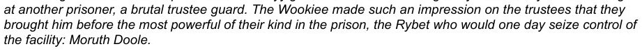

# Owner Material 037 — Star Wars D20 Drive folder (Core, Revised Core and Saga Edition): Locations/Planet Hoppers/Kessel - Hell in Space/Part 2 - In the Land of the Blind.pdf [Star Wars Roleplaying Game Revised Core (d20, 2002)]

- **Source:** Wizards of the Coast Star Wars Roleplaying Game books, web enhancements, Living Force campaign modules and articles (2000–2010), from the owner's "Star Wars D20" Drive folder (only the three edition subfolders; "General" was not read, as instructed). Secondary source (licensed Legends reference). Scan OCR'd on the box; the scan stays box-only and is **not** published.
- **Method:** every scanned page was OCR'd and machine-screened sentence by sentence for power-relevant statements (fights, kills, defeats, Force feats, rankings, superweapons) that name a character on our roster; each kept sentence is quoted verbatim from the OCR text and has a crop of the printed passage directly under it. Pages with nothing power-relevant are still listed with what is on them.
- **Citation:** "*Part 2 - In the Land of the Blind* (SWRPG d20 Revised Core), p.X" by printed page ("scan p.X" where no printed number applies). **Weight:** Licensed RPG material: a secondary source. Narrative text sums up Legends lore; game statistics are rules for players, not canon power levels, and rank lowest.

## scan p.1 (scan page 1)

Page contents: Day ~73; defends the Sullustan from a one-eyed Barabel trustee; Doole has him beaten and left in the Pit about a week; the Sullustan is gone; plan to gain trust; Moruth Doole stats (Diplomat 4/Thug 2, DSP 11, CL C) (hand-read)

- **Moruth Doole** — entry/section: Part 2 - In the Land of the Blind: "Doole is the most powerful trustee in the Kessel mines, a conniving Rybet who has, it's said, enough dirt on everyone in the prison, even the Imperials, to bring down the whole operation." Source: *Part 2 - In the Land of the Blind* (SWRPG d20 Revised Core), scan p.1
  
- **No single roster character (rules/setting/general)** — entry/section: Gyylghrard's journal: "Killing Doole would do little good, since another would replace him soon enough. But if I can gain his trust, and then that of the Imperials, I may be able to get into a position to do some real damage." Source: *Part 2 - In the Land of the Blind* (SWRPG d20 Revised Core), scan p.1
  
- **Moruth Doole**: "The Wookiee made such an impression on the trustees that they brought him before the most powerful of their kind in the prison, the Rybet who would one day seize control of the facility: Moruth Doole." Source: *Part 2 - In the Land of the Blind* (SWRPG d20 Revised Core), scan p.1
  

### Stat block notes (game mechanics, not feats)

- Moruth Doole: Male Rybet Diplomat 4/Thug 2; Init +0 (Dex); Def 13 (+2 class,+1 size); Spd 6 m, swim 6 m; VP/WP -/12; Attack +3 melee (1d3-1, punch) or +5 ranged (3d4, holdout blaster); SQ Amphibious; SV Fort +3, Ref +2, Will +5; SZ S; FP 0; DSP 11; Rep +1; Str 8, Dex 13, Con 9, Int 17, Wis 12, Cha 16; Challenge Code C. Equipment: 2d4 bodyguards (3rd-level Thugs, any spec (Source: *Part 2 - In the Land of the Blind* (SWRPG d20 Revised Core), scan p.1)

## scan p.2 (scan page 2)

Page contents: Amphibious SQ; Spice Mines sidebar (repeat); Part Three teaser (Wookiee holiday); "Jedi Counseling" plug (hand-read)

