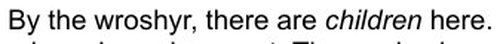
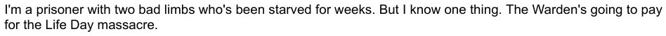

# Owner Material 037 — Star Wars D20 Drive folder (Core, Revised Core and Saga Edition): Locations/Planet Hoppers/Kessel - Hell in Space/Part 3 - Hope in Darkness.pdf [Star Wars Roleplaying Game Revised Core (d20, 2002)]

- **Source:** Wizards of the Coast Star Wars Roleplaying Game books, web enhancements, Living Force campaign modules and articles (2000–2010), from the owner's "Star Wars D20" Drive folder (only the three edition subfolders; "General" was not read, as instructed). Secondary source (licensed Legends reference). Scan OCR'd on the box; the scan stays box-only and is **not** published.
- **Method:** every scanned page was OCR'd and machine-screened sentence by sentence for power-relevant statements (fights, kills, defeats, Force feats, rankings, superweapons) that name a character on our roster; each kept sentence is quoted verbatim from the OCR text and has a crop of the printed passage directly under it. Pages with nothing power-relevant are still listed with what is on them.
- **Citation:** "*Part 3 - Hope in Darkness* (SWRPG d20 Revised Core), p.X" by printed page ("scan p.X" where no printed number applies). **Weight:** Licensed RPG material: a secondary source. Narrative text sums up Legends lore; game statistics are rules for players, not canon power levels, and rank lowest.

## scan p.1 (scan page 1)

Page contents: Day 404: child work gangs; Doole assigns Gyylghrard to tend them; the Wookiee children want Life Day; Day 411: bionic leg; ryshcate cakes and sparksticks; "Tree of Life" hymn; shackles overloaded; blasters drained; uprising (hand-read)

- **No single roster character (rules/setting/general)** — entry/section: Gyylghrard's journal: "By the wroshyr, there are children here." Source: *Part 3 - Hope in Darkness* (SWRPG d20 Revised Core), scan p.1
  

## scan p.2 (scan page 2)

Page contents: Children cut down at the launch bay on the Warden's shoot-to-kill order; Gyylghrard stunned; Spice Mines sidebar; Part Four teaser; Hero's Guide preview plug (hand-read)

- **No single roster character (rules/setting/general)** — entry/section: Gyylghrard's journal: "I'm a prisoner with two bad limbs who's been starved for weeks. But I know one thing. The Warden's going to pay for the Life Day massacre." Source: *Part 3 - Hope in Darkness* (SWRPG d20 Revised Core), scan p.2
  
