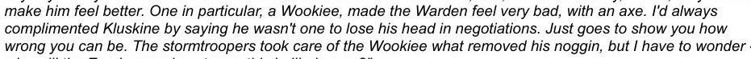

# Owner Material 037 — Star Wars D20 Drive folder (Core, Revised Core and Saga Edition): Locations/Planet Hoppers/Kessel - Hell in Space/Part 5 - The Warden.pdf [Star Wars Roleplaying Game Revised Core (d20, 2002)]

- **Source:** Wizards of the Coast Star Wars Roleplaying Game books, web enhancements, Living Force campaign modules and articles (2000–2010), from the owner's "Star Wars D20" Drive folder (only the three edition subfolders; "General" was not read, as instructed). Secondary source (licensed Legends reference). Scan OCR'd on the box; the scan stays box-only and is **not** published.
- **Method:** every scanned page was OCR'd and machine-screened sentence by sentence for power-relevant statements (fights, kills, defeats, Force feats, rankings, superweapons) that name a character on our roster; each kept sentence is quoted verbatim from the OCR text and has a crop of the printed passage directly under it. Pages with nothing power-relevant are still listed with what is on them.
- **Citation:** "*Part 5 - The Warden* (SWRPG d20 Revised Core), p.X" by printed page ("scan p.X" where no printed number applies). **Weight:** Licensed RPG material: a secondary source. Narrative text sums up Legends lore; game statistics are rules for players, not canon power levels, and rank lowest.

## scan p.1 (scan page 1)

Page contents: Day 947: promoted to Kluskine's alien honor guard (ceremonial poleaxes, Gamorrean armor); Twi'lek crime lord reception; the plan forms; archivist's note: Doole arranged the assignment; Fossco's memoir of the beheading; Dewt Kluskine stats (Noble 1/Soldier 4/Officer 4, DSP 22, CL D) (hand-read)

- **No single roster character (rules/setting/general)** — entry/section: Fossco (Toydarian accountant), memoir: "I'd always complimented Kluskine by saying he wasn't one to lose his head in negotiations. Just goes to show you how wrong you can be." Source: *Part 5 - The Warden* (SWRPG d20 Revised Core), scan p.1
  

## scan p.2 (scan page 2)

Page contents: Remaining feats; Spice Mines sidebar; June teaser (Arbra, Hoojibs); "Tips and Tactics" plug (hand-read)

