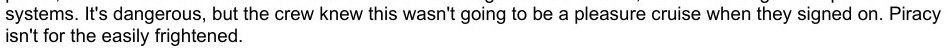

# Owner Material 037 — Star Wars D20 Drive folder (Core, Revised Core and Saga Edition): Locations/Planet Hoppers/Korriban - Planet of Lost Souls/Part 1 - Haunted Hideout.pdf [Star Wars Roleplaying Game Revised Core (d20, 2002)]

- **Source:** Wizards of the Coast Star Wars Roleplaying Game books, web enhancements, Living Force campaign modules and articles (2000–2010), from the owner's "Star Wars D20" Drive folder (only the three edition subfolders; "General" was not read, as instructed). Secondary source (licensed Legends reference). Scan OCR'd on the box; the scan stays box-only and is **not** published.
- **Method:** every scanned page was OCR'd and machine-screened sentence by sentence for power-relevant statements (fights, kills, defeats, Force feats, rankings, superweapons) that name a character on our roster; each kept sentence is quoted verbatim from the OCR text and has a crop of the printed passage directly under it. Pages with nothing power-relevant are still listed with what is on them.
- **Citation:** "*Part 1 - Haunted Hideout* (SWRPG d20 Revised Core), p.X" by printed page ("scan p.X" where no printed number applies). **Weight:** Licensed RPG material: a secondary source. Narrative text sums up Legends lore; game statistics are rules for players, not canon power levels, and rank lowest.

## scan p.1 (scan page 1)

Page contents: Logs disputed (sealed in a 7,000-year-old tomb); possible cloaked Imperial attackers; Korriban stats (1.4 g, historic pop. 9.6 billion Sith, "Major Exports: evil"); Felyood's log: running the engines on the ground; emergency jump (hand-read)

- **No single roster character (rules/setting/general)** — entry/section: Captain Naz Felyood's log: "Piracy isn't for the easily frightened." Source: *Part 1 - Haunted Hideout* (SWRPG d20 Revised Core), scan p.1
  

## scan p.2 (scan page 2)

Page contents: Astromech explodes and Nrross dies; Janah navigates; fire from invisible ships; Babb's ancient star charts; [LOG ENDS]; Part Two teaser; "Jedi Counseling" plug (hand-read)

