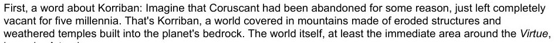

# Owner Material 037 — Star Wars D20 Drive folder (Core, Revised Core and Saga Edition): Locations/Planet Hoppers/Korriban - Planet of Lost Souls/Part 2 - Valley of Darkness.pdf [Star Wars Roleplaying Game Revised Core (d20, 2002)]

- **Source:** Wizards of the Coast Star Wars Roleplaying Game books, web enhancements, Living Force campaign modules and articles (2000–2010), from the owner's "Star Wars D20" Drive folder (only the three edition subfolders; "General" was not read, as instructed). Secondary source (licensed Legends reference). Scan OCR'd on the box; the scan stays box-only and is **not** published.
- **Method:** every scanned page was OCR'd and machine-screened sentence by sentence for power-relevant statements (fights, kills, defeats, Force feats, rankings, superweapons) that name a character on our roster; each kept sentence is quoted verbatim from the OCR text and has a crop of the printed passage directly under it. Pages with nothing power-relevant are still listed with what is on them.
- **Citation:** "*Part 2 - Valley of Darkness* (SWRPG d20 Revised Core), p.X" by printed page ("scan p.X" where no printed number applies). **Weight:** Licensed RPG material: a secondary source. Narrative text sums up Legends lore; game statistics are rules for players, not canon power levels, and rank lowest.

## scan p.1 (scan page 1)

Page contents: Recon with Babbnod and Deksi Fivvl; an old hooded woman at sabacc on Nar Shaddaa foretold the tombworld and its treasure; Korriban as an abandoned Coruscant; a 100+ km valley with a 1,200 m drop and Sith protective carvings; power drain on the engines (hand-read)

- **No single roster character (rules/setting/general)** — entry/section: Captain Naz Felyood's log: "Imagine that Coruscant had been abandoned for some reason, just left completely vacant for five millennia. That's Korriban, a world covered in mountains made of eroded structures and weathered temples built into the planet's bedrock." Source: *Part 2 - Valley of Darkness* (SWRPG d20 Revised Core), scan p.1
  

## scan p.2 (scan page 2)

Page contents: Game notes: Valley of Golg; tomb valleys are dark side focal points that interfere with tech within 5 km; Part Three teaser (Dathka Graush tomb artifact); "Hutt! Hutt! Hutt!" plug (hand-read)

