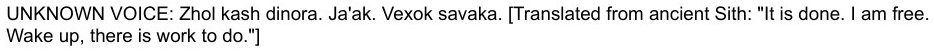

# Owner Material 037 — Star Wars D20 Drive folder (Core, Revised Core and Saga Edition): Locations/Planet Hoppers/Korriban - Planet of Lost Souls/Part 3 - The Dark Lord's Heart.pdf [Star Wars Roleplaying Game Revised Core (d20, 2002)]

- **Source:** Wizards of the Coast Star Wars Roleplaying Game books, web enhancements, Living Force campaign modules and articles (2000–2010), from the owner's "Star Wars D20" Drive folder (only the three edition subfolders; "General" was not read, as instructed). Secondary source (licensed Legends reference). Scan OCR'd on the box; the scan stays box-only and is **not** published.
- **Method:** every scanned page was OCR'd and machine-screened sentence by sentence for power-relevant statements (fights, kills, defeats, Force feats, rankings, superweapons) that name a character on our roster; each kept sentence is quoted verbatim from the OCR text and has a crop of the printed passage directly under it. Pages with nothing power-relevant are still listed with what is on them.
- **Citation:** "*Part 3 - The Dark Lord's Heart* (SWRPG d20 Revised Core), p.X" by printed page ("scan p.X" where no printed number applies). **Weight:** Licensed RPG material: a secondary source. Narrative text sums up Legends lore; game statistics are rules for players, not canon power levels, and rank lowest.

## scan p.1 (scan page 1)

Page contents: Two-month date discrepancy; Day three: red eyes at the perimeter; climb into the valley; cavern with 14 Sith shrines; opens the sarcophagus (sword, amulet, pyramid crystal, fist-sized jewel in place of the heart); unknown voice in Sith (hand-read)

- **No single roster character (rules/setting/general)** — entry/section: Unknown voice (Dathka Graush?), translated from Sith: "It is done. I am free. Wake up, there is work to do." Source: *Part 3 - The Dark Lord's Heart* (SWRPG d20 Revised Core), scan p.1
  

## scan p.2 (scan page 2)

Page contents: Game notes: Graush, pureblood Sith conqueror ~7,000 years before Yavin, replaced his heart with a Force crystal holding dark side spirits; touching it: Will DC 30 or be possessed by a Sith spirit; +10 to Cha checks against lower-level Sith; Part Four teaser; "Jedi Counseling" plug (hand-read)

