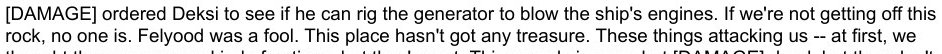

# Owner Material 037 — Star Wars D20 Drive folder (Core, Revised Core and Saga Edition): Locations/Planet Hoppers/Korriban - Planet of Lost Souls/Part 4 - The Sith Shall Rise Again.pdf [Star Wars Roleplaying Game Revised Core (d20, 2002)]

- **Source:** Wizards of the Coast Star Wars Roleplaying Game books, web enhancements, Living Force campaign modules and articles (2000–2010), from the owner's "Star Wars D20" Drive folder (only the three edition subfolders; "General" was not read, as instructed). Secondary source (licensed Legends reference). Scan OCR'd on the box; the scan stays box-only and is **not** published.
- **Method:** every scanned page was OCR'd and machine-screened sentence by sentence for power-relevant statements (fights, kills, defeats, Force feats, rankings, superweapons) that name a character on our roster; each kept sentence is quoted verbatim from the OCR text and has a crop of the printed passage directly under it. Pages with nothing power-relevant are still listed with what is on them.
- **Citation:** "*Part 4 - The Sith Shall Rise Again* (SWRPG d20 Revised Core), p.X" by printed page ("scan p.X" where no printed number applies). **Weight:** Licensed RPG material: a secondary source. Narrative text sums up Legends lore; game statistics are rules for players, not canon power levels, and rank lowest.

## scan p.1 (scan page 1)

Page contents: Search for the Captain called off; Sev, Derec and Nrross lost; the dead walk; Deksi rigging the engines to blow; head shots; game notes: Graush's zombies woken by the theft of the Heart, spread by bite (hand-read)

- **No single roster character (rules/setting/general)** — entry/section: First Mate Babb Luroon's log: "If we're not getting off this rock, no one is. Felyood was a fool. This place hasn't got any treasure." Source: *Part 4 - The Sith Shall Rise Again* (SWRPG d20 Revised Core), scan p.1
  

### Stat block notes (game mechanics, not feats)

- Never learned the secret of the Korriban zombies (a limit): Fortunately for the galaxy at large, even Emperor Palpatine never learned the secrets of their creation, so for now these Sith ghouls are confined to the tombworld. (Source: *Part 4 - The Sith Shall Rise Again* (SWRPG d20 Revised Core), scan p.1)

## scan p.2 (scan page 2)

Page contents: Zombie traits (Plague: Fort DC 20, +2 per bite; Undead; Terrifying Presence); Korriban Sith Zombie stats (Predator 9, CL D); Part Five teaser; rogue-Jedi mini-adventure plug (hand-read)

