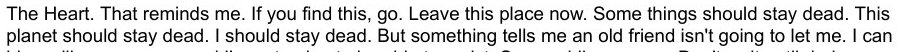
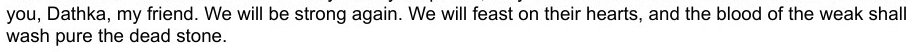

# Owner Material 037 — Star Wars D20 Drive folder (Core, Revised Core and Saga Edition): Locations/Planet Hoppers/Korriban - Planet of Lost Souls/Part 5 - Sole Survivor.pdf [Star Wars Roleplaying Game Revised Core (d20, 2002)]

- **Source:** Wizards of the Coast Star Wars Roleplaying Game books, web enhancements, Living Force campaign modules and articles (2000–2010), from the owner's "Star Wars D20" Drive folder (only the three edition subfolders; "General" was not read, as instructed). Secondary source (licensed Legends reference). Scan OCR'd on the box; the scan stays box-only and is **not** published.
- **Method:** every scanned page was OCR'd and machine-screened sentence by sentence for power-relevant statements (fights, kills, defeats, Force feats, rankings, superweapons) that name a character on our roster; each kept sentence is quoted verbatim from the OCR text and has a crop of the printed passage directly under it. Pages with nothing power-relevant are still listed with what is on them.
- **Citation:** "*Part 5 - Sole Survivor* (SWRPG d20 Revised Core), p.X" by printed page ("scan p.X" where no printed number applies). **Weight:** Licensed RPG material: a secondary source. Narrative text sums up Legends lore; game statistics are rules for players, not canon power levels, and rank lowest.

## scan p.1 (scan page 1)

Page contents: 7,000-year-old parchment; Part 1 (Basic): the crew is gone and Babb blew the ship; "I was a god, until the Heart was taken from me"; warning to leave; Part 2 (Sith runes in blood): a prayer to Dathka; game notes: Felyood no longer ages and searches for the Heart (hand-read)

- **No single roster character (rules/setting/general)** — entry/section: Naz Felyood, last message: "Some things should stay dead. This planet should stay dead. I should stay dead." Source: *Part 5 - Sole Survivor* (SWRPG d20 Revised Core), scan p.1
  
- **No single roster character (rules/setting/general)** — entry/section: Naz Felyood, Sith runes (translated): "We will feast on their hearts, and the blood of the weak shall wash pure the dead stone." Source: *Part 5 - Sole Survivor* (SWRPG d20 Revised Core), scan p.1
  

## scan p.2 (scan page 2)

Page contents: Encounter guidance; Naz Felyood stats (Scoundrel 10, CL F); Curse of Graush SQ (no aging, 10x healing, DR 15/20, speaks Sith); "Jedi Counseling" (ion weapons) plug (hand-read)

