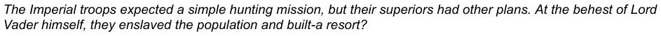

# Owner Material 037 — Star Wars D20 Drive folder (Core, Revised Core and Saga Edition): Locations/Planet Hoppers/Manaan - Depths of History/Part 1 - Backwater.pdf [Star Wars Roleplaying Game Revised Core (d20, 2002)]

- **Source:** Wizards of the Coast Star Wars Roleplaying Game books, web enhancements, Living Force campaign modules and articles (2000–2010), from the owner's "Star Wars D20" Drive folder (only the three edition subfolders; "General" was not read, as instructed). Secondary source (licensed Legends reference). Scan OCR'd on the box; the scan stays box-only and is **not** published.
- **Method:** every scanned page was OCR'd and machine-screened sentence by sentence for power-relevant statements (fights, kills, defeats, Force feats, rankings, superweapons) that name a character on our roster; each kept sentence is quoted verbatim from the OCR text and has a crop of the printed passage directly under it. Pages with nothing power-relevant are still listed with what is on them.
- **Citation:** "*Part 1 - Backwater* (SWRPG d20 Revised Core), p.X" by printed page ("scan p.X" where no printed number applies). **Weight:** Licensed RPG material: a secondary source. Narrative text sums up Legends lore; game statistics are rules for players, not canon power levels, and rank lowest.

## scan p.1 (scan page 1)

Page contents: Kolto and Malak's war; Manaan's decline and refused Republic membership; forgotten by Palpatine's era; the Emperor remembered; at Vader's behest, natives enslaved and a resort built; Manaan stats (pop. 1.8M, Selkath 80%); complaint letter begins (hand-read)

- **Darth Vader (Anakin Skywalker)**: "At the behest of Lord Vader himself, they enslaved the population and built-a resort?" Source: *Part 1 - Backwater* (SWRPG d20 Revised Core), scan p.1
  

### Stat block notes (game mechanics, not feats)

- Remembered forgotten Manaan and its secrets: By the time Emperor Palpatine rose to power, few galactic citizens even remembered that Manaan existed. ... Yet the Emperor remembered, and he also knew that Manaan still held many secrets that could be of use to him. (Source: *Part 1 - Backwater* (SWRPG d20 Revised Core), scan p.1)
- Had Manaan's population enslaved and a resort built: The Imperial troops expected a simple hunting mission, but their superiors had other plans. At the behest of Lord Vader himself, they enslaved the population and built-a resort? (Source: *Part 1 - Backwater* (SWRPG d20 Revised Core), scan p.1)

## scan p.2 (scan page 2)

Page contents: Complaints: pollution, Selkath slaves, restaurants with water lice, cheating sabacc dealer, decrepit leaking resort; threat of legal action; Part Two teaser; Geonosis and the Outer Rim Worlds preview (Makem Te) plug (hand-read)

