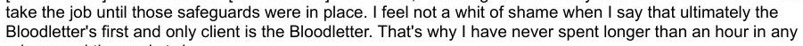

# Owner Material 037 — Star Wars D20 Drive folder (Core, Revised Core and Saga Edition): Locations/Planet Hoppers/Thyferra - Bacta Basics/Part 2 - Ashern to Ashern.pdf [Star Wars Roleplaying Game Revised Core (d20, 2002)]

- **Source:** Wizards of the Coast Star Wars Roleplaying Game books, web enhancements, Living Force campaign modules and articles (2000–2010), from the owner's "Star Wars D20" Drive folder (only the three edition subfolders; "General" was not read, as instructed). Secondary source (licensed Legends reference). Scan OCR'd on the box; the scan stays box-only and is **not** published.
- **Method:** every scanned page was OCR'd and machine-screened sentence by sentence for power-relevant statements (fights, kills, defeats, Force feats, rankings, superweapons) that name a character on our roster; each kept sentence is quoted verbatim from the OCR text and has a crop of the printed passage directly under it. Pages with nothing power-relevant are still listed with what is on them.
- **Citation:** "*Part 2 - Ashern to Ashern* (SWRPG d20 Revised Core), p.X" by printed page ("scan p.X" where no printed number applies). **Weight:** Licensed RPG material: a secondary source. Narrative text sums up Legends lore; game statistics are rules for players, not canon power levels, and rank lowest.

## scan p.1 (scan page 1)

Page contents: Thriving Season coincides with Palpatine's first ten years as Chancellor; Chapter 3 "Hive-Bound": two cover identities; field inspector jobs; alazhi fields; Vratix tree-towns ("Kashyyyk, redesigned by giant bugs"); partner Seeqov Thranx (hand-read)

- **No single roster character (rules/setting/general)** — entry/section: The Bloodletter, memoir: "I feel not a whit of shame when I say that ultimately the Bloodletter's first and only client is the Bloodletter." Source: *Part 2 - Ashern to Ashern* (SWRPG d20 Revised Core), scan p.1
  

## scan p.2 (scan page 2)

Page contents: Thranx background (stopped the Rodian fungus epidemic; master of deception); Thranx stats (Expert 12/Scoundrel 2, CL C); Part Three teaser; "Jedi Counseling" plug (hand-read)

- **No single roster character (rules/setting/general)** — entry/section: The Bloodletter, memoir: "Of course, not even Thranx saw the Empire coming. I did, naturally, but no one ever asked me." Source: *Part 2 - Ashern to Ashern* (SWRPG d20 Revised Core), scan p.2
  
