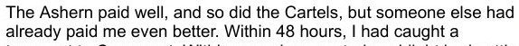

# Owner Material 037 — Star Wars D20 Drive folder (Core, Revised Core and Saga Edition): Locations/Planet Hoppers/Thyferra - Bacta Basics/Part 4 - The Kolcta Generation.pdf [Star Wars Roleplaying Game Revised Core (d20, 2002)]

- **Source:** Wizards of the Coast Star Wars Roleplaying Game books, web enhancements, Living Force campaign modules and articles (2000–2010), from the owner's "Star Wars D20" Drive folder (only the three edition subfolders; "General" was not read, as instructed). Secondary source (licensed Legends reference). Scan OCR'd on the box; the scan stays box-only and is **not** published.
- **Method:** every scanned page was OCR'd and machine-screened sentence by sentence for power-relevant statements (fights, kills, defeats, Force feats, rankings, superweapons) that name a character on our roster; each kept sentence is quoted verbatim from the OCR text and has a crop of the printed passage directly under it. Pages with nothing power-relevant are still listed with what is on them.
- **Citation:** "*Part 4 - The Kolcta Generation* (SWRPG d20 Revised Core), p.X" by printed page ("scan p.X" where no printed number applies). **Weight:** Licensed RPG material: a secondary source. Narrative text sums up Legends lore; game statistics are rules for players, not canon power levels, and rank lowest.

## scan p.1 (scan page 1)

Page contents: Chapter 10: no stun setting on Mandalorian blasters; the Bloodletter owns blasters said to be the Ordo patriarch's; Thranx healed the Bloodletter with kolcta made from her own body; history of kolto; kolazhi hybrid spliced into alazhi (hand-read)

## scan p.2 (scan page 2)

Page contents: The Bloodletter snaps Thranx's head off; blight on all kolazhi fields but one; tons of kolcta delivered to a Coruscant client who says he has a degenerative aging disease; GM notes: surviving fields saved by the "blue one"; kolcta rules (revives within 5 minutes, 150,000 cr); December teaser (Hoth) (hand-read)

- **No single roster character (rules/setting/general)** — entry/section: The Bloodletter, memoir: "The Ashern paid well, and so did the Cartels, but someone else had already paid me even better." Source: *Part 4 - The Kolcta Generation* (SWRPG d20 Revised Core), scan p.2
  

### Stat block notes (game mechanics, not feats)

- IMPLIED, NOT NAMED: the "blue one," a Mandalorian in silver-and-blue armor, enforcer for the same client nine years before Geonosis: Though scholars disagree on the details, most agree that the kolazhi fields that survived did so as a result of the violent efforts of the other, less subtle operative working for the Bloodletter's employer, the "blue one" who shot the corporate spy in the face. (Source: *Part 4 - The Kolcta Generation* (SWRPG d20 Revised Core), scan p.2)
- IMPLIED, NOT NAMED: a Coruscant client buys up the galaxy's kolcta for an "aging disease": Within 48 hours, I had caught a transport to Coruscant. ... I personally oversaw the harvesting of that field and delivered several tons of the galaxy's only known kolcta to my client within a month. He claimed to suffer from a degenerative aging disease and needed the kolcta to keep himself young. (Source: *Part 4 - The Kolcta Generation* (SWRPG d20 Revised Core), scan p.2)

## scan p.3 (scan page 3)

Page contents: Navigation text; "Tips and Tactics" plug; copyright (hand-read)

