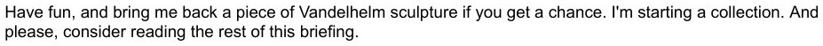

# Owner Material 037 — Star Wars D20 Drive folder (Core, Revised Core and Saga Edition): Locations/Planet Hoppers/Vandelhelm - Enemies and Alloys/Part 1 - File Vandelhelm­LC:hsnn.pdf [Star Wars Roleplaying Game Revised Core (d20, 2002)]

- **Source:** Wizards of the Coast Star Wars Roleplaying Game books, web enhancements, Living Force campaign modules and articles (2000–2010), from the owner's "Star Wars D20" Drive folder (only the three edition subfolders; "General" was not read, as instructed). Secondary source (licensed Legends reference). Scan OCR'd on the box; the scan stays box-only and is **not** published.
- **Method:** every scanned page was OCR'd and machine-screened sentence by sentence for power-relevant statements (fights, kills, defeats, Force feats, rankings, superweapons) that name a character on our roster; each kept sentence is quoted verbatim from the OCR text and has a crop of the printed passage directly under it. Pages with nothing power-relevant are still listed with what is on them.
- **Citation:** "*Part 1 - File Vandelhelm­LC:hsnn* (SWRPG d20 Revised Core), p.X" by printed page ("scan p.X" where no printed number applies). **Weight:** Licensed RPG material: a secondary source. Narrative text sums up Legends lore; game statistics are rules for players, not canon power levels, and rank lowest.

## scan p.1 (scan page 1)

Page contents: Vandelhelm found 22,000 years after the Republic by Vandel and Helm; Metalsmiths Guild reveres the Venerated Ones; Empire held them hostage; Han returned them; stats (pop. 40M, corporate monarchy); Lando's briefing: Guildmaster Orrk untrustworthy (hand-read)

## scan p.2 (scan page 2)

Page contents: Lilli and Endro, the last Vandelhelms, at Ord Vaug; Orrk has worked with the Imperials for 10+ years; possible interdictor mines; Han sent with Nien Nunb; comic-panel caption text (garbled OCR, art); "Supply and Demand" sidebar (Marvel #98, Goodwin and Williamson); Part Two teaser; "Jedi Counseling" plug (hand-read)

- **No single roster character (rules/setting/general)** — entry/section: Lando Calrissian, briefing to Han: "Have fun, and bring me back a piece of Vandelhelm sculpture if you get a chance. I'm starting a collection. And please, consider reading the rest of this briefing." Source: *Part 1 - File Vandelhelm­LC:hsnn* (SWRPG d20 Revised Core), scan p.2
  

## scan p.3 (scan page 3)

Page contents: Blank page (dark_px 0) (hand-read)

