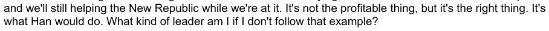

# Owner Material 037 — Star Wars D20 Drive folder (Core, Revised Core and Saga Edition): Locations/Planet Hoppers/Vandelhelm - Enemies and Alloys/Part 2 - Venerated.pdf [Star Wars Roleplaying Game Revised Core (d20, 2002)]

- **Source:** Wizards of the Coast Star Wars Roleplaying Game books, web enhancements, Living Force campaign modules and articles (2000–2010), from the owner's "Star Wars D20" Drive folder (only the three edition subfolders; "General" was not read, as instructed). Secondary source (licensed Legends reference). Scan OCR'd on the box; the scan stays box-only and is **not** published.
- **Method:** every scanned page was OCR'd and machine-screened sentence by sentence for power-relevant statements (fights, kills, defeats, Force feats, rankings, superweapons) that name a character on our roster; each kept sentence is quoted verbatim from the OCR text and has a crop of the printed passage directly under it. Pages with nothing power-relevant are still listed with what is on them.
- **Citation:** "*Part 2 - Venerated* (SWRPG d20 Revised Core), p.X" by printed page ("scan p.X" where no printed number applies). **Weight:** Licensed RPG material: a secondary source. Narrative text sums up Legends lore; game statistics are rules for players, not canon power levels, and rank lowest.

## scan p.1 (scan page 1)

Page contents: Vandelhelm metal helped beat Thrawn; Lilli made Guildmistress at 15; flat profits; a costly freighter fleet for the New Republic; holojournal (8th of Fenja, 3013): no metal for Imperials; Han invited; GM notes: Lilli in her mid-twenties, idealist, sculptor, martial artist (hand-read)

- **No single roster character (rules/setting/general)** — entry/section: Lilli Vandelhelm, holojournal: "It's not the profitable thing, but it's the right thing. It's what Han would do. What kind of leader am I if I don't follow that example?" Source: *Part 2 - Venerated* (SWRPG d20 Revised Core), scan p.1
  

## scan p.2 (scan page 2)

Page contents: Endro and the bodyguard droid; both always armed; Lilli stats (Noble 9, CL D; Falcon hydrospanner charm); comic-art OCR noise; Part Three teaser; Roon / Geonosis and the Outer Rim Worlds plug (hand-read)

