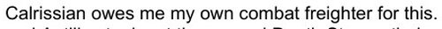
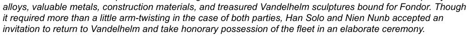
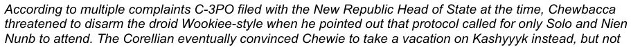
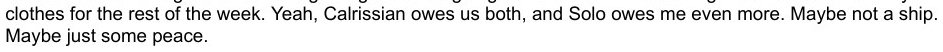

# Owner Material 037 — Star Wars D20 Drive folder (Core, Revised Core and Saga Edition): Locations/Planet Hoppers/Vandelhelm - Enemies and Alloys/Part 4 - The Demands of Supply.pdf [Star Wars Roleplaying Game Revised Core (d20, 2002)]

- **Source:** Wizards of the Coast Star Wars Roleplaying Game books, web enhancements, Living Force campaign modules and articles (2000–2010), from the owner's "Star Wars D20" Drive folder (only the three edition subfolders; "General" was not read, as instructed). Secondary source (licensed Legends reference). Scan OCR'd on the box; the scan stays box-only and is **not** published.
- **Method:** every scanned page was OCR'd and machine-screened sentence by sentence for power-relevant statements (fights, kills, defeats, Force feats, rankings, superweapons) that name a character on our roster; each kept sentence is quoted verbatim from the OCR text and has a crop of the printed passage directly under it. Pages with nothing power-relevant are still listed with what is on them.
- **Citation:** "*Part 4 - The Demands of Supply* (SWRPG d20 Revised Core), p.X" by printed page ("scan p.X" where no printed number applies). **Weight:** Licensed RPG material: a secondary source. Narrative text sums up Legends lore; game statistics are rules for players, not canon power levels, and rank lowest.

## scan p.1 (scan page 1)

Page contents: Tenth anniversary launch of the Solo fleet; Chewie threatens to disarm 3PO; Nien Nunb's grumbling log (the second Death Star launch code, the earlier Vandelhelm rescue); arrival; Lilli's hug; the protocol droid opens fire at the ceremony; comic-panel OCR noise (art) (hand-read)

- **No single roster character (rules/setting/general)** — entry/section: Nien Nunb, personal log: "Calrissian owes me my own combat freighter for this." Source: *Part 4 - The Demands of Supply* (SWRPG d20 Revised Core), scan p.1
  
- **Han Solo**: "Though it required more than a little arm-twisting in the case of both parties, Han Solo and Nien Nunb accepted an invitation to return to Vandelhelm and take honorary possession of the fleet in an elaborate ceremony." Source: *Part 4 - The Demands of Supply* (SWRPG d20 Revised Core), scan p.1
  
- **Chewbacca**: "According to multiple complaints C-3PO filed with the New Republic Head of State at the time, Chewbacca threatened to disarm the droid Wookiee-style when he pointed out that protocol called for only Solo and Nien Nunb to attend." Source: *Part 4 - The Demands of Supply* (SWRPG d20 Revised Core), scan p.1
  

## scan p.2 (scan page 2)

Page contents: Nunb destroys the droid; Han subdues Endro, who plotted to frame Nunb and sell the fleet; heading home; April teaser (Adumar); Greater Javin mini-adventure plug (hand-read)

- **No single roster character (rules/setting/general)** — entry/section: Nien Nunb, personal log: "Yeah, Calrissian owes us both, and Solo owes me even more. Maybe not a ship. Maybe just some peace." Source: *Part 4 - The Demands of Supply* (SWRPG d20 Revised Core), scan p.2
  
