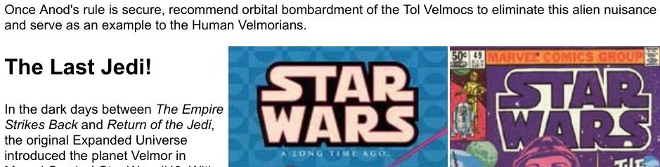

# Owner Material 037 — Star Wars D20 Drive folder (Core, Revised Core and Saga Edition): Locations/Planet Hoppers/Velmor - Royalty and Rebellion/Part 1 - A Diplomatic Report.pdf [Star Wars Roleplaying Game Revised Core (d20, 2002)]

- **Source:** Wizards of the Coast Star Wars Roleplaying Game books, web enhancements, Living Force campaign modules and articles (2000–2010), from the owner's "Star Wars D20" Drive folder (only the three edition subfolders; "General" was not read, as instructed). Secondary source (licensed Legends reference). Scan OCR'd on the box; the scan stays box-only and is **not** published.
- **Method:** every scanned page was OCR'd and machine-screened sentence by sentence for power-relevant statements (fights, kills, defeats, Force feats, rankings, superweapons) that name a character on our roster; each kept sentence is quoted verbatim from the OCR text and has a crop of the printed passage directly under it. Pages with nothing power-relevant are still listed with what is on them.
- **Citation:** "*Part 1 - A Diplomatic Report* (SWRPG d20 Revised Core), p.X" by printed page ("scan p.X" where no printed number applies). **Weight:** Licensed RPG material: a secondary source. Narrative text sums up Legends lore; game statistics are rules for players, not canon power levels, and rank lowest.

## scan p.1 (scan page 1)

Page contents: Archivist frame: an intercepted Imperial report from before Prince Anod's coronation; survey data (pop. 892,000, Velmoc natives, Velm system planets); Captain Zeta Traal's log: Mid Rim location, velmstone, settled from Empress Teta (hand-read)

## scan p.2 (scan page 2)

Page contents: Recommends a puppet king; King Lorac killed by an Imperial-incited mob; Denid fled with a Velmoc aide and his Alderaanian betrothed; Regent and Anod called fools; proposes orbital bombardment of the Velmoc; sidebar: Marvel Star Wars #49 "The Last Jedi!" (Barr/Simonson), reprinted in A Long Time Ago Vol. 3; Part Two teaser (Denid) (hand-read)

- **No single roster character (rules/setting/general)** — entry/section: Captain Zeta Traal, IDC assessment log: "Once Anod's rule is secure, recommend orbital bombardment of the Tol Velmocs to eliminate this alien nuisance and serve as an example to the Human Velmorians." Source: *Part 1 - A Diplomatic Report* (SWRPG d20 Revised Core), scan p.2
  
