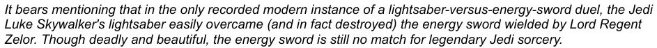

# Owner Material 037 — Star Wars D20 Drive folder (Core, Revised Core and Saga Edition): Locations/Planet Hoppers/Velmor - Royalty and Rebellion/Part 3 - An Elegant Weapon.pdf [Star Wars Roleplaying Game Revised Core (d20, 2002)]

- **Source:** Wizards of the Coast Star Wars Roleplaying Game books, web enhancements, Living Force campaign modules and articles (2000–2010), from the owner's "Star Wars D20" Drive folder (only the three edition subfolders; "General" was not read, as instructed). Secondary source (licensed Legends reference). Scan OCR'd on the box; the scan stays box-only and is **not** published.
- **Method:** every scanned page was OCR'd and machine-screened sentence by sentence for power-relevant statements (fights, kills, defeats, Force feats, rankings, superweapons) that name a character on our roster; each kept sentence is quoted verbatim from the OCR text and has a crop of the printed passage directly under it. Pages with nothing power-relevant are still listed with what is on them.
- **Citation:** "*Part 3 - An Elegant Weapon* (SWRPG d20 Revised Core), p.X" by printed page ("scan p.X" where no printed number applies). **Weight:** Licensed RPG material: a secondary source. Narrative text sums up Legends lore; game statistics are rules for players, not canon power levels, and rank lowest.

## scan p.1 (scan page 1)

Page contents: Energy sword origins (a metal-saving alternative to blasters); ceremonial duel tradition for outsiders; Luke's lightsaber destroyed Zelor's energy sword; memoir of Court Swordmaster Lady Debor Fyalko (velmorite crystals, 1.3 m blade, maintenance, King Bonod and the mud); stats: from the image, Cost 1,000 + 1d6x100, Damage 3d4, Crit 18-20; 19 kg; Exotic; Plasma blade and Well-balanced special qualities (hand-read)

- **Luke Skywalker** — entry/section: Part 3 - An Elegant Weapon: "It bears mentioning that in the only recorded modern instance of a lightsaber-versus-energy-sword duel, the Jedi Luke Skywalker's lightsaber easily overcame (and in fact destroyed) the energy sword wielded by Lord Regent Zelor." Source: *Part 3 - An Elegant Weapon* (SWRPG d20 Revised Core), scan p.1
  

## scan p.2 (scan page 2)

Page contents: Repeated "The Last Jedi!" sidebar; Part Four teaser (a bodyguard's view of Coronation Day) (hand-read)

