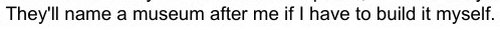

# Owner Material 037 — Star Wars D20 Drive folder (Core, Revised Core and Saga Edition): Locations/Planet Hoppers/Yavin - The Big Red One/Part 1 - Giant.pdf [Star Wars Roleplaying Game Revised Core (d20, 2002)]

- **Source:** Wizards of the Coast Star Wars Roleplaying Game books, web enhancements, Living Force campaign modules and articles (2000–2010), from the owner's "Star Wars D20" Drive folder (only the three edition subfolders; "General" was not read, as instructed). Secondary source (licensed Legends reference). Scan OCR'd on the box; the scan stays box-only and is **not** published.
- **Method:** every scanned page was OCR'd and machine-screened sentence by sentence for power-relevant statements (fights, kills, defeats, Force feats, rankings, superweapons) that name a character on our roster; each kept sentence is quoted verbatim from the OCR text and has a crop of the printed passage directly under it. Pages with nothing power-relevant are still listed with what is on them.
- **Citation:** "*Part 1 - Giant* (SWRPG d20 Revised Core), p.X" by printed page ("scan p.X" where no printed number applies). **Weight:** Licensed RPG material: a secondary source. Narrative text sums up Legends lore; game statistics are rules for players, not canon power levels, and rank lowest.

## scan p.1 (scan page 1)

Page contents: Rodian female myths debunked; Suz Tanwa: treasure hunter turned Chair of Xenoarchaeology; her memoirs interest the Jedi Academy; Yavin survey data; start of the hunt log (hand-read)

## scan p.2 (scan page 2)

Page contents: The family amulet is an ancient data crystal pointing to five treasures in the Yavin system, just after the Death Star battle; Yavin's glow; hires a stone-fishing vessel; droid TU-5; GM notes: Corusca stones (20,000 cr, 1 kg; possible lightsaber use, technique lost); floaters header (hand-read)

## scan p.3 (scan page 3)

Page contents: Damarind Corporation holds the fishing rights; herbivore and hunter-floater species; Explosive trait; stats (Herbivore CL D, Hunter-Floater CL F); addendum: finds an ancient pod with five huge Corusca gems; Captain Jymbud's crew killed by a floater pack; next stop the thirteenth moon (hand-read)

- **No single roster character (rules/setting/general)** — entry/section: Suz Tanwa, hunt log: "They'll name a museum after me if I have to build it myself." Source: *Part 1 - Giant* (SWRPG d20 Revised Core), scan p.3
  

## scan p.4 (scan page 4)

Page contents: Part Two teaser (Yavin 13); Living Force "Lockdown" plug (hand-read)

