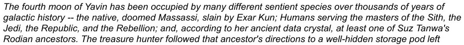

# Owner Material 037 — Star Wars D20 Drive folder (Core, Revised Core and Saga Edition): Locations/Planet Hoppers/Yavin - The Big Red One/Part 4 - Four Sighted.pdf [Star Wars Roleplaying Game Revised Core (d20, 2002)]

- **Source:** Wizards of the Coast Star Wars Roleplaying Game books, web enhancements, Living Force campaign modules and articles (2000–2010), from the owner's "Star Wars D20" Drive folder (only the three edition subfolders; "General" was not read, as instructed). Secondary source (licensed Legends reference). Scan OCR'd on the box; the scan stays box-only and is **not** published.
- **Method:** every scanned page was OCR'd and machine-screened sentence by sentence for power-relevant statements (fights, kills, defeats, Force feats, rankings, superweapons) that name a character on our roster; each kept sentence is quoted verbatim from the OCR text and has a crop of the printed passage directly under it. Pages with nothing power-relevant are still listed with what is on them.
- **Citation:** "*Part 4 - Four Sighted* (SWRPG d20 Revised Core), p.X" by printed page ("scan p.X" where no printed number applies). **Weight:** Licensed RPG material: a secondary source. Narrative text sums up Legends lore; game statistics are rules for players, not canon power levels, and rank lowest.

## scan p.1 (scan page 1)

Page contents: Yavin 4 history (Massassi, Exar Kun); the Death Star wreck salvage; survey data as of her visit (no sentients); hunt log: Imperials over the ziggurats, so she heads for the far side (hand-read)

- **Exar Kun**: "The fourth moon of Yavin has been occupied by many different sentient species over thousands of years of galactic history -- the native, doomed Massassi, slain by Exar Kun; Humans serving the masters of the Sith, the Jedi, the Republic, and the Rebellion; and, according to her ancient data crystal, at least one of Suz Tanwa's Rodian ancestors." Source: *Part 4 - Four Sighted* (SWRPG d20 Revised Core), scan p.1
  

## scan p.2 (scan page 2)

Page contents: Addenda: crash into grenade fungi; the Reeko crash shattered the pod; woolamanders hold the pieces; finds armor said to be Exar Kun's hanging in a tree; doubts her ancestor's honesty (hand-read)

## scan p.3 (scan page 3)

Page contents: GM notes: grenade fungi rules (Spot DC, 1d8 per pod, chain explosions, throwing); Exar Kun's Light Battle Suit (DR 10, Max Dex +3, ACP -4; Strength Bonus, Cortosis Weave, Dark Side Taint); Kun's war came about fifty years before Revan and Malak; Part Five teaser (the 22nd moon); "Jedi Counseling" plug (hand-read)

