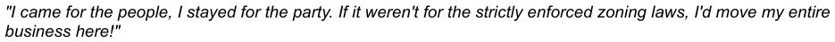

# Owner Material 037 — Star Wars D20 Drive folder (Core, Revised Core and Saga Edition): Locations/Planet Hoppers/Zeltros - Pleasure Planet/Part 1 - Who Doesn't Like Zeltrons_.pdf [Star Wars Roleplaying Game Revised Core (d20, 2002)]

- **Source:** Wizards of the Coast Star Wars Roleplaying Game books, web enhancements, Living Force campaign modules and articles (2000–2010), from the owner's "Star Wars D20" Drive folder (only the three edition subfolders; "General" was not read, as instructed). Secondary source (licensed Legends reference). Scan OCR'd on the box; the scan stays box-only and is **not** published.
- **Method:** every scanned page was OCR'd and machine-screened sentence by sentence for power-relevant statements (fights, kills, defeats, Force feats, rankings, superweapons) that name a character on our roster; each kept sentence is quoted verbatim from the OCR text and has a crop of the printed passage directly under it. Pages with nothing power-relevant are still listed with what is on them.
- **Citation:** "*Part 1 - Who Doesn't Like Zeltrons_* (SWRPG d20 Revised Core), p.X" by printed page ("scan p.X" where no printed number applies). **Weight:** Licensed RPG material: a secondary source. Narrative text sums up Legends lore; game statistics are rules for players, not canon power levels, and rank lowest.

## scan p.1 (scan page 1)

Page contents: Zeltros: pheromones and fighting skill have kept even the Empire out; excerpt from the pre-Clone Wars guide Luxury on the Inner Rim; survey (5.3 billion, popular monarchy, Zel system); tour copy; testimonials from Jiri Sools (completed from the image: "I might never leave!") and Ruudi Buundaz (starts) (hand-read)

## scan p.2 (scan page 2)

Page contents: More testimonials: Buundaz, Nuboocha the Hutt, DK-4F3, Red-Eye Baldarek; Part Two teaser (King Arno and Queen Leonie interview); HK-47 Expanded Universe plug (hand-read)

- **No single roster character (rules/setting/general)** — entry/section: Nuboocha the Hutt (testimonial): "I came for the people, I stayed for the party. If it weren't for the strictly enforced zoning laws, I'd move my entire business here!" Source: *Part 1 - Who Doesn't Like Zeltrons_* (SWRPG d20 Revised Core), scan p.2
  
