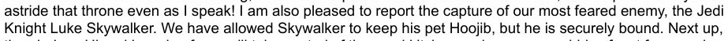
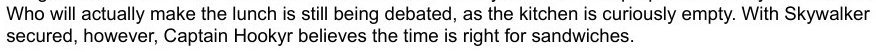

# Owner Material 037 — Star Wars D20 Drive folder (Core, Revised Core and Saga Edition): Locations/Planet Hoppers/Zeltros - Pleasure Planet/Part 4 - I, Hiromi.pdf [Star Wars Roleplaying Game Revised Core (d20, 2002)]

- **Source:** Wizards of the Coast Star Wars Roleplaying Game books, web enhancements, Living Force campaign modules and articles (2000–2010), from the owner's "Star Wars D20" Drive folder (only the three edition subfolders; "General" was not read, as instructed). Secondary source (licensed Legends reference). Scan OCR'd on the box; the scan stays box-only and is **not** published.
- **Method:** every scanned page was OCR'd and machine-screened sentence by sentence for power-relevant statements (fights, kills, defeats, Force feats, rankings, superweapons) that name a character on our roster; each kept sentence is quoted verbatim from the OCR text and has a crop of the printed passage directly under it. Pages with nothing power-relevant are still listed with what is on them.
- **Citation:** "*Part 4 - I, Hiromi* (SWRPG d20 Revised Core), p.X" by printed page ("scan p.X" where no printed number applies). **Weight:** Licensed RPG material: a secondary source. Narrative text sums up Legends lore; game statistics are rules for players, not canon power levels, and rank lowest.

## scan p.1 (scan page 1)

Page contents: Shortest successful invasion; report 834b (First Officer Hirog): throne room taken, Luke "captured" with his Hoojib, time for sandwiches; report 882d (Ensign Phoebe): the Nagai seize the party; report 837b: peace with Luke, the Tof warship fought, Tofs defeated (hand-read)

- **Luke Skywalker** — entry/section: Part 4 - I, Hiromi: "|am also pleased to report the capture of our most feared enemy, the Jedi Knight Luke Skywalker." Source: *Part 4 - I, Hiromi* (SWRPG d20 Revised Core), scan p.1
  
- **No single roster character (rules/setting/general)** — entry/section: First Officer Hirog, Hiromi mission report: "With Skywalker secured, however, Captain Hookyr believes the time is right for sandwiches." Source: *Part 4 - I, Hiromi* (SWRPG d20 Revised Core), scan p.1
  

## scan p.2 (scan page 2)

Page contents: Hirog requests transfer home; sidebar: Mary Jo Duffy's Marvel Zeltros arc (Nagai, Tofs, Hiromi; Cynthia Martin art; reprinted in A Long Time Ago Vol. 7); Part Five teaser; Geonosis and the Outer Rim Worlds plug (hand-read)

