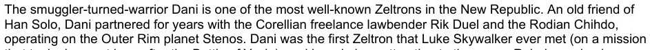

# Owner Material 037 — Star Wars D20 Drive folder (Core, Revised Core and Saga Edition): Locations/Planet Hoppers/Zeltros - Pleasure Planet/Part 5 - The Zeltron Who Cried.pdf [Star Wars Roleplaying Game Revised Core (d20, 2002)]

- **Source:** Wizards of the Coast Star Wars Roleplaying Game books, web enhancements, Living Force campaign modules and articles (2000–2010), from the owner's "Star Wars D20" Drive folder (only the three edition subfolders; "General" was not read, as instructed). Secondary source (licensed Legends reference). Scan OCR'd on the box; the scan stays box-only and is **not** published.
- **Method:** every scanned page was OCR'd and machine-screened sentence by sentence for power-relevant statements (fights, kills, defeats, Force feats, rankings, superweapons) that name a character on our roster; each kept sentence is quoted verbatim from the OCR text and has a crop of the printed passage directly under it. Pages with nothing power-relevant are still listed with what is on them.
- **Citation:** "*Part 5 - The Zeltron Who Cried* (SWRPG d20 Revised Core), p.X" by printed page ("scan p.X" where no printed number applies). **Weight:** Licensed RPG material: a secondary source. Narrative text sums up Legends lore; game statistics are rules for players, not canon power levels, and rank lowest.

## scan p.1 (scan page 1)

Page contents: Dani: smuggler with Rik Duel and Chihdo; attraction to Luke; stole an Imperial scout craft of treasure; loved Kiro of Iskalon; tortured by the Nagai Den Siva and turned to vengeance; allied against the Tofs; GM notes: broken-hearted warrior on Zeltros, Luke's secret that Kiro lives; stats (Scoundrel 8/Scout 4, CL D, DSP 5); equipment, skills, feats (hand-read)

- **Han Solo**: "An old friend of Han Solo, Dani partnered for years with the Corellian freelance lawbender Rik Duel and the Rodian Chihdo, operating on the Outer Rim planet Stenos." Source: *Part 5 - The Zeltron Who Cried* (SWRPG d20 Revised Core), scan p.1
  

## scan p.2 (scan page 2)

Page contents: Zeltron species traits; February teaser (Manaan); "Tips and Tactics" plug (hand-read)

