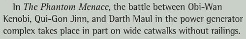

# Owner Material 037 — Star Wars D20 Drive folder (Core, Revised Core and Saga Edition): Sourcebooks/Sourcebook Web Enhancements/Galactic Campaign Guide - Quick Locations.pdf [Star Wars Roleplaying Game Revised Core (d20, 2002)]

- **Source:** Wizards of the Coast Star Wars Roleplaying Game books, web enhancements, Living Force campaign modules and articles (2000–2010), from the owner's "Star Wars D20" Drive folder (only the three edition subfolders; "General" was not read, as instructed). Secondary source (licensed Legends reference). Scan OCR'd on the box; the scan stays box-only and is **not** published.
- **Method:** every scanned page was OCR'd and machine-screened sentence by sentence for power-relevant statements (fights, kills, defeats, Force feats, rankings, superweapons) that name a character on our roster; each kept sentence is quoted verbatim from the OCR text and has a crop of the printed passage directly under it. Pages with nothing power-relevant are still listed with what is on them.
- **Citation:** "*Galactic Campaign Guide - Quick Locations* (SWRPG d20 Revised Core), p.X" by printed page ("scan p.X" where no printed number applies). **Weight:** Licensed RPG material: a secondary source. Narrative text sums up Legends lore; game statistics are rules for players, not canon power levels, and rank lowest.

## scan p.1 (scan page 1)

Page contents: Cover (hand-read)

## scan p.2 (scan page 2)

Page contents: Credits and legal; intro (description plus rules; hooks incl. informer "Snitchly Gritch"); Alleyway (cover, Hide +2, door DCs, obstruction) (hand-read)

## scan p.3 (scan page 3)

Page contents: Alleyway hook (Bothan courier Fenn Sei'nel found dead, Quantill City, Ando); Apartment, Cheap (25-50 cr/day; DR 10 doors); hook: Il Avali, Druckenwell evacuation from Yuuzhan Vong; Apartment, Standard (hand-read)

## scan p.4 (scan page 4)

Page contents: Rents 150/wk, 600/mo; hook: Resdall Towers ad, Coruscant; Arena (Mos Espa, Geonosis; sand-blinding, doors DR 10 / 120 WP, Climb DC 25); hook: Galaxy Gladiator Federation; Barracks (hand-read)

## scan p.5 (scan page 5)

Page contents: Barracks rules and hook (Imperial outpost, Quvil Valley); Catwalk (TPM generator-complex duel cited; Reflex DC 10 to avoid falls; struts DR 10 / 15 WP); hook: Separatists hold a weapons plant; City Street (hand-read)

- **Obi-Wan Kenobi** — entry/section: TPM generator-complex duel on railless catwalks: "In The Phantom Menace, the battle between Obi-Wan Kenobi, Qui-Gon Jinn, and Darth Maul in the power generator complex takes place in part on wide catwalks without railings." Source: *Galactic Campaign Guide - Quick Locations* (SWRPG d20 Revised Core), scan p.5
  

## scan p.6 (scan page 6)

Page contents: City street crossing Reflex DCs; d10 spot-encounter table; Corridor (Death Star, Cloud City; one-half cover; Disable Device DCs) (hand-read)

## scan p.7 (scan page 7)

Page contents: Corridor hook (escort prisoner VAB-927, Detention Block AA-23); Hospital Private Room (double healing, +2 Treat Injury, 300 cr/day; gas ports explode 2d6+1); hook: guard assassin Severus Ryyw; Maintenance Tunnels (hand-read)

## scan p.8 (scan page 8)

Page contents: Maintenance tunnel rules and hook (damaged ship); Office (doors, Computer Use and vault DCs); Snitchly Gritch hook on a Black Sun office begins (hand-read)

## scan p.9 (scan page 9)

Page contents: Gritch hook ends; Scrap Heap (Climb DC 20, falling debris 2d6/4d6, infection, radiation, Search DC 30); hook: Sybar's syndicate; Shop begins (hand-read)

## scan p.10 (scan page 10)

Page contents: Shop rules (DR 10 / 36 WP doors; DC 20 locks); hook: Grand Colonnade, Brentaal (Kallean League; Ithorian Gm'uyal); Turbolift (DR 10 / 120 WP hatch; DC 20/25 tampering) (hand-read)

## scan p.11 (scan page 11)

Page contents: Turbolift shaft rules; hook: Legislative Hall outage, Curamelle, Corulag (Justar Villius, Gov. Zafiel Snopps, Cmdr. Dyssa Vye); Urban Promenade (Cloud City, AOTC Coruscant); hook: Streysal Island festival, Vaynai (Gallo Memm); about the authors (hand-read)

