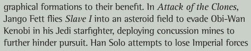
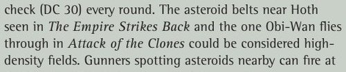

# Owner Material 037 — Star Wars D20 Drive folder (Core, Revised Core and Saga Edition): Sourcebooks/Sourcebook Web Enhancements/Galactic Campaign Guide - Quick Starfields.pdf [Star Wars Roleplaying Game Revised Core (d20, 2002)]

- **Source:** Wizards of the Coast Star Wars Roleplaying Game books, web enhancements, Living Force campaign modules and articles (2000–2010), from the owner's "Star Wars D20" Drive folder (only the three edition subfolders; "General" was not read, as instructed). Secondary source (licensed Legends reference). Scan OCR'd on the box; the scan stays box-only and is **not** published.
- **Method:** every scanned page was OCR'd and machine-screened sentence by sentence for power-relevant statements (fights, kills, defeats, Force feats, rankings, superweapons) that name a character on our roster; each kept sentence is quoted verbatim from the OCR text and has a crop of the printed passage directly under it. Pages with nothing power-relevant are still listed with what is on them.
- **Citation:** "*Galactic Campaign Guide - Quick Starfields* (SWRPG d20 Revised Core), p.X" by printed page ("scan p.X" where no printed number applies). **Weight:** Licensed RPG material: a secondary source. Narrative text sums up Legends lore; game statistics are rules for players, not canon power levels, and rank lowest.

## scan p.1 (scan page 1)

Page contents: Cover (hand-read)

## scan p.2 (scan page 2)

Page contents: Credits and legal; intro (space locations; AOTC Slave I chase, Han at Hoth); Asteroid Field (nature, description; Pilot DCs by density) (hand-read)

- **Jango Fett; Obi-Wan Kenobi** — entry/section: Slave I evades Obi-Wan in asteroid field (AOTC example): "In Attack of the Clones, Jango Fett flies Slave I into an asteroid field to evade Obi-Wan Kenobi in his Jedi starfighter, deploying concussion mines to further hinder pursuit." Source: *Galactic Campaign Guide - Quick Starfields* (SWRPG d20 Revised Core), scan p.2
  

## scan p.3 (scan page 3)

Page contents: Pilot DC 10/20/30 per round; Hoth and AOTC fields are high-density; explosives +2 to hit; Table 1 Asteroid Size (from the image): 1-2 Colossal -8 DC 40; 3-4 Gargantuan -4 35; 5-7 Huge -2 30; 8-10 Large -1 25; 11-13 Medium +0 20; 14-15 Small +1 15; 16-17 Tiny +2 10; 18-19 Diminutive +4 5; 20+ Fine +8 0; hook: Keller's Void pirates (Udine system; Blissa Vlix; starliner Kooba's Pride; 500,000-cr bounty); Mine Field (passive and active; +10 attack, 8d10x2) (hand-read)

- **Obi-Wan Kenobi** — entry/section: Obi-Wan's AOTC asteroid field rated high-density: "The asteroid belts near Hoth seen in The Empire Strikes Back and the one Obi-Wan flies through in Attack of the Clones could be considered high-density fields." Source: *Galactic Campaign Guide - Quick Starfields* (SWRPG d20 Revised Core), scan p.3
  

## scan p.4 (scan page 4)

Page contents: Active mines move 9 squares for 6 rounds; hook: clear a mine field; Nebula (sensors +10 DC; 1-in-6 ion lightning 5d10; plasma flares 8d10x2); Gritch hook: Itani Nebula weapon lab, Darknon Station; Planetary Orbit begins (hand-read)

## scan p.5 (scan page 5)

Page contents: Orbit encounters (stardock: Fondor, Wroona; factory, starport, debris, patrol, pirates, derelict, satellites); collision rules; hook: guard secret base; about the authors (hand-read)

