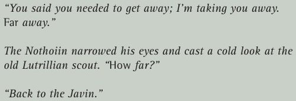
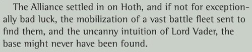
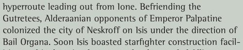
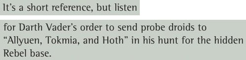

# Owner Material 037 — Star Wars D20 Drive folder (Core, Revised Core and Saga Edition): Sourcebooks/Sourcebook Web Enhancements/Galactic Gazetteer - Hoth and the Greater Javin.pdf [Star Wars Roleplaying Game Revised Core (d20, 2002)]

- **Source:** Wizards of the Coast Star Wars Roleplaying Game books, web enhancements, Living Force campaign modules and articles (2000–2010), from the owner's "Star Wars D20" Drive folder (only the three edition subfolders; "General" was not read, as instructed). Secondary source (licensed Legends reference). Scan OCR'd on the box; the scan stays box-only and is **not** published.
- **Method:** every scanned page was OCR'd and machine-screened sentence by sentence for power-relevant statements (fights, kills, defeats, Force feats, rankings, superweapons) that name a character on our roster; each kept sentence is quoted verbatim from the OCR text and has a crop of the printed passage directly under it. Pages with nothing power-relevant are still listed with what is on them.
- **Citation:** "*Galactic Gazetteer - Hoth and the Greater Javin* (SWRPG d20 Revised Core), p.X" by printed page ("scan p.X" where no printed number applies). **Weight:** Licensed RPG material: a secondary source. Narrative text sums up Legends lore; game statistics are rules for players, not canon power levels, and rank lowest.

## scan p.1 (scan page 1)

Page contents: Cover (hand-read)

## scan p.2 (scan page 2)

Page contents: Credits and legal; opening fiction (Lutrillian scout Solomahal flies the Nothoiin Covah from Mos Espa in a YV-888, toward the Javin); intro to the Greater Javin (hand-read)

- **No single roster character (rules/setting/general)** — entry/section: Opening fiction: Solomahal and Covah: ""You said you needed to get away; I'm taking you away. Far away." The Nothoiin narrowed his eyes and cast a cold look at the old Lutrillian scout. "How far?" "Back to the Javin."" Source: *Galactic Gazetteer - Hoth and the Greater Javin* (SWRPG d20 Revised Core), scan p.2
  

## scan p.3 (scan page 3)

Page contents: The Far End of the Spine; Javin Sector history (Mugaari Space, Twin Nebulae Kiax/Ivax, "the Ring"); Republic-Mugaari war; Twin Nebulae sectors Yarith and Anoat; sidebar on Lord Ecclessis Figg (Outer Javin Company, founded Cloud City, Lady Yarith Figg) (hand-read)

## scan p.4 (scan page 4)

Page contents: Figg's later routes; Anoat sector named; Yarith sector; Ison Corridor (Varonat, Bespin, Anoat, Hoth, Ison; Tibanna); Hoth System table (from the image): Shron volcanic 0 moons; Biosh barren 0; Nushk methane oceans 4; Jhas gas giant 24; Ordaj gas giant 17 (possible pirate base on moon Ordaj Besh); Hoth terrestrial 3 (Echo Base); Hoth planet stats (23-hr day, 549-day year); asteroid field (pirate Icanis Tsur's 80-Vag; Clabburn); Hoth: The Cold Facts (hand-read)

## scan p.5 (scan page 5)

Page contents: Hoth climate, equatorial rift lumni-spice (pirate Raskar), southern ice spires and ice worms; sidebar "Why Hoth?" (Luke and C-3PO crash; Frija Turlock and the Turlock droids, possibly by Massad Thrumble); Alliance chooses Hoth; Echo Base (Rieekan; Maj. Monnon; pirate Salmakk's old facilities) (hand-read)

- **Darth Vader (Anakin Skywalker)** — entry/section: Vader's intuition found Echo Base: "The Alliance settled in on Hoth, and if not for exceptionally bad luck, the mobilization of a vast battle fleet sent to find them, and the uncanny intuition of Lord Vader, the base might never have been found." Source: *Galactic Gazetteer - Hoth and the Greater Javin* (SWRPG d20 Revised Core), scan p.5
  

## scan p.6 (scan page 6)

Page contents: Echo Base details (v-150 ion cannon; about 8,000 personnel; Echo Stations); creatures: wampa (stats CL C), tauntaun (CL B), ice scrabbler (CL A); Salmakk sidebar; outer-system creatures (mynocks, space slugs; Clabburn legend) (hand-read)

## scan p.7 (scan page 7)

Page contents: Notable worlds of the Spine: Javin (station D-34), Aztubek, High Chunah, Kirtarkin (ISD Desolator), Mexeluine, Gerrenthum (Figg HQ), Indellian, Bendeluum, Zhanox, with stats (hand-read)

## scan p.8 (scan page 8)

Page contents: Sector map (Hoth and the Greater Javin); Ione (Figg Excavations, hyperroute to Isis), read from the image (hand-read)

## scan p.9 (scan page 9)

Page contents: Ione stats; Mataou (ro hypa venom), Anantapar, Shuxl, Ertegas, Darlyn Boda (toccat haruspexes), Orn Kios, Ozu, Isde Naha, Togominda; Ison Corridor: Varonat (Morodin; Krish; Talon Karrde) (hand-read)

## scan p.10 (scan page 10)

Page contents: Bespin; Anoat system (Anoat, Deyer, Gentes); Ison; Lutrillian Cross: Mijos, Lutrillia (rolling platform-cities), Shuldene; Nothoiin route: Council (hand-read)

## scan p.11 (scan page 11)

Page contents: Nothoiin (perpetual wildfires; ur-diamonds), Bavva, Polmanar (reedug; Rebel-armed resistance); Mining Worlds: Burnin Konn, Allyuen, Tokmia (Oku cargo cult), Isis (Gutretees; Neskroff colony under Bail Organa); sidebar "Is That It?" (hand-read)

- **Palpatine (Darth Sidious)** — entry/section: Alderaanian opponents of Palpatine colonize Isis (Palpatine named only as a target of opposition): "Befriending the Gutretees, Alderaanian opponents of Emperor Palpatine colonized the city of Neskroff on Isis under the direction of Bail Organa." Source: *Galactic Gazetteer - Hoth and the Greater Javin* (SWRPG d20 Revised Core), scan p.11
  

## scan p.12 (scan page 12)

Page contents: Isis stats; species: Gutretees, Morodins, Nothoiins (commoner stats); ro hypa (poison rules, CL E); toccat (hand-read)

## scan p.13 (scan page 13)

Page contents: Toccat stats (CL C); Rebellion-era and New Republic-era source lists (hand-read)

- **Darth Vader (Anakin Skywalker)** — entry/section: Vader's probe-droid order (NPR ESB source note): "It's a short reference, but listen for Darth Vader's order to send probe droids to "Allyuen, Tokmia, and Hoth" in his hunt for the hidden Rebel base." Source: *Galactic Gazetteer - Hoth and the Greater Javin* (SWRPG d20 Revised Core), scan p.13
  
