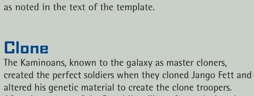
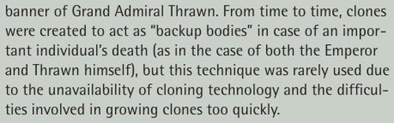
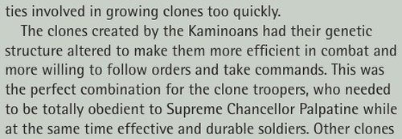
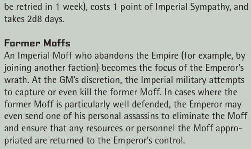

# Owner Material 037 — Star Wars D20 Drive folder (Core, Revised Core and Saga Edition): Sourcebooks/Sourcebook Web Enhancements/Hero's Guide Web Enhancement - Character Templates and Prestige Classes.pdf [Star Wars Roleplaying Game Revised Core (d20, 2002)]

- **Source:** Wizards of the Coast Star Wars Roleplaying Game books, web enhancements, Living Force campaign modules and articles (2000–2010), from the owner's "Star Wars D20" Drive folder (only the three edition subfolders; "General" was not read, as instructed). Secondary source (licensed Legends reference). Scan OCR'd on the box; the scan stays box-only and is **not** published.
- **Method:** every scanned page was OCR'd and machine-screened sentence by sentence for power-relevant statements (fights, kills, defeats, Force feats, rankings, superweapons) that name a character on our roster; each kept sentence is quoted verbatim from the OCR text and has a crop of the printed passage directly under it. Pages with nothing power-relevant are still listed with what is on them.
- **Citation:** "*Hero's Guide Web Enhancement - Character Templates and Prestige Classes* (SWRPG d20 Revised Core), p.X" by printed page ("scan p.X" where no printed number applies). **Weight:** Licensed RPG material: a secondary source. Narrative text sums up Legends lore; game statistics are rules for players, not canon power levels, and rank lowest.

## scan p.1 (scan page 1)

Page contents: Cover (hand-read)

## scan p.2 (scan page 2)

Page contents: Credits and legal; templates intro; Clone template (Kaminoans, Jango Fett, Thrawn; Fort +2, Will -2; ability floors for unaltered clones) (hand-read)

- **Jango Fett** — entry/section: Clone template: Jango cloned for clone troopers: "The Kaminoans, known to the galaxy as master cloners, created the perfect soldiers when they cloned Jango Fett and altered his genetic material to create the clone troopers." Source: *Hero's Guide Web Enhancement - Character Templates and Prestige Classes* (SWRPG d20 Revised Core), scan p.2
  
- **Palpatine (Darth Sidious)** — entry/section: Clone template: Emperor's backup clone bodies: "From time to time, clones were created to act as "backup bodies" in case of an important individual's death (as in the case of both the Emperor and Thrawn himself), but this technique was rarely used due to the unavailability of cloning technology and the difficulties involved in growing clones too quickly." Source: *Hero's Guide Web Enhancement - Character Templates and Prestige Classes* (SWRPG d20 Revised Core), scan p.2
  
- **Palpatine (Darth Sidious); Jango Fett** — entry/section: Clone troopers engineered for obedience to Palpatine: "The clones created by the Kaminoans had their genetic structure altered to make them more efficient in combat and more willing to follow orders and take commands. This was the perfect combination for the clone troopers, who needed to be totally obedient to Supreme Chancellor Palpatine while at the same time effective and durable soldiers." Source: *Hero's Guide Web Enhancement - Character Templates and Prestige Classes* (SWRPG d20 Revised Core), scan p.2
  

## scan p.3 (scan page 3)

Page contents: Shaped template (Yuuzhan Vong Shapers; Will -2, Con +2, Yuuzhan Vong language; biological cybernetics); Spice-Addicted template (-1 to all abilities per day without spice; Telepathy and Empathy bonuses); prestige class list; Holovid Star intro (hand-read)

## scan p.4 (scan page 4)

Page contents: Holovid Star requirements (Entertain 6, Profession (actor) 4, Fame), class skills, Celebrity, bonus class skill, bonus feats, Favor; Table 1 (from the image): BAB +0/+1/+1/+2/+2; Fort +0/+0/+1/+1/+1; Ref +1/+2/+2/+2/+3; Will +2/+3/+3/+4/+4; Def +1/+1/+2/+2/+3; Rep +2/+2/+2/+3/+3 (hand-read)

## scan p.5 (scan page 5)

Page contents: Look-a-likes, Major Celebrity, Ex-Stars; Spirit Master (Force adepts only, no Jedi levels; requirements Will +4, See Force 6, Telepathy 4, Spellcaster); Table 2 (from the image): 10 levels, BAB +0 to +5, Fort +1 to +5, Ref +0 to +3, Will +2 to +7, Def +0 to +3, Rep +1 to +4; totems at 1, 3, 7 and 9, lore 2, focus 5, unseen defender 6, spirit form 10 (hand-read)

## scan p.6 (scan page 6)

Page contents: Spirit Master features: spirit totem options, spirit lore (yes/no questions; future "unclear"), spirit focus (-2 to a target), unseen defender (vitality for DR), spirit form (Force duplicate within 60 m; 10 VP plus 4/round; Will DC 20 + Cha to detect) (hand-read)

## scan p.7 (scan page 7)

Page contents: Spirit form damage rules; Corporate Viceprex (requirements: Appraise 8, Diplomacy 6, Knowledge (business) 8, credit-line feats, Rep +3, Corporate Sympathy +4); resource access (level x Cha check x 50); personal transport (Guardian-class); Favor; Table 3 (from the image): BAB +0/+1/+2/+3/+3; Fort +1/+2/+2/+2/+3; Ref +1/+2/+2/+2/+3; Will +1/+2/+2/+2/+3; Def +1/+2/+2/+2/+3; Rep +1/+2/+2/+3/+4 (hand-read)

## scan p.8 (scan page 8)

Page contents: Favor limits; Minions; Signing Authority options; Ex-Corporate; Imperial Moff (appointed by the Emperor; requirements BAB +6, Diplomacy 10, Imperial Command Training, Iron Will, Rep +4, Imperial Sympathy +4); Table 4 (from the image): BAB +0/+1/+1/+2/+2; Fort +0/+0/+1/+1/+1; Ref +1/+2/+2/+2/+3; Will +2/+3/+3/+4/+4; Def +1/+2/+2/+2/+3; Rep +1/+2/+2/+3/+3 (hand-read)

## scan p.9 (scan page 9)

Page contents: Moff features: backup (2 stormtroopers per level), resource access, bonus feats, Overlord, Flagship (Imperial I-class), personal transport, Former Moffs (Emperor may send assassins); about the authors (hand-read)

- **Palpatine (Darth Sidious)** — entry/section: Former Moffs face the Emperor's wrath: "An Imperial Moff who abandons the Empire (for example, by joining another faction) becomes the focus of the Emperor's wrath. At the GM's discretion, the Imperial military attempts to capture or even kill the former Moff. In cases where the former Moff is particularly well defended, the Emperor may even send one of his personal assassins to eliminate the Moff and ensure that any resources or personnel the Moff appropriated are returned to the Emperor's control." Source: *Hero's Guide Web Enhancement - Character Templates and Prestige Classes* (SWRPG d20 Revised Core), scan p.9
  
