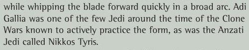
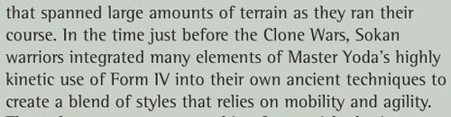

# Owner Material 037 — Star Wars D20 Drive folder (Core, Revised Core and Saga Edition): Sourcebooks/Sourcebook Web Enhancements/Hero's Guide Web Enhancement - Lightsaber Forms and the Fallanassi.pdf [Star Wars Roleplaying Game Revised Core (d20, 2002)]

- **Source:** Wizards of the Coast Star Wars Roleplaying Game books, web enhancements, Living Force campaign modules and articles (2000–2010), from the owner's "Star Wars D20" Drive folder (only the three edition subfolders; "General" was not read, as instructed). Secondary source (licensed Legends reference). Scan OCR'd on the box; the scan stays box-only and is **not** published.
- **Method:** every scanned page was OCR'd and machine-screened sentence by sentence for power-relevant statements (fights, kills, defeats, Force feats, rankings, superweapons) that name a character on our roster; each kept sentence is quoted verbatim from the OCR text and has a crop of the printed passage directly under it. Pages with nothing power-relevant are still listed with what is on them.
- **Citation:** "*Hero's Guide Web Enhancement - Lightsaber Forms and the Fallanassi* (SWRPG d20 Revised Core), p.X" by printed page ("scan p.X" where no printed number applies). **Weight:** Licensed RPG material: a secondary source. Narrative text sums up Legends lore; game statistics are rules for players, not canon power levels, and rank lowest.

## scan p.1 (scan page 1)

Page contents: Cover (hand-read)

## scan p.2 (scan page 2)

Page contents: Credits; Variant Lightsaber Forms: Sokan (mobility; blended with Yoda's Form IV), Shien (reverse horizontal grip; Adi Gallia, Nikkos Tyris), Niman (two lightsabers); Sokan Mastery (no AoO moves per day: 1/2/3/4 at Jedi levels 1-5/6-10/11-15/16-20, from the image); Shien Mastery prerequisites (hand-read)

- **Adi Gallia** — entry/section: Hero's Guide Web Enhancement - Lightsaber Forms and the Fallanassi: "Adi Gallia was one of the few Jedi around the time of the Clone Wars known to actively practice the form, as was the Anzati Jedi called Nikkos Tyris." Source: *Hero's Guide Web Enhancement - Lightsaber Forms and the Fallanassi* (SWRPG d20 Revised Core), scan p.2
  
- **Yoda** — entry/section: Sokan absorbed Yoda's kinetic Form IV: "In the time just before the Clone Wars, Sokan warriors integrated many elements of Master Yoda's highly kinetic use of Form IV into their own ancient techniques to create a blend of styles that relies on mobility and agility." Source: *Hero's Guide Web Enhancement - Lightsaber Forms and the Fallanassi* (SWRPG d20 Revised Core), scan p.2
  

## scan p.3 (scan page 3)

Page contents: Shien Mastery benefit (extra AoO; 2 m steps between cleaves); Niman Mastery (off-hand lightsaber counts as light; +1 Defense with Off-Hand Parry); Fallanassi: White Current, secrecy, contacted Luke Skywalker; philosophy, tradition, training (hand-read)

## scan p.4 (scan page 4)

Page contents: Fallanassi Force powers (immersion, illusions, doppelgangers); Doppelganger feat; White Current Adept (Affect Mind 4, Force Stealth 8, Illusion 6); Immersion (2 VP/round); Fallanassi script; Table 1 (from the image): BAB +0/+1/+2/+3/+3; Fort +0/+1/+2/+2/+3; Ref +1/+2/+2/+2/+3; Will +2/+3/+3/+4/+4; Def +1/+2/+2/+2/+3; Rep +0 at all levels (hand-read)

## scan p.5 (scan page 5)

Page contents: Hidden Powers; Immerse Another (5th level, double VP); about the authors (hand-read)

