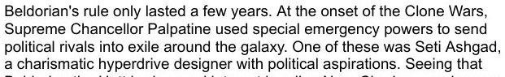
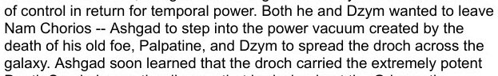
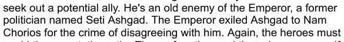
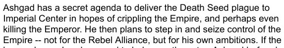

# Owner Material 037 — Star Wars D20 Drive folder (Core, Revised Core and Saga Edition): Sourcebooks/Sourcebook Web Enhancements/Power of the Jedi Sourcebook - The Planet of Twilight.pdf [Star Wars Roleplaying Game Revised Core (d20, 2002)]

- **Source:** Wizards of the Coast Star Wars Roleplaying Game books, web enhancements, Living Force campaign modules and articles (2000–2010), from the owner's "Star Wars D20" Drive folder (only the three edition subfolders; "General" was not read, as instructed). Secondary source (licensed Legends reference). Scan OCR'd on the box; the scan stays box-only and is **not** published.
- **Method:** every scanned page was OCR'd and machine-screened sentence by sentence for power-relevant statements (fights, kills, defeats, Force feats, rankings, superweapons) that name a character on our roster; each kept sentence is quoted verbatim from the OCR text and has a crop of the printed passage directly under it. Pages with nothing power-relevant are still listed with what is on them.
- **Citation:** "*Power of the Jedi Sourcebook - The Planet of Twilight* (SWRPG d20 Revised Core), p.X" by printed page ("scan p.X" where no printed number applies). **Weight:** Licensed RPG material: a secondary source. Narrative text sums up Legends lore; game statistics are rules for players, not canon power levels, and rank lowest.

## scan p.1 (scan page 1)

Page contents: Nam Chorios history: refugees from the Grissmath Dynasty, penal colony, drochs; Theras's vision and the Theran cult seizing the gun stations; Beldorian the Hutt (trained as a potential Jedi); Palpatine exiles Seti Ashgad; Dzym the evolved droch; Death Seed plague (hand-read)

- **Palpatine (Darth Sidious)** — entry/section: Palpatine exiles rivals at the onset of the Clone Wars: "At the onset of the Clone Wars, Supreme Chancellor Palpatine used special emergency powers to send political rivals into exile around the galaxy. One of these was Seti Ashgad, a charismatic hyperdrive designer with political aspirations." Source: *Power of the Jedi Sourcebook - The Planet of Twilight* (SWRPG d20 Revised Core), scan p.1
  
- **Palpatine (Darth Sidious)** — entry/section: Ashgad eyes the vacuum left by his old foe Palpatine: "Both he and Dzym wanted to leave Nam Chorios -- Ashgad to step into the power vacuum created by the death of his old foe, Palpatine, and Dzym to spread the droch across the galaxy." Source: *Power of the Jedi Sourcebook - The Planet of Twilight* (SWRPG d20 Revised Core), scan p.1
  

## scan p.2 (scan page 2)

Page contents: Tsils (intelligent crystals) keep the droch in check; Ashgad and Loronar (needle fighters, synthdroids); Rationalist Party; abducts Leia; Daala; Luke and Callista; the tsils destroy Ashgad's ship; description (Hweg Shul, about 8,000 people; gun-station grid about 250 km apart; ships Tiny or smaller can get through); Force storms (+20 to Force rolls, damage doubled) (hand-read)

## scan p.3 (scan page 3)

Page contents: Force storm mechanics (Fort DC 15 or 1d4+1 Str damage; Force Whirlwind on a natural 1); adventure hooks for the Rise of the Empire era (Beldorian, mining pods, Trade Federation?) and the Rebellion era (Ashgad posing as his son) (hand-read)

- **Palpatine (Darth Sidious)** — entry/section: The Emperor exiled Ashgad for disagreeing: "He's an old enemy of the Emperor, a former politician named Seti Ashgad. The Emperor exiled Ashgad to Nam Chorios for the crime of disagreeing with him." Source: *Power of the Jedi Sourcebook - The Planet of Twilight* (SWRPG d20 Revised Core), scan p.3
  

## scan p.4 (scan page 4)

Page contents: Twist: Dzym keeps Ashgad young; Death Seed plot against Imperial Center; tsil description and Tsil Commoner stat block (Def 12, VP/WP 0/12, electrical discharge 4d6 Reflex DC 15, telepathy Will DC 15, light amplification) (hand-read)

- **Palpatine (Darth Sidious)** — entry/section: Ashgad's Death Seed plot against the Emperor: "Ashgad has a secret agenda to deliver the Death Seed plague to Imperial Center in hopes of crippling the Empire, and perhaps even killing the Emperor. He then plans to step in and seize control of the Empire -- not for the Rebel Alliance, but for his own ambitions." Source: *Power of the Jedi Sourcebook - The Planet of Twilight* (SWRPG d20 Revised Core), scan p.4
  
