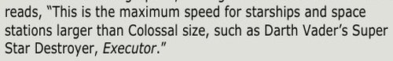
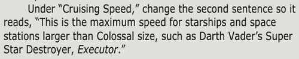

# Owner Material 037 — Star Wars D20 Drive folder (Core, Revised Core and Saga Edition): Sourcebooks/Sourcebook Web Enhancements/Revised Core Rulebook Errata 2006.pdf [Star Wars Roleplaying Game Revised Core (d20, 2002)]

- **Source:** Wizards of the Coast Star Wars Roleplaying Game books, web enhancements, Living Force campaign modules and articles (2000–2010), from the owner's "Star Wars D20" Drive folder (only the three edition subfolders; "General" was not read, as instructed). Secondary source (licensed Legends reference). Scan OCR'd on the box; the scan stays box-only and is **not** published.
- **Method:** every scanned page was OCR'd and machine-screened sentence by sentence for power-relevant statements (fights, kills, defeats, Force feats, rankings, superweapons) that name a character on our roster; each kept sentence is quoted verbatim from the OCR text and has a crop of the printed passage directly under it. Pages with nothing power-relevant are still listed with what is on them.
- **Citation:** "*Revised Core Rulebook Errata 2006* (SWRPG d20 Revised Core), p.X" by printed page ("scan p.X" where no printed number applies). **Weight:** Licensed RPG material: a secondary source. Narrative text sums up Legends lore; game statistics are rules for players, not canon power levels, and rank lowest.

## scan p.1 (scan page 1)

Page contents: Cover: Revised Core Rulebook Errata by Gary M. Sarli (hand-read)

## scan p.2 (scan page 2)

Page contents: Credits; intro (first-printing-only fixes in red); p30 Quarren low-light vision; p33 Wookiee rage (Combat Expertise; no rage while fatigued); p38 Con raise; p46, p51 (soldier bonus feats add Advanced Martial Arts); pp52-53 tech specialist (6 + Int skill points; mastercraft XP 40/160/360; new bonus feats at 6/12/18) (hand-read)

## scan p.3 (scan page 3)

Page contents: p58; pp59/62 new Block ability; pp64-65 starting feats; p77 Balance; p79 Climb; p85 Enhance 60 VP; p87 Force Grip (no automatic DSP) plus new Force Choke option (dazes; 6 VP); p87 new Force Lightning (DC 15, ranged attack, 3d8, Fort save or dazed; 10 m; can be deflected; 6 VP); p88 Force Strike (no DSP) plus Force Push option (4 VP, pushes 2 m and prone) (hand-read)

## scan p.4 (scan page 4)

Page contents: p89 Friendship Will DC table (up to 4: 5; 5–14: 10; 15–24: 15; 25–34: 20; 35+: 25; from the image); p89 Gamble wager penalties (up to 49 none to 20,000+ -25) and pure-chance d20 table; p91 Heal Another; p92 Hide plus Sniping; Illusion; p93 Jump time; pp94-95 new Move Object (table from the image: 10–14 5 kg Tiny Will 10 1d3 1 VP up to 40–44 5,000 tons Colossal Will 20 Ref 35 10d6 7 VP; +5 per step: x10 weight, +1 size, +2d6, +1 VP) (hand-read)

## scan p.5 (scan page 5)

Page contents: Move Object continued (contesting, obstructions, moving characters with a Will save, moving piloted vehicles, Hurl Object, dropping objects; Time); p95 Move Silently and Tumble time; Burst of Speed; Combat Reflexes; Dissipate Energy; p108 EWP; Force Speed; p111 Improved Force Mind; Knight Speed (hand-read)

## scan p.6 (scan page 6)

Page contents: p113 Master Speed; p114 Rage, Power Attack two-handed rule; p115 Shot on the Run; p121 new Table 6-5 Height and Weight for 22 species/sexes (from the image; Human male 1.50 m + 2d10x2.5 cm, 55 kg; Ewok 0.90 m; Wookiee male 1.95 m, 70 kg); p132 knife, E-Web size, short lightsaber (2,500 cr, 2d6, 19-20, Small, Exotic); p133 Setting Weapons on Stun sidebar (stun table; 4 m stun range) (hand-read)

## scan p.7 (scan page 7)

Page contents: Lightsabers ignore personal armor DR; lightsaber activation is a free action; double-bladed lightsaber sizes; p134 short lightsaber entry; blaster carbine retractable stock (E-5); p135 new E-Web entry (two-man crew, fire control, overheating); E-11 retractable stock; p137 slug clip; two-weapon multifire/autofire stacking; p165 autofire and multifire recoil penalties; grenade square Defense 5 (hand-read)

## scan p.8 (scan page 8)

Page contents: p169 Disarm; p187 vehicle combat actions sidebar; p188 new Table 10-3 Vehicle Speeds (from the image: stationary 0; cautious 1–20 sq; cruising 21–50 (+1 Def, -1); high 51–150 (+2, -2); top 151+ (+4, -4)); p190 ion immunity; p191 Speed Categories; p192 45-degree turn, Dash and Hard Brake stunts; p193 collision damage dice and characters hit by vehicles (hand-read)

## scan p.9 (scan page 9)

Page contents: Collision rule continued (Qui-Gon and Jar Jar under an MTT example); vehicle stat changes pp197–201 (AT-ST 38 m 120 HP, AT-AT 26 m 360 HP, AT-TE 26 m 320 HP, X-34, Flash, Chariot, Nightfalcon, sail barge, skiff); AAT ion vulnerability; new AAT-1 stat block (240 HP DR 15, heavy laser 5d10); MTT; p206 hyperspace times divided by 3; p210 sensors; new Target Range table (from the image: point blank 0–10 -2, short 11–20 +0, medium 21–40 +2, long 41–80 +4, extreme 81–160 +6) (hand-read)

## scan p.10 (scan page 10)

Page contents: p211 starship combat actions; p214 new Table 11-8 (point blank +0, short -2, medium -4, long -6; from the image), atmospheric range increments (50/250/500/1,000 m), missiles in atmosphere; Dogfights (capital ships limited to 1/4 or 1/10 of their weapons; -4 when firing near an ally); point-defense; Establishing and Breaking a Missile Lock; p215 missiles Defense 22, 10 HP; p218 speed categories (Executor cruising) (hand-read)

- **Darth Vader (Anakin Skywalker)** — entry/section: Executor cited as a Colossal-plus example (cruising speed rule): "This is the maximum speed for starships and space stations larger than Colossal size, such as Darth Vader's Super Star Destroyer, Executor." Source: *Revised Core Rulebook Errata 2006* (SWRPG d20 Revised Core), scan p.10
  
- **Darth Vader (Anakin Skywalker)**: "Under "Cruising Speed," change the second sentence so it reads, "This is the maximum speed for starships and space stations larger than Colossal size, such as Darth Vader's Super Star Destroyer, Executor."" Source: *Revised Core Rulebook Errata 2006* (SWRPG d20 Revised Core), scan p.10
  

## scan p.11 (scan page 11)

Page contents: New Table 11-13 Starship Speeds (from the image: docking 1; cruising 2–4 (atmosphere 2); attack 5–8 (3–6); ramming 9+ (7+)); p219 45-degree turn, Loop deleted; p220 Afterburn and Hard Brake; p223 Pursuit; pp227–232 starship DR and initiative changes (X-wing, Y-wing, TIE, Z-95, droid starfighter, N-1, Delta-7, YT-1300, Millennium Falcon, Firespray-31, Slave I, Guardian, ISD DR 60) (hand-read)

## scan p.12 (scan page 12)

Page contents: Mon Calamari cruiser, Nebulon-B, Corellian corvette and cruiser, Trade Federation battleship, Republic assault ship; p235–237 airspeeder hull points (snowspeeder Huge, STAP, Storm IV); p268 Dark Side Devotee; p270 Marauder bonus feats; elite trooper Weapon Specialization; p274; p280 Starship Ace; Falling and Falling Objects; p291 acid (hand-read)

## scan p.13 (scan page 13)

Page contents: p307 Chewbacca stat blocks; p310 Yoda stat block switched to a short lightsaber; p336–339 bantha, gundark, rancor, reek; p340 battle droid prices; pp345–346 doctors; p352 slicers; p354 stormtroopers; p357 razorbug; p362 Force Grip affects droids; p366 shutting down droids; p369–370 droid shield generators (DR 5/10/15; Constitution overheating); p373 B2 double blaster rifle; droideka wheel mode (hand-read)

### Stat block notes (game mechanics, not feats)

- Errata: Yoda's stat block uses a short lightsaber: Yoda stat block: Change melee attack to +20/+15/+10/+5* melee (2d6+4d8-1/19-20, short lightsaber), and replace lightsaber with short lightsaber in equipment list. (Source: *Revised Core Rulebook Errata 2006* (SWRPG d20 Revised Core), scan p.13)

## scan p.14 (scan page 14)

Page contents: p373 Destroyer Droids & Autofire table (from the image: Rapid Shot +9/+9/+9/+4/-1; plus autofire +7/+7/+7/+2/-3; plus second blaster multifire +1/+1/+1/+1/-4/-9 and +1/+1; autofire -1/-1/-1/-1/-6/-11 and -1/-1/-1); p374 droideka stat block; about the author (hand-read)

