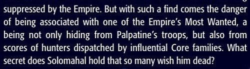

# Owner Material 037 — Star Wars D20 Drive folder (Core, Revised Core and Saga Edition): Sourcebooks/Sourcebook Web Enhancements/Rough and Tundra.pdf [Star Wars Roleplaying Game Revised Core (d20, 2002)]

- **Source:** Wizards of the Coast Star Wars Roleplaying Game books, web enhancements, Living Force campaign modules and articles (2000–2010), from the owner's "Star Wars D20" Drive folder (only the three edition subfolders; "General" was not read, as instructed). Secondary source (licensed Legends reference). Scan OCR'd on the box; the scan stays box-only and is **not** published.
- **Method:** every scanned page was OCR'd and machine-screened sentence by sentence for power-relevant statements (fights, kills, defeats, Force feats, rankings, superweapons) that name a character on our roster; each kept sentence is quoted verbatim from the OCR text and has a crop of the printed passage directly under it. Pages with nothing power-relevant are still listed with what is on them.
- **Citation:** "*Rough and Tundra* (SWRPG d20 Revised Core), p.X" by printed page ("scan p.X" where no printed number applies). **Weight:** Licensed RPG material: a secondary source. Narrative text sums up Legends lore; game statistics are rules for players, not canon power levels, and rank lowest.

## scan p.1 (scan page 1)

Page contents: Title: Rough and Tundra, Adventure Settings and Scenarios for the Greater Javin (hand-read)

## scan p.2 (scan page 2)

Page contents: Credits; opening quote by Fenn Gilbrantes (Yarith Sector Ranger, ret.) about Salmakk and Clabburn; intro (four heroes of 8th–10th level, Rebellion era); Background: the pirates return and join forces (hand-read)

## scan p.3 (scan page 3)

Page contents: Getting the Heroes Involved: possible employers, the Outer Javin Company, Figg Excavations, the Mining Guild (Guild Enforcers) and the Empire (wants the pirates delivered to Javin); the Hutts of Port Town (hand-read)

## scan p.4 (scan page 4)

Page contents: The Hutts want the base coordinates; The Plot Revealed (FiggEx black ops hired the pirates to justify leaving the Mining Guild; Mapes Shaywa); Salmakk's history (Mon Calamari, Boss Gurgle, base on Hoth until Solo and Skywalker caved it in); Salmakk stat block (Scoundrel 8/Soldier 4) (hand-read)

## scan p.5 (scan page 5)

Page contents: Clabburn (Mugaari; the Malachite Scent score); Clabburn the Younger stat block (Scoundrel 12; missing lower arm); Casefile sidebar (the son posing as the father); The New Crew; Broken Jaw (Sentinel-class cruiser) (hand-read)

## scan p.6 (scan page 6)

Page contents: Broken Jaw stat block; Greater Javin Contacts: Nogo Sistek (fixer, Scout 6/Deep-Space Pilot 2; 'Barseth Gynes'); Expanding the Adventure sidebar (Clabburn the Elder); Fannis Gult (Guild Enforcer, Scoundrel 5/Soldier 5) (hand-read)

## scan p.7 (scan page 7)

Page contents: Mapes Shaywa (secret FiggEx Security chief, alias Barseth Gynes; Scoundrel 8/Soldier 4); Expanding sidebar; Treva Horme (Lutrillian Planet Dreams saleswoman, Diplomat 8); Solomahal (Lutrillian Clone Wars veteran, Soldier 8/Fringer 4) (hand-read)

## scan p.8 (scan page 8)

Page contents: Solomahal stats continued (Rep +8; note on his fading fame); Sergeant Taray (Nothoiin Wing Guard, Soldier 6/Officer 2); sidebar 'Well, Look at You, a General!' (General Solomahal); Sheryc Seka (Yarkora weapons smuggler, Scoundrel 6) (hand-read)

- **Palpatine (Darth Sidious)** — entry/section: Solomahal sidebar: hiding from Palpatine's troops: "But with such a find comes the danger of being associated with one of the Empire's Most Wanted, a being not only hiding from Palpatine's troops, but also from scores of hunters dispatched by influential Core families. What secret does Solomahal hold that so many wish him dead?" Source: *Rough and Tundra* (SWRPG d20 Revised Core), scan p.8
  

## scan p.9 (scan page 9)

Page contents: Locations: Hoth (Hardfrost Base, which later became part of Echo Base; Iceglaze lumni-spice base); Hoth asteroid field (Airtight Base; space slugs; Darksaber-era note); dragon-slug sidebar and stats (Challenge Code G); Darlyn Boda (Pepper's Pax) (hand-read)

## scan p.10 (scan page 10)

Page contents: Pepper's Pax rules; haruspex readings from toccat entrails; Gerrenthum (Figg HQ); Expanding sidebar (haruspex quoting 'Always in motion is the future'; fugitive on Lutrillia); Bespin (Port Town, Hutts, Sergeant Taray, Treva Horme, Ugnaught union halls, Glor Jal) (hand-read)

