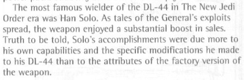
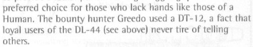
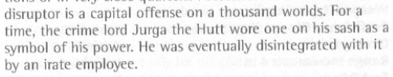
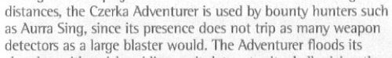
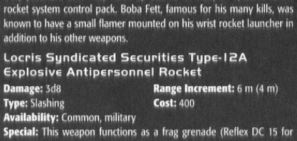
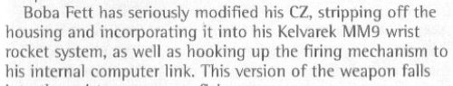
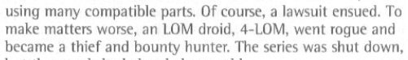

# Owner Material 037 — Star Wars D20 Drive folder (Core, Revised Core and Saga Edition): Sourcebooks/Arms and Equipment Guide.pdf [Star Wars Roleplaying Game Revised Core (d20, 2002)] (scan pages 1–60)

- **Source:** Wizards of the Coast Star Wars Roleplaying Game books, web enhancements, Living Force campaign modules and articles (2000–2010), from the owner's "Star Wars D20" Drive folder (only the three edition subfolders; "General" was not read, as instructed). Secondary source (licensed Legends reference). Scan OCR'd on the box; the scan stays box-only and is **not** published.
- **Method:** every scanned page was OCR'd and machine-screened sentence by sentence for power-relevant statements (fights, kills, defeats, Force feats, rankings, superweapons) that name a character on our roster; each kept sentence is quoted verbatim from the OCR text and has a crop of the printed passage directly under it. Pages with nothing power-relevant are still listed with what is on them.
- **Citation:** "*Arms and Equipment Guide* (SWRPG d20 Revised Core), p.X" by printed page ("scan p.X" where no printed number applies). **Weight:** Licensed RPG material: a secondary source. Narrative text sums up Legends lore; game statistics are rules for players, not canon power levels, and rank lowest.

## scan p.1 (scan page 1)

Page contents: Cover: Arms and Equipment Guide (Star Wars Roleplaying Game supplement). (hand-read)

## scan p.2 (scan page 2)

Page contents: Credits (Jeff Grubb, Owen K.C. Stephens; editor Charles Ryan) and table of contents. (hand-read)

## scan p.3 (scan page 3)

Page contents: Introduction: using the book, equipment availability ratings (prevalent, common, specialized, rare; licensed, restricted, military, illegal). (hand-read)

## scan p.4 (scan page 4)

Page contents: Introduction cont.: eras of play icons, black market and buying illegal gear. (hand-read)

## scan p.5 (scan page 5)

Page contents: Chapter 1 Weapons opener; weapon categories; customizing and personalizing weapons. (hand-read)

## scan p.6 (scan page 6)

Page contents: Weapon modification limits table; what can be modified; making the modification. (hand-read)

## scan p.7 (scan page 7)

Page contents: Concealing weapons rules; blaster pistols intro. (hand-read)

## scan p.8 (scan page 8)

Page contents: Blaster pistols: DH-23, DL-18 (typical), DL-22. (hand-read)

## scan p.9 (scan page 9)

Page contents: Blaster pistols: DH-17, Merr-Sonn IR-5 Intimidator, SoroSuub ELG-3A, SC-4. (hand-read)

## scan p.10 (scan page 10)

Page contents: IR-5 cont.; Heavy blaster pistols: BlasTech DL-44 (Han Solo), DT-12 (Greedo). (hand-read)

- **Han Solo** — entry/section: DL-44 and Han Solo: "The most famous wielder of the DL-44 in The New Jedi Order era was Han Solo. As tales of the General's exploits spread, the weapon enjoyed a substantial boost in sales. Truth to be told, Solo's accomplishments were due more to his own capabilities and the specific modifications he made to his DL-44 than to the attributes of the factory version of the weapon." Source: *Arms and Equipment Guide* (SWRPG d20 Revised Core), scan p.10
  
- **Greedo** — entry/section: Greedo's DT-12: "The bounty hunter Greedo used a DT-12, a fact that loyal users of the DL-44 (see above) never tire of telling others." Source: *Arms and Equipment Guide* (SWRPG d20 Revised Core), scan p.10
  

## scan p.11 (scan page 11)

Page contents: Heavy blasters: T-6 Thunder, Caliban Model X, Merr-Sonn Power 5. (hand-read)

## scan p.12 (scan page 12)

Page contents: SoroSuub Renegade heavy blaster; hold-out blasters; Czerka 411. (hand-read)

## scan p.13 (scan page 13)

Page contents: Hold-outs cont.; Gee-Tech 12 Defender MicroBlaster. (hand-read)

## scan p.14 (scan page 14)

Page contents: Merr-Sonn Model 02, Model 1J Happy Surprise, Defender, Luxan Penetrator MB-450; sporting blaster pistols. (hand-read)

## scan p.15 (scan page 15)

Page contents: Merr-Sonn Quick-6; blaster rifles and carbines; DLT-20A and A280. (hand-read)

## scan p.16 (scan page 16)

Page contents: A280 cont.; SoroSuub Firelance. (hand-read)

## scan p.17 (scan page 17)

Page contents: Core World Arms Pulse-Blast Rifle. (hand-read)

## scan p.18 (scan page 18)

Page contents: N'Gant-Zarvel S118 heavy carbine, SoroSuub Heavy Tracker 16; sporting blaster rifles. (hand-read)

## scan p.19 (scan page 19)

Page contents: Herloss sporting blaster, Xerral Nightstinger. (hand-read)

## scan p.20 (scan page 20)

Page contents: Merr-Sonn underslung rotary blaster carbine; Felebreck droid disabler. (hand-read)

## scan p.21 (scan page 21)

Page contents: DEMP/antidroid weapons; disruptors Tenloss DX-2, DXR-6 (one worn by Jurga the Hutt); ranged projectile weapons. (hand-read)

- **Jurga the Hutt** — entry/section: Jurga the Hutt disintegrated: "For a time, the crime lord Jurga the Hutt wore one on his sash as a symbol of his power. He was eventually disintegrated with it by an irate employee." Source: *Arms and Equipment Guide* (SWRPG d20 Revised Core), scan p.21
  

## scan p.22 (scan page 22)

Page contents: Slugthrowers intro; Czerka Adjudicator. (hand-read)

## scan p.23 (scan page 23)

Page contents: Slugthrower pistols cont.; slugthrower rifles; Czerka Adventurer (Aurra Sing). (hand-read)

- **Aurra Sing** — entry/section: Aurra Sing's Czerka Adventurer: "the Czerka Adventurer is used by bounty hunters such as Aurra Sing, since its presence does not trip as many weapon detectors as a large blaster would." Source: *Arms and Equipment Guide* (SWRPG d20 Revised Core), scan p.23
  

## scan p.24 (scan page 24)

Page contents: Dresselian projectile rifle; dart pistols (Prax Arms PRP-502, Kelvarek Dissuader, Magna Caster-100). (hand-read)

## scan p.25 (scan page 25)

Page contents: Special dart ammunition sidebar; flechette launchers. (hand-read)

## scan p.26 (scan page 26)

Page contents: FWG-5 flechette smart pistol; wrist weapons. (hand-read)

## scan p.27 (scan page 27)

Page contents: Wrist rocket ammunition sidebar (K26, Lumablast, Vac Attack); wrist flamer (Boba Fett). (hand-read)

- **Boba Fett** — entry/section: Boba Fett's wrist flamer: "Boba Fett, famous for his many kills, was known to have a small flamer mounted on his wrist rocket launcher in addition to his other weapons," Source: *Arms and Equipment Guide* (SWRPG d20 Revised Core), scan p.27
  

## scan p.28 (scan page 28)

Page contents: Kelvarek MM9 rocket system; melee weapons intro; standard melee weapons; garrote. (hand-read)

## scan p.29 (scan page 29)

Page contents: Melee weapon illustrations (vibrorapier, vibroknucklers, stun gauntlets, neuronic whip, stun baton, ryyk blade). (hand-read)

## scan p.30 (scan page 30)

Page contents: Tribal longspear; vibro weapons; LaserHone duelist vibrorapier. (hand-read)

## scan p.31 (scan page 31)

Page contents: Merr-Sonn vibrobayonet; melee stun weapons; stun baton. (hand-read)

## scan p.32 (scan page 32)

Page contents: Neuronic whip; grenades: Czerka Spore/B, Cryoban, Glop, stun grenades. (hand-read)

## scan p.33 (scan page 33)

Page contents: Stun spore grenade; Merr-Sonn C-10, C-14A, C-16, C-22, G-20 grenades. (hand-read)

## scan p.34 (scan page 34)

Page contents: Timed grenades; grenade launchers. (hand-read)

## scan p.35 (scan page 35)

Page contents: BlasTech Tees launcher; other weapons and systems; CZ wrist rig (Boba Fett); flame projectors CR-24, C-22. (hand-read)

- **Boba Fett** — entry/section: Boba Fett's modified CZ: "Boba Fett has seriously modified his CZ, stripping off the housing and incorporating it into his Kelvarek MM9 wrist rocket system, as well as hooking up the firing mechanism to his internal computer link." Source: *Arms and Equipment Guide* (SWRPG d20 Revised Core), scan p.35
  

## scan p.36 (scan page 36)

Page contents: CZ-22 Flametongue; CR-24/CZ-24 Flamemaster; sonic weapons. (hand-read)

## scan p.37 (scan page 37)

Page contents: Pacnorval Sg-82, Sil-50 sonic pistols; species-specific ranged weapons; optional species chips; Squib tensor rifle. (hand-read)

## scan p.38 (scan page 38)

Page contents: Tensor rifle cont.; weapon attachments and accessories: BlasTech Ramtek, Novaless target imager. (hand-read)

## scan p.39 (scan page 39)

Page contents: Chapter 2 Protective Gear opener; customizing and personalizing armor. (hand-read)

## scan p.40 (scan page 40)

Page contents: Armor modification; other armor rules; Ayelixe/Krongbing climbsuit, shadowsuit. (hand-read)

## scan p.41 (scan page 41)

Page contents: Armor illustrations: Barabel microbe armor, leather jerkin, combat suit, utility vest, climbsuit, Tuff combat suit, thinsuit. (hand-read)

## scan p.42 (scan page 42)

Page contents: Barabel microbe armor; Kamperdine leather jerkin; armor illustrations (polarizing insulator suit, blast-dampening, camo scout, AV-1 series). (hand-read)

## scan p.43 (scan page 43)

Page contents: Medium armor; Teshaldyne blast-dampening armor; GTU AV-1A assault armor. (hand-read)

## scan p.44 (scan page 44)

Page contents: AV-1A features; AV-1C combat armor; AV-1S scout armor (powered). (hand-read)

## scan p.45 (scan page 45)

Page contents: AV-1S cont.; Regallis EVA vacuum pod; other gear: Pacnorval sonic dampening helmet, dampener aerosol. (hand-read)

## scan p.46 (scan page 46)

Page contents: Chapter 3 Droids opener; P2 astromech. (hand-read)

## scan p.47 (scan page 47)

Page contents: R1 astromech; R3/R4/R5 illustrations. (hand-read)

## scan p.48 (scan page 48)

Page contents: Droid Heroes sidebar (droid classes for heroic droids); R3 series. (hand-read)

## scan p.49 (scan page 49)

Page contents: R4 and R5 astromechs. (hand-read)

## scan p.50 (scan page 50)

Page contents: R6 and R7 astromechs; LE repair droid. (hand-read)

## scan p.51 (scan page 51)

Page contents: LIN and NR-5 repair droids. (hand-read)

## scan p.52 (scan page 52)

Page contents: MSE-6 mouse droid; protocol and commercial droids; RA-7. (hand-read)

## scan p.53 (scan page 53)

Page contents: PD and 3D-4X protocol droids; illustrations RA-7, LOM, SE4, CZ. (hand-read)

## scan p.54 (scan page 54)

Page contents: LOM protocol droid (4-LOM went rogue); SE4 servant droid; TTS-15 tutorial droid. (hand-read)

- **4-LOM** — entry/section: 4-LOM goes rogue: "To make matters worse, an LOM droid, 4-LOM, went rogue and became a thief and bounty hunter." Source: *Arms and Equipment Guide* (SWRPG d20 Revised Core), scan p.54
  

## scan p.55 (scan page 55)

Page contents: Serv-O-Droid CZ communications droid; medical droids; MD series. (hand-read)

## scan p.56 (scan page 56)

Page contents: FX medical droid; illustrations; military droids. (hand-read)

## scan p.57 (scan page 57)

Page contents: OOM series droids (commander and pilot variants). (hand-read)

## scan p.58 (scan page 58)

Page contents: SD-9/SD-10, Eradicator, M-3PO military droids; security and guard droids. (hand-read)

## scan p.59 (scan page 59)

Page contents: G-2RD guard droid; GV series. (hand-read)

## scan p.60 (scan page 60)

Page contents: TT-8L, SoroSuub 501-Z police droid; DRK-1 probe. (hand-read)

