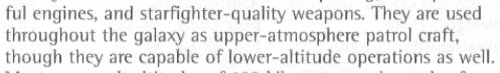
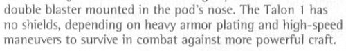

# Owner Material 037 — Star Wars D20 Drive folder (Core, Revised Core and Saga Edition): Sourcebooks/Arms and Equipment Guide.pdf [Star Wars Roleplaying Game Revised Core (d20, 2002)] (scan pages 61–97)

- **Source:** Wizards of the Coast Star Wars Roleplaying Game books, web enhancements, Living Force campaign modules and articles (2000–2010), from the owner's "Star Wars D20" Drive folder (only the three edition subfolders; "General" was not read, as instructed). Secondary source (licensed Legends reference). Scan OCR'd on the box; the scan stays box-only and is **not** published.
- **Method:** every scanned page was OCR'd and machine-screened sentence by sentence for power-relevant statements (fights, kills, defeats, Force feats, rankings, superweapons) that name a character on our roster; each kept sentence is quoted verbatim from the OCR text and has a crop of the printed passage directly under it. Pages with nothing power-relevant are still listed with what is on them.
- **Citation:** "*Arms and Equipment Guide* (SWRPG d20 Revised Core), p.X" by printed page ("scan p.X" where no printed number applies). **Weight:** Licensed RPG material: a secondary source. Narrative text sums up Legends lore; game statistics are rules for players, not canon power levels, and rank lowest.

## scan p.61 (scan page 61)

Page contents: Mark VII Inquisitor seeker; RMD-20; messenger droids AS-M12. (hand-read)

## scan p.62 (scan page 62)

Page contents: M4 messenger; labor droids; B1 worker. (hand-read)

## scan p.63 (scan page 63)

Page contents: Labor droid illustrations (U2-C1, Scrubber, Gyrowheel, M38, 11-17 miner). (hand-read)

## scan p.64 (scan page 64)

Page contents: EV interrogator droid; U2-C1 housekeeping. (hand-read)

## scan p.65 (scan page 65)

Page contents: Other droids intro; M38 explorer. (hand-read)

## scan p.66 (scan page 66)

Page contents: Droid illustrations (M4, MSE-6, DRK-1, Mark VII, Scarab); Terminax/Mark X. (hand-read)

## scan p.67 (scan page 67)

Page contents: Mark VI Scarab assassin droid; droid illustrations. (hand-read)

## scan p.68 (scan page 68)

Page contents: Chapter 4 Vehicles opener. (hand-read)

## scan p.69 (scan page 69)

Page contents: Customizing vehicles: modification limits, what can be modified. (hand-read)

## scan p.70 (scan page 70)

Page contents: Go-Corp Utilitech Metrocab; airspeeders (T-16, V-wing). (hand-read)

## scan p.71 (scan page 71)

Page contents: TaggeCo Cargohopper; Talon I combat cloud car. (hand-read)

- **Darth Talon** — entry/section: Ubrikkian Talon | Combat Cloud Car: "They are used throughout the galaxy as upper-atmosphere patrol craft, though they are capable of lower-altitude operations as well." Source: *Arms and Equipment Guide* (SWRPG d20 Revised Core), scan p.71
  
- **Darth Talon** — entry/section: Ubrikkian Talon | Combat Cloud Car: "The Talon | has no shields, depending on heavy armor plating and high-speed maneuvers to survive in combat against more powerful craft." Source: *Arms and Equipment Guide* (SWRPG d20 Revised Core), scan p.71
  

## scan p.72 (scan page 72)

Page contents: Jetpacks: Aratech Jumper, Mitrinomon Z-6, Mobquet DKC-167 repulsor pack, Nen-Carvon R-23 paraglider. (hand-read)

## scan p.73 (scan page 73)

Page contents: Speeder bikes and swoops: Aratech 74-Z, Bespin Motors JR-4 swoop. (hand-read)

## scan p.74 (scan page 74)

Page contents: Ikas-Adno R-2000 Raptor, Incom MVR-3, Mobquet Flare-S, Mobquet Overracer. (hand-read)

## scan p.75 (scan page 75)

Page contents: Razalon FC-20 speeder bike; Aratech Arrow-23. (hand-read)

## scan p.76 (scan page 76)

Page contents: Civilian speeders: HVP-200 hover shopper, SoroSuub JG-8 luxury speeder. (hand-read)

## scan p.77 (scan page 77)

Page contents: Landspeeders: SoroSuub XP-38, TaggeCo SCS-19 Sentinel, SoroSuub V-35 Courier. (hand-read)

## scan p.78 (scan page 78)

Page contents: Sentinel cont.; Tion Hyperfoil, Trast A-A5 speeder truck, Ubrikkian gravsled, personnel skiff. (hand-read)

## scan p.79 (scan page 79)

Page contents: Military groundspeeders: Baktoid Transpeeder, KAAC Freerunner, Mekuun CMD-1 stats. (hand-read)

## scan p.80 (scan page 80)

Page contents: CMD-1 text; Merr-Sonn WW-676 sled; Sienar ULAV; SoroSuub V-19 Gian stats. (hand-read)

## scan p.81 (scan page 81)

Page contents: V-19 Gian text; Walkers: Arakyd Emperiax Walking Throne, Caridan MT-AT, KDY AT-PT stats. (hand-read)

## scan p.82 (scan page 82)

Page contents: AT-PT text; SecuriTech Espo Walker. (hand-read)

## scan p.83 (scan page 83)

Page contents: zZip Gladiator Walker; Seacraft: Sedrimotors Amphibion; Other vehicles: Aratech A14 repulsorlift disk. (hand-read)

## scan p.84 (scan page 84)

Page contents: Repulsorlift disk cont.; CMC Mining Digger (sandcrawler); KDY A5 Juggernaut HAV. (hand-read)

## scan p.85 (scan page 85)

Page contents: Chapter 5 Equipment opener; breathing devices: A99 Aquata Breather, Atmospherics Oxidizer. (hand-read)

## scan p.86 (scan page 86)

Page contents: Roamer-6 breath mask, Mon Calamari organic gill, Easy Breathing mask; communication devices (MultiNode, OmniNode, SW-95, 3-Mal). (hand-read)

## scan p.87 (scan page 87)

Page contents: Tagger, PAC20 wrist com, Naboo Secure-A3, CS-Mark 12 holoprojector, SoroSuub C1, Hologram Projection Pod. (hand-read)

## scan p.88 (scan page 88)

Page contents: Hush-98, Imagecaster, VDV-100, implant communicator, BX-333 Biorecorder, pocket scrambler, AlienEnhancer voxbox. (hand-read)

## scan p.89 (scan page 89)

Page contents: Detection devices: communications scanner, PX-7 heat sensor, EnhanceScan, SDS-632, SE-Vigilant beacon. (hand-read)

## scan p.90 (scan page 90)

Page contents: ILF-5000, 9320/B sensor pack, ChemDetect, holorecording macrobinoculars, TeleSonic, SureSnoop. (hand-read)

## scan p.91 (scan page 91)

Page contents: Veridicator 200, Ez1 analyzer, Peer and 1125 macrobinoculars; sensor jammers: No-Show, Sheer Silence, CQ-3.9x holoshroud. (hand-read)

## scan p.92 (scan page 92)

Page contents: CN-15 camouflage netting, ComTech jammer; medical equipment rules; Athakam II Med Unit; What's in My Medical Kit sidebar; FastFlesh medpac. (hand-read)

## scan p.93 (scan page 93)

Page contents: RFX/K Medisensor, EMC-598 backpack, Shock Cloth, Field Cauterizer, MDS-50; security devices intro. (hand-read)

## scan p.94 (scan page 94)

Page contents: DCD-4800 coder, MLC-50 magnolock, SC-401 stun cuffs, binder cuffs, monofilament screen guard, MagnaCuffs, Thalassian security collar. (hand-read)

## scan p.95 (scan page 95)

Page contents: Security collar cont.; survival gear: DuraShelter, ration packs, Bubble Cloak, Coolth backpack, PED-21 beacon, Water JugFilter; What's in My Escape Pod sidebar. (hand-read)

## scan p.96 (scan page 96)

Page contents: Tools and sundries: Vennoc-x chronometer, blaster repair kit, syntherope, vibrosaw, Mk-11 droid diagnostic, Pocket Secretary; What's in My Tool Kit sidebar. (hand-read)

## scan p.97 (scan page 97)

Page contents: Back cover blurb ("Hokey religions and ancient weapons are no match for having a good blaster at your side"); no characters. (hand-read)

