# Owner Material 037 — Star Wars D20 Drive folder (Core, Revised Core and Saga Edition): Sourcebooks/Coruscant and the Core Worlds.pdf [Star Wars Roleplaying Game Revised Core (d20, 2002)] (scan pages 1–60)

- **Source:** Wizards of the Coast Star Wars Roleplaying Game books, web enhancements, Living Force campaign modules and articles (2000–2010), from the owner's "Star Wars D20" Drive folder (only the three edition subfolders; "General" was not read, as instructed). Secondary source (licensed Legends reference). Scan OCR'd on the box; the scan stays box-only and is **not** published.
- **Method:** every scanned page was OCR'd and machine-screened sentence by sentence for power-relevant statements (fights, kills, defeats, Force feats, rankings, superweapons) that name a character on our roster; each kept sentence is quoted verbatim from the OCR text and has a crop of the printed passage directly under it. Pages with nothing power-relevant are still listed with what is on them.
- **Citation:** "*Coruscant and the Core Worlds* (SWRPG d20 Revised Core), p.X" by printed page ("scan p.X" where no printed number applies). **Weight:** Licensed RPG material: a secondary source. Narrative text sums up Legends lore; game statistics are rules for players, not canon power levels, and rank lowest.

## scan p.1 (scan page 1)

Page contents: Cover: Star Wars Roleplaying Game, Coruscant and the Core Worlds; designers' names (hand-read)

## scan p.2 (scan page 2)

Page contents: Title page: Coruscant and the Core Worlds; designers (hand-read)

## scan p.3 (scan page 3)

Page contents: Credits page (designers, developers, editors, artists), references (Essential Guide to Planets and Moons, Star Wars Gamer, Duro Delta Twelve web enhancement), WotC addresses, (c)2003 Lucasfilm, First Printing January 2003 (hand-read)

## scan p.4 (scan page 4)

Page contents: Table of contents (garbled OCR): planets Coruscant through Velusia, supporting-character index, new vehicles, starships, prestige class, creatures, species, feats, equipment, droids (hand-read)

## scan p.5 (scan page 5)

Page contents: Introduction: The Bright Center of Your Campaign; Something for Everyone; A World for Heroes (each heroic class on Coruscant); A Campaign on Coruscant (hand-read)

## scan p.6 (scan page 6)

Page contents: Map of the Core (Koornacht Cluster, Metellos Trade Route, Rimma Trade Route, planet labels) (hand-read)

## scan p.7 (scan page 7)

Page contents: Rise of the Empire, Rebellion and New Jedi Order eras on Coruscant; Coruscant and Beyond (hand-read)

## scan p.8 (scan page 8)

Page contents: Coruscant planet stats (pop. 1 trillion), system table; Description (Chancellor Signet Mezzileen and poet Adder Ain-la quotes on Coruscant, Monument Plaza, orbital traffic, Imperial City); History begins (hand-read)

## scan p.9 (scan page 9)

Page contents: Coruscant History: Dha Werda Verda (Taungs vs Zhell), hyperroutes, Republic City, Sith Empire/Great Hyperspace War, Ulic Qel-Droma and Mandalore ravage Coruscant, Valorum, Palpatine, Imperial Center, Invisec, Krytos virus, reborn Emperor, Yuuzhan Vong conquest, Borsk Fey'lya dies (hand-read)

- **Ulic Qel-Droma** — entry/section: Coruscant ravaged by Ulic Qel-Droma: "Coruscant was nearly captured by the Sith Empire during the Great Hyperspace War, and a thousand years later the planet was again ravaged by Sith disciple Ulic Qel-Droma and the masked warriors of Mandalore." Source: *Coruscant and the Core Worlds* (SWRPG d20 Revised Core), scan p.9
  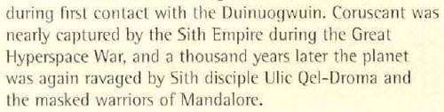

## scan p.10 (scan page 10)

Page contents: People (Coruscanti); Locations: Skyhooks (Palpatine's and Xizor's skyhooks), The Imperial Palace begins; map labels (hand-read)

## scan p.11 (scan page 11)

Page contents: Imperial Palace (Grand Corridor, Crypt, Imperial Information Center; Borsk Fey'lya suicide bomb kills 20,000 Yuuzhan Vong); Glitannai Esplanade; Galactic Senate Chamber (Vodo Siosk-Baas and Exar Kun battled to the death in old Senate Hall); Jedi Temple; Western Sea (hand-read)

- **Borsk Fey'lya** — entry/section: Borsk Fey'lya's suicide bomb: "When the Yuuzhan Vong invaded Coruscant, Chief of State Borsk Fey'lya detonated a suicide bomb and took out 20,000 enemy warriors." Source: *Coruscant and the Core Worlds* (SWRPG d20 Revised Core), scan p.11
  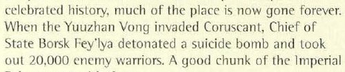
- **Exar Kun; Vodo-Siosk Baas** — entry/section: Duel in the original Senate Hall: "the original Senate Hall in which Vodo Siosk-Baas and Exar Kun battled to the death" Source: *Coruscant and the Core Worlds* (SWRPG d20 Revised Core), scan p.11
  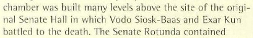

## scan p.12 (scan page 12)

Page contents: Coruscant Opera House; Skydome Botanical Gardens; Westport; Calocour Heights; Column Commons; Southern Underground (Crystal Jewel cantina); Invisible Sector (Asyr Sei'lar, Ysanne Isard); Garbage Pits begin (hand-read)

## scan p.13 (scan page 13)

Page contents: Garbage pits; Orbital Mirrors (OSETS); WeatherNet; Polar Ice Caps; Xizor's Castle begins (hand-read)

## scan p.14 (scan page 14)

Page contents: Xizor's Castle (Lando Calrissian collapses it with a thermal detonator down the trash chute; Bothan Spynet HQ); Petrax Historic Quarter; Galactic Museum; Monument Plaza (Flames of Umate) (hand-read)

- **Lando Calrissian; Prince Xizor** — entry/section: Lando collapses Xizor's castle: "Despite the millions spent on security, Xizor's castle proved surprisingly vulnerable to internal sabotage—after infiltrating the structure, Lando Calrissian collapsed it by dropping a thermal detonator down the trash chute." Source: *Coruscant and the Core Worlds* (SWRPG d20 Revised Core), scan p.14
  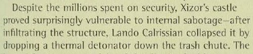

## scan p.15 (scan page 15)

Page contents: Grand Reception Hall (Leia welcomes Prince Isolder); Kallarak Amphitheater; University of Coruscant; Coruscant Livestock Exchange and Exhibition begins (hand-read)

## scan p.16 (scan page 16)

Page contents: Livestock Exchange (Anx, Amaran dealers); Royal Iequi Aquaria; Holographic Zoo of Extinct Animals; Dexter's Diner (Didi Oddo, Qui-Gon Jinn friend, Dexter Jettster, Hermione Bagwa, WA-7); Zlato's Place begins (hand-read)

## scan p.17 (scan page 17)

Page contents: Zlato's Place (Jeseej the Sljee forger and soothsayer); The Outlander (Volven Roxe, Anzat rumor); Gartro Rookery (Lost Ones initiation); Ice Crypts; East Minor and Trophill Gardens (hand-read)

## scan p.18 (scan page 18)

Page contents: Trophill Gardens (Green Mazes); Factory District (Grungeon block; Darth Sidious' secret hangar for Darth Tyranus); PCBU police cruiser backup unit stats; Coruscant Survival Kit begins (hand-read)

## scan p.19 (scan page 19)

Page contents: Survival kit contents; Racing Wings stats; Hot Rod Airspeeder (Senator Simon Greyshade's aircar borrowed by Anakin Skywalker to pursue Zam Wesell) stats; Death Stick drug rules (hand-read)

- **Darth Vader (Anakin Skywalker); Zam Wesell** — entry/section: Anakin borrows Greyshade's aircar: "In an incident that left Greyshade afire with rage, Padawan learner Anakin Skywalker “borrowed” the senator's aircar to pursue fugitive assassin Zam Wesell." Source: *Coruscant and the Core Worlds* (SWRPG d20 Revised Core), scan p.19
  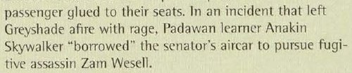

## scan p.20 (scan page 20)

Page contents: Spot-On Locator; Merr-Sonn R-88 Suppressor Riot Rifle; For the GM: Adventures - A Night at the Opera, Panic in the Plaza (Reina March, Edge-9) (hand-read)

## scan p.21 (scan page 21)

Page contents: Adventures: Panic in the Plaza (cont.), Murder at the Heights (Ocka Dwei, bafforr pollen), Unhooked Skyhook (Archa Sabis), The Price of Fame, A Capital Dogfight (Air Marshal Cargeloch), Always a Bigger Fish (hand-read)

## scan p.22 (scan page 22)

Page contents: Adventures: Always a Bigger Fish (opee sea killer), Something in the Water (Edge-9 pipeline bombers), Lost and Lost (Shasheva Astopone's ring) (hand-read)

## scan p.23 (scan page 23)

Page contents: Down in the Dregs adventures: Deeper and Deeper (taozin), Every Droid Has Its Day (Archa Sabis), A Whole New World (Master Shaper Gengi Tung), Mayhem at 2,000 Meters (Beuga Odell), Love Ortolan Style (Sleta Suke, Trunks Bibo), Late Shift at Dex's begins (hand-read)

## scan p.24 (scan page 24)

Page contents: Late Shift at Dex's (Dexter Jettster vs Beuga Odell's thugs, Zip Beeline); Powerhouse (Grungeon factories); Unearthing Evil (Cell of Imu, Jedi Humat, soul stealer); Troglodyte Terror (Elbee Bribb, Volven Roxe, Cthons); Stratt Catchers (hand-read)

## scan p.25 (scan page 25)

Page contents: Stratt Catchers (cont.); Allies and Antagonists: Calder Brya (Noble 5) stats; Trey Duna, mayor of Imperial City (Diplomat 11/Noble 3) stats (hand-read)

### Stat block notes (game mechanics, not feats)

- Calder Brya stat block: Calder Brya: Male Human Noble 5; Init +1; Defense 15 (+1 Dex, +4 class); Spd 10 m; VP/WP 22/10; Atk +3 melee (1d3, punch) or +4 ranged (3d4, sporting blaster); SQ bonus class skill (Gather Information), coordinate +1, favor +2, inspire confidence, resource access; SV Fort +1, Ref +4, Will +4; SZ M; FP 1; DSP 0; Rep +5; Str 10, Code C. (Source: *Coruscant and the Core Worlds* (SWRPG d20 Revised Core), scan p.25)
- Trey Duna stat block: Trey Duna: Male Human Diplomat 11/Noble 3; Init +0; Defense 14 (+4 class); Spd 10 m; VP/WP 10/93 Atk +7/+2 melee (1d3, punch) or +7/+2 ranged (3d4, hold-out blaster); SQ bonus class skill (Bluff), favor +2, inspire confidence, resource access; SV Fort +5, Ref +5, Will +14; SZ M; FP 0; DSP 0; Rep +6; Str 10, Dex 10, Con 9, Int 16, Wis 12, Cha 17. Challenge Code D. (Source: *Coruscant and the Core Worlds* (SWRPG d20 Revised Core), scan p.25)

## scan p.26 (scan page 26)

Page contents: Trey Duna skills/feats; Shasheva Astopone (Rebel agent recruited by Bail Organa, Noble 5) stats; Major Potiphar Migg (ISB, Soldier 5/Noble 2) stats; Quetemoor (Mugaari crime lord, Noble 2/Soldier 4/Crime Lord 8) stats (hand-read)

### Stat block notes (game mechanics, not feats)

- Shasheva Astopone stat block: Shasheva Astopone: Female Human Noble 5; Init +1; Defense 15 (+1 Dex, +4 class); Spd 10 m; VP/WP. 15/10; Atk +3 melee (1d3, punch) or +4 ranged; SQ bonus class skill (Bluff), coordinate +1, favor +2, inspire confidence, resource access; SV Fort +1, Ref +4, Will +7; SZ M; FP 0; DSP 0; Rep +2; Str 10, Dex 12, Con 10, Int 11, Wis 12, Cha 15. Challenge Code C. (Source: *Coruscant and the Core Worlds* (SWRPG d20 Revised Core), scan p.26)
- Major Potiphar Migg stat block: Major Potiphar Migg: Male Human Soldier 5/Noble 2; Init +5 (+1 Dex, +4 Improved Initiative); Defense 17 (+1 Dex, +6 class); Spd 10 m; VP/WP 38/12; Atk +6/+1 melee (1d3, punch) or +7/+2 ranged (3d6, blaster pistol); SQ bonus class skill (Gather Information), favor +1, inspire confidence, ocular implants; SV Fort +7, Ref +4, Will +6; SZ M; FP. 0; DSP 0; Rep +2; Str 10, Dex 12, Con 12, Int 12, Wis 10, Cha 14. Challenge Code D. (Source: *Coruscant and the Core Worlds* (SWRPG d20 Revised Core), scan p.26)
- Quetemoor stat block: Quetemoor: Male Mugaari Noble 2/Soldier 4/Crime Lord 8; Init +3 (-1 Dex, +4 Improved Initiative); Defense 18 (-1 Dex, +9 class); Spd 10 m; VP/WP 71/14; Atk +12/+7 melee (1d3+3, punch) or +8/43 ranged (3d6, blaster pistol); SQ bonus class skill (Bluff), contacts (3), exceptional minions, favor +1, inspire confidence, inspire (Source: *Coruscant and the Core Worlds* (SWRPG d20 Revised Core), scan p.26)

## scan p.27 (scan page 27)

Page contents: Quetemoor equipment/feats; New Species: Mugaari; Beuga Odell (crime boss, Scoundrel 4/Noble 2/Crime Lord 5); Volven Roxe (Shistavanen spice lord, Scoundrel 7) (hand-read)

- **Hero of Tython**: "Roxe also owns several nightclubs, including the Outlander, which has made him a target for rival gangsters who periodically try to put "the wolfman" in his place." Source: *Coruscant and the Core Worlds* (SWRPG d20 Revised Core), scan p.27
  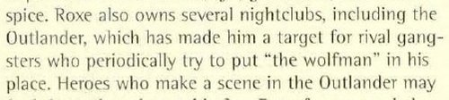

### Stat block notes (game mechanics, not feats)

- Beuga Odell stat block: Beuga Odell: Female Human Scoundrel 4/Noble 2/Crime Lord 5; Init -1; Defense 16 (-1 Dex, +7 class); Spd 10 m; VP/WP 29/9; Atk +5/+0 melee (1d3-1, punch) or +5/+0 ranged (3d6, blaster pistol); SQ bonus class skill (Bluff), contacts (2), favor +1, illicit barter, inspire confidence, inspire fear —2, lucky (1/day), minions, precise attack +1, resource access; SV Fort +1, Ref +8, Will +11; SZ M; FP 1; DSP 6; Rep +12; Str 8, Dex 8, Con 9, Int 15, Wis 13, Cha 16. Challenge Code E. (Source: *Coruscant and the Core Worlds* (SWRPG d20 Revised Core), scan p.27)
- Volven Roxe stat block: Valven Roxe: Male Shistavanen Scoundrel 7; Init 4-6 (+2 Dex, +4 Improved Initiative); Defense 17 (+2 Dex, +5 class); Spd 10 m; VP/WP 27/10; Atk +5 melee (13, punch) or +7 ranged (3d8, heavy blaster pistol); SQ illicit barter, low-light vision, lucky (2/day), precise attack +1, xenophobia; SV Fort +2, Ref +7, Will +3; SZ M; FP 2; DSP 4; Rep +2; Str 10, Dex 15, Con 10, Int 11, Wis 12, Cha 13. Challenge Code D. (Source: *Coruscant and the Core Worlds* (SWRPG d20 Revised Core), scan p.27)

## scan p.28 (scan page 28)

Page contents: Mal Coramma (Black Sun envoy; Xizor's death, allied with Savan) stats; Mazumoda (Worrite) stats; Archa Sabis (mad cyborg industrialist) (hand-read)

### Stat block notes (game mechanics, not feats)

- Mal Coramma stat block: Mal Coramma: Male Chagrian Scoundrel 1/Noble 4; Init +0; Defense 13 (+3 class); Spd ranged (3d6, blaster pistol); SQ amphibious, bonus class skill (Gather Information), coordinate +1, favor +2, illicit barter, inspire confidence, low-light vision, radiation resistance, resource access; SV Fort +1, Ref +4, Will +8; SZ M; FP 0; DSP 1; Rep +2; Str 10, Dex 10, Con 11, Int 15, Wis 15, Cha 12. Challenge Code C. (Source: *Coruscant and the Core Worlds* (SWRPG d20 Revised Core), scan p.28)
- Mazumoda stat block: Mazumoda: Male Worrite ARCHA SABIS (Source: *Coruscant and the Core Worlds* (SWRPG d20 Revised Core), scan p.28)
- Archa Sabis stat block: Archa Sabis: Male Human Noble 10/Expert 7; Init +6 (+2 Dex, +4 Improved Initiative); Defense 23 (+2 Dex, +6 class, +5 natural cyborg parts); Spd 10 m; VP/WP 45/10; Atk +15/+10/+5 melee (1d4+3, punch) or +15/+10/+5 (Source: *Coruscant and the Core Worlds* (SWRPG d20 Revised Core), scan p.28)

## scan p.29 (scan page 29)

Page contents: Jeseej (Sljee Expert 8/Force Adept 2) stats; New Species: Sljee; Nibber Swoo (Rybet air taxi pilot) (hand-read)

### Stat block notes (game mechanics, not feats)

- Jeseej stat block: Jdeseaj: Male Sijee Expert 8/Force Adept 2; Init -2; Defense 13 (~2 Dex, +1 size, +4 class); Spd 4 m; VP/WP 7/10; Atk +7/+2 melee (1d2-1, tentacle slap) or +6/+1 ranged; SQ blindness, scent; SV Fort +6, Ref +2, Will +14; SZ S; FP 2; DSP 0; Rep +2; Str 8, Dex 6, Con 10, Int 15, Wis 16, Cha 10. Challenge Code C. (Source: *Coruscant and the Core Worlds* (SWRPG d20 Revised Core), scan p.29)
- Nibber Swoo stat block: Nibber Swoo: Male Rybet Expert 3/Scoundrel 1; Init +2; Defense 14 (+2 Dex, +1 size, +1 class); Spd @ m, swim 6 m; VP/WP 6/10; Atk +2 melee (1d2-1, punch) or +5 ranged (3d4, hold-out blaster); SQ amphibious, illicit barter; SV Fort +1, Ref +7, Will +4; SZ S; FP 0; DSP 0; Rep +0; Str 8, Dex 14, Con 10, Int 10, Wis 13, Cha 10. Challenge Code B. (Source: *Coruscant and the Core Worlds* (SWRPG d20 Revised Core), scan p.29)

## scan p.30 (scan page 30)

Page contents: Lieutenant Ia (Coruscant Security, Soldier 4) stats; Zip Beeline (outlaw racer) stats; Dexter Jettster begins (hand-read)

### Stat block notes (game mechanics, not feats)

- Lieutenant Ia stat block: Lieutenant la; Female Human Soldier 4; Init +6 (+2 Dex, +4 Improved Initiative); Defense 16 (42 Dex, +4 class); Spd 10 m; VP/WP. 22/11; Atk +4 melee (1d3, punch) or +6 ranged (3d6, blaster pistol); SV Fort +4, Ref +5, Con 11, Int 15, Wis 11, Cha 10. Challenge Code C. (Source: *Coruscant and the Core Worlds* (SWRPG d20 Revised Core), scan p.30)
- Zip Beeline stat block: Zip Beeline: Male Drall Fringer 5; Init +2; Defense 18 (+2 Dex, +1 size, +5 class); Spd 6 m; VP/WP. 20/10; Atk +3 melee (1d2-1, punch) or +6 ranged; SQ barter, bonus class skill (Read/Write Basic, Repair), jury-rig +2, survival +2; SV Fort +4, Ref +5, Will +2; SZ S; FP 0; DSP 0; Rep +4; Str 8, Dex 15, Con 10, Int 10, Wis 12, Cha 12. Challenge Code C. (Source: *Coruscant and the Core Worlds* (SWRPG d20 Revised Core), scan p.30)

## scan p.31 (scan page 31)

Page contents: Dexter Jettster (Besalisk Scoundrel 6; identified Kaminoan saberdart for Obi-Wan Kenobi) stats; Anniha Nega (bounty hunter) stats; Trunks Bibo (Ortolan Lost Ones leader) stats (hand-read)

- **Dexter Jettster; Obi-Wan Kenobi** — entry/section: Dexter identifies the saberdart: "His old friend Obi-Wan Kenobi brought him a poisoned Kaminoan saberdart, and Jettster's identification of the artifact touched off a chain of events that led to the start of the Clone Wars." Source: *Coruscant and the Core Worlds* (SWRPG d20 Revised Core), scan p.31
  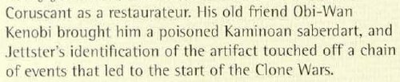

### Stat block notes (game mechanics, not feats)

- Dexter Jettster stat block: Dexter Jettster: Male Besalisk Scoundrel 6; Init +3 (—1 Dex, +4 Improved Initiative); Defense 13 (-1 Dex, +4 class); Spd 10 m; VP/WP 36/14; Atk +6 melee (1d3+2, punch) or +6 melee (1d4+2, knife) or +3 ranged (3d8, heavy blaster pistol); SQ +2 species bonus to coldweather Survival checks, illicit barter, lucky 2/day, precise attack +1; SV Fort +4, Ref +4, Will +3; SZ M; FP 3; DSP 2; Rep +1; Str 14, Dex 9, Con 14, Int 13, Wis 12, Cha 13. Challenge Code D. (Source: *Coruscant and the Core Worlds* (SWRPG d20 Revised Core), scan p.31)
- Anniha Nega stat block: Anniha Nega: Male Human Soldier 7/Bounty Hunter 3; Init +6 (+2 Dex, +4 Improved Initiative); Defense 20 (Source: *Coruscant and the Core Worlds* (SWRPG d20 Revised Core), scan p.31)

## scan p.32 (scan page 32)

Page contents: Murble and Fierce (Fringer with pet bursa) stats; Lexia Ginorra (fallen Jedi Guardian 5/Dark Side Marauder 3) stats; Zesi Phinx (ancient killer, Scoundrel 8/Force Adept 4) (hand-read)

- **Lexia Ginorra** — entry/section: Lexia Ginorra slaughters her kidnappers: "Fearing for her life, and convinced in a moment of panic that the morality of the Jedi Code was a hindrance that could kill her, Ginorra slaughtered her kidnappers in an explosion of rage, then disappeared into the jungles of Kamparas." Source: *Coruscant and the Core Worlds* (SWRPG d20 Revised Core), scan p.32
  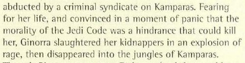

### Stat block notes (game mechanics, not feats)

- Trunks Bibo stat block: Trunks Bibo: Male Ortolan Fringer 5; Init +0; Defense 16 (+1 size, +5 class); Spd 6 m; VP/WP 29/12; Atk +4 melee (1d2+1, punch) or +3 ranged (3d4, hold-out blaster); SQ barter, bonus class skills (Intimidate, Move Silently), forager, intestinal fortitude, jury-rig +2, keen smell, survival +2; SV Fort +5, Ref +3, Will +2; SZ S; FP 0; (Source: *Coruscant and the Core Worlds* (SWRPG d20 Revised Core), scan p.32)
- Murble stat block: Murble: Male Human Fringer 3; Init +0; Defense 14 punch) or +2 melee (2d6, vibroblade) or +2 ranged; SQ barter, bonus class skill (Entertain), jury-rig +2; SV Fort +2, Ref +2, Will +2; SZ M; FP 1; DSP 0; Rep +0; Str 10, Dex 10, Con 9, Int 11, Wis 13, Cha 9. Challenge Code C. (Source: *Coruscant and the Core Worlds* (SWRPG d20 Revised Core), scan p.32)
- Lexia Ginorra stat block: Lexia Ginorra: Female Human Jedi Guardian 5/Dark Side Marauder 3; Init +7 (+3 Dex, +4 Improved Intitiative); Defense 20 (+3 Dex, +7 class); Spd 10 m; VP/WP 47/12; Atk +10/+5 melee (3d8+1/19-20, lightsaber) or +9/+-4 melee (1d3+1, punch) or +11/+6 ranged (3d8, heavy blaster pistol) or +11/+6 ranged (3d8/ 19-20, blaster rifle); SQ deflect (attack -4, defense +1), increase lightsaber damage +1d8, tainted; SV Fort +8, Ref +9, Will +6; SZ M; FP 3; DSP 7; Rep +3; Str 13, Dex 16, Con 12, Int 10, Wis 12, Cha 13. Challenge Code D. (Source: *Coruscant and the Core Worlds* (SWRPG d20 Revised Core), scan p.32)

## scan p.33 (scan page 33)

Page contents: Zesi Phinx stats; Ra-Zyrth (Naga Sadow's alchemically mutated Sith commander) stats; Reina March (Edge-9 anarchist) stats (hand-read)

- **Zesi Phinx** — entry/section: Zesi Phinx's millennia of murders: "If the evidence is to be believed, Phinx has survived on the capital planet for millennia and is responsible for murders numbering in the hundreds of thousands." Source: *Coruscant and the Core Worlds* (SWRPG d20 Revised Core), scan p.33
  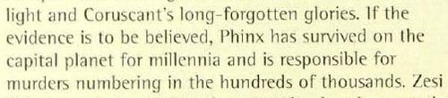
- **Ra-Zyrth; Naga Sadow** — entry/section: Naga Sadow transforms his commanders: "Before the Sith invasion, Naga Sadow summoned his top commanders, including Ra- Zyrth, and used dark side alchemy to transform them into muscular monstrosities." Source: *Coruscant and the Core Worlds* (SWRPG d20 Revised Core), scan p.33
  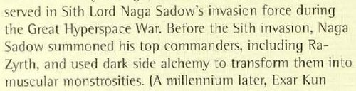
- **Ra-Zyrth** — entry/section: Ra-Zyrth fights the Jedi: "Some say Ra-Zyrth awoke immediately and fought Coruscant's Jedi defenders to the death." Source: *Coruscant and the Core Worlds* (SWRPG d20 Revised Core), scan p.33
  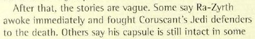

### Stat block notes (game mechanics, not feats)

- Zesi Phinx stat block: Zesi Phinx: Female Anzati Scoundrel 8/Force Adept 4; Init +2; Defense 19 (+2 Dex, +7 class); Spd 10 m; VP/WP 52/12; Atk +12/+7 melee (1d4+3, punch) or +11/+6 ranged; SQ hypnotism, illicit barter, lucky 2/day, precise attack +1, proboscises; SV Fort +5, Ref +10, Will +7; Int 15, Wis 13, Cha 11. Challenge Code F. (Source: *Coruscant and the Core Worlds* (SWRPG d20 Revised Core), scan p.33)
- Ra-Zyrth stat block: Ra-Zyrth: Male Mutated Sith (Massassi) Thug 5/Soldier 3; Init +6 (+2 Dex, +4 Improved Initiative); Defense 21 (+2 Dex, +3 class, +6 natural); DR 5; Spd 10 m; VP/WP 35/23; Atk +13/+8 melee (1d8+5, sword) or +10/+5 ranged (3d4, Sith lanvarok); SQ warrior culture, natural armor; SV Fort +12, Ref +4, Will +1; SZ M; FP 0; DSP 0; Rep +2; Str 20, Dex 14, Con 20, Int 8, Wis 8, Cha 6. Challenge Code C. (Source: *Coruscant and the Core Worlds* (SWRPG d20 Revised Core), scan p.33)
- Reina March stat block: Reina March: Female Human Scoundrel 10; Init +3; Defense 19 (+3 Dex, +6 class); Spd 10 m; VP/WP 36/10; Atk +7/+2 melee (2d4/19-20, punch) or +7/+2 melee (2d6, vibroblade) or +10/+5 ranged (3d8, heavy blaster pistol); SQ illicit barter, lucky 2/day, precise attack +2; SV Fort +3, Ref +10, Will +3; SZ M; FP 0; DSP 0; Rep +2; Str 10, Dex 16, Con 10, Int 12, Wis 10, Cha 12. Challenge Code E. (Source: *Coruscant and the Core Worlds* (SWRPG d20 Revised Core), scan p.33)

## scan p.34 (scan page 34)

Page contents: Senator Canny Mandary Bertar (Mrlssi Noble 9) stats; Air Marshal Cargeloch (destroyed a rebellious city with four TIE bombers) stats; Tuchap (Farghul) begins (hand-read)

- **Air Marshal Cargeloch** — entry/section: Cargeloch's four TIE bombers: "He earned his rank by blasting a rebellious city to rubble with only four TIE bombers." Source: *Coruscant and the Core Worlds* (SWRPG d20 Revised Core), scan p.34
  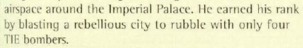

### Stat block notes (game mechanics, not feats)

- Senator Canny Mandary Bertar stat block: Canny Mandary Bertar: Female Mrlssi Noble 9; Init +4 (+4 Improved Initiative); Defense 16 (+1 size, +5 class); Spd 6 m; VP/WP 39/9; Atk +7/+2 melee (1d3, claw) or +7/+2 ranged; SQ bonus class skill (Bluff), coordinate +2, favor +3, inspire confidence, resource access; SV Fort +2, Ref +4, Will +10; SZ S; FP 4; DSP 1; Rep +8; Str 10, Dex 10, Con 9, Int 15, Wis 15, Cha 15. Challenge Code D. (Source: *Coruscant and the Core Worlds* (SWRPG d20 Revised Core), scan p.34)
- Air Marshal Cargeloch stat block: Air Marshal Cargeloch: Male Human Soldier 7/Noble 1/ Officer 3; Init +5 (+1 Dex, +4 Improved Initiative); Defense 19 (+1 Dex, +8 class); Spd 10 m; VP/WP 60/12; Atk +10/+5 melee (1d3+1, punch) or +10/+5 (3d6, blaster pistol); SQ bonus class skill (Gather Information), favor +1, leadership, requisition supplies; SV Fort +8, Ref +8, Will +8; SZ M; FP 2; DSP 6; Rep +8; Str 13, Dex 13, Con 12, Int 15, Wis 11, Cha 13. Challenge Code E. (Source: *Coruscant and the Core Worlds* (SWRPG d20 Revised Core), scan p.34)
- Ocka Dwei stat block: Ocka Dwei: Male Yuuzhan Vong Scout 11; Init +1; Defense 18 (+1 Dex, +7 class); Spd 10 m; VP/WP 72/14; Atk +10/+5 melee (1d3+2, punch) or +10/+5 melee (1d642, coufee) or +9/+4 ranged (2d6, thud bug); SQ biotechnology, evasion, extreme effort, Force absence, heart +2, skill mastery (Bluff, Spot), technophobia, trailblazing, uncanny dodge (can’t be flanked, Dex bonus to Defense); SV Fort +7, Ref +6, Will +4; SZ M; FP 0; DSP 2; Rep +3; Str 14, Dex 12, Con 14, Int 13, Wis 8, Cha 10. Challenge Code E. (Source: *Coruscant and the Core Worlds* (SWRPG d20 Revised Core), scan p.34)

## scan p.35 (scan page 35)

Page contents: Tuchap stats; Master Shaper Gengi Tung (Yuuzhan Vong) stats; Ocka Dwei (Yuuzhan Vong scout) stats; New Creature: Gartro (hand-read)

### Stat block notes (game mechanics, not feats)

- Tuchap stat block: Tuchap: Male Farghul Scoundrel 5; Init +1; Defense 15 (+1 Dex, +4 class); Spd 10 m; VP/WP 19/9; Atk +2 melee (1d3-1, punch) or +4 ranged (3d6, blaster pistol); SQ illicit barter, lucky 1/day, precise attack +1, prehensile tail; SV Fort +0, Ref +5, Will +2; SZ M; FP 0; DSP 2; Rep +1; Str 8, Dex 12, Con 9, Int 14, Wis 10, Cha 12. Challenge Code C. (Source: *Coruscant and the Core Worlds* (SWRPG d20 Revised Core), scan p.35)
- Gengi Tung stat block: Gengi Tung: Male Yuuzhan Vong Expert 10/Noble 8; Init +5 (+1 Dex, +4 Improved Initiative); Defense 17 (+1 Dex, +6 class); Spd 10 m; VP/WP. 34/10; Atk +13/+8/+3 melee (1d3, punch) or +13/+8/+3 melee (1d6, tsaisi) or +14]/+9/+4 ranged; SQ biotechnology, bonus class skill (Intimidate), coordinate +2, favor +3, Force absence, inspire confidence, resource access, technophobia; SV Fort +5, Ref +8, Will +14; SZ M; FP 0; DSP 8; Rep +5; Str 10, Dex 12, Con 10, Int 17, Wis 12, Cha 15. Challenge Code F. (Source: *Coruscant and the Core Worlds* (SWRPG d20 Revised Core), scan p.35)

## scan p.36 (scan page 36)

Page contents: New Creatures: Cthon, Stratt, Umrach; New Droids: Construction Droid, ASP Series labor droid stats (hand-read)

## scan p.37 (scan page 37)

Page contents: Abregado-rae planet stats; Description; History (Thrawn's campaign seizes region bordering Abregado-rae; offensive collapsed at Bilbringi) (hand-read)

- **Grand Admiral Thrawn** — entry/section: Thrawn's campaign near Abregado-rae: "During Grand Admiral Thrawn's campaign, Imperial forces seized a region of space bordering Abregado-rae. It appeared as though Thrawn might capture the world and advance on Coruscant with a twin-pincer tactic through the galactic northern and southern quadrants. His offensive collapsed at Bilbringi." Source: *Coruscant and the Core Worlds* (SWRPG d20 Revised Core), scan p.37
  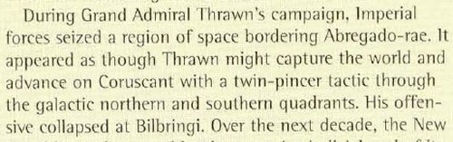

## scan p.38 (scan page 38)

Page contents: Abregado-rae People; Locations: Abregado-rae Spaceport (hand-read)

## scan p.39 (scan page 39)

Page contents: Gilt Gushers; Gados Floatboat stats; For the GM: Mercy Mission (hand-read)

## scan p.40 (scan page 40)

Page contents: Topple the Tundei adventure; Trarr and Shelov stats; New Species: Moocher (hand-read)

### Stat block notes (game mechanics, not feats)

- Trarr stat block: Trarr: Male Gados Scoundrel 6; Init +2; Defense 16 (+2 Dex, +4 class); Spd 12 m; VP/WP 18/8; Atk +4 melee (1d3, punch) or +6 ranged (3d6, blaster pistol); SQ illicit barter, lucky 2/day, precise attack +1; SV Fort +1, Ref +7, Will +1; SZ M; FP 1; DSP 1; Rep +1; Str 11, Dex 14, Con 8, Int 10, Wis 9, Cha 12. Challenge Code D. (Source: *Coruscant and the Core Worlds* (SWRPG d20 Revised Core), scan p.40)
- Shelov stat block: Shelov: Male Herglic Diplomat 10/Soldier 6; Init +3 (—1 Dex, +4 Improved Initiative); Defense 16 (-1 Dex, -1 size, +6 class, +2 natural); Spd 8 m; VP/WP 50/15; Atk +12/+7 melee (1d4+2, punch) or +9/+4/-1 ranged (3d6, blaster pistol); SQ gambling addiction; SV Fort +11, Dex 8, Con 12, Int 12, Wis 10, Cha 12. Challenge Code E. (Source: *Coruscant and the Core Worlds* (SWRPG d20 Revised Core), scan p.40)

## scan p.41 (scan page 41)

Page contents: Moochers (Queen Moocher stats); Alderaan planet stats and Description (hand-read)

### Stat block notes (game mechanics, not feats)

- Queen Moocher stat block: Queen Moocher: Female Moocher Fringer 12; Init +5 (+1 Dex, +4 Improved Initiative); Defense 19 (+1 Dex, +8 class); Spd 10 m; VP/WP 48/7; Atk +8/+3 melee (1d3-1, punch) or +10/+5 ranged; SQ barter, blindsight 80 m, jury-tig +6, prehensile tail, survival +4; SV Fort +5, Ref +7, Will +4; SZ M; FP 1; DSP. 0; Rep +0; Str 8, Dex 13, Con 7, Int 11, Wis 11, Cha 9. Challenge Code D. (Source: *Coruscant and the Core Worlds* (SWRPG d20 Revised Core), scan p.41)

## scan p.42 (scan page 42)

Page contents: Alderaan History (Grand Moff Tarkin orders Alderaan as Death Star's first test; Bail Organa's tip saves Mon Mothma); People (hand-read)

- **Grand Moff Tarkin** — entry/section: Tarkin destroys Alderaan: "Grand Moff Tarkin ordered that Alderaan would be the first test of the Death Star's weaponry. In a single, searing blast, all the beauty, culture, and majesty that was Alderaan vanished in a heartbeat." Source: *Coruscant and the Core Worlds* (SWRPG d20 Revised Core), scan p.42
  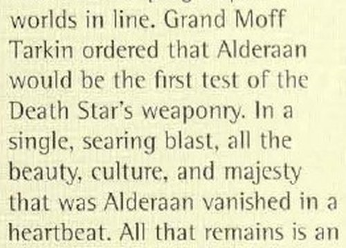
- **Bail Organa; Mon Mothma** — entry/section: Bail Organa saves Mon Mothma: "For instance, a tip from Bail Organa saved future Rebel leader Mon Mothma from Imperial capture." Source: *Coruscant and the Core Worlds* (SWRPG d20 Revised Core), scan p.42
  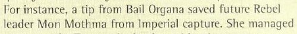

## scan p.43 (scan page 43)

Page contents: Alderaan Locations: Crevasse City and map (hand-read)

## scan p.44 (scan page 44)

Page contents: Aldera; The Killik Mounds; The Graveyard (story planted by Empire to lure Princess Leia); For the GM (hand-read)

- **Leia Organa Solo** — entry/section: Graveyard trap for Leia: "This was eventually found to be a story planted by the Empire to lure Princess Leia and her allies to the Graveyard and capture them." Source: *Coruscant and the Core Worlds* (SWRPG d20 Revised Core), scan p.44
  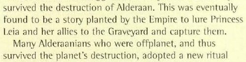

## scan p.45 (scan page 45)

Page contents: Adventures: Codename: Restoration; Allies and Antagonists: Lorac Nonnaihr stats; Shadowcloak (hand-read)

### Stat block notes (game mechanics, not feats)

- Lorac Nonnaihr stat block: Lorac Nonnaihr: Male Human Scoundrel 5/Noble 4; Init +2; Defense 17 (+2 Dex, +5 class); Spd 10 m; VP/WP 63/12; Atk +7/+2 melee (1d3+1, punch) or +8/+3 ranged (3d6, blaster pistol); SQ bonus class skill (Bluff), coordinate +1, favor +2, illicit barter, inspire confidence, lucky \/day, precise attack +1, resource access; SV Fort +3, Code E. (Source: *Coruscant and the Core Worlds* (SWRPG d20 Revised Core), scan p.45)

## scan p.46 (scan page 46)

Page contents: Shadowcloak item stats; Milessa Kand stats (Nature Affinity feat) (hand-read)

### Stat block notes (game mechanics, not feats)

- Milessa Kand stat block: Milessa Kand: Female Human Force Adept 6; Init +1; Defense 16 (+1 Dex, +5 class); Spd 10 m; VP/WP. 30/10; Atk +4 melee (1d3, punch) or +4 melee (1d6/1d6, quarterstaff) or +5 ranged; SQ Force weapon +1d8; SV Fort +5, Ref +4, Will +10; SZ M; FP 10; DSP 0; Rep +1; Str 10, Dex 13, Con 10, Int 15, Wis 20, Cha 20. Challenge Code D. (Source: *Coruscant and the Core Worlds* (SWRPG d20 Revised Core), scan p.46)

## scan p.47 (scan page 47)

Page contents: Christoph Jam stats; New Creature: Thranta; Anaxes planet stats and Description (hand-read)

### Stat block notes (game mechanics, not feats)

- Christoph Jam stat block: Christoph Jam: Male Human Noble 9; Init +1; SQ bonus class skill (Bluff), coordinate +2, favor +3, inspire confidence, resource access; SV Fort +4, Ref +5, Will +12; SZ M; FP 5; DSP 0; Rep +5; Str 14, Dex 12, Con 12, Int 18, Wis 17, Cha 23. Challenge Code D. (Source: *Coruscant and the Core Worlds* (SWRPG d20 Revised Core), scan p.47)

## scan p.48 (scan page 48)

Page contents: Anaxes History (Anaxes Citadel built seven centuries before Palpatine, Imperial Center Oversector "Sector Zero", Azure Hammer Command, Grand Admiral Osvald Teshik, Osted Wermis); People (Holts, Ozzels, Trommers, Jerjerrods); Anaxes Citadel begins (hand-read)

## scan p.49 (scan page 49)

Page contents: Grand Piazza of Anaxes Citadel map; Sirpar Hills; Pols Anaxes; Anaxes Groundcoach and Pols Anaxes Airspeeder stats (hand-read)

## scan p.50 (scan page 50)

Page contents: For the GM: At the Heart of the Citadel (Admiral Arhul Holt defects, Pash Galae), The Needle in the Nerfsteaks, Anaxes Masquerade (Yuuzhan Vong impersonate General Jodd Zarfane); Pash Galae (Scoundrel 4/Tech Specialist 6) stats (hand-read)

### Stat block notes (game mechanics, not feats)

- Pash Galae stat block: Pash Galae: Male Human Scoundrel 4/Tech Specialist 6; Init +2; Defense 17 (+2 Dex, +5 class); Spd 10 m; VP/WP 27/9; Atk +6/+1 melee (1d3-1, punch or +9/+4 ranged (3d6, blaster pistol); SQ expert (Craft [electronic devices]), illicit barter, instant mastery (Search), lucky //day, precise attack +1, research, tech specialty (computer specialist +1); SV Fort +2, Ref +9, Will +5; SZ M; FP 0; DSP 0; Rep +2; Str 8, Dex 14, Con 9, Int 16, Wis 13, Cha 12. Challenge Code E. (Source: *Coruscant and the Core Worlds* (SWRPG d20 Revised Core), scan p.50)

## scan p.51 (scan page 51)

Page contents: Arhul Holt (Noble 6/Officer 10) stats; Hilas Bannock (Imperial Intelligence, Scoundrel 6) stats; New Creature: Keffi (hand-read)

### Stat block notes (game mechanics, not feats)

- Arhul Holt stat block: Arhul Holt: Male Human Noble 6/Officer 10; Init +0; Defense 19 (+9 class); Spd 10 m; VP/WP 97/13; Atk +11/+6/+1 melee (1d3, punch) or +11/+6/+1 ranged (3d6, blaster pistol); SQ bonus class skill (Bluff), coordinate +1, favor +2, improved tactics, inspire confidence, leadership, requisition supplies, resource access, uncanny survival; SV Fort +8, Ref +8, Will +14; SZ M; FP 0; DSP 0; Rep +9; Str 11, Dex 10, Con 13, Int 14, Wis 14, Cha 16. Challenge Code G. (Source: *Coruscant and the Core Worlds* (SWRPG d20 Revised Core), scan p.51)
- Hilas Bannock stat block: Hilas Bannock; Male Human Scoundrel 6; Init +2; Defense 16 (+2 Dex, +4 class); Spd 10 m; VP/WP 23/14; Atk 45 melee (stun DC 15, stun baton) or +5 melee (1d3+1, punch) or +6 ranged (3d4, hold-out blaster); SQ illicit barter, lucky 2/day, precise attack +1; SV Fort +4, Ref +7, Will +4; SZ M; FP 3; DSP 0; Rep +1; Str 12, Dex 14, Con 14, Int 13, Wis 14, Cha 10. Challenge Code D. (Source: *Coruscant and the Core Worlds* (SWRPG d20 Revised Core), scan p.51)

## scan p.52 (scan page 52)

Page contents: Belgaroth planet stats; Description; History (Belgar Overlord and Roth Skimm, Imperial weapons-testing world); People (hand-read)

## scan p.53 (scan page 53)

Page contents: Belgarian philosophy (ABH, WYS); Locations: Upside dockyard, Belgar, Xot's Megabar, The Scrapyard (hand-read)

## scan p.54 (scan page 54)

Page contents: For the GM adventures: An Unexpected Stop (superweapon tests), A-Hunting We Will Go (droidbreaker), Let's Pick through Garbage!; Lieutenant Brivyl Goss begins; Belgar spaceport map (hand-read)

## scan p.55 (scan page 55)

Page contents: Lieutenant Brivyl Goss (Soldier 4/Noble 1/Officer 2) stats; New Creature: Droidbreaker (hand-read)

### Stat block notes (game mechanics, not feats)

- Lieutenant Brivyl Goss stat block: Lieutenant Brivyl Goss: Male Human Soldier 4/Noble 1/Officer 2; Init +1; Defense 17 (+1 Dex, +6 class); Spd 10 m; VP/WP. 33/10; Atk +6 melee (1d3+1, punch) or +6 ranged (3d6, blaster pistol); SQ bonus class skill (Gather Information), favor +1, leadership; SV Fort +6, Ref +5, Will +4; SZ M; FP 1; DSP 0; Rep +3; Str 12, Dex 13, Con 10, Int 10, Wis 9, Cha 13. Challenge Code D. (Source: *Coruscant and the Core Worlds* (SWRPG d20 Revised Core), scan p.55)

## scan p.56 (scan page 56)

Page contents: Brentaal planet stats; Description; History (Perlemian/Hydian junction, Battle of Brentaal); People (hand-read)

## scan p.57 (scan page 57)

Page contents: Brentaal culture; Locations: Trade Hall (Cormond), Alfex Cargo Stacks (Black Sun front), Favis Resort, HoloNet Relay Station; Cargo Container Loader begins (hand-read)

## scan p.58 (scan page 58)

Page contents: Travis Motors Starlifter stats; For the GM: HoloNet Down, Stacked Deck (Surl, Dania) (hand-read)

## scan p.59 (scan page 59)

Page contents: Stacked Deck (cont.); Sun Storm (House Okeefe vs Black Sun, Fellion); Surl (ISB, Scoundrel 4/Soldier 2) stats; Barthos Okeefe (Noble 4) stats; Fellion begins (hand-read)

### Stat block notes (game mechanics, not feats)

- Surl stat block: Surl: Male Human Scoundrel 4/Soldier 2; Init +1; Defense 15 (+1 Dex, +4 class); Spd 10 m; VP/WP 30/12; Atk +6 melee (1d3+1, punch) or +6 ranged (3d8, heavy blaster pistol); SQ illicit barter, lucky 1/day, precise attack +1; SV Fort +5, Ref +5, Will +0; SZ M; FP 0; DSP 0; Rep +2; Str 12, Dex 13, Con 12, Int 14, Wis 9, Cha 16. Challenge Code D. (Source: *Coruscant and the Core Worlds* (SWRPG d20 Revised Core), scan p.59)
- Barthos Okeefe stat block: Barthos Okeefe: Male Human Noble 4; Init -1; Defense 12 (-1 Dex, +3 class); Spd 10 m; VP/WP 17/12; Atk +5 melee (1d3+2, punch) or +5 melee (1d4+2, knife) or +2 ranged (3d6, blaster pistol); SQ coordinate +1, favor +2, inspire confidence, bonus class skill (Survival), resource access; SV Fort +2, Ref +1, Will +5; SZ M; FP 0; DSP 0; Rep +2; Str 14, Dex 9, Con 12, Int 10, Wis 13, Cha 15. Challenge Code C. (Source: *Coruscant and the Core Worlds* (SWRPG d20 Revised Core), scan p.59)

## scan p.60 (scan page 60)

Page contents: Fellion (Black Sun enforcer, Soldier 7) stats; New Creature: Kundril; Caamas planet stats; Description; History (Palpatine secretly engineered destruction of Caamas with Bothan operatives) (hand-read)

- **Palpatine (Darth Sidious)** — entry/section: Palpatine engineers the destruction of Caamas: "In truth, Palpatine secretly engineered the destruction of Caamas with assistance from Bothan operatives." Source: *Coruscant and the Core Worlds* (SWRPG d20 Revised Core), scan p.60
  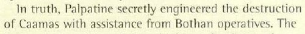

### Stat block notes (game mechanics, not feats)

- Fellion stat block: Fellian: Female Human Soldier 7; Init +3; Defense 19 (+3 Dex, +6 class); Spd 10 m; VP/WP 43/11; Atk +10/+5 melee (1d4+3, punch) or +10/+5 ranged (3d6, blaster pistol) or +10/+5 ranged (3d8/19-20, blaster rifle) or +10/+5 ranged (3d6/stun DC 15, ion gun) or +10/+5 ranged (4d6+1, frag grenade); SV Fort +5, Ref +5, (Source: *Coruscant and the Core Worlds* (SWRPG d20 Revised Core), scan p.60)
