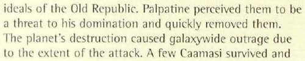
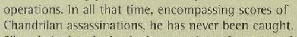
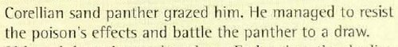
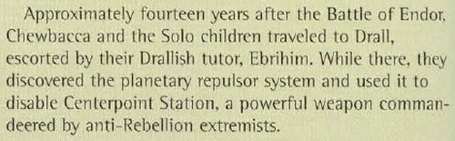
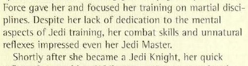
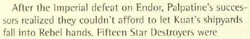
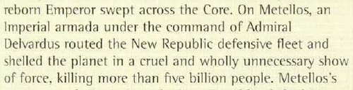
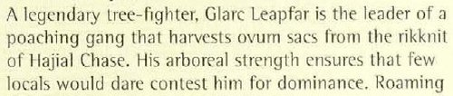

# Owner Material 037 — Star Wars D20 Drive folder (Core, Revised Core and Saga Edition): Sourcebooks/Coruscant and the Core Worlds.pdf [Star Wars Roleplaying Game Revised Core (d20, 2002)] (scan pages 61–120)

- **Source:** Wizards of the Coast Star Wars Roleplaying Game books, web enhancements, Living Force campaign modules and articles (2000–2010), from the owner's "Star Wars D20" Drive folder (only the three edition subfolders; "General" was not read, as instructed). Secondary source (licensed Legends reference). Scan OCR'd on the box; the scan stays box-only and is **not** published.
- **Method:** every scanned page was OCR'd and machine-screened sentence by sentence for power-relevant statements (fights, kills, defeats, Force feats, rankings, superweapons) that name a character on our roster; each kept sentence is quoted verbatim from the OCR text and has a crop of the printed passage directly under it. Pages with nothing power-relevant are still listed with what is on them.
- **Citation:** "*Coruscant and the Core Worlds* (SWRPG d20 Revised Core), p.X" by printed page ("scan p.X" where no printed number applies). **Weight:** Licensed RPG material: a secondary source. Narrative text sums up Legends lore; game statistics are rules for players, not canon power levels, and rank lowest.

## scan p.61 (scan page 61)

Page contents: Caamas History (cont.), People (memnii); Locations: Refuge City (Elek D'cel), Bothan Debris Inc. (Kursk Te'tell), Alien Jungle (hand-read)

- **Palpatine (Darth Sidious)**: "Palpatine perceived them to be a threat to his domination and quickly removed them. lhe planet's destruction caused galaxywide outrage due to the extent of the attack." Source: *Coruscant and the Core Worlds* (SWRPG d20 Revised Core), scan p.61
  

## scan p.62 (scan page 62)

Page contents: Alien jungle (crashed Ithorian herdship); Ruined Jedi Temple; Shield Generator Stations; For the GM: Exploration (Ish'tay), Verifying the Document (Caamas Document) (hand-read)

## scan p.63 (scan page 63)

Page contents: Station #14 map; The Missing Scientist; Ish'tay (Ithorian Force Adept 5) stats (hand-read)

### Stat block notes (game mechanics, not feats)

- Ish'tay stat block: Ish'tay: Male Ithorian Force Adept 5; Init -1; Defense 14 (—1 Dex, +5 class); Spd 10 m; VP/WP 31/12; Atk +3 melee (1d3, punch) or +3 melee (1d6/1d6, quarterstaff) or Con 12, Int 14, Wis 16, Cha 18. Challenge Code C. (Source: *Coruscant and the Core Worlds* (SWRPG d20 Revised Core), scan p.63)

## scan p.64 (scan page 64)

Page contents: Ish'tay feats; Tosk-tar'ilya (insane Bothan saboteur, Scout 8/Scoundrel 6) stats; Elek D'cel (Caamasi Diplomat 6/Noble 3) stats; memory sharing (hand-read)

### Stat block notes (game mechanics, not feats)

- Tosk-tar'ilya stat block: Tosk-tar'ilya: Male Bothan Scout 8/Scoundrel 6; Init +5; Defense 22 (+5 Dex, +7 class); Spd 10 m; VP/WP. 62/10; Atk +11/+6 melee (1d4+1, punch) or +11/+6 melee (1d4+1, knife) or +11/+6 melee (1d6+1, metal pipe) or +15/+10 ranged (3d4, hold-out blaster); SOQ evasion, extreme effort, heart +1, illicit barter, lucky 2/day, precise attack +1, skill mastery (Computer Use), trailblazing, uncanny dodge (can’t be flanked, Dex bonus to Defense); SV Fort +6, Ref +14, Will +7; SZ M; FP 0; DSP 0; Rep +1; Str 13, Dex 21, Con 10, Int 14, Wis 13, Cha 14. Challenge Code F,. (Source: *Coruscant and the Core Worlds* (SWRPG d20 Revised Core), scan p.64)
- Elek D'cel stat block: Elek D'cel: Male Caamasi Diplomat 6/Noble 3; Init +0; Defense 13 (+3 class); Spd 10 m; VP/WP 10/8; Atk +4 melee or +5 ranged; SQ memory sharing, gentle reputation, bonus class skill (Bluff), favor +2, inspire confidence, resource (Source: *Coruscant and the Core Worlds* (SWRPG d20 Revised Core), scan p.64)

## scan p.65 (scan page 65)

Page contents: New Creatures: Mutated Behemoth, Thornsniper Plant; Chandrila planet stats and Description (hand-read)

## scan p.66 (scan page 66)

Page contents: Chandrila History (Mon Mothma, Bail Organa, Canna Omonda executed, Moff Seerdon blockade, Sate Pestage blockade, Ysanne Isard); People (Gerald Weizel) (hand-read)

## scan p.67 (scan page 67)

Page contents: Chandrilans (Admiral Drayson, Sera Faleur, Gavin Darklighter); Locations: Hanna, Brionelle Academy and Imperial Garrison, Hanna Wild Game Reserve; Datadagger (hand-read)

## scan p.68 (scan page 68)

Page contents: For the GM: Poison Politics (Jovive Centi, Tristan Pex, Ratambo Gale), The Hunt Is On, Vilthar's Goodbye; Jovive Centi (Diplomat 7) stats; Tristan Pex (Soldier 7/Bounty Hunter 4) begins (hand-read)

### Stat block notes (game mechanics, not feats)

- Jovive Centi stat block: Jovive Centi: Female Human Diplomat 7; Init +0; Defense 12 (+2 class); Spd 10 m; VP/WP 0/10; Atk +2 melee (1d3-1, punch) or +3 ranged; SV Fort +2, Ref +2, Will +8; SZ M; FP 2; DSP 0; Rep +5; Str 9, Dex 10, Con 10, Int 15, Wis 12, Cha 14. Challenge Code B. (Source: *Coruscant and the Core Worlds* (SWRPG d20 Revised Core), scan p.68)
- Tristan Pex stat block: Tristan Pex: Male Human Soldier 7/Bounty Hunter 4; Init +6 (+2 Dex, +4 Improved Initiative); Defense 20 (+2 Dex, +8 class); Spd 10 m; VP/WP 76/12; (Source: *Coruscant and the Core Worlds* (SWRPG d20 Revised Core), scan p.68)

## scan p.69 (scan page 69)

Page contents: Tristan Pex stats (cont.); Ratambo Gale (Malkite Poisoner, Scoundrel 5/Soldier 9) stats; New Creatures: Squall, Cairnmog (hand-read)

- **Ratambo Gale** — entry/section: Ratambo Gale never caught: "In all that time, encompassing scores of Chandrilan assassinations, he has never been caught." Source: *Coruscant and the Core Worlds* (SWRPG d20 Revised Core), scan p.69
  

### Stat block notes (game mechanics, not feats)

- Ratambo Gale stat block: Ratambo Gale: Male Human Scoundrel 5/Soldier 9; Con 11, Int 15, Wis 12, Cha 12. Challenge Code F. (Source: *Coruscant and the Core Worlds* (SWRPG d20 Revised Core), scan p.69)

## scan p.70 (scan page 70)

Page contents: Cairnmog stats; Corellia planet stats; Description (Five Brothers, Centerpoint, CDF, CorSec); History begins (hand-read)

## scan p.71 (scan page 71)

Page contents: Corellia History (Moff Fliry Vorru betrayed by Prince Xizor, second Corellian Treaty, Diktat, Thrackan Sal-Solo thwarted by Solo family); People (hand-read)

## scan p.72 (scan page 72)

Page contents: Corellian drink; Locations: Coronet (Blue Sector, Treasure Ship Row), Gold Beaches, CEC Shipyards (Millennium Falcon a modified YT-1300) (hand-read)

## scan p.73 (scan page 73)

Page contents: CEC shipyards; Groola's Place and map; For the GM: Such a Deal! (Groola), The Wreck of Boolarg begins (hand-read)

## scan p.74 (scan page 74)

Page contents: The Wreck of Boolarg (Gaber Rollobad); Unfriendly Competition (KDY recruiting); Eryk Kroogar "Talonscar" (Scoundrel 6) stats; Gilflyn begins (hand-read)

- **Eryk Kroogar** — entry/section: Kroogar battles the panther: "He managed to resist the poison's effects and battle the panther to a draw." Source: *Coruscant and the Core Worlds* (SWRPG d20 Revised Core), scan p.74
  

### Stat block notes (game mechanics, not feats)

- Eryk Kroogar stat block: Eryk Kroogar: Male Human Scoundrel 6; Init +2; Defense 16 (+2 Dex, +4 class}; Spd 10 m; VP/WP 43/14; Atk +5 melee (1d3+1, punch) or +6 ranged (3d6, blaster pistol); SQ illicit barter, lucky 2/day, precise attack +1; SV Fort +4, Ref +7, Will +2; SZ M; FP 2; DSP 0; Rep +1; Str 12, Dex 14, Con 14, Int 12, Wis 10, Cha 14. Challenge Code D. (Source: *Coruscant and the Core Worlds* (SWRPG d20 Revised Core), scan p.74)

## scan p.75 (scan page 75)

Page contents: Gilflyn (Dark Jedi hero hunter, Jedi Guardian 8) stats; Groola the Hutt begins (hand-read)

### Stat block notes (game mechanics, not feats)

- Gilflyn stat block: Gilflyn: Male Human Jedi : Guardian 8; Init +10 (+6 . Dex, +4 Improved <= » ) Initiative); Defense 22 (+6 Dex, +6 class); Spd 10 m; VP/WP 86/14; Atk +14/+9 melee (3d8+3/19-20, lightsaber) or +11/+6 melee (1d3+3, punch) or +14/+9 ranged (3d6, blaster pistol); SQ deflect (attack —4, defense +1, extend defense and attack), increase lightsaber damage +1d8; SV Fort +8, Ref +12, Will +6; SZ M; FP 10; DSP 12; Rep +2; Str 16, Dex 22, Con 14, Int 16, Wis 15, Cha 17. Challenge Code E. (Source: *Coruscant and the Core Worlds* (SWRPG d20 Revised Core), scan p.75)

## scan p.76 (scan page 76)

Page contents: Groola (Hutt Scoundrel 4/Noble 2/Crime Lord 7) stats; New Creature: Spukamas; Corulag planet stats and Description (hand-read)

### Stat block notes (game mechanics, not feats)

- Groola stat block: Groola: Hutt Scoundrel 4/Noble 2/Crime Lord 7; Init +3 (-1 Dex, +4 Improved Initiative); Defense 16 (-1 Dex, -1 size, +8 class); Spd 2 m; VP/WP 100/22; Atk +12/+7 melee (1d4+6, punch) or +5/+0 ranged; SQ bonus class skill (Bluff), can't be knocked prone, contacts (3), favor +1, Force resistance (+6 species bonus on Will saves against Force skills and Force feats.), illicit barter, inspire confidence, inspire fear -4, lucky 1/day, minions, precise attack +1, resource access; SV Fort +9, Ref +9, Will +12; SZ L; FP 5; DSP 5; Rep +12; Str 22, Dex 8, Con 22, Int 12, Wis 14, Cha 16. Challenge Code F. (Source: *Coruscant and the Core Worlds* (SWRPG d20 Revised Core), scan p.76)

## scan p.77 (scan page 77)

Page contents: Corulag History, People; Locations: Imperial Academy, Sienar Advanced Research Division (hand-read)

## scan p.78 (scan page 78)

Page contents: Abersaith Aviary; Crullov City; TIE/Ad Defender Prototype begins; Sienar facility map (hand-read)

## scan p.79 (scan page 79)

Page contents: TIE/Ad x7 prototype stats; For the GM: Strike Breakers (Zafiel Snopps, Reni Wajetta), Escaping the Birdcage (Haris Causus, Colonel Hadis Ato), TIE Acquisition; Colonel Hadis Ato begins (hand-read)

## scan p.80 (scan page 80)

Page contents: Colonel Hadis Ato (Soldier 6/Noble 1/Officer 2) stats; Reni Wajetta (Scoundrel 4) stats; Zafiel Snopps (Noble 15) stats; New Creature: Bulfus (hand-read)

### Stat block notes (game mechanics, not feats)

- Colonel Hadis Ato stat block: Colonel Hadis Ato: Male Human Soldier 6/Noble 1/ Officer 2; Init +3; Defense 20 (+3 Dex, +7 class); Spd Con 10, Int 12, Wis 11, Cha 14. Challenge Code E. (Source: *Coruscant and the Core Worlds* (SWRPG d20 Revised Core), scan p.80)
- Reni Wajetta stat block: Reni Wajetta: Male Human Scoundrel 4; Init +2; Defense 15 (+2 Dex, +3 class); Spd 10 m; VP/WP. 18/16; Atk +3 melee (1d3, punch) or +5 ranged (3d6, blaster pistol); SQ illicit barter, lucky 1/day, precise attack +1; (Source: *Coruscant and the Core Worlds* (SWRPG d20 Revised Core), scan p.80)
- Zafiel Snopps stat block: Zafiel Snopps: Male Human Noble 15; Init +1; Defense 19 (+1 Dex, +8 class); Spd 10 m; VP/WP 76/11; Atk +12/+7/+2 melee (1d3+1, punch) or +12/+7/+2 ranged (3d6, blaster pistol); SQ bonus class skill (Gather Information), coordinate +3, favor +4, inspire confidence, inspire greatness, resource access; SV Fort +5, Ref +8, Will +11; SZ M; FP 0; DSP 0; Rep +9; Str 12, Dex 13, Con 11, Int 15, Wis 10, Cha 18. Challenge Code F. (Source: *Coruscant and the Core Worlds* (SWRPG d20 Revised Core), scan p.80)

## scan p.81 (scan page 81)

Page contents: Drall planet stats; Description; History (Chewbacca and the Solo children use planetary repulsor to disable Centerpoint Station); People (hand-read)

- **Chewbacca; Jacen Solo (Darth Caedus); Jaina Solo; Anakin Solo** — entry/section: Disabling Centerpoint from Drall: "Approximately fourteen years after the Battle of Endor, Chewbacca and the Solo children traveled to Drall, escorted by their Drallish tutor, Ebrihim. While there, they discovered the planetary repulsor system and used it to disable Centerpoint Station, a powerful weapon commandeered by anti-Rebellion extremists." Source: *Coruscant and the Core Worlds* (SWRPG d20 Revised Core), scan p.81
  

## scan p.82 (scan page 82)

Page contents: Drall (Duchesses, Wingriders); Locations: Caverns of Drall, Boiling Sea, Luminous Gardens (Drusa), Meccha; Flashstick, Dim Goggles (hand-read)

## scan p.83 (scan page 83)

Page contents: Meloria's island map; Vitapill; For the GM: Locating Meloria, Information Gathering (hand-read)

## scan p.84 (scan page 84)

Page contents: Information Gathering (cont.); Duchess Sarella (Drall Noble 4) stats; Wingrider Elamm (Drall Scout 9) stats; Meloria (fallen Jedi) begins (hand-read)

- **Meloria** — entry/section: Meloria's combat skills: "Despite her lack of dedication to the mental aspects of Jedi training, her combat skills and unnatural reflexes impressed even her Jedi Master." Source: *Coruscant and the Core Worlds* (SWRPG d20 Revised Core), scan p.84
  

### Stat block notes (game mechanics, not feats)

- Duchess Sarella stat block: Duchess Sarella: Female Drall Noble 4; Init -1; Defense 13 (-1 Dex, +1 size, +3 class); Spd 6 m; VP/WP 18/11; Atk +3 melee (1d2—1, punch) or +3 ranged; SQ bonus class skill (Gather Information), coordinate +1, favor +2, inspire confidence, resource access; SV Fort +1, Ref +1, Will +7; SZ S; FP 1; DSP 0; Rep +2; Str 8, Dex 8, Con 11, Int 19, Wis 17, Cha 17. Challenge Code B. (Source: *Coruscant and the Core Worlds* (SWRPG d20 Revised Core), scan p.84)
- Wingrider Elamm stat block: Wingrider Elamm: Male Drall Scout 9; Init +3; Defense 20 (+3 Dex, +1 size, +6 class); Spd 6 m; VP/WP 36/9; Atk +8/+3 melee (1d4+1 plus blindness, flashstick) or +8/+3 melee (1d2+1, punch) or +6/+1 ranged (1d4, sling); SQ evasion, extreme effort, heart +1, skill mastery (Handle Animal), trailblazing, uncanny dodge (can't be flanked, Dex bonus to Defense); SV Fort +4, Ref +7, Will +5; SZ S; FP 0; DSP 0; Rep +2; Str 12, Dex 16, Con 9, Int 15, Wis 13, Cha 18. Challenge Code D. (Source: *Coruscant and the Core Worlds* (SWRPG d20 Revised Core), scan p.84)

## scan p.85 (scan page 85)

Page contents: Meloria (Jedi Guardian 7/Scout 7, cryogenically frozen) stats; New Creature: Ibbot (great ibbot, flame ibbot) (hand-read)

### Stat block notes (game mechanics, not feats)

- Meloria stat block: Meloria: Female Human Jedi Guardian 7/Scout 7; Init +7 (+3 Dex, +4 Improved Initiative); Defense 22 (+3 Dex, +9 class); Spd 10 m; VP/WP. 111/16; (3d8+2/ 19-20, lightsaber) or +14/+9/+4 melee (1d3+2, punch) or +15/+10/+5 ranged; SQ deflect (attack -4, defense +1, extend defense and attack), evasion, extreme effort, heart +1, increase lightsaber damage +1d8, skill mastery (Computer Use), trailblazing, uncanny dodge (can’t be flanked, Dex bonus to Defense); SV Fort +12, Ref +14, Will +8; SZ M; FP 0; Rep +4; Str 14, Dex 16, Con 16, Int 12, Wis 11, Cha 14. Challenge Code F. (Source: *Coruscant and the Core Worlds* (SWRPG d20 Revised Core), scan p.85)

## scan p.86 (scan page 86)

Page contents: Duro planet stats; Description; History (Queen Rana, Duchess Geneer, Imperial Reprogramming Institute) (hand-read)

## scan p.87 (scan page 87)

Page contents: Duro History (Yuuzhan Vong crash orbital cities); People; Locations: Bburru Station, Event Horizon (Clawfish), Duro Starshipwright Shipyards (hand-read)

## scan p.88 (scan page 88)

Page contents: Event Horizon map; Duro Delta Twelve Orbital Shipyard; New Creature: Mutant Fefze Beetle; For the GM (hand-read)

## scan p.89 (scan page 89)

Page contents: Adventures: All the Admiral's Men (Admiral Cov, Kadlo Talisman), Murder, Imported (SELCORE); Formmn Badees begins; DD12 map (hand-read)

## scan p.90 (scan page 90)

Page contents: Formmn Badees (Duros Fringer 4) stats; Clawfish (Quarren outlaw tech, Scoundrel 8) stats; Til "Crunch" (Kubaz Diplomat 4) stats (hand-read)

### Stat block notes (game mechanics, not feats)

- Formmn Badees stat block: Formm Badees: Male Duros Fringer 4; Init +3; Defense 17 (+3 Dex, +4 class); Spd 10 m; VP/WP. 19/10; Atk +3 melee (1d3, punch) or +2 (3d6, blaster pistol); SQ barter, bonus class skill (Appraise, Computer Use), jury-rig +2; SV Fort +4, Ref +5, Will +1; SZ M; FP 1; DSP 0; Rep +0; Str 10, Dex 17, Con 10, Int 13, Wis 11, Cha 11. Challenge Code B. (Source: *Coruscant and the Core Worlds* (SWRPG d20 Revised Core), scan p.90)
- Clawfish stat block: Clawfish: Male Quarren Scoundrel 8; Init +0; Defense 15 (+5 class); Spd 10 m; VP/WP 33/17; Atk +8/+3 melee (id3+2, punch) or +8/+3 melee (2d6+2, vibroblade) or +6/+1 ranged (3d6, blaster pistol); SQ breathe underwater, illicit barter, low-light vision, lucky 2/day, precise (Source: *Coruscant and the Core Worlds* (SWRPG d20 Revised Core), scan p.90)
- Til (Crunch) stat block: Til (a.k.a. Crunch): Male Kubaz Diplomat 4; Init +1; Defense 12 (+1 Dex, +1 class); Spd 10 m; VP/WP 0/15; Atk +3 melee (1d3+1, punch) or +3 ranged (3d8, heavy blaster pistol); SQ light sensitive; SV Fort +3, Ref +2, Will +5; SZ M; FP 1; DSP 2; Rep +1; Str 13, Dex 12, Con 15, Int 14, Wis 12, Cha 13. Challenge Code A. (Source: *Coruscant and the Core Worlds* (SWRPG d20 Revised Core), scan p.90)

## scan p.91 (scan page 91)

Page contents: Til feats; DDF E-Wing and DDF Dagger-D stats; Esseles planet stats; Description; History begins (hand-read)

## scan p.92 (scan page 92)

Page contents: Esseles History (Esselian empire, New Order party); People; Locations: Calamar, Terril Naval Base (hand-read)

## scan p.93 (scan page 93)

Page contents: Esprix Estate map and description (Esseles spynet); Togatto Speedway (Ferlani family); Fort Cravus (assassin droids); New Feats: Bureaucratic Flair, Headstrong, High Culture, Living History (hand-read)

## scan p.94 (scan page 94)

Page contents: For the GM: Going Gangbusters (Luthus Ferlani), A Taxing Party (Moff Graffe, Deena Mipps), The Esseles Bombers (Garthus Hal); Garthus Hal (Scoundrel 5/Soldier 4) stats; Deena Mipps begins (hand-read)

### Stat block notes (game mechanics, not feats)

- Garthus Hal stat block: Garthus Hal: Male Human Scoundrel 5/Soldier 4; Init +2; Defense 18 (+2 Dex, +6 class); Spd 10 m; VP/WP 52/12; Atk +7/+2 melee (1d3, punch) or +7/+2 melee (2d6, vibroblade) or +9/+4 ranged (3d8, heavy blaster pistol) or +9/+4 ranged (8d6+6, thermal detonator); SQ illicit barter, lucky 1/day, precise attack +1; SV Fort +8, Ref +7, Will +1; SZ M; FP 0; DSP 0; Rep +2; Str 11, Dex 15, Con 12, Int 15, Wis 8, Cha 14. Challenge Code E. (Source: *Coruscant and the Core Worlds* (SWRPG d20 Revised Core), scan p.94)
- Deena Mipps stat block: Deena Mipps: Female Human Noble 4/Scout 1; Init +3: Defense 16 (+3 Dex, +3 class); Spd 10 m; VP/WP 20/12; Atk +3 melee (1d3, punch) or -1 melee (2d6, vibroblade) (Source: *Coruscant and the Core Worlds* (SWRPG d20 Revised Core), scan p.94)

## scan p.95 (scan page 95)

Page contents: Deena Mipps (Noble 4/Scout 1) stats; Luthus Ferlani (Scoundrel 6/Noble 4/Crime Lord 2) stats; Chiba DR-10 protocol droid stats (hand-read)

### Stat block notes (game mechanics, not feats)

- Luthus Ferlani stat block: Luthus Ferlani: Male Human Scoundrel 6/Noble 4/Crime Lord 2; Init +4 (+4 Improved Initiative); Defense 17 (+7 class); Spd 10 m; VP/WP 42/12; Atk +7/+2 melee (1d3-1, punch) or +7/+2 melee (2d6-1, vibroblade) or +8/+3 ranged (3d4, hold-out blaster); SQ bonus class skill (Gather Information), contact (1), coordinate +1, favor +2, illicit barter, inspire confidence, lucky 2/day, precise attack +1, resource access; SV Fort +4, Ref +9, Will +12; SZ M; FP 0; DSP 5; Rep +8; Str 9, Dex 11, Con 12, Int 15, Wis 14, Cha 17. Challenge Code F. (Source: *Coruscant and the Core Worlds* (SWRPG d20 Revised Core), scan p.95)

## scan p.96 (scan page 96)

Page contents: Fresia planet stats; Description; History (Incom, Z-95, X-wing defection raid, Bespin Motors, FreiTek) (hand-read)

## scan p.97 (scan page 97)

Page contents: Fresia People; Locations: Coromon Islands (Colonel Garr), Cerise Fog Debris Field (hand-read)

## scan p.98 (scan page 98)

Page contents: Coromon Islands map; Incom I-7 Howlrunner stats; For the GM: The X-Drone Dump (hand-read)

## scan p.99 (scan page 99)

Page contents: Toe to Toe; Colonel Faltun Garr (Soldier 14) stats; Riun Riev (Sullustan engineer) stats (hand-read)

### Stat block notes (game mechanics, not feats)

- Colonel Faltun Garr stat block: Colonel Faltun Garr: Male Human Soldier 14; Init +1; Defense 22 (+1 Dex, +9 class, +2 Defensive Martial Arts); Spd 10 m; VP/WP 77/12; Atk +16/+11/+6 melee (1d4+2, punch) or +15/+10/+5 ranged (3d6, blaster pistol); SV Fort +10, Ref +5, Will +8; SZ M; FP 1; DSP 2; Rep +4; Str 14, Dex 13, Con 12, Int 16, Wis 15, Cha 10. Challenge Code F. (Source: *Coruscant and the Core Worlds* (SWRPG d20 Revised Core), scan p.99)
- Riun Riev stat block: Riun Riev: Male Sullustan Expert 12; Init +1; Defense 15 (+1 Dex, +4 class); Spd 10 m; VP/WP 44/10; Atk +9/+4 melee (1d3, punch) or +10/+5 ranged (3d8/19-20, blaster carbine); SQ darkvision 20 m; SV Fort +4, Ref +5, Will +8; SZ M; FP 0; DSP 0; Rep +6; Str 11, Dex 13, Con 10, Int 16, Wis 10, Cha 9. Challenge Code D. (stat lines recovered by full-page re-OCR of p99) (Source: *Coruscant and the Core Worlds* (SWRPG d20 Revised Core), scan p.99)

## scan p.100 (scan page 100)

Page contents: Scay Danson (industrial saboteur, Scoundrel 8) stats; New Creature: Coromon Headhunter (hand-read)

### Stat block notes (game mechanics, not feats)

- Scay Danson stat block: Scay Danson: Male Human Scoundrel 8; Init +7 (43 Dex, +4 Improved Initiative); Defense 18 (+3 Dex, +5 class); Spd 10 m; VP/WP 28/10; Atk +6/+1 melee (1d3, punch) or +6/+1 melee (2d4, vibrodagger) or +9/+4 ranged (3d6/stun DC 15, ion pistol); SQ illicit barter, lucky 2/day, precise attack +1; SV Fort +2, Ref +9, Will +2; SZ M; Wis 11, Cha 17, Challenge Code D. (Source: *Coruscant and the Core Worlds* (SWRPG d20 Revised Core), scan p.100)

## scan p.101 (scan page 101)

Page contents: Galantos planet stats; Description; History (Fia, Yevetha Great Purge, Plat Mallar, Jobath Knox petitions Leia Organa Solo) (hand-read)

## scan p.102 (scan page 102)

Page contents: Galantos History (cont.); People (Fia, Gods of Age); Locations: Gal'fian'deprisi; map (hand-read)

## scan p.103 (scan page 103)

Page contents: Net'lseb Toli Park; Black Hammer Pirate Base; Vert'bo Airship stats; For the GM: Gelquake!, Hammer into Anvil, Restoration (hand-read)

## scan p.104 (scan page 104)

Page contents: Jobath Knox (Fia Soldier 1/Noble 4) stats; Brabe (Fia Fringer 4) stats; Stima Ardella (Trandoshan pirate, Scoundrel 14) stats (hand-read)

- **Stima Ardella** — entry/section: Stima Ardella's twin disruptors: "She is a dead shot with her twin disruptor pistols." Source: *Coruscant and the Core Worlds* (SWRPG d20 Revised Core), scan p.104
  

### Stat block notes (game mechanics, not feats)

- Jobath Knox stat block: Jobath Knox: Male Fia Soldier 1/Noble 4; Init +0; Defense 14 (+4 class); Spd 8 m; VP/WP 37/12; Atk +3 melee (1d3-1, punch) or +4 ranged; SQ bonus class skill (Treat Injury), coordinate +1, favor +2, inspire confidence, resource access, surefooted; SV Fort +4, Ref +2, Will +5; SZ M; FP 4; DSP 0; Rep +23 Str 8, Dex 10, Con 12, Int 14, Wis 13, Cha 14. Challenge Code C. (Source: *Coruscant and the Core Worlds* (SWRPG d20 Revised Core), scan p.104)
- Brabe stat block: Brabe: Male Fia Fringer 4; Init +0; Defense 14 (+4 class); Spd 8 m; VP/WP 28/14; Atk +4 melee (1d3+1, punch) or +3 ranged (3d6, blaster pistol); SQ barter, bonus class skill (Balance, Tumble), jury-rig +2, surefooted; SV Fort +6, Ref +2, Will +2; SZ M; FP 0; DSP 0; Rep +0; Str 12, Dex 11, Con 14, Int 10, Wis 12, Cha 10. Challenge Code C. (Source: *Coruscant and the Core Worlds* (SWRPG d20 Revised Core), scan p.104)
- Stima Ardella stat block: Stima Ardella: Female Trandoshan Scoundrel 14; Init +6 (+2 Dex, +4 Improved Initiative); Defense 21 (42 Dex, +8 class, +1 natural); Spd 10 m; VP/WP 55/11; Atk +12/+7 melee (1d3+2, punch) or +12/+7 melee (2d6+2, vibroblade) or +12/+7 ranged (3d8+6, custom disruptor pistol); SQ darkvision 20 m, illicit barter, lucky 3/day, precise attack +3; SV Fort +4, Ref +11, Will +4; SZ M; FP 2; DSP 8; Rep +3; Str 14, Dex 15, Con 11, Int 10, Wis 10, Cha 13. Challenge Code F. (Source: *Coruscant and the Core Worlds* (SWRPG d20 Revised Core), scan p.104)

## scan p.105 (scan page 105)

Page contents: Stima Ardella feats; New Species: Fia; New Creature: Skree-skater; Kuat planet stats; Description; History begins (hand-read)

## scan p.106 (scan page 106)

Page contents: Kuat History (KDY, Lusankya, Slave I Firespray template, Eclipse-class); People (telbuns); Locations: Kuati Space Stations (hand-read)

- **Palpatine (Darth Sidious)**: "After the Imperial defeat on Endor, Palpatine's successors realized they couldn't afford to let Kuat's shipyards fall into Rebel hands." Source: *Coruscant and the Core Worlds* (SWRPG d20 Revised Core), scan p.106
  

## scan p.107 (scan page 107)

Page contents: Kuat City; Kuat Drive Yards map; For the GM: A Plague on Both Your Houses (Trondor Pyn), X Marcus the Spot begins (hand-read)

## scan p.108 (scan page 108)

Page contents: X Marcus the Spot (Lucius Rothingham); Upper Echelons (House Andrim, House Depon); Marcus Sione "The Wizard" begins (hand-read)

## scan p.109 (scan page 109)

Page contents: Marcus Sione stats; Beekly Grimlok (Rodian technological assassin, Fringer 4/Expert 2) stats; Lucius Rothingham begins (hand-read)

### Stat block notes (game mechanics, not feats)

- Beekly Grimlok stat block: Beekly Grimlok: Male Rodian Fringer 4/Expert 2; Init +4; Defense 16 (+4 Dex, +2 class); Spd 10 m3; VP/WP 52/14; Atk +9 melee (1d3+5, punch) or +4 ranged (3d8/19-20, blaster carbine) or +8 ranged (3d8, heavy blaster pistol); SQ barter, bonus class skill (Demolitions, Disable Device), jury-rig +2; SV Fort +6, Ref +6, Will +4; SZ M; FP 0; DSP 1; Rep +0; Str 20, Dex 18, Con 14, Int 16, Wis 10, Cha 10. (Source: *Coruscant and the Core Worlds* (SWRPG d20 Revised Core), scan p.109)
- Marcus Sione stat block: Marcus Sione: Male Human Expert 10; Init +2; Defense 15 (+2 Dex, +3 class); Spd 10 m; VP/WP 0/125 Atk +7/+2 melee (1d3, punch) or +9/+4 ranged; SV Fort +4, Ref +5, Will +6; SZ M; FP 0; DSP 0; Rep +5; Str 10, Dex 15, Con 12, Int 18, Wis 9, Cha 10. Challenge Code C. (stat lines recovered by full-page re-OCR of p109; "0/125" as OCR'd, likely 0/12;) (Source: *Coruscant and the Core Worlds* (SWRPG d20 Revised Core), scan p.109)

## scan p.110 (scan page 110)

Page contents: Lucius Rothingham (Expert 4/Scoundrel 4) stats; Captain Anton Kale (Soldier 4/Noble 1/Officer 3) stats; KDY-4 Series Tech Droid stats (hand-read)

### Stat block notes (game mechanics, not feats)

- Lucius Rothingham stat block: Lucius Rothingham: Male Human Expert 4/Scoundrel 4; Init +2; Defense 16 (+2 Dex, +4 class); Spd 10 m; VP/WP. 35/18; Atk +8 melee (1d3+2, punch) or +8 ranged (3d6, blaster pistol); SQ illicit barter, lucky 1/day, precise (Source: *Coruscant and the Core Worlds* (SWRPG d20 Revised Core), scan p.110)
- Captain Anton Kale stat block: Captain Anton Kale: Male Human Soldier 4/Noble 1/Officer 3; Init +5 (+1 Dex, +4 Improved Initiative); Defense 17 (+1 Dex, +6 class); Spd 10 m; VP/WP 70/14; Atk +8/+3 melee (1d3+2, punch) or +7/+2 ranged (3d6, blaster pistol); SQ bonus class skill (Intimidate), favor +1, leadership, requisition supplies; SV Fort +8, Ref +5, (Source: *Coruscant and the Core Worlds* (SWRPG d20 Revised Core), scan p.110)

## scan p.111 (scan page 111)

Page contents: Metellos planet stats; Description; History begins (hand-read)

## scan p.112 (scan page 112)

Page contents: Metellos History (floating cities, Admiral Delvardus shells Metellos killing five billion); People (gentry, groundpounders); Locations: Moridebo District, Stratablock 7 (hand-read)

- **Admiral Delvardus** — entry/section: Delvardus shells Metellos: "On Metellos, an Imperial armada under the command of Admiral Delvardus routed the New Republic defensive fleet and shelled the planet in a cruel and wholly unnecessary show of force, killing more than five billion people." Source: *Coruscant and the Core Worlds* (SWRPG d20 Revised Core), scan p.112
  

## scan p.113 (scan page 113)

Page contents: Stratablock 7 map; Ciuray Sea and the Hellwell; For the GM: Early Retirement (Hynla, Rinn Renado), Race to the Prize (Lowal Pulse); Hynla (Chadra-Fan Diplomat 7) stats (hand-read)

### Stat block notes (game mechanics, not feats)

- Hynla stat block: Hynla: Male Chadra-Fan Diplomat 7; Init +2; Defense 15 (+2 Dex, +1 size, +2 class); Spd 6 m; VP/WP 0/10; Atk +3 melee (1d2-1, punch) or +6 ranged (3d6, blaster pistol); SQ darkvision 20 m, isolation aversion, low-light vision; (Source: *Coruscant and the Core Worlds* (SWRPG d20 Revised Core), scan p.113)

## scan p.114 (scan page 114)

Page contents: Hynla equipment; Lowal Pulse (Scoundrel 6/Thug 7) stats; Rinn Renado (Scoundrel 17) stats; New Creature: Steep (hand-read)

### Stat block notes (game mechanics, not feats)

- Lowal Pulse stat block: Lowal Pulse: Male Human Scoundrel 6/Thug 7; Init +4 (+4 Improved Initiative); Defense 14 (+4 class); Spd 10 m; VP/WP 40/15; Atk +13/+8/+3 melee (1d3+2, punch) or +13/+8/+3 melee (2d6+2, vibroblade) or +11/+6/+1 ranged (3d8, heavy blaster pistol); SQ illicit barter, lucky 2/day, precise attack +1; SV Fort +8, Ref +7, Will +3; SZ M; FP 0; DSP 2; Rep +2; Str 15,Dex 11, -*& Con 12, Int 10, Wis 9, Cha 10. Challenge Code E. (Source: *Coruscant and the Core Worlds* (SWRPG d20 Revised Core), scan p.114)
- Rinn Renado stat block: Rinn Renada: Male Human Scoundrel 17; Init +6 (+2 Dex, +4 Improved Initiative); Defense 22 (+2 Dex, +10 class); Spd 10 m; VP/WP 68/10; Atk +14/+9/+4 melee (1d3+2, punch) or +14/+9/+4 melee (2d4+2, vibrodagger) or +14/+9/+4 ranged (3d8/19-20, blaster carbine); SQ illicit barter, lucky 3/day, precise attack +3; SV Fort +5, Ref +12, Will +6; SZ M; FP 0; DSP 3; Rep +4; Str 14, Dex 14, Con 10, Int 12, Wis 11, Cha 15. Challenge Code G. (Source: *Coruscant and the Core Worlds* (SWRPG d20 Revised Core), scan p.114)

## scan p.115 (scan page 115)

Page contents: New Plympto planet stats; Description; History (ji rikknit, General Fefar Blackeye, Yuuzhan Vong plague); People (Nosaurians) (hand-read)

## scan p.116 (scan page 116)

Page contents: Nosaurian clans; Locations: Phemiss, Hajial Chase, Karsten Moon, Rikknit Harvest (hand-read)

## scan p.117 (scan page 117)

Page contents: Tree-claw and harvest blade; New Feat: Brachiation; Phemiss map; For the GM: High above the Hajial (Glarc Leapfar, Xant Flashheel) (hand-read)

## scan p.118 (scan page 118)

Page contents: Showdown on the Karsten Moon (Maki Salak); Xant Flashheel (Nosaurian Fringer 3) stats; Maki Salak (Ho'Din Expert 11/Noble 2) stats; Glarc Leapfar (legendary tree-fighter, Scout 10) stats (hand-read)

- **Glarc Leapfar** — entry/section: Glarc Leapfar, legendary tree-fighter: "A legendary tree-fighter, Glare Leapfar is the leader of a poaching gang that harvests ovum sacs from the rikknit of Hajial Chase. His arboreal strength ensures that few locals would dare contest him for dominance." Source: *Coruscant and the Core Worlds* (SWRPG d20 Revised Core), scan p.118
  

### Stat block notes (game mechanics, not feats)

- Xant Flashheel stat block: Xant Flashheel: Male Nosaurian Fringer 3; Init +2; Defense 16 (+2 Dex, +4 class); Spd 10 m; VP/WP 17/11; Atk +2 melee (1d3, punch) or +2 melee (1d6, horns) or +4 ranged (3d6, blaster pistol); SQ barter, bonus class skill (Escape Artist), jury-rig +2; SV Fort +3, Ref +4, Will +0; SZ M:; FP 0; DSP 0; Rep +0; Str 10, Dex 15, Con 11, Int 12, Wis 8, Cha 11. Challenge Code B. (Source: *Coruscant and the Core Worlds* (SWRPG d20 Revised Core), scan p.118)
- Maki Salak stat block: Maki Salak: Male Ho’din Expert 11/Noble 2; Init +2; Defense 15 (+2 Dex, -1 size, +4 class); Spd 12 m; VP/WP 8/11; Atk +8/+3 melee (1d4, punch) or +8/+3 melee (1d6, staff) or +10/+5 ranged (3d4, hold-out blaster); SQ +4 species bonus on Knowledge (wilderness lore) checks, +4 species bonus on Survival checks in heavy vegetation environments, bonus class skill (Intimidate), cold-blooded, favor +1, inspire confidence; SV Fort +3, Ref +7, Will +10; SZ L; FP 0; DSP 0; Rep +3; Str 11, Dex 14, Con 11, Int 15, Wis 11, Cha 14. Challenge Code C. (Source: *Coruscant and the Core Worlds* (SWRPG d20 Revised Core), scan p.118)
- Glarc Leapfar stat block: Glarc Leapfar: Male Nosaurian Scout 10; Init +2; Defense 18 (+2 Dex, +6 class); Spd 10 m; VP/WP 45/12; Atk +10/4-5 melee (1d4+2, harvest blade) or +9/+4 melee (1d3+2, punch) or +9/+4 melee (1d6+2, horns) or +9/+4 ranged (3d6, blaster pistol); SQ evasion, extreme effort, heart +1, skill mastery (Move Silently, Survival), trailblazing, uncanny dodge (can’t be flanked, Dex bonus to Defense); SV Fort +6, Ref +7, Will +6; SZ M; FP 0; DSP 0; Rep +2; Str 15, Dex 15, Con 12, Int 10, Wis 12, Cha 12. Challenge Code E. (Source: *Coruscant and the Core Worlds* (SWRPG d20 Revised Core), scan p.118)

## scan p.119 (scan page 119)

Page contents: Glarc Leapfar feats; New Species: Nosaurian; New Creature: Rikknit; Nubia planet stats; Description (hand-read)

## scan p.120 (scan page 120)

Page contents: Nubia History (Prall the Hutt shadow government), People (ronto racing, grav-ball); Locations: Nuba City, Tallera Downs (hand-read)

