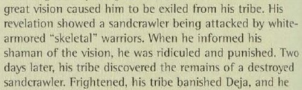
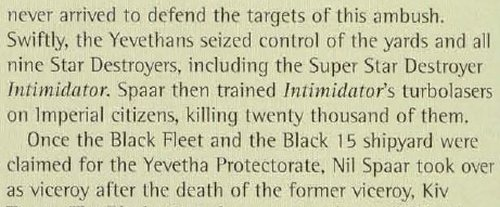
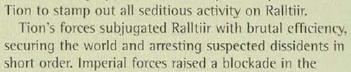
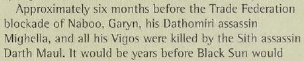
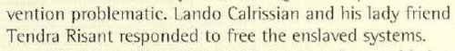
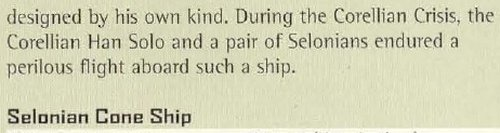
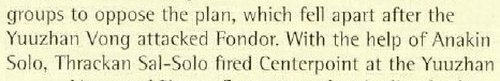
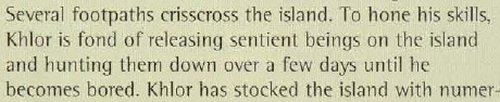

# Owner Material 037 — Star Wars D20 Drive folder (Core, Revised Core and Saga Edition): Sourcebooks/Coruscant and the Core Worlds.pdf [Star Wars Roleplaying Game Revised Core (d20, 2002)] (scan pages 121–162)

- **Source:** Wizards of the Coast Star Wars Roleplaying Game books, web enhancements, Living Force campaign modules and articles (2000–2010), from the owner's "Star Wars D20" Drive folder (only the three edition subfolders; "General" was not read, as instructed). Secondary source (licensed Legends reference). Scan OCR'd on the box; the scan stays box-only and is **not** published.
- **Method:** every scanned page was OCR'd and machine-screened sentence by sentence for power-relevant statements (fights, kills, defeats, Force feats, rankings, superweapons) that name a character on our roster; each kept sentence is quoted verbatim from the OCR text and has a crop of the printed passage directly under it. Pages with nothing power-relevant are still listed with what is on them.
- **Citation:** "*Coruscant and the Core Worlds* (SWRPG d20 Revised Core), p.X" by printed page ("scan p.X" where no printed number applies). **Weight:** Licensed RPG material: a secondary source. Narrative text sums up Legends lore; game statistics are rules for players, not canon power levels, and rank lowest.

## scan p.121 (scan page 121)

Page contents: Tallera Downs map; Nubian Palace; Solar Gardens; Hover Boots (Zen Lotto) (hand-read)

## scan p.122 (scan page 122)

Page contents: Nubian B4 Cloudbus stats; For the GM: Crop Circles, A Day at the Races; Prall the Hutt (Scoundrel 8/Noble 1/Crime Lord 7) stats (hand-read)

### Stat block notes (game mechanics, not feats)

- Prall the Hutt stat block: Prall the Hutt: Hutt Scoundrel 8/Noble 1/Crime Lord 7; Init -3; Defense 15 (-3 Dex, -1 size, +9 class); Spd 2 m; VP/WP. 128/20; Atk +11/+6 melee (stun DC 12, stun baton) or +11/+6 melee (1d843, tail spike) or +11/+6 melee (1d4+3, punch) or +5/+0 ranged; SQ can’t be knocked prone, contacts (3), favor +1, Force resistance (gains +6 species bonus on Will saves against Force skills and Force feats), illicit barter, inspire fear -4, lucky 2/day, minions, precise attack +1, resource access; SV Fort +9, Ref +8, Will +12; SZL; FP 0; DSP 6; Rep +14; Str 16, Dex 5, Con 20, Int 17, Wis 13, Cha 16. Challenge Code G. (Source: *Coruscant and the Core Worlds* (SWRPG d20 Revised Core), scan p.122)

## scan p.123 (scan page 123)

Page contents: Prall feats; Dace Wilder (ronto racing champion, Fringer 5) stats; Deja (Jawa visionary mechanic, Fringer 7/Force Adept 2) stats (hand-read)

- **Deja (shaman visionary)** — entry/section: Deja's vision: "His revelation showed a sandcrawler being attacked by whitearmored “skeletal” warriors. When he informed his shaman of the vision, he was ridiculed and punished. Two days later, his tribe discovered the remains of a destroyed sandcrawler." Source: *Coruscant and the Core Worlds* (SWRPG d20 Revised Core), scan p.123
  

### Stat block notes (game mechanics, not feats)

- Dace Wilder stat block: Dace Wilder: Male Human Fringer 5; Init +4; Defense 19 (+4 Dex, +5 class); Spd 10 m; VP/WP. 28/12; Atk +5 melee (1d3+2, punch) or +] melee (2d4+2, vibrodagger) or +7 ranged (3d6, blaster pistol); SQ barter, bonus class skill (Bluff, Swim), jury-rig +2, survival +2; SV Fort +5, Ref +7, Will +1; SZ M; FP 0; DSP 0; Rep +1; Str 14, Dex 18, Con 12, Int 10, Wis 10, Cha 16. Challenge Code C. (Source: *Coruscant and the Core Worlds* (SWRPG d20 Revised Core), scan p.123)
- Deja stat block: Deja: Male Jawa Pringer 7/ Force Adept 2; Dex, +1 size, +8 class); Spd 6 m; VP/WP 47/10; Atk +6/+1 melee (1d2-1, punch) or +6/+1 melee (1d6-1, heavy spanner) or +11/+6 ranged (3d8/19-20, ion rifle); SQ barter, bonus class skill (Computer Use, Disable Device), dark- vision 20 m, jury-rig +4, primitive, (Source: *Coruscant and the Core Worlds* (SWRPG d20 Revised Core), scan p.123)

## scan p.124 (scan page 124)

Page contents: Deja feats; Floating Archidia and archidia poisons; New Creature: Armadid; N'zoth planet stats and Description (hand-read)

## scan p.125 (scan page 125)

Page contents: N'zoth History (Black 15 shipyard, Nil Spaar seizes the Black Fleet, kills twenty thousand Imperials with Intimidator's turbolasers; Great Purge; Battle of N'zoth); People (Yevethan castes) (hand-read)

- **Nil Spaar** — entry/section: Nil Spaar seizes the Black Fleet: "Swiftly, the Yevethans seized control of the yards and all nine Star Destroyers, including the Super Star Destroyer Intimidator. Spaar then trained Intimidator’s turbolasers on Imperial citizens, killing twenty thousand of them." Source: *Coruscant and the Core Worlds* (SWRPG d20 Revised Core), scan p.125
  

## scan p.126 (scan page 126)

Page contents: Yevethans; Locations: Giat Nor, Hariz (Aramadia), Valley of Rejection; Disguise Kit (hand-read)

## scan p.127 (scan page 127)

Page contents: For the GM: Extreme Breaking and Entering (Aramadia trophy room, Eye of Deth, Deth Korakill slain by Nil Spaar), Painful Rejection (Werstilhere), Claws of N'zoth; Minister Zorbazat Xong (hand-read)

## scan p.128 (scan page 128)

Page contents: Zorbazat Xong (Yevethan Expert 3/Soldier 3) stats; Habbala Brupt (Sullustan Imperial spy, Scoundrel 3/Scout 3) stats; New Creature: Siringana (hand-read)

### Stat block notes (game mechanics, not feats)

- Zorbazat Xong stat block: Zorbazat Xong: Male Yevethan Expert 3/Soldier 3; (Source: *Coruscant and the Core Worlds* (SWRPG d20 Revised Core), scan p.128)
- Habbala Brupt stat block: Habbala Brupt: Male Sullustan Scoundrel 3/Scout 3: Init +9 (+5 Dex, +4 Improved Initiative); Defense 19 (+5 Dex, +4 class); Spd 10 m; VP/WP 33/10; Atk +5 melee (1d3+1, punch) or +9 (3d6, blaster pistol); SQ darkvision 20 m, heart +1, illicit barter, lucky 1/day, precise attack +1, trailblazing; SV Fort +3, Ref +10, Con 10, Int 11, Wis 10, Cha 9. Challenge Code D. (Source: *Coruscant and the Core Worlds* (SWRPG d20 Revised Core), scan p.128)

## scan p.129 (scan page 129)

Page contents: Ralltiir planet stats; Description; History (Lord Tion subjugates Ralltiir; Tantive IV, Princess Leia; Governor Dennix Graeber) (hand-read)

- **Lord Tion** — entry/section: Tion subjugates Ralltiir: "Tion’s forces subjugated Ralltiir with brutal efficiency, securing the world and arresting suspected dissidents in short order." Source: *Coruscant and the Core Worlds* (SWRPG d20 Revised Core), scan p.129
  

## scan p.130 (scan page 130)

Page contents: Ralltiir Yuuzhan Vong era; People; Locations: Grallia Spaceport, Black Sun Fortress (Alexi Garyn and his Vigos killed by Darth Maul), Jumper Quarries (Zeclo Fas) (hand-read)

- **Darth Maul; Mighella** — entry/section: Coruscant and the Core Worlds: "Approximately six months before the Trade Federation blockade of Naboo, Garyn, his Dathomiri assassin Mighella, and all his Vigos were killed by the Sith assassin Darth Maul." Source: *Coruscant and the Core Worlds* (SWRPG d20 Revised Core), scan p.130
  

## scan p.131 (scan page 131)

Page contents: Black Sun fortress map; Armored Speedertruck stats; For the GM: Black Sun Rising (Shal'mak), Doctor's Orders (Croy Winnis) (hand-read)

## scan p.132 (scan page 132)

Page contents: Payload (XwiziMarble); Bosrik Mak-Ageejay (Noble 8) stats; Stubble Trel (Scout 4) stats; Shal'mak (Kian'thar Scoundrel 5/Noble 2/Crime Lord 3) stats (hand-read)

### Stat block notes (game mechanics, not feats)

- Bosrik Mak-Ageejay stat block: Basrik Mak-Ageejay: Male Human Noble 8; Init +1; Defense 16 (+1 Dex, +5 class); Spd 10 m; VP/WP. 28/10; Atk +6/+1 melee (1d3, punch) or +7/+2 ranged (3d4, sporting blaster); SQ bonus class skill (Gather Information), coordinate +2, favor +3, inspire confidence, resource access; SV Fort +2, Ref +5, Will +9; SZ M; FP 1; DSP 1; Rep +5; Str 11, Dex 13, Con 10, Int 16, Wis 16, Cha 15. Challenge Code D. (Source: *Coruscant and the Core Worlds* (SWRPG d20 Revised Core), scan p.132)
- Stubble Trel stat block: Stubble Trel: Male Human Scout 4; Init +1; Defense 14 (+1 Dex, +3 class}; Spd 10 m; VP/WP 26/19; Atk +6 melee (1d3+3, punch) or +4 ranged (3d8/19-20, blaster rifle); SQ heart +1, trailblazing, uncanny dodge (Dex bonus to Defense); SV Fort +5, Ref +3, Will +3; SZ M; FP 1; DSP 0; Rep —1; Str 16, Dex 13, Con 16, Int 12, Wis 13, Cha 14. Challenge Code C. (Source: *Coruscant and the Core Worlds* (SWRPG d20 Revised Core), scan p.132)
- Shal'mak stat block: Shal'mak: Female Kian'thar Scoundrel 5/Noble 2/Crime Lord 3; Init +1; Defense 19 (+1 Dex, +7 class, +1 natural); Spd 10 m; VP/WP. 52/12; Atk +5 melee (1d3, punch) or +5 melee (26, vibroblade) or +6 ranged; SQ bonus class skill (Bluff), breathe underwater, contact (1), empath, favor +1, illicit barter, inspire confidence, inspire fear -2, low-light vision, lucky 1/day, precise attack +1, resource access, +2 species bonus on Swim checks; SV Fort +5, Ref +9, Will +9; SZ M; FP 3; DSP 4; Rep +10; Str 10, Dex 12, Con 12, Int 14, Wis 14, Cha 16. Challenge Code E. (Source: *Coruscant and the Core Worlds* (SWRPG d20 Revised Core), scan p.132)

## scan p.133 (scan page 133)

Page contents: Shal'mak skills; New Creature: Casting Hawk; Recopia planet stats; Description; History begins (hand-read)

## scan p.134 (scan page 134)

Page contents: Recopia History, People; Locations: Scapio, Hinder Market, Tuldok Ranch (hand-read)

## scan p.135 (scan page 135)

Page contents: Seyugi compound map; Mallif Cove; New Prestige Class: Seyugi Dervish (requirements, class features) (hand-read)

## scan p.136 (scan page 136)

Page contents: Seyugi Dervish features (Improved Alertness, Uncanny Speed); For the GM: Pecoppi Hunt (Tama Burr), Dervish Delights (Razi Khan); Tama Burr (Expert 3/Diplomat 2) stats; Razi Khan begins (hand-read)

### Stat block notes (game mechanics, not feats)

- Tama Burr stat block: Tama Burr: Female Human Expert 3/Diplomat 2; Init +1; Defense 11 (+1 Dex, +1 class); Spd 10 m; VP/WP. 0/10; Atk +2 melee (DC 15 stun, stun baton) or +2 melee (1d3-1, punch) or +4 ranged (3d4, sporting blaster); (Source: *Coruscant and the Core Worlds* (SWRPG d20 Revised Core), scan p.136)

## scan p.137 (scan page 137)

Page contents: Razi Khan (Scoundrel 6/Seyugi Dervish 4) stats; Gull Tuldok (Scoundrel 7/Soldier 3) stats; New Creature: Krendel (hand-read)

### Stat block notes (game mechanics, not feats)

- Razi Khan stat block: Razi Khan; Male Human Scoundrel 6/Seyugi Dervish 4; Init +3; Defense +23 (+3 Dex, +9 class); Spd 10 m; VP/WP. 58/14; Atk +8/+1 melee (1d6+3, punch) or +8/+3 ranged (2d6, slugthrower rifle); SQ illicit barter, improved alertness, lucky 2/day, smite +2, precise attack +1; SV Fort +6, Ref +9, Will +4; SZ M; FP 0; DSP 2; Rep +3; Str 12, Dex 16, Con 14, Int 10, Wis 9, Cha 13. Challenge Code E. (Source: *Coruscant and the Core Worlds* (SWRPG d20 Revised Core), scan p.137)
- Gull Tuldok stat block: Gull Tuldok: Male Human Scoundrel 7/Soldier 3; Init +6 (+2 Dex, +4 Improved Initiative); Defense 19 (+2 Dex, +7 class); Spd 10 m; VP/WP 55/12; Atk +9/+4 melee (1d3+1, punch) or +9/+4 melee (2d6+1, vibroblade) or +10/+5 ranged (3d8, heavy blaster pistol); SQ illicit barter, lucky 2/day, precise attack +1; SV Fort +6, Ref +8, Will +3; SZ M; FP 0; DSP 0; Rep +3; Str 13, Dex 15, Con 12, Int 15, Wis 10, Cha 13. Challenge Code E. (Source: *Coruscant and the Core Worlds* (SWRPG d20 Revised Core), scan p.137)

## scan p.138 (scan page 138)

Page contents: Rhinnal planet stats; Description; History (Jedi healers' chapter house, Moff Jander Graffe, Governor Phadreas Kole) (hand-read)

## scan p.139 (scan page 139)

Page contents: Rhinnal People; Locations: Rhire, State Medical Academy, Jedi Chapter House, Zirfan Glacier; V-Fin Submersible Icebreaker stats (hand-read)

## scan p.140 (scan page 140)

Page contents: For the GM: Frozen in Time (Berra Sane), Quarantine (Dr. Garven Meccamitta, Imono Durshana); Rhire map; Berra Sane (Fringer 4/Scoundrel 6) stats (hand-read)

### Stat block notes (game mechanics, not feats)

- Berra Sane stat block: Berra Sane: Female Human Fringer 4/Scoundrel 6; Init +6 (+2 Dex, +4 Improved Initiative); Defense 18 (+2 Dex, +6 class); Spd 10 m; VP/WP 36/12; Atk +7/+2 melee (1d3, punch) or +7/+2 melee (2d6, vibroblade) or +9/+4 ranged (3d6, blaster pistol); SQ barter, bonus class skill (Bluff, Treat Injury), illicit barter, jury-rig +2, lucky 2/day, precise attack +1; SV Fort +7, Ref +9, Will +4; SZ M; FP 1; DSP 3; Rep +1; Str 10, Dex 14, Con 12, Int 10, Wis 12, Cha 10. Challenge Code E. (Source: *Coruscant and the Core Worlds* (SWRPG d20 Revised Core), scan p.140)

## scan p.141 (scan page 141)

Page contents: Dr. Garven Meccamitta (Noble 2/Expert 14) stats; Imono Durshana (Fringer 5) stats; New Creatures: Firehead, Tenticulon (hand-read)

### Stat block notes (game mechanics, not feats)

- Dr. Garven Meccamitta stat block: Garven Meccamitta: Male Human Noble 2/Expert 14; Init +0; Defense 15 (+5 class); Spd 10 m; VP/WP. 12/10; Atk +11/+6/+1 melee (1d3, punch) or +11/+6/+1 ranged; SQ bonus class skill (Bluff), favor +1, inspire confidence; SV Fort +4, Ref +6, Will +15; SZ M; FP 2; DSP 0; Rep +7; Str 10, Dex 10, Con 10, Int 18, Wis 12, Cha 14. Challenge Code C. (Source: *Coruscant and the Core Worlds* (SWRPG d20 Revised Core), scan p.141)
- Imono Durshana stat block: Imono Durshana: Male Human Fringer 5; Init +2; Defense 17 (+2 Dex, +5 class); Spd 10 m; VP/WP 26/13; Atk +4 melee (1d3+1, punch) or +5 ranged (3d6, blaster pistol); SQ barter, bonus class skill (Computer Use, Disguise), jury-rig +2, survival +2; SV Fort +4, Ref +5, Will +1; SZ M; FP 0; DSP 0; Rep +1; Str 12, Dex 14, Con 10, Int 10, Wis 11, Cha 12. Challenge Code C. (Source: *Coruscant and the Core Worlds* (SWRPG d20 Revised Core), scan p.141)

## scan p.142 (scan page 142)

Page contents: Sacorria planet stats; Description; History (Triad; Lando Calrissian and Tendra Risant help New Republic destroy Triad fleet); People (hand-read)

- **Lando Calrissian**: "Lando Calrissian and his lady friend Tendra Risant responded to free the enslaved systems." Source: *Coruscant and the Core Worlds* (SWRPG d20 Revised Core), scan p.142
  

## scan p.143 (scan page 143)

Page contents: Sacorrian laws; Locations: Sarcophagus, Dorthus Tal Prison, Dorthus Tal City, Watchtower Base, Sacorria Central Spaceport; For the GM (hand-read)

## scan p.144 (scan page 144)

Page contents: Adventures: All for Love (Doloria assassins), Jailbreak! (Marcus Korrin, Kedar Blackgate), Shoo Fly, Don't Bother Me; Dorthus Tal Prison map (hand-read)

## scan p.145 (scan page 145)

Page contents: Shoo Fly (assassin droids, cont.); A Grave Errand; New Creature: Sacorrian Grain Fly; Colonel Kedar Blackgate (Soldier 12/Officer 6) stats (hand-read)

### Stat block notes (game mechanics, not feats)

- Colonel Kedar Blackgate stat block: Colonel Kedar Blackgate: Male Human Soldier 12/ Officer 6; Init +0; Defense 21 (+11 class); Spd 10 m; VP/WP. 100/15; Atk +20/+15/+10/+5 melee (3d4+3/18-20, punch) or +16/+11/+6/+1 ranged (3d6+3, mastercraft blaster pistol); SQ leadership, requisition supplies, tactics; SV Fort +13, Ref +7, Will +10; SZ M; FP 7; DSP 2; Rep +11; Str 18, Dex 10, Con 15, Int 14, Wis 12, Cha 17. Challenge Code H. (Source: *Coruscant and the Core Worlds* (SWRPG d20 Revised Core), scan p.145)

## scan p.146 (scan page 146)

Page contents: Blackgate skills/feats; Major Astar Vangor (Soldier 6/Noble 1/Officer 2) stats; Selonia planet stats and Description (hand-read)

### Stat block notes (game mechanics, not feats)

- Major Astar Vangor stat block: Major Astar Vangor: Female Human Soldier 6/Noble 1/ Officer 2; Init +3; Defense 20 (+3 Dex, +7 class); DR 5; Spd 8 m; VP/WP 51/10; Atk +10/+5 melee (2d4+3/19-20, punch) or +10/+5 ranged (3d8/19~-20, blaster carbine); SQ bonus class skill (Spot), favor +1, leadership; SV Fort +7, Ref +10, Will +6; SZ M; FP 3; DSP 0; Rep +4; Str 16, Dex 16, Con 10, Int 12, Wis 11, Cha 14. Challenge Code E. (Source: *Coruscant and the Core Worlds* (SWRPG d20 Revised Core), scan p.146)

## scan p.147 (scan page 147)

Page contents: Selonia History (planetary repulsor, Republicists vs Absolutists); People (dens, septs, honesty) (hand-read)

## scan p.148 (scan page 148)

Page contents: Selonian offworld population; Locations: Cloudland Peaks, Shevo Banks; Selonian Cone Ship (Han Solo's perilous flight) stats; For the GM (hand-read)

- **Han Solo** — entry/section: Han Solo's cone ship flight: "During the Corellian Crisis, the Corellian Han Solo and a pair of Selonians endured a perilous flight aboard such a ship." Source: *Coruscant and the Core Worlds* (SWRPG d20 Revised Core), scan p.148
  

## scan p.149 (scan page 149)

Page contents: Adventures: Skip and a Jump (Neic Norim, InCorCol), Den Bones, Den Bones (Gray Cove Den); Shaclor (Selonian Scout 4) stats; Neic Norim (Sullustan Scoundrel 4) stats (hand-read)

### Stat block notes (game mechanics, not feats)

- Shaclor stat block: Shaclor: Female Selonian Scout 4; Init +3; Defense 16 (+3 Dex, +3 class); Spd 10 m, swim 12 m; VP/WP 30/17; Atk +5 melee (1d3+2, claw) or +6; SQ agoraphobia, heart +1, trailblazing, uncanny dodge (Dex bonus to Defense); SV Fort +4, Ref +5, Will +2; SZ M; FP 0; DSP 0; Rep +1; Str 15, Dex 17, Con 14, Int 11, Wis 10, Cha 12. Challenge Code B. (Source: *Coruscant and the Core Worlds* (SWRPG d20 Revised Core), scan p.149)
- Neic Norim stat block: Neic Norim: Male Sullustan Scoundrel 4; Init +3; Defense 16 (+3 Dex, +3 class); Spd 10 m; VP/WP. 14/9; Atk +4 melee (1d3+1, punch) or +6 ranged (3d6, blaster pistol); SQ darkvision 20 m, illicit barter, lucky 1/day, precise attack +1; SV Fort +0, Ref +7, Will +1; SZ M; FP 1; DSP 1; Rep +1; Str 13, Dex 16, Con 9, Int 14, Wis 10, Cha 9. Challenge Code C. (Source: *Coruscant and the Core Worlds* (SWRPG d20 Revised Core), scan p.149)

## scan p.150 (scan page 150)

Page contents: Neic Norim skills; Fulin Gor (New Republic Observer, Soldier 12) stats; Talus, Tralus and Centerpoint Station planet stats (hand-read)

### Stat block notes (game mechanics, not feats)

- Fulin Gor stat block: Fulin Gor: Male Human Soldier 12; Init +3 (—1 Dex, +4 Improved Initiative); Defense 17 (-1 Dex, +8 class); Dex 8, Con 14, Int 14, Wis 13, Cha 12. Challenge Code E. (Source: *Coruscant and the Core Worlds* (SWRPG d20 Revised Core), scan p.150)

## scan p.151 (scan page 151)

Page contents: Double Worlds Description (Centerpoint, Hollowtown, Glowpoint); History (Fed-Dub, Corellian Crisis; Anakin Solo helps Thrackan Sal-Solo fire Centerpoint at Yuuzhan Vong and Hapan fleets); People; Locations: Qaestar Town (hand-read)

- **Anakin Solo; Thrackan Sal-Solo** — entry/section: Firing Centerpoint: "With the help of Anakin Solo, Thrackan Sal-Solo fired Centerpoint at the Yuuzhan" Source: *Coruscant and the Core Worlds* (SWRPG d20 Revised Core), scan p.151
  

## scan p.152 (scan page 152)

Page contents: Qaestar Town (spaceport gangs); Sea of Jarad (nagaks, styanax, stabmen); Hollowtown; Hunting the Styanax rules; Qaestar map (hand-read)

## scan p.153 (scan page 153)

Page contents: For the GM: Qaestar Missteps, An Offer You'd Better Not Refuse (Gentius Parl), Beneath the Spine (Selonian champions); Centerpoint map (hand-read)

## scan p.154 (scan page 154)

Page contents: Killing a Legend; Salvage Mission (Eben and Zyne Kinahay, Sith holocron); A Double Worlds Campaign; Gentius Parl (Scoundrel 6/Noble 2) stats; Magalak begins (hand-read)

### Stat block notes (game mechanics, not feats)

- Gentius Parl stat block: Gentius Parl: Male Human Scoundrel 6/Noble 2; Init +5 (+1 Dex, +4 Improved Initiative); Defense 16 (+1 Dex, +5 class); Spd 10 m; VP/WP 34/11; Atk +7 melee (DC 15 stun, stun baton) or +7 melee (1d34+2, punch) or +6 ranged (3d6, blaster pistol); SQ bonus class skill (Intimidate), favor +1, illicit barter, inspire confidence, lucky 2/day, precise attack +1; SV Fort +2, Ref +8, (Source: *Coruscant and the Core Worlds* (SWRPG d20 Revised Core), scan p.154)

## scan p.155 (scan page 155)

Page contents: Magalak (Selonian Soldier 9/Scout 4) stats; New Weapon: Selonian Glaive; Van Jahan Surgoth (stabman, Fringer 4/Scout 10) stats; Zyne Kinahay (Force Adept 5/Dark Side Devotee 9) stats (hand-read)

### Stat block notes (game mechanics, not feats)

- Magalak stat block: Magalak: Female Selonian Soldier 9/Scout 4; Init +7 (+3 Dex, +4 Improved Initiative); Defense 21 (+3 Dex, Atk +13/+8/+3 melee (1d4+1, claw) or +15/+10/+5 melee (1d8+1/1d6+1, Selonian glaive) or +15/+10/+5 ranged (3d6, blaster pistol); SQ agoraphobia, heart +1, trailblazing, uncanny dodge (Dex bonus to Defense); SV (Source: *Coruscant and the Core Worlds* (SWRPG d20 Revised Core), scan p.155)
- Van Jahan Surgoth stat block: Van Jahan Surgoth: Male Human Fringer 4/Scout 10; Init +3; Defense 21 (+3 Dex, +8 class); Spd 10 m; VP/WP 81/14; Atk +12/+7 melee (1d3+2, punch) or +8/+3 melee (2d6+2, vibroblade) or +13/+8 ranged (3d4, styanax lance); SQ barter, bonus class skill (Repair, Swim), evasion, extreme effort, heart +1, jury-rig +2, trailblazing, uncanny dodge (can’t be flanked, Dex bonus to Defense); SV Fort +12, Ref +10, Will +7; SZ M; FP 0; DSP 0; (Source: *Coruscant and the Core Worlds* (SWRPG d20 Revised Core), scan p.155)
- Zyne Kinahay stat block: Zyne Kinahay: Male Human Force Adept 5/Dark Side Devotee 9; Init +0; Defense 20 (+10 class); Spd 10 m; VP/WP 95/14; Atk +8/+3 melee (1d8-1/1d6-1 plus 3d8, Selonian glaive) or +8/+3 melee (1d6-1 plus 3d8, quarterstaff) or +8/+3 melee (3d4-1/18-20, punch) or +9/+4 ranged (3d6, blaster pistol); SQ Force weapon +3d8; SV Fort +9, Ref +7, Will +15; SZ M; FP 6; DSP 13; Rep +5; (Source: *Coruscant and the Core Worlds* (SWRPG d20 Revised Core), scan p.155)

## scan p.156 (scan page 156)

Page contents: Zyne Kinahay equipment, Force skills and feats; New Creatures: Dimlurker, Styanax (Old Gloxix) (hand-read)

## scan p.157 (scan page 157)

Page contents: Velusia planet stats; Description; History (Aquar, Nexcore Mining Corporation lease); People (hand-read)

## scan p.158 (scan page 158)

Page contents: Aquar; Locations: Mount Hollow, Khlor's Hideout (Khlor hunts sentients for sport); Magna Bolas (hand-read)

- **Khlor** — entry/section: Khlor hunts sentients for sport: "To hone his skills, Khlor is fond of releasing sentient beings on the island and hunting them down over a few days until he becomes bored." Source: *Coruscant and the Core Worlds* (SWRPG d20 Revised Core), scan p.158
  

## scan p.159 (scan page 159)

Page contents: For the GM: Missing Aquascout, Escape from Khlor's Island; Khlor, Bounty Hunter (Scoundrel 6/Soldier 4/Bounty Hunter 5) begins; island map (hand-read)

### Stat block notes (game mechanics, not feats)

- Khlor, Bounty Hunter stat block: Khlor: Male Human Scoundrel 6/Soldier 4/Bounty Hunter 5; Init +5); Defense 24 (+5 Dex, +9 class); DR 4; Khloris Island Military Issue Prefabricated Barracks Blaster (Source: *Coruscant and the Core Worlds* (SWRPG d20 Revised Core), scan p.159)

## scan p.160 (scan page 160)

Page contents: Khlor stats (cont.); Vilhona (Aquar Thug 8/Soldier 2, Sisters of the Crimson Mark) stats; New Creature: Velusian Fursnake; New Species: Aquar (hand-read)

### Stat block notes (game mechanics, not feats)

- Vilhona stat block: Vilhona: Female Aquar (Near-Human) Thug 8/Soldier 2; Init +5; Defense 18 (+5 Dex, +3 class); Spd 10 m, swim 10 m; VP/WP. 25/14; Atk +12/+7 melee (1d3+2, punch) or +15/+10 melee (2d6+2, vibroblade) or +15/+10 ranged (3d4, hold-out blaster); SQ breathe underwater; SV (Source: *Coruscant and the Core Worlds* (SWRPG d20 Revised Core), scan p.160)

## scan p.161 (scan page 161)

Page contents: RPGA Living Force advertisement ("A Cast of Thousands Starring You!") (hand-read)

## scan p.162 (scan page 162)

Page contents: Back cover blurb: 28 Core Worlds planets, Coruscant emphasis, GM-only sections (hand-read)

