# Owner Material 037 — Star Wars D20 Drive folder (Core, Revised Core and Saga Edition): Sourcebooks/Galactic Campaign Guide.pdf [Star Wars Roleplaying Game Revised Core (d20, 2002)] (scan pages 1–60)

- **Source:** Wizards of the Coast Star Wars Roleplaying Game books, web enhancements, Living Force campaign modules and articles (2000–2010), from the owner's "Star Wars D20" Drive folder (only the three edition subfolders; "General" was not read, as instructed). Secondary source (licensed Legends reference). Scan OCR'd on the box; the scan stays box-only and is **not** published.
- **Method:** every scanned page was OCR'd and machine-screened sentence by sentence for power-relevant statements (fights, kills, defeats, Force feats, rankings, superweapons) that name a character on our roster; each kept sentence is quoted verbatim from the OCR text and has a crop of the printed passage directly under it. Pages with nothing power-relevant are still listed with what is on them.
- **Citation:** "*Galactic Campaign Guide* (SWRPG d20 Revised Core), p.X" by printed page ("scan p.X" where no printed number applies). **Weight:** Licensed RPG material: a secondary source. Narrative text sums up Legends lore; game statistics are rules for players, not canon power levels, and rank lowest.

## scan p.1 (scan page 1)

Page contents: Cover: Star Wars Roleplaying Game, Galactic Campaign Guide; Peter Schweighofer and JD Wiker (hand-read)

## scan p.2 (scan page 2)

Page contents: Title page: Galactic Campaign Guide; designers (hand-read)

## scan p.3 (scan page 3)

Page contents: Credits (designers Peter Schweighofer, JD Wiker; editors; artists), WotC/Lucasfilm notices (c)2003 (hand-read)

## scan p.4 (scan page 4)

Page contents: Table of contents: Introduction; The Campaign Foundation; Settings; The Environment; The People; Heroic Journey (hand-read)

## scan p.5 (scan page 5)

Page contents: Introduction art page (hand-read)

## scan p.6 (scan page 6)

Page contents: Introduction: Welcome to the Galactic Campaign Guide; The Purpose of This Book; how to use the chapters (hand-read)

## scan p.7 (scan page 7)

Page contents: Chapter One opener: The Campaign Foundation (hand-read)

## scan p.8 (scan page 8)

Page contents: Campaign beginnings; Interactive Campaign Creation; coordinating the group (hand-read)

## scan p.9 (scan page 9)

Page contents: Twenty Questions for a Better Campaign begins (campaign as banquet; soliciting player opinions) (hand-read)

## scan p.10 (scan page 10)

Page contents: Twenty Questions: session length and frequency, episodic vs continuing sessions, absent players (hand-read)

## scan p.11 (scan page 11)

Page contents: Twenty Questions: absent players and their heroes, group rules, idea lists (hand-read)

## scan p.12 (scan page 12)

Page contents: Twenty Questions: Which Star Wars era (Rise of the Empire, Rebellion, New Jedi Order); same-level heroes (Han and Chewbacca vs Luke and Leia; Qui-Gon vs Amidala, Anakin, Obi-Wan) (hand-read)

- **Han Solo; Chewbacca; Luke Skywalker; Leia Organa Solo; Qui-Gon Jinn; Padmé Amidala; Darth Vader (Anakin Skywalker); Obi-Wan Kenobi** — entry/section: Han and Chewbacca more experienced: "After all, Han and Chewbacca certainly had more experience under their belts than Luke and Leia, and Qui-Gon was far more experienced than Amidala, Anakin, or even Obi-Wan." Source: *Galactic Campaign Guide* (SWRPG d20 Revised Core), scan p.12
  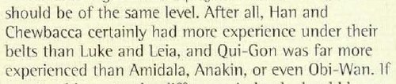
- **Luke Skywalker**: "Additionally, because the era is so thoroughly documented in books and movies, it is a fertile field for "what if?" campaigns in which some aspect of the central story changes (for example, the first Death Star isn't destroyed, or Han dies on Bespin, or the Emperor succeeds in turning Luke to the dark side) in such a way that the players' characters become the major heroes of the story." Source: *Galactic Campaign Guide* (SWRPG d20 Revised Core), scan p.12
  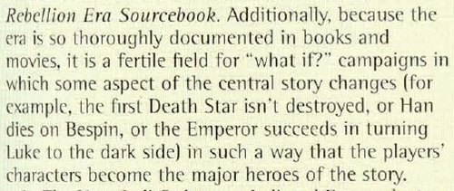

## scan p.13 (scan page 13)

Page contents: Twenty Questions: how heroes met; primary goal; mix of fighting, talking and thinking (hand-read)

## scan p.14 (scan page 14)

Page contents: Twenty Questions: famous guest stars (Luke, Qui-Gon; let Yoda help only as last resort); altering movie history; SMART goals begin (hand-read)

- **Yoda** — entry/section: Yoda as a last resort: "Let the diminutive Jedi Master pull their fat out of the fire only when they've exhausted their other plans and resources." Source: *Galactic Campaign Guide* (SWRPG d20 Revised Core), scan p.14
  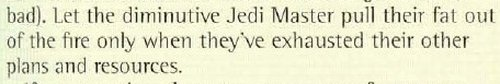

## scan p.15 (scan page 15)

Page contents: Campaign goals: specific, measurable, achievable, relevant, timed (hand-read)

## scan p.16 (scan page 16)

Page contents: Discussing era; Quick Mini-Campaign Ideas: Commando Operation, Survival and others (hand-read)

## scan p.17 (scan page 17)

Page contents: Mini-campaigns: Pay Off the Debt (Han Solo's debt to Jabba; Qui-Gon seeks currency for a hyperdrive), others (hand-read)

- **Han Solo; Jabba the Hutt; Qui-Gon Jinn** — entry/section: Pay Off the Debt examples: "Much of Han Solo’s motivation during Star Wars: A New Hope focuses on accumulating credits to pay his debt to Jabba the Hutt. Qui-Gon Jinn’s activities on Tatooine during The Phantom Menace focus on finding local currency to buy a new hyperdrive for Queen Amidala’s Royal Starship." Source: *Galactic Campaign Guide* (SWRPG d20 Revised Core), scan p.17
  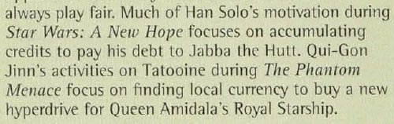

## scan p.18 (scan page 18)

Page contents: Classic campaigns: sources (mythology, Homer's Odyssey); classic Star Wars campaign goals begin (hand-read)

## scan p.19 (scan page 19)

Page contents: Classic campaign goals: rescue; Restore the Rightful Ruler (hand-read)

## scan p.20 (scan page 20)

Page contents: Classic goals: Balance the Force (incl. New Jedi Order era); Journey on a Quest; 100 Adventure Ideas begin (hand-read)

## scan p.21 (scan page 21)

Page contents: 100 Adventure Ideas 1-16 (Ambush, Black Market Offer, Blow the Bunker, Break-In...) (hand-read)

## scan p.22 (scan page 22)

Page contents: 100 Adventure Ideas 16-46 (Escape Pod Down, Escape Under Fire, Establish Contact...) (hand-read)

## scan p.23 (scan page 23)

Page contents: 100 Adventure Ideas 47-73 (Medical Infiltration, Military Escort, Missing Goods, Murder Investigation...) (hand-read)

## scan p.24 (scan page 24)

Page contents: 100 Adventure Ideas 74-95 (Salvage Duty, Scout Duty, Search and Rescue, Secret Weapon...) (hand-read)

## scan p.25 (scan page 25)

Page contents: 100 Adventure Ideas 96-100 (Treasure Hunt, Troubling Developments, Undercover, Unwelcome Return); theme (hand-read)

## scan p.26 (scan page 26)

Page contents: Character creation: emulating film roles, buddy characters, weeding out odd concepts (hand-read)

## scan p.27 (scan page 27)

Page contents: Checking character sheets (addition errors, accidental cheating); Worksheet: Hero Goal Tracker (hand-read)

- **Darth Vader (Anakin Skywalker); Luke Skywalker**: "Like the great themes of ancient myths, Star Wars tells many stories in one long saga: the advent of Anakin Skywalker, the end of the Jedi Knights, the coming of Luke Skywalker (a hero born of a mythic figure and a queen, destined to kill his own father), the battle to destroy the Death Star, Luke's training under the tutelage of the wise old master, his first and nearly fatal duel with his father, the rescue of his friend and companion, his final duel with his father, and the promise that Luke will take what he has learned and reestablish the Order of the Jedi Knights." Source: *Galactic Campaign Guide* (SWRPG d20 Revised Core), scan p.27
  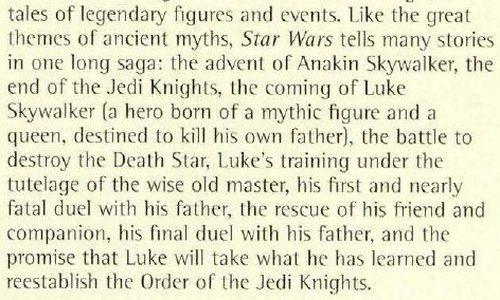

## scan p.28 (scan page 28)

Page contents: Saga, Depth and Emotion: saga (Luke's story and his companions); engendering saga (hand-read)

- **Darth Vader (Anakin Skywalker); Luke Skywalker** — entry/section: Galactic Campaign Guide (Revised Core): "Return of the Jedi told the story of the last Jedi’s final triumph over the Sith—how Luke overcame not only his own anger, but Darth Vader's as well, and how the redeemed Anakin Skywalker destroyed the last of the Sith." Source: *Galactic Campaign Guide* (SWRPG d20 Revised Core), scan p.28
  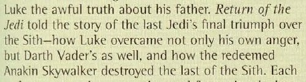
- **Obi-Wan Kenobi; Darth Vader (Anakin Skywalker); Luke Skywalker**: "The Phantom Menace introduced Obi-Wan Kenobi, whose failure to properly train Anakin led to his Padawan's transformation into Darth Vader, and who survived long enough to set Anakin's son Luke on the path of adventure." Source: *Galactic Campaign Guide* (SWRPG d20 Revised Core), scan p.28
  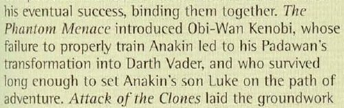

## scan p.29 (scan page 29)

Page contents: Depth in Star Wars (used technology, histories); conveying depth (hand-read)

- **Obi-Wan Kenobi; Qui-Gon Jinn**: "Obi-Wan Kenobi watches helplessly as his beloved Master, Qui-Gon Jinn, is cut down by a Sith—who the young Padawan knows will be coming after him next." Source: *Galactic Campaign Guide* (SWRPG d20 Revised Core), scan p.29
  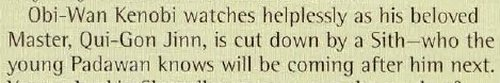
- **Darth Vader (Anakin Skywalker)**: "Had Qui- Gon not been killed, or had Shmi Skywalker died before Anakin reached her, it would not have produced much of a response from the audience." Source: *Galactic Campaign Guide* (SWRPG d20 Revised Core), scan p.29
  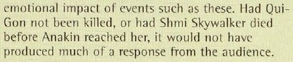

## scan p.30 (scan page 30)

Page contents: Emotion (Luke as first pilot, Leia confessing love to Han); imbuing emotion; mood (hand-read)

## scan p.31 (scan page 31)

Page contents: Opening crawl; Cut Scenes (Boba Fett follows the Falcon to Cloud City and alerts Vader, who set a trap) (hand-read)

- **Boba Fett; Darth Vader (Anakin Skywalker)** — entry/section: Vader's trap at Cloud City: "Boba Fett might follow the Millennium Falcon to Cloud City, but the audience doesn’t know that he has alerted Darth Vader—let alone that Vader got there first and has set a trap." Source: *Galactic Campaign Guide* (SWRPG d20 Revised Core), scan p.31
  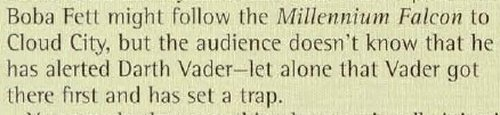

## scan p.32 (scan page 32)

Page contents: Cut scene guidelines (general descriptors, no details, don't lie); pacing (hand-read)

- **Darth Vader (Anakin Skywalker)**: "If the heroes just encountered Darth Vader in Cloud City, and now they're close to reaching their ship and making for a hyperspace jump point, but you need Vader aboard the Star Destroyer that chases them, improvise." Source: *Galactic Campaign Guide* (SWRPG d20 Revised Core), scan p.32
  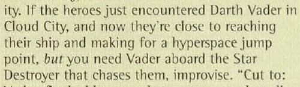
- **Darth Vader (Anakin Skywalker)**: "By creating a cut scene like this, you don't have to explain later why Vader's own ship would abandon him to chase the heroes, and you're not forced to discard or hastily rework an important cut scene showing Vader on the bridge of his Star Destroyer." Source: *Galactic Campaign Guide* (SWRPG d20 Revised Core), scan p.32
  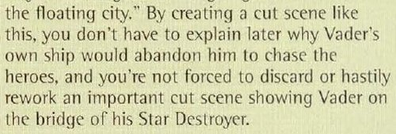

## scan p.33 (scan page 33)

Page contents: Pacing (Battle of Endor; Jabba's palace scenes alternate interaction and action); Cliffhangers (hand-read)

- **Han Solo; Luke Skywalker; Darth Vader (Anakin Skywalker)**: "The protagonists have all faced defeat in one form or another: Han Solo has been captured and transported to Jabba the Hutt and an unknown fate; Luke Skywalker has been seriously injured physically and psychologically in his confrontation with Darth Vader; and so on." Source: *Galactic Campaign Guide* (SWRPG d20 Revised Core), scan p.33
  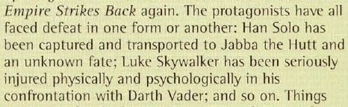

## scan p.34 (scan page 34)

Page contents: Cliffhangers cont.; Forging the Group: combining character concepts, roles (hand-read)

## scan p.35 (scan page 35)

Page contents: Jedi in the group (don't let Jedi dominate; handling overpowered Jedi players); compromise (hand-read)

## scan p.36 (scan page 36)

Page contents: Split groups; shortening time; Handling Splits (hand-read)

## scan p.37 (scan page 37)

Page contents: Side Encounters by class: Fringers, Nobles, Scoundrels, Scouts, Soldiers (hand-read)

## scan p.38 (scan page 38)

Page contents: Side encounters: Tech Specialists, Jedi Consulars, Jedi Guardians; Running Combat Encounters; Set the Stage (hand-read)

## scan p.39 (scan page 39)

Page contents: Set dressing and props in combat; special effects (hand-read)

## scan p.40 (scan page 40)

Page contents: Changing the battlefield; Check the Stage (surrounded foes); optional hit locations (Tables 1-1, 1-2) (hand-read)

## scan p.41 (scan page 41)

Page contents: Severed and broken limbs, cybernetic replacements; Impaled Opponents; bleeding to death (hand-read)

## scan p.42 (scan page 42)

Page contents: Critical hit tables 1-3 to 1-5 (lightsaber/slashing, etc.); Running Epic Battles (Hoth) (hand-read)

- **Han Solo; Chewbacca; Leia Organa Solo**: "Han Solo and Chewbacca initially take the roles of scouts to find and destroy the Imperial probe droid, and then spend most of the actual battle preparing the Millennium Falcon for their escape and rescuing Princess Leia." Source: *Galactic Campaign Guide* (SWRPG d20 Revised Core), scan p.42
  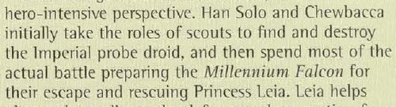

## scan p.43 (scan page 43)

Page contents: Running Noncombat Encounters; games of skill; dejarik (hand-read)

## scan p.44 (scan page 44)

Page contents: Games of chance: jubilee wheels, sabacc (hand-read)

## scan p.45 (scan page 45)

Page contents: Rules for Trin Sticks; competitive sports; racing (Boonta Eve Podrace, Anakin and Sebulba) (hand-read)

- **Darth Vader (Anakin Skywalker); Sebulba** — entry/section: Anakin in the Boonta Eve Podrace: "In the Boonta Eve Podrace in The Phantom Menace, Anakin Skywalker faces numerous perils that in the game would require an entire battery of Pilot checks to negotiate the twists and obstacles of the race course (with appropriate modifiers for his craft’s maneuverability and speed), attempt a few risky maneuvers, and maintain control of his Podracer after Sebulba sideswipes it." Source: *Galactic Campaign Guide* (SWRPG d20 Revised Core), scan p.45
  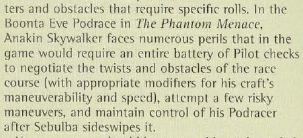

## scan p.46 (scan page 46)

Page contents: Team events; endurance events; Rewards begin (Han Solo's reward motive) (hand-read)

## scan p.47 (scan page 47)

Page contents: Rewards: Han helps rescue Leia for credits then values friendship; Obi-Wan as Padawan; roleplaying XP sidebar examples (Luke catching the lightsaber at the Sarlacc, Han charging stormtroopers, Obi-Wan giving Luke the lightsaber, Luke leaving Dagobah) (hand-read)

- **Han Solo; Leia Organa Solo; Luke Skywalker; Obi-Wan Kenobi; Qui-Gon Jinn** — entry/section: Han's reward changes: "Han Solo helps rescue Princess Leia from the Death Star because Luke Skywalker claims he'll be rewarded with credits the smuggler intends to use in paying off his debt to Jabba the Hutt. He later changes his mind, knowing that the reward of friendship with the Rebel Alliance, and Luke and Leia in particular, has far greater value. In The Phantom Menace, Obi-Wan Kenobi serves Qui-Gon Jinn as his Padawan, with the aspirations of gaining experience to become a full Jedi Knight." Source: *Galactic Campaign Guide* (SWRPG d20 Revised Core), scan p.47
  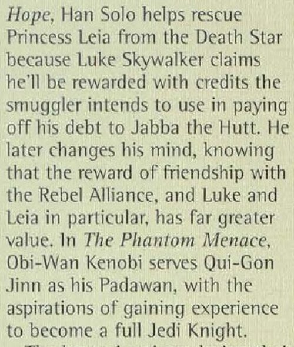
- **Luke Skywalker; R2-D2** — entry/section: Luke catches his lightsaber over the Sarlacc: "Example: Luke Skywalker not simply catching the lightsaber R2-D2 throws to him during his confrontation over the Sarlacc in Return of the Jedi, but dropping off the skiff’s gangplank, leaping, flipping, landing, and then catching the lightsaber." Source: *Galactic Campaign Guide* (SWRPG d20 Revised Core), scan p.47
  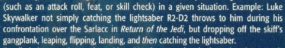
- **Han Solo** — entry/section: Han charges the stormtroopers: "Example: Han Solo charging off recklessly after the stormtroopers on the Death Star in Star Wars: A New Hope." Source: *Galactic Campaign Guide* (SWRPG d20 Revised Core), scan p.47
  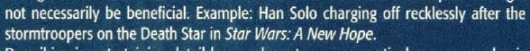
- **Obi-Wan Kenobi; Luke Skywalker** — entry/section: Obi-Wan gives Luke the lightsaber: "Example: In Star Wars: A New Hope, Obi-Wan Kenobi telling Luke Skywalker about his father and the heritage of the Jedi Knights, and finally giving Luke his father’s lightsaber." Source: *Galactic Campaign Guide* (SWRPG d20 Revised Core), scan p.47
  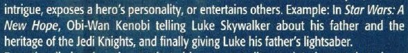
- **Luke Skywalker** — entry/section: Luke leaves Dagobah: "Example: Luke Skywalker leaving his Jedi training on Dagobah to fly to Cloud City and rescue his friends in The Empire Strikes Back." Source: *Galactic Campaign Guide* (SWRPG d20 Revised Core), scan p.47
  

## scan p.48 (scan page 48)

Page contents: Rewards: commodities (Bothan intelligence donations), art objects, favors, story awards (hand-read)

## scan p.49 (scan page 49)

Page contents: Chapter Two opener: Settings (hand-read)

## scan p.50 (scan page 50)

Page contents: Settings introduction: film sets as encounter settings; describing settings (hand-read)

## scan p.51 (scan page 51)

Page contents: Quick location: Luxury Apartment (adventure hook from Snitchly Gritch) (hand-read)

## scan p.52 (scan page 52)

Page contents: Luxury Apartment cont.; Standard Apartment (hand-read)

## scan p.53 (scan page 53)

Page contents: Standard Apartment cont.; Cantina (hand-read)

## scan p.54 (scan page 54)

Page contents: Cantina cont.; Casino (hand-read)

## scan p.55 (scan page 55)

Page contents: Casino cont.; City Block (hand-read)

## scan p.56 (scan page 56)

Page contents: City Block cont.; Conference Room; Docking Bay begins (hand-read)

## scan p.57 (scan page 57)

Page contents: Docking Bay; Table 2-1 cargo (hand-read)

## scan p.58 (scan page 58)

Page contents: Table 2-2 cargo; Factory begins (hand-read)

## scan p.59 (scan page 59)

Page contents: Factory (hand-read)

## scan p.60 (scan page 60)

Page contents: Factory cont.; Guard Post (hand-read)

