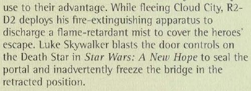
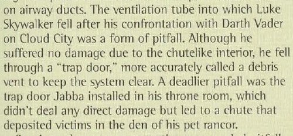
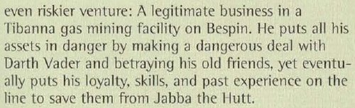

# Owner Material 037 — Star Wars D20 Drive folder (Core, Revised Core and Saga Edition): Sourcebooks/Galactic Campaign Guide.pdf [Star Wars Roleplaying Game Revised Core (d20, 2002)] (scan pages 61–120)

- **Source:** Wizards of the Coast Star Wars Roleplaying Game books, web enhancements, Living Force campaign modules and articles (2000–2010), from the owner's "Star Wars D20" Drive folder (only the three edition subfolders; "General" was not read, as instructed). Secondary source (licensed Legends reference). Scan OCR'd on the box; the scan stays box-only and is **not** published.
- **Method:** every scanned page was OCR'd and machine-screened sentence by sentence for power-relevant statements (fights, kills, defeats, Force feats, rankings, superweapons) that name a character on our roster; each kept sentence is quoted verbatim from the OCR text and has a crop of the printed passage directly under it. Pages with nothing power-relevant are still listed with what is on them.
- **Citation:** "*Galactic Campaign Guide* (SWRPG d20 Revised Core), p.X" by printed page ("scan p.X" where no printed number applies). **Weight:** Licensed RPG material: a secondary source. Narrative text sums up Legends lore; game statistics are rules for players, not canon power levels, and rank lowest.

## scan p.61 (scan page 61)

Page contents: Guard Post cont.; Hangar Bay begins (hand-read)

## scan p.62 (scan page 62)

Page contents: Hangar Bay (hand-read)

## scan p.63 (scan page 63)

Page contents: Hangar Bay cont.; Holding Cells (hand-read)

## scan p.64 (scan page 64)

Page contents: Holding Cells cont.; Hotel Room (hand-read)

## scan p.65 (scan page 65)

Page contents: Hotel Room cont.; Laboratory (hand-read)

## scan p.66 (scan page 66)

Page contents: Laboratory (hand-read)

## scan p.67 (scan page 67)

Page contents: Laboratory cont.; Lobby (hand-read)

## scan p.68 (scan page 68)

Page contents: Lobby cont.; Medical Bay (hand-read)

## scan p.69 (scan page 69)

Page contents: Medical Bay cont.; Mess Hall (hand-read)

## scan p.70 (scan page 70)

Page contents: Mess Hall cont.; Mine Complex (hand-read)

## scan p.71 (scan page 71)

Page contents: Mine Complex (hand-read)

## scan p.72 (scan page 72)

Page contents: Mine Complex cont.; Nightclub (hand-read)

## scan p.73 (scan page 73)

Page contents: Nightclub (hand-read)

## scan p.74 (scan page 74)

Page contents: Nightclub cont.; Operations Room (hand-read)

## scan p.75 (scan page 75)

Page contents: Operations Room cont.; Parts Shop (hand-read)

## scan p.76 (scan page 76)

Page contents: Parts Shop cont.; Police Station (hand-read)

## scan p.77 (scan page 77)

Page contents: Police Station cont.; Power Station (hand-read)

## scan p.78 (scan page 78)

Page contents: Power Station cont.; Repair Bay (hand-read)

## scan p.79 (scan page 79)

Page contents: Repair Bay cont.; Restaurant (hand-read)

## scan p.80 (scan page 80)

Page contents: Restaurant cont.; Sewer System (hand-read)

## scan p.81 (scan page 81)

Page contents: Sewer System cont.; Shanty Town (hand-read)

## scan p.82 (scan page 82)

Page contents: Shanty Town cont.; Speeder Platform (hand-read)

## scan p.83 (scan page 83)

Page contents: Speeder Platform cont.; Throne Room (hand-read)

## scan p.84 (scan page 84)

Page contents: Throne Room (hand-read)

## scan p.85 (scan page 85)

Page contents: Throne Room cont.; Trash Compactor (hand-read)

## scan p.86 (scan page 86)

Page contents: Trash Compactor cont.; Warehouse (hand-read)

## scan p.87 (scan page 87)

Page contents: Chapter Three opener: The Environment (hand-read)

## scan p.88 (scan page 88)

Page contents: Chapter Three: Life in the Galaxy (hand-read)

## scan p.89 (scan page 89)

Page contents: Common Services (price list: office rent, transport, air taxi, droid rental, nightclub cover, drinks); Governments; Republic Hierarchy (hand-read)

## scan p.90 (scan page 90)

Page contents: Trade Federation Hierarchy; Separatist Hierarchy (hand-read)

## scan p.91 (scan page 91)

Page contents: Imperial Hierarchy; Rebel Hierarchy; Corporate Hierarchy (hand-read)

## scan p.92 (scan page 92)

Page contents: Hierarchies cont. (hand-read)

## scan p.93 (scan page 93)

Page contents: Star Wars World-Building (hand-read)

## scan p.94 (scan page 94)

Page contents: Environments: Underwater, Zero Gravity, Low Gravity (hand-read)

## scan p.95 (scan page 95)

Page contents: Planet Generator: terrain tables (Arid, Temperate, Humid planets); Habitation (hand-read)

## scan p.96 (scan page 96)

Page contents: Habitation cont. (Sprawl etc.); Prop Rules intro (R2-D2's fire extinguisher on Cloud City; Luke blasts Death Star door controls) (hand-read)

- **R2-D2; Luke Skywalker** — entry/section: R2-D2's fire extinguisher; Luke seals the Death Star door: "While fleeing Cloud City, R2- D2 deploys his fire-extinguishing apparatus to discharge a flame-retardant mist to cover the heroes’ escape. Luke Skywalker blasts the door controls on the Death Star in Star Wars: A New Hope to seal the portal and inadvertently freeze the bridge in the retracted position." Source: *Galactic Campaign Guide* (SWRPG d20 Revised Core), scan p.96
  

## scan p.97 (scan page 97)

Page contents: Table 3-1 Planet Name Syllables; Props: Airlocks (hand-read)

## scan p.98 (scan page 98)

Page contents: Airlocks cont. (Falcon dorsal hatch Lando uses to rescue Luke under Cloud City); Alarm Panels; Blast Doors; Comm Panels; Control Panels (hand-read)

## scan p.99 (scan page 99)

Page contents: Escape Pods (stats); Fire Extinguishers (hand-read)

## scan p.100 (scan page 100)

Page contents: Laser Doors; Magnetic Shielding; Oil Bath; Pressure Doors; Raised Walkways; Remote Sentry Blasters (hand-read)

## scan p.101 (scan page 101)

Page contents: Sentry blasters cont.; Surveillance Cameras; Turbolifts; New Hazards: Traps (hand-read)

## scan p.102 (scan page 102)

Page contents: Pitfalls (Luke's fall into Cloud City vent; Jabba's rancor trap door); Remote Weapon Emplacements; Table 3-4 Pit Trap Damage; Gas Traps (hand-read)

- **Luke Skywalker; Darth Vader (Anakin Skywalker); Jabba the Hutt** — entry/section: Cloud City vent and Jabba's trap door: "The ventilation tube into which Luke Skywalker fell after his confrontation with Darth Vader on Cloud City was a form of pitfall. Although he suffered no damage due to the chutelike interior, he fell through a “trap door,” more accurately called a debris vent to keep the system clear. A deadlier pitfall was the trap door Jabba installed in his throne room, which didn’t deal any direct damage but led to a chute that deposited victims in the den of his pet rancor." Source: *Galactic Campaign Guide* (SWRPG d20 Revised Core), scan p.102
  

## scan p.103 (scan page 103)

Page contents: Table 3-5 Drugs (beneficial drugs, costs, side effects); drug/poison tables (hand-read)

## scan p.104 (scan page 104)

Page contents: Table 3-7 Diseases (incubation, damage); Drugs and Poisons; Diseases (hand-read)

## scan p.105 (scan page 105)

Page contents: Chapter Four opener: The People (hand-read)

## scan p.106 (scan page 106)

Page contents: Chapter Four: Ten Essential Supporting Characters intro (hand-read)

## scan p.107 (scan page 107)

Page contents: Supporting characters: Common Thug; Freighter Pilot; Gambler (Lando Calrissian example begins) (hand-read)

## scan p.108 (scan page 108)

Page contents: Gambler cont. (Lando's deal with Vader, rescue from Jabba); Law Enforcement Officer; Man on the Street; Mechanic; Instant Contacts sidebar (hand-read)

- **Lando Calrissian; Darth Vader (Anakin Skywalker); Jabba the Hutt** — entry/section: Lando the classy gambler: "even riskier venture: A legitimate business in a Tibanna gas mining facility on Bespin. He puts all his assets in danger by making a dangerous deal with Darth Vader and betraying his old friends, yet eventually puts his loyalty, skills, and past experience on the line to save them from Jabba the Hutt." Source: *Galactic Campaign Guide* (SWRPG d20 Revised Core), scan p.108
  

## scan p.109 (scan page 109)

Page contents: Military Officer; Scientist; Shopkeeper/Innkeeper; Air Taxi Driver (hand-read)

## scan p.110 (scan page 110)

Page contents: Generating Personalities; Appearance (hand-read)

## scan p.111 (scan page 111)

Page contents: Table 4-1 Appearance (hand-read)

## scan p.112 (scan page 112)

Page contents: Table 4-2 Mannerism; Personality Traits (hand-read)

## scan p.113 (scan page 113)

Page contents: Table 4-3 Personality Traits; Generating Names (hand-read)

## scan p.114 (scan page 114)

Page contents: Table 4-4 Human Given Names (hand-read)

## scan p.115 (scan page 115)

Page contents: Tables 4-5, 4-6 Human male and female names (hand-read)

## scan p.116 (scan page 116)

Page contents: Table 4-7 Human Surnames; Bothan Names; Table 4-8 Bothan Male Names (hand-read)

## scan p.117 (scan page 117)

Page contents: Tables 4-9 to 4-11 Bothan female names, family names, clan suffixes; Cerean Names (hand-read)

## scan p.118 (scan page 118)

Page contents: Tables 4-12, 4-13 Cerean male and female names; Cerean naming conventions (Ki-Adi-Mundi example) (hand-read)

## scan p.119 (scan page 119)

Page contents: Cerean name order (Ki-Adi-Mundi = vital, strong-willed spirit; Sen-Udo-Mal); Duros Names; Table 4-14 Duros male names (hand-read)

## scan p.120 (scan page 120)

Page contents: Ewok Names (Warrick surname); Table 4-15 Duros female names; Table 4-16 Duros surnames; Gamorrean Names (hand-read)

