# Owner Material 037 — Star Wars D20 Drive folder (Core, Revised Core and Saga Edition): Sourcebooks/Galactic Campaign Guide.pdf [Star Wars Roleplaying Game Revised Core (d20, 2002)] (scan pages 121–162)

- **Source:** Wizards of the Coast Star Wars Roleplaying Game books, web enhancements, Living Force campaign modules and articles (2000–2010), from the owner's "Star Wars D20" Drive folder (only the three edition subfolders; "General" was not read, as instructed). Secondary source (licensed Legends reference). Scan OCR'd on the box; the scan stays box-only and is **not** published.
- **Method:** every scanned page was OCR'd and machine-screened sentence by sentence for power-relevant statements (fights, kills, defeats, Force feats, rankings, superweapons) that name a character on our roster; each kept sentence is quoted verbatim from the OCR text and has a crop of the printed passage directly under it. Pages with nothing power-relevant are still listed with what is on them.
- **Citation:** "*Galactic Campaign Guide* (SWRPG d20 Revised Core), p.X" by printed page ("scan p.X" where no printed number applies). **Weight:** Licensed RPG material: a secondary source. Narrative text sums up Legends lore; game statistics are rules for players, not canon power levels, and rank lowest.

## scan p.121 (scan page 121)

Page contents: Table 4-17 Ewok male names (Chirpa, Logray, Paploo, Teebo, Wicket...); Gamorrean naming; Gungan Names (Obi, Quiggon, Annie, Rugor = Boss Nass's given name; Jar Jar never popular) (hand-read)

## scan p.122 (scan page 122)

Page contents: Table 4-18 Ewok female names (Kneesaa...); Table 4-19 Gamorrean names; Ithorian Names (hand-read)

## scan p.123 (scan page 123)

Page contents: Tables 4-20, 4-21 Gungan male and female names; Kel Dor Names (wind spirits superstition) (hand-read)

## scan p.124 (scan page 124)

Page contents: Table 4-22 Gungan surnames (Binks, Nass, Tarpals...); Mon Calamari Names (Jesmin Ackbar); Quarren Names (hand-read)

## scan p.125 (scan page 125)

Page contents: Tables 4-23, 4-24 Ithorian male and female names (Momaw...) (hand-read)

## scan p.126 (scan page 126)

Page contents: Table 4-25 Ithorian family names (Nadon...); Tables 4-26, 4-27 Kel Dor names; Table 4-28 Kel Dor family names (Koon...) (hand-read)

## scan p.127 (scan page 127)

Page contents: Tables 4-29, 4-30 Mon Calamari male and female names (Ackbar, Cilghal, Jesmin, Terpfen...) (hand-read)

## scan p.128 (scan page 128)

Page contents: Tables 4-31, 4-32 Quarren male and female names (hand-read)

## scan p.129 (scan page 129)

Page contents: Table 4-33 Quarren surnames; Rodian Names; Table 4-34 Random Rodian Names (hand-read)

## scan p.130 (scan page 130)

Page contents: Tables 4-35, 4-36 Rodian male and female names (Greedo = Ambitious, Greeata...) (hand-read)

## scan p.131 (scan page 131)

Page contents: Tables 4-37, 4-38 Sullustan male and female names (hand-read)

## scan p.132 (scan page 132)

Page contents: Table 4-39 Sullustan surnames (Nunb = Teacher); Sullustan Names; Table 4-40 Trandoshan names (Bossk, Cradossk...) (hand-read)

## scan p.133 (scan page 133)

Page contents: Tables 4-41, 4-42 Twi'lek male and female names (Bib Fortuna, Aayla, Nawara...) (hand-read)

## scan p.134 (scan page 134)

Page contents: Table 4-43 Twi'lek clan names; Trandoshan Names; Twi'lek Names (Bib Fortuna cast out by Una clan; Aayla Secura; Firith Olan; Nawara Ven) (hand-read)

- **Bib Fortuna; Aayla Secura** — entry/section: Twi'lek name separation: "Some Twi'leks choose to separate their names because they do not feel that they belong to their clan anymore, such as in the case of Firith Olan, who turned his back on his clan to make his own fortune in the galaxy. Others have this separation forced upon them, as in the case of Bib Fortuna, whom the Una clan cast out for his depredations on his own people." Source: *Galactic Campaign Guide* (SWRPG d20 Revised Core), scan p.134
  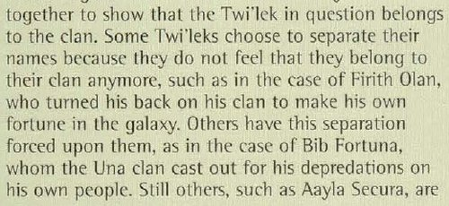

## scan p.135 (scan page 135)

Page contents: Wookiee Names; Tables 4-44 to 4-46 Wookiee prefixes and suffixes (hand-read)

## scan p.136 (scan page 136)

Page contents: Table 4-47 Zabrak male names; Zabrak Names (hand-read)

## scan p.137 (scan page 137)

Page contents: Table 4-48 Zabrak female names; Droid Names (R2-D2, IG-88, phonetic letters) (hand-read)

## scan p.138 (scan page 138)

Page contents: Table 4-49 Zabrak surnames (hand-read)

## scan p.139 (scan page 139)

Page contents: Chapter Five opener: Heroic Journey (hand-read)

## scan p.140 (scan page 140)

Page contents: Epic intro; Designing an Epic; Creating the Hook (Anakin, Luke, Leia, Han hooks) (hand-read)

- **Leia Organa Solo**: "Princess Leia seeks to further the cause of the Rebel Alliance and defeat the evil Empire." Source: *Galactic Campaign Guide* (SWRPG d20 Revised Core), scan p.140
  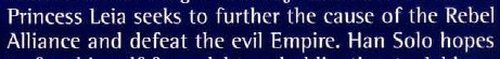

## scan p.141 (scan page 141)

Page contents: Campaign hooks; Preparing the Heroes (Anakin, Luke, Leia, Han motivations); What the Heroes Know; Disseminating Information (hand-read)

## scan p.142 (scan page 142)

Page contents: Option: Heroic Qualities (Anakin's Force strength; Anakin Solo machine affinity; Corran Horn mind tricks; Luke's secret extra Force die); Assigning Heroic Qualities (hand-read)

- **Luke Skywalker** — entry/section: Luke's secret Force die: "For example, while you might tell Luke Skywalker’s player that Luke gets the Force-Sensitive feat for free, and that he can purchase a Force feat before taking a level in a Force-using class, you withhold the information that Luke is getting an additional Force die when he spends a Force Point." Source: *Galactic Campaign Guide* (SWRPG d20 Revised Core), scan p.142
  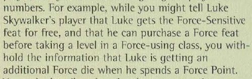

## scan p.143 (scan page 143)

Page contents: Assigning Heroic Qualities: player availability, playing style, campaign focus, moderation (Jacen Solo's animals, Han's luck, Winter's memory); Designing Heroic Qualities; Anakin Skywalker (The Chosen One) (hand-read)

- **Darth Vader (Anakin Skywalker); Yoda** — entry/section: Galactic Campaign Guide (Revised Core): "Anakin Skywalker (The “Chosen One”) Anakin is “the Chosen One” of ancient Jedi prophecies, the one who will “bring balance to the Force.” He is very powerful in the Force, perhaps even more powerful than Yoda." Source: *Galactic Campaign Guide* (SWRPG d20 Revised Core), scan p.143
  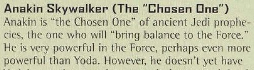
- **Han Solo; Winter Celchu** — entry/section: Moderation: Han's luck, Winter's memory: "Similarly, Han Solo’s luck is easily represented by the scoundrel class ability Lucky. The “perfect memory” of the character Winter, while unusual, should really be a feat rather than a Heroic Quality." Source: *Galactic Campaign Guide* (SWRPG d20 Revised Core), scan p.143
  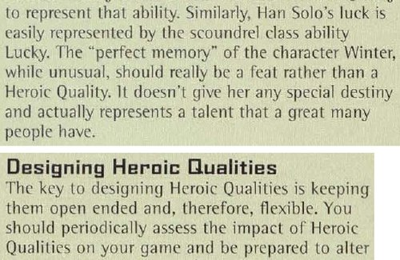

## scan p.144 (scan page 144)

Page contents: Anakin's secret bonuses, drawbacks, design notes; Luke Skywalker (The Bloodline) (hand-read)

- **Darth Vader (Anakin Skywalker)** — entry/section: Galactic Campaign Guide (Revised Core): "In time, fate will force Anakin to face the most powerful darksider in the galaxy, and defeating the villain will cost Anakin his life." Source: *Galactic Campaign Guide* (SWRPG d20 Revised Core), scan p.144
  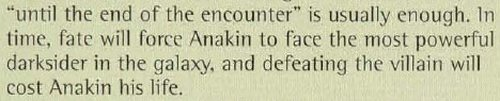
- **Luke Skywalker; Darth Vader (Anakin Skywalker)** — entry/section: Luke Skywalker (The Bloodline): "Luke, the son of Anakin Skywalker, is very strong in the Force as well. His destiny has been hidden from him to keep him safe, and until events cause him to question his tenets, he doesn’t even believe in the Force." Source: *Galactic Campaign Guide* (SWRPG d20 Revised Core), scan p.144
  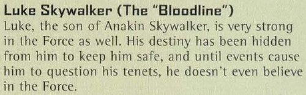
- **Luke Skywalker; Darth Vader (Anakin Skywalker)** — entry/section: Luke's Bloodline drawbacks: "Drawbacks: Though Anakin Skywalker brings balance to the Force, the real hero is his son Luke, who will force his father to examine his feelings and, out of love for Luke, fulfill his destiny. Thus, the drawback to Luke’s Heroic Qualities is that he is brought into conflict with Darth Vader repeatedly; Vader becomes Luke’s personal nemesis. After Anakin’s death, Luke will carry the weight of rebuilding the Jedi Order and using it to help restore justice to the galaxy." Source: *Galactic Campaign Guide* (SWRPG d20 Revised Core), scan p.144
  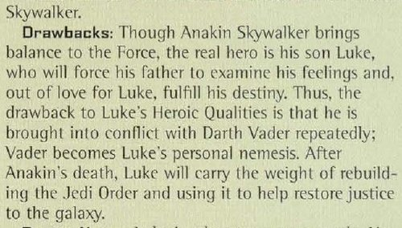
- **Darth Vader (Anakin Skywalker)**: "Anakin receives a number of benefits, but he gets very little mystery— except never really knowing what "bringing balance to the Force" means until he faces and destroys the Emperor." Source: *Galactic Campaign Guide* (SWRPG d20 Revised Core), scan p.144
  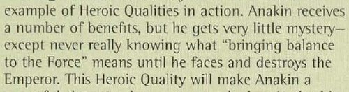

## scan p.145 (scan page 145)

Page contents: Corran Horn (The Legacy); Anakin Solo (The Specialty); The Extraordinary Talent (hand-read)

- **Corran Horn** — entry/section: Corran Horn (The Legacy) bonus: "Bonuses: Corran’s maximum ranks with Affect Mind or Illusion are calculated from his character level, not his Force-user level." Source: *Galactic Campaign Guide* (SWRPG d20 Revised Core), scan p.145
  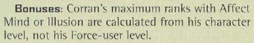
- **Anakin Solo; Darth Vader (Anakin Skywalker)** — entry/section: Anakin Solo (The Specialty): "Named after his grandfather, Anakin Skywalker, Anakin Solo is likewise very strong in the Force. His grandfather's facility with machines seems to have skipped a generation, giving Anakin a certain affinity for anything electronic." Source: *Galactic Campaign Guide* (SWRPG d20 Revised Core), scan p.145
  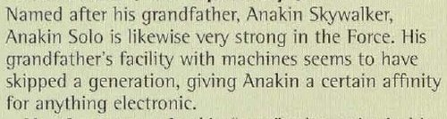
- **Anakin Solo** — entry/section: Anakin Solo sees schematics: "Manifestations: Anakin “sees” schematics in his mind by using the Force and can discern how they work or why they won’t. He merely needs to concentrate on the machine in question in order for this to work." Source: *Galactic Campaign Guide* (SWRPG d20 Revised Core), scan p.145
  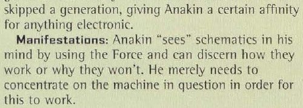
- **Anakin Solo** — entry/section: Anakin Solo bonuses: "Bonuses: Anakin gets the Repair skill as a class skill, no matter what class he takes. Additionally, Anakin may attempt a Repair check as a full-round action to diagnose problems with machines, such as droids or starships." Source: *Galactic Campaign Guide* (SWRPG d20 Revised Core), scan p.145
  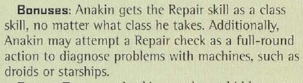
- **Anakin Solo** — entry/section: Anakin Solo secret bonuses: "Secret Bonuses: Anakin can detect hidden machinery merely by coming close to it. You should secretly roll a Search check for Anakin whenever he passes within 2 meters of concealed machinery." Source: *Galactic Campaign Guide* (SWRPG d20 Revised Core), scan p.145
  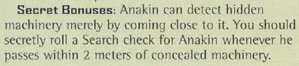
- **Anakin Solo; Darth Vader (Anakin Skywalker)** — entry/section: Anakin Solo drawbacks: "Drawbacks: Because young Anakin Solo has so many things in common with his grandfather, he is in some danger of following in the elder Anakin’s footsteps and turning to the dark side. Also, as a result of seeing so much of the world around him as a machine that needs to be repaired, Anakin has a somewhat simplistic view of life’s problems and how to go about correcting them. He reacts far more analytically than he does emotionally to social conundrums." Source: *Galactic Campaign Guide* (SWRPG d20 Revised Core), scan p.145
  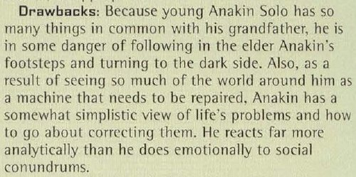
- **Anakin Solo** — entry/section: Anakin Solo design notes: "Design Notes: Anakin Solo, despite being the grandson of the “Chosen One,” is not as “in tune” with the totality of the Force as his grandfather or his older brother, Jacen Solo. He is much more focused on simply being a good warrior, using the Force primarily to further that goal." Source: *Galactic Campaign Guide* (SWRPG d20 Revised Core), scan p.145
  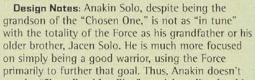
- **Corran Horn** — entry/section: Corran Horn (The "Legacy"): "Manifestations: When Corran attempts to use telekinetic Force powers, he instead taps into his innate talent for mind tricks." Source: *Galactic Campaign Guide* (SWRPG d20 Revised Core), scan p.145
  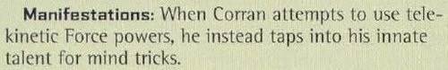
- **Corran Horn** — entry/section: Corran Horn (The "Legacy"): "Drawbacks: Corran may not purchase ranks in any telekinetic Force skill, such as Move Object or Force Strike." Source: *Galactic Campaign Guide* (SWRPG d20 Revised Core), scan p.145
  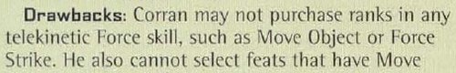
- **Corran Horn** — entry/section: Corran Horn (The "Legacy"): "For Corran to use telekinetic Force skills at all, he must first spend a Force Point." Source: *Galactic Campaign Guide* (SWRPG d20 Revised Core), scan p.145
  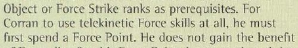
- **Corran Horn** — entry/section: Corran Horn (The "Legacy"): "Note that the text is worded in such a way that those skills are only examples: if more telekinetic Force skills become available later in the campaign, Corran won't be able to take them, either." Source: *Galactic Campaign Guide* (SWRPG d20 Revised Core), scan p.145
  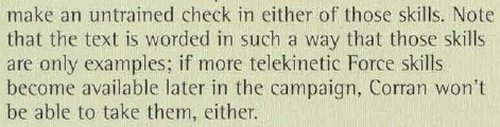

## scan p.146 (scan page 146)

Page contents: The Last King; The Artifact (hand-read)

## scan p.147 (scan page 147)

Page contents: The Artifact cont.; Elements of an Epic Campaign (JD Wiker article); The Hero's Journey; recommended reading; Luke Skywalker's Journey (hand-read)

- **Luke Skywalker; Obi-Wan Kenobi** — entry/section: Luke Skywalker's Journey: "He clings to his life as a moisture farmer, however, and only when his Ordinary World is destroyed (with the death of his aunt and uncle) does he elect to accompany Ben Kenobi (his Mentor) to the world of adventure." Source: *Galactic Campaign Guide* (SWRPG d20 Revised Core), scan p.147
  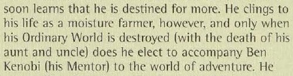
- **Luke Skywalker; Han Solo; Chewbacca; Leia Organa Solo** — entry/section: Luke Skywalker's Journey: "He meets allies—Han Solo, Chewbacca, and Princess Leia—and faces the nearly insurmountable challenge of destroying the Death Star." Source: *Galactic Campaign Guide* (SWRPG d20 Revised Core), scan p.147
  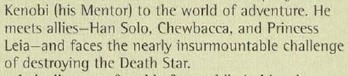

## scan p.148 (scan page 148)

Page contents: Luke's journey cont. (Cloud City failure, rescue of Han, Emperor); Roleplaying the Heroic Journey; Laying the Groundwork (hand-read)

- **Luke Skywalker; Darth Vader (Anakin Skywalker)** — entry/section: Luke Skywalker's Journey: "Luke's heroic journey becomes a bit derailed then, as he spends much of his time trying to undo the consequences of his failure to defeat Vader." Source: *Galactic Campaign Guide* (SWRPG d20 Revised Core), scan p.148
  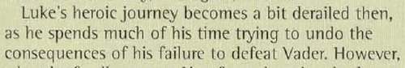

## scan p.149 (scan page 149)

Page contents: Single hero vs group; Executing the Concept; The Ordinary World (hand-read)

## scan p.150 (scan page 150)

Page contents: Ordinary World (Owen and Beru); The Call to Adventure; The Reluctant Hero (Han replaces Owen); The Mentor (Ben's spirit on Hoth) (hand-read)

- **Luke Skywalker**: "(Imagine if, on discovering that his Uncle Owen and Aunt Beru had been killed by stormtroopers, Luke had rejoiced at his freedom from them, rather than grieved over their loss!)" Source: *Galactic Campaign Guide* (SWRPG d20 Revised Core), scan p.150
  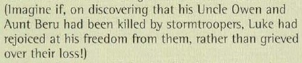

## scan p.151 (scan page 151)

Page contents: The Mentor cont.; Crossing the First Threshold; Tests, Allies, and Enemies (Wedge, R2-D2, C-3PO as static allies); Approach to the Inmost Cave (hand-read)

## scan p.152 (scan page 152)

Page contents: Inmost Cave cont. (Luke's lightsaber and the Emperor on Endor); Supreme Ordeal (hand-read)

- **Luke Skywalker; Palpatine (Darth Sidious)** — entry/section: Luke's lightsaber within reach on the Death Star: "For example, in Return of the Jedi, Luke Skywalker’s lightsaber is taken away when he’s captured by the Imperials on Endor, but the overconfident Emperor not only leaves it within Luke’s easy reach, he also taunts him into taking it up." Source: *Galactic Campaign Guide* (SWRPG d20 Revised Core), scan p.152
  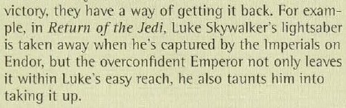

## scan p.153 (scan page 153)

Page contents: The Reward; The Road Back; Designing Adventures (good vs bad design chart); Archetypal Themes: Betrayal (hand-read)

## scan p.154 (scan page 154)

Page contents: Themes: Desire, Duty, Family, Fear, Growth and Understanding, Honor (Han's debts to Jabba), Loss, Mistaken Identity, Sacrifice, Trust (hand-read)

- **Han Solo; Jabba the Hutt** — entry/section: Han's lost honor: "Han Solo loses his honor in the smuggling community by failing to pay off his debts to Jabba; he forges a new reputation by helping his friends eliminate the Hutt crime lord." Source: *Galactic Campaign Guide* (SWRPG d20 Revised Core), scan p.154
  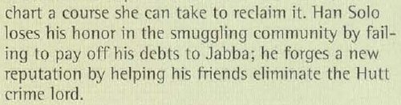

## scan p.155 (scan page 155)

Page contents: Trust (Leia as Boushh with Chewbacca before Jabba); Vengeance; Archetypal Adventure Plots: Collection, Delivery (hand-read)

- **Leia Organa Solo; Chewbacca; Jabba the Hutt** — entry/section: Leia as Boushh: "In Return of the Jedi, Princess Leia, disguised as the bounty hunter Boushh, proves her criminal nature by “capturing” Chewbacca and then threatening Jabba over the reward money." Source: *Galactic Campaign Guide* (SWRPG d20 Revised Core), scan p.155
  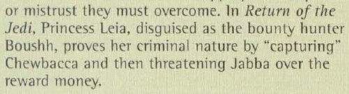

## scan p.156 (scan page 156)

Page contents: Plots: Delivery cont., Destruction, Diplomacy, Escape, Exploration (hand-read)

## scan p.157 (scan page 157)

Page contents: Plots: Investigation, Murder, Proof, Protection, Repair, Sabotage (hand-read)

## scan p.158 (scan page 158)

Page contents: Plots: Sabotage cont., Survival, Victory; Adventure Structures (hand-read)

## scan p.159 (scan page 159)

Page contents: Adventure structures: One-Shot (Mos Eisley escape), Simple, Complex (hand-read)

## scan p.160 (scan page 160)

Page contents: Compound; Conditional; The Final Adventure (High Inquisitor Volytar example); The Final Details (hand-read)

## scan p.161 (scan page 161)

Page contents: The Final Sacrifice; The Journey Home (heroes of Skorrupon); Roleplaying Game Resources sidebar (hand-read)

## scan p.162 (scan page 162)

Page contents: Back cover: blurb, features list, (c)2003 Lucasfilm (hand-read)

