# Owner Material 037 — Star Wars D20 Drive folder (Core, Revised Core and Saga Edition): Sourcebooks/Geonosis and the Outer Rim Worlds.pdf [Star Wars Roleplaying Game Revised Core (d20, 2002)] (scan pages 1–60)

- **Source:** Wizards of the Coast Star Wars Roleplaying Game books, web enhancements, Living Force campaign modules and articles (2000–2010), from the owner's "Star Wars D20" Drive folder (only the three edition subfolders; "General" was not read, as instructed). Secondary source (licensed Legends reference). Scan OCR'd on the box; the scan stays box-only and is **not** published.
- **Method:** every scanned page was OCR'd and machine-screened sentence by sentence for power-relevant statements (fights, kills, defeats, Force feats, rankings, superweapons) that name a character on our roster; each kept sentence is quoted verbatim from the OCR text and has a crop of the printed passage directly under it. Pages with nothing power-relevant are still listed with what is on them.
- **Citation:** "*Geonosis and the Outer Rim Worlds* (SWRPG d20 Revised Core), p.X" by printed page ("scan p.X" where no printed number applies). **Weight:** Licensed RPG material: a secondary source. Narrative text sums up Legends lore; game statistics are rules for players, not canon power levels, and rank lowest.

## scan p.1 (scan page 1)

Page contents: Cover: Star Wars Roleplaying Game - Geonosis and the Outer Rim Worlds (Wizards of the Coast). (hand-read)

## scan p.2 (scan page 2)

Page contents: Title page: Geonosis and the Outer Rim Worlds. (hand-read)

## scan p.3 (scan page 3)

Page contents: Credits, legal and acknowledgments page (WotC, March 2004). (hand-read)

## scan p.4 (scan page 4)

Page contents: Table of contents listing the Outer Rim worlds covered (OCR garbled). (hand-read)

## scan p.5 (scan page 5)

Page contents: Full-page art / blank. (hand-read)

## scan p.6 (scan page 6)

Page contents: Into the Outer Rim: introduction explaining the book follows Coruscant and the Core Worlds and covers Outer Rim planets (Tatooine and Naboo omitted as covered elsewhere); how to use world entries, stats, hooks and eras. (hand-read)

## scan p.7 (scan page 7)

Page contents: Bakura: planetary stats; description and history; Ssi-ruuvi invasion just before Endor; Palpatine had secretly agreed to cede parts of the galaxy to the Ssi-ruuk. (hand-read)

## scan p.8 (scan page 8)

Page contents: Bakura: Corellian Incident; P'w'eck betrayal; people and culture (Balance, Feather and Bowl); Salis D'aar capital. (hand-read)

## scan p.9 (scan page 9)

Page contents: Bakura: Bakur Complex; Arden plant; sidebar HIMS / Beating the Interdictors; IR-3F patrol craft stats; adventure hook Black Hulk Down. (hand-read)

## scan p.10 (scan page 10)

Page contents: Bakura: hook What Goes Up...; NPC stat blocks Conn Doruggan (Male Human Soldier 9/Officer 2) and Bix Arden-Govia (Male Human Scout 8/Starship Ace 3/Noble 2). (hand-read)

### Stat block notes (game mechanics, not feats)

- Conn Doruggan stat block: Conn Doruggan: Male Human Soldier 9/Officer 2; Init +7 (+3 Dex, +4 Improved Initiative); Defense 21 (+7 class, +2 Dex, +2 dodge); DR 3; Spd 10 m; VP/WP 89/ 16; Atk +13/+8 melee (3d4+6, unarmed strike) or +11/+6 ranged (3d8, blaster pistol) or +11/+6 ranged (348/19-20, blaster rifle); SQ Leadership; SV Fort +11, Ref +7, Will +5; SZ M; FP 0; DSP 1; Rep +3; Str 16, Dex 15, Con 16, Int 12, Wis 11, Cha 12. Challenge Code F. (Source: *Geonosis and the Outer Rim Worlds* (SWRPG d20 Revised Core), scan p.10)
- Bix Arden-Govia stat block: Bix Arden-Govia: Male Human Scout 8/Starship Ace 3/ Noble 2; Init +2; Defense 18 (+6 class, +2 Dex); Spd 10 m; VP/WP 62/10; Atk +9/+4 (1d4, knife) or +11/+6 ranged (3d6-1, blaster pistol); SQ Evasion, extreme effort (2/day), familiarity, favor +3, heart +1, inspire confidence, skill mastery (pilot), starship defense, trailblazing, uncanny dodge (can't be flanked), uncanny dodge (Dex bonus Cha 14. Challenge Code E. (Source: *Geonosis and the Outer Rim Worlds* (SWRPG d20 Revised Core), scan p.10)

## scan p.11 (scan page 11)

Page contents: Bakura: Salia Arden-Govia stat block (Female Human Scout 4). Bandomeer: stats, description, history (AgriCorps Enrichment Zones; Offworld Corporation; Qui-Gon Jinn and Obi-Wan Kenobi exposed its corruption; ionite). (hand-read)

- **Qui-Gon Jinn; Obi-Wan Kenobi** — entry/section: Exposed Offworld's corruption on Bandomeer: "Though Offworld had absolute power during the later years of the Republic, nothing lasts forever. Several incidents involving corruption and murder schemes came to plague the company, which Jedi Knight Qui-Gon Jinn and his Padawan Obi-Wan Kenobi were involved in exposing. These illicit activities eventually doomed the company’s monopolistic hold on the world, allowing other interests—among them Arconan Harvest and the allied Home Planet Party—to flourish and bring about positive change." Source: *Geonosis and the Outer Rim Worlds* (SWRPG d20 Revised Core), scan p.11
  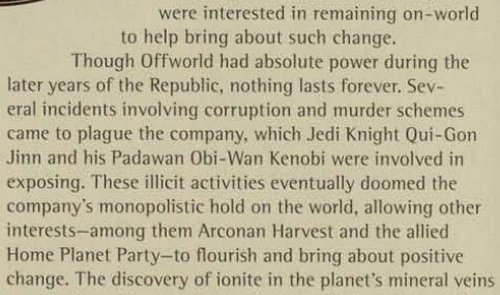

### Stat block notes (game mechanics, not feats)

- Salia Arden-Govia stat block: Salia Arden-Govia: Female Human Scout 4; Init +1: Defense 14 (+3 class, +1 Dex); Spd 10 m; VP/WP 21/10; Atk +4 melee (1d3+1, unarmed strike) or +4 ranged (3d6, blaster pistol); SQ Heart +1, trailblazing, uncanny dodge (Dex bonus to Defense); SV Fort +2, Ref +3, Will +2; SZ M; FP 0; DSP 0; Rep +1; Str 12, Dex 12, Con 10, Int 14, Wis 11, Cha 12. Challenge Code C. (Source: *Geonosis and the Outer Rim Worlds* (SWRPG d20 Revised Core), scan p.11)

## scan p.12 (scan page 12)

Page contents: Bandomeer: people; Bandor; deepsea mining platforms. (hand-read)

## scan p.13 (scan page 13)

Page contents: Bandomeer: ice mines; adventure hook Cold Comfort. (hand-read)

## scan p.14 (scan page 14)

Page contents: Bandomeer: hook Salt of the Earth; stat blocks Governor Sontag (Female Meerian Noble 8) and Kitalic Nirasik (Male Svivreni Tech Specialist 12, continues p15). (hand-read)

### Stat block notes (game mechanics, not feats)

- Governor Sontag stat block: Governor Sontag: Female Meerian Noble 8; Init -1; Defense 15 (+5 class, -1 Dex, +1 size); Spd 6 m; KITALIC NIRASIK VP/WP. 28/14; Atk +7/+2 melee (1d3+1, unarmed strike) or +5/+0 ranged; SQ Bonus class skill (Gather Information), coordinate +2, favor +3, inspire confidence, poison resistance; SV Fort +4, Ref +3, Will +8; SZ M; FP 0; DSP 0; Rep +6; Str 12, Dex 9, Con 14, Int 14, Wis 15, Cha 13. Challenge Code C. (Source: *Geonosis and the Outer Rim Worlds* (SWRPG d20 Revised Core), scan p.14)
- Kitalic Nirasik stat block: Kitalic Nirasik: Male Svivreni Tech Specialist 12; Init +1; Defense 18 (+7 class, +1 Dex); Spd 10 m; VP/WP 44/16; Atk +11/+6 melee (1d3+2, unarmed strike) or +10/+5 ranged (3d8/19-20, blaster rifle); SQ Expert (Knowledge [geology]), expert (Knowledge [mining]), instant mastery (Knowledge ores}), tech specialty (metallurgy specialist +2), research: SV Fort +8, Ref +6, Will +7; SZ M; FP 4; DSP 0; Rep +6; Str 15, Dex 13, Con 16, Int 15, Wis 10, Cha 9. Challenge Code E. (Source: *Geonosis and the Outer Rim Worlds* (SWRPG d20 Revised Core), scan p.14)

## scan p.15 (scan page 15)

Page contents: Bandomeer: Offworld Guard (Imbats; Norta the Toydarian); electro-collar and electro-jabber equipment; Meerian species entry begins. (hand-read)

## scan p.16 (scan page 16)

Page contents: Meerian species traits and Meerian Commoner stats; Svivreni species (Thrawn's attack on Svivren) and traits. (hand-read)

## scan p.17 (scan page 17)

Page contents: Barab I: stats, description, history (lost Jedi mediation; rediscovered under Palpatine's reign). (hand-read)

## scan p.18 (scan page 18)

Page contents: Barab I: Planetary Safaris; war with the Verpine; people (Barabel culture). (hand-read)

## scan p.19 (scan page 19)

Page contents: Barab I: Alater-ka (Captain Osted Alater); Neutral Jedi Zone; hooks Finding the Lost Jedi and Hutt Overboard (Dromo the Hutt, Ullumub). (hand-read)

## scan p.20 (scan page 20)

Page contents: Barab I: stat blocks Korshnak (Male Barabel Soldier 5) and Kursma (Female Barabel Soldier 8); shenbit bonecrusher creature. (hand-read)

### Stat block notes (game mechanics, not feats)

- Korshnak stat block: Korshnak: Male Barabel Soldier 5; Init -1; Defense 16 (+5 class, -1 Dex, +2 natural); DR 4; Spd 8 m; VP/WP 49/14; Atk +9 melee (2d8+6, force pike) or +9 melee (id6+4, bite or tail slap) or +4 ranged (3d8, heavy blaster); SQ +2 species bonus on Fortitude saves against radiation, darkvision, low-light vision; SV Fort +6, Ref +0, Will +3; SZ M; FP 1; DSP 3; Rep +1; Str 18, Dex 9, Con 14, Int 11, Wis 14, Cha 16. Challenge Code C. (Source: *Geonosis and the Outer Rim Worlds* (SWRPG d20 Revised Core), scan p.20)
- Kursma stat block: Kursma: Female Barabel Soldier 8; Init +5 (+1 Dex, +4 Improved Initia- tive); Defense 19 (+6 class, +1 Dex, +2 natural); Spd 10 m; VP/WP 85/16; Atk +12/+7 melee (2d4+4, unarmed strike) or +12/+7 melee (1d6+4, claw or bite or tail slap) or +9/+4 ranged; SQ +2 species bonus on Fortitude \ saves against radiation, darkvision, low-light vision; SV Fort +9, Ref +3, Will +3; SZ M; FPO; DSP 3; Rep + Str 18, Dex 13, Con 16, Int 10, Wis 9, Cha 10. Challenge Code D. (Source: *Geonosis and the Outer Rim Worlds* (SWRPG d20 Revised Core), scan p.20)

## scan p.21 (scan page 21)

Page contents: Barab I: durgolosk creature. Bespin: stats and description (Lando Calrissian's civic improvements made Bespin a destination). (hand-read)

- **Lando Calrissian** — entry/section: Bespin's reputation owed to Lando: "It owes much of its current reputation to the charismatic Lando Calrissian, whose civic improvements and flamboyant reputation have made Bespin a top-notch destination for Outer Rim gamblers and sightseers." Source: *Geonosis and the Outer Rim Worlds* (SWRPG d20 Revised Core), scan p.21
  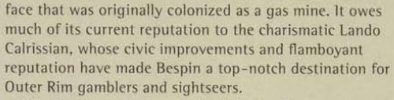

## scan p.22 (scan page 22)

Page contents: Bespin: history (Lando won Cloud City; Vader's trap for Luke; Captain Treece; Zorba the Hutt; Lobot; Thrawn, Desann, Black Sun designs on the city); people. (hand-read)

- **Lando Calrissian; Darth Vader (Anakin Skywalker); Luke Skywalker** — entry/section: Lando wins Cloud City; Vader's trap: "Lando Calrissian won ownership of Cloud City shortly after the Battle of Yavin and increased Tibanna-mining profits by over 35 percent, while simultaneously deflecting the attention of the Mining Guild and the Empire. His triumphs crumbled when Darth Vader set a trap for Luke Skywalker on Bespin and left behind a Cloud City garrison under the command of Captain Treece. Though Calrissian kicked Treece off Bespin, the Empire quickly returned and wasn’t permanently dislodged until after the Battle of Endor." Source: *Geonosis and the Outer Rim Worlds* (SWRPG d20 Revised Core), scan p.22
  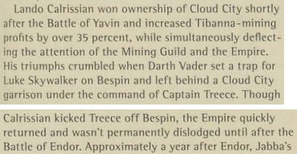

## scan p.23 (scan page 23)

Page contents: Bespin: locations Port Town (Sawthawne), Cloud City, Tibannopolis, Ugnaught surface (King Ozz); airhook. (hand-read)

## scan p.24 (scan page 24)

Page contents: Bespin: hooks Look Out Below! (Baron-Administrator Calrissian hires the heroes), Coup in the Clouds, Hit the Deck. (hand-read)

## scan p.25 (scan page 25)

Page contents: Bespin: stat blocks Commander Flagesso (Male Human Soldier 6), Sawthawne (Male Lutrillian Scoundrel 5/Noble 2/Crime Lord 1), King Ozz (Male Ugnaught Expert 4/Noble 6, continues p26). (hand-read)

### Stat block notes (game mechanics, not feats)

- Commander Flagesso stat block: Commander Flagesso: Male Human Soldier 6; Init +6 (+2 Dex, +4 Improved Initiative); Defense 17 (+5 class, +2 Dex); Spd 10 m; VP/WP 36/12; Atk +7/+2 melee (1441, unarmed strike) or +8/+3 ranged (3d6, blaster pistol); SV Fort +5, Ref +2, Will +2; SZ M; FP 1; DSP 1; Rep +2; LUTRILLIAN Str 12, Dex 14, Con 12, Int 9, Wis 10, Cha 14. Challenge Code C. (Source: *Geonosis and the Outer Rim Worlds* (SWRPG d20 Revised Core), scan p.25)
- Sawthawne stat block: Sawthawne: Male Lutrillian Scoundrel 5/Noble 2/Crime Lord 1; Init +1; Defense 17 (+6 class, +1 Dex); Spd 10 m; VP/WP 24/10; Atk +3 melee (1d3-1, unarmed strike) or +6 ranged (3d6, blaster pistol); SQ Contact, favor +1, illicit barter, inspire confidence, lucky (1/day), precise attack +1; SV Fort +3, Ref +8, Will +7; SZ M; FP 2; DSP 3; Rep +6; Str 8, Dex 12, Con 10, Int 14, Wis 13, Cha 16. Challenge Code D. (Source: *Geonosis and the Outer Rim Worlds* (SWRPG d20 Revised Core), scan p.25)
- King Ozz stat block: King Ozz: Male Ugnaught Expert 4/Noble 6; Init -1; Defense 13 (+3 class, -1 Dex, +1 size); Spd 6 m; VP/WP. 22/12; Atk +7/+2 melee (1d2-1, unarmed strike) or +7/+2 ranged; SQ Coordinate +1, favor +2, inspire confidence, fesource access; SV Fort +4, Ref +3, Will +14; SZ S; F DSP 1; Rep +6; Str 8, Dex 8, Con 12, Int 14, Wis 16, Cha 14. Challenge Code C. (Source: *Geonosis and the Outer Rim Worlds* (SWRPG d20 Revised Core), scan p.25)

## scan p.26 (scan page 26)

Page contents: Lutrillian species; airsquid creature. Clak'dor VII: planetary stats. (hand-read)

## scan p.27 (scan page 27)

Page contents: Clak'dor VII: description and history (Nozho and Weogar city-states, bio-war). (hand-read)

## scan p.28 (scan page 28)

Page contents: Clak'dor VII: people; Nozho University; Weogar; Mezhra Station; hook Beat of a Different Drum (Wurokkk). (hand-read)

## scan p.29 (scan page 29)

Page contents: Clak'dor VII: hooks Bombs Away (Degred Hon) and Accepting Implants. (hand-read)

## scan p.30 (scan page 30)

Page contents: Clak'dor VII: stat blocks Omow Moder (Male Ithorian Force Adept 3/Fringer 2), Prozzen Fosky (Male Bith Noble 9), Talrin Youp (Female Bith Tech Specialist 6/Noble 1). (hand-read)

### Stat block notes (game mechanics, not feats)

- Omow Moder stat block: Omow Moder: Male Ithorian Force Adept 3/Fringer 2: Init +0; Defense 16 (+6 class); Spd 10 m; VP/WP 25/10; Atk +3 melee (1d3, unarmed strike) or +3 ranged; SQ Barter; SV Fort +7, Ref +4, Will +7; SZ M; FP 2; DSP 0; Rep +0; Str 11, Dex 10, Con 10, Int 12, Wis 16, Cha 15. Challenge Code C. (Source: *Geonosis and the Outer Rim Worlds* (SWRPG d20 Revised Core), scan p.30)
- Prozzen Fosky stat block: Prozzen Fosky: Male Bith Noble 9; Init +1; Defense 16 (+5 class, +1 Dex); Spd 10 m; VP/WP 34/10; Atk+6/+1 melee (1d3, unarmed strike) or +7/+2 ranged (3d4, sport- ing blaster pistol); SQ Coordinate +2, favor +3, heightened smell, inspire confidence, micro-vision, resource access; SV Fort +5, Ref +5, Will +6; SZ M; FP 1; DSP 0; Rep +6; Str 11, Dex 13, Con 10, Int 15, Wis 10, Cha 17. Challenge Code D. (Source: *Geonosis and the Outer Rim Worlds* (SWRPG d20 Revised Core), scan p.30)
- Talrin Youp stat block: Talrin Youp: Female Bith Tech Specialist 6/Noble 1; Init +1; Defense 15 (+4 class, +1 Dex); Spd 10 m; VP/ WP 27/11; Atk +4 melee (DC 15 stun, stun baton) or +5 ranged; SQ Expert (Knowledge [technology]), favor +1, heightened smell, micro-vision, research, tech specialty (mechanic); SV Fort +2, Ref +5, Will +5; SZ M; FP 1; DSP 0; Rep +2; Str 10, Dex 12, Con 11, Int 20, Wis 10, Cha 10. Challenge Code D. (Source: *Geonosis and the Outer Rim Worlds* (SWRPG d20 Revised Core), scan p.30)

## scan p.31 (scan page 31)

Page contents: Dathomir: stats and history (Allya exiled; Chu'unthor crash; Gra'aton, Vulatan and Yoda; Quinlan Vos and the Infinity Gate; Imperial prison). (hand-read)

- **Yoda** — entry/section: Yoda arranges the Chu'unthor settlement: "Three Jedi Masters—Gra’aton, Vulatan, and Yoda—came from Coruscant to arrange the release of the Chu'unthor passengers, but the witches and their trained rancors sent the negotiators fleeing back into orbit. Eventually, Yoda arranged a settlement. The Jedi departed, but the wreck of the Chu’unthor remained." Source: *Geonosis and the Outer Rim Worlds* (SWRPG d20 Revised Core), scan p.31
  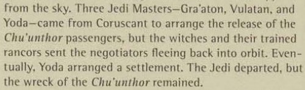
- **Quinlan Vos** — entry/section: Vos destroys the Infinity Gate: "Approximately a year after the Battle of Naboo, the Jedi Council sent Jedi Knight Quinlan Vos to investigate reports of an ancient “Infinity Gate” buried beneath the surface of Dathomir. Going undercover on the interdicted world, Vos discovered that the hidden teleportation chamber had been built millennia earlier by the reptilian Kwa species (whose de-evolved descendants still lived on Dathomir as the animalistic Kwi). Under the malevolent hands of the Nightsisters, the Infinity Gate almost destroyed Coruscant with a wave of energy before Jedi Vos engineered the machine's destruction." Source: *Geonosis and the Outer Rim Worlds* (SWRPG d20 Revised Core), scan p.31
  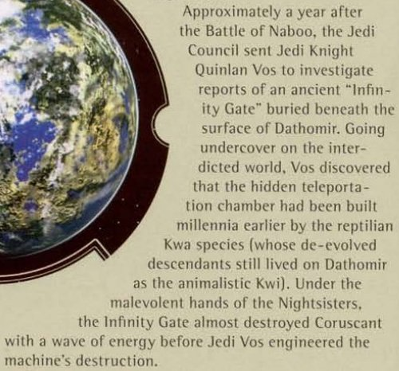
- **Palpatine (Darth Sidious)** — entry/section: Palpatine allows a prison on Dathomir: "It is not known how much Emperor Palpatine knew about the witches’ abilities, but he allowed an Imperial prison to be built on the planet's surface around the time of the Battle of Yavin." Source: *Geonosis and the Outer Rim Worlds* (SWRPG d20 Revised Core), scan p.31
  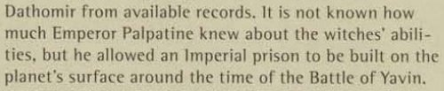

## scan p.32 (scan page 32)

Page contents: Dathomir: history continued (Palpatine destroys prison ships; Gethzerion; Warlord Zsinj and Rancor Base; Han Solo; Teneniel Djo marries Prince Isolder; witches to Luke's academy; Great Canyon Nightsisters; Yuuzhan Vong); people (matriarchy and magic). (hand-read)

- **Palpatine (Darth Sidious); Gethzerion** — entry/section: Palpatine strands the Dathomir prison: "it wasn't long before Palpatine ordered all the prison’s starships destroyed from orbit—apparently to ensure that no Nightsisters could escape off-world to upset his personal hierarchy of Force-using servants. The stranded prison staff became slaves for the Nightsisters and their leader, Gethzerion." Source: *Geonosis and the Outer Rim Worlds* (SWRPG d20 Revised Core), scan p.32
  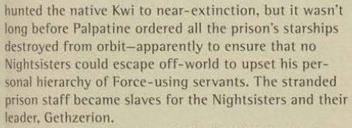
- **Warlord Zsinj; Han Solo; Gethzerion** — entry/section: Zsinj's Rancor Base and death: "Following Palpatine’s death, Warlord Zsinj seized control of the Quelii Sector from the dominant Drackmarians. He soon discovered rich veins of ore on one of Dathomir’s moons, and he built a ten-kilometer shipbuilding facility in planetary orbit, which he nicknamed “Rancor Base.” Zsinj lost his shipyard—and his life—in battle with New Republic general Han Solo four years after Endor. The same conflict saw the death of Nightsister Gethzerion and the end of Dathomir’s isolation." Source: *Geonosis and the Outer Rim Worlds* (SWRPG d20 Revised Core), scan p.32
  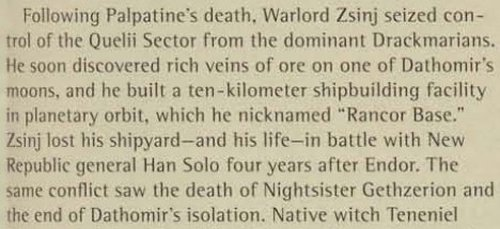
- **Teneniel Djo; Luke Skywalker** — entry/section: Teneniel Djo becomes Queen Mother: "Native witch Teneniel Djo married the off-worlder Prince Isolder to become the Queen Mother of the Hapes Consortium, while several other witches left the planet to study at Luke Skywalker’s Jedi academy." Source: *Geonosis and the Outer Rim Worlds* (SWRPG d20 Revised Core), scan p.32
  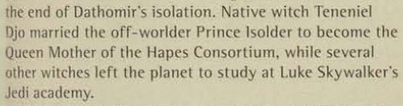

## scan p.33 (scan page 33)

Page contents: Dathomir: locations Great Canyon Clan, Chu'unthor wreck, Imperial prison; Sith abattar. (hand-read)

## scan p.34 (scan page 34)

Page contents: Dathomir: hooks Puppet Master, Relic (Luke's academy), Clash of the Clans; stat block War Chief Robetheri (Female Human Force Adept 6/Dark Force Witch 7). (hand-read)

### Stat block notes (game mechanics, not feats)

- War Chief Robetheri stat block: War Chief Robetheri: Female Human Force Adept 6/Dark Force Witch 7; Init +2; Defense 20 (+8 class, +2 Dex); Spd 10 m; VP/WP 96/13; Atk +11/+6 melee (1d3+2, unarmed strike) or +11/+6 melee (1d6+2, quarterstaff) or +11/+6 melee (1d6+2[+1d8], Force-imbued quarterstaff) or +11/+6 ranged (3d6, blaster pistol); SQ Enshroud, Force flight (10 m), inspire fear -2, spider walk, summon storm; SV Fort +7, Ref +7, Will +10; SZ M; FP 1; DSP 12; Rep +5; Str 15, Dex 14, Con 10, Int 12, Wis 15, Cha 13. Challenge Code D (Source: *Geonosis and the Outer Rim Worlds* (SWRPG d20 Revised Core), scan p.34)

## scan p.35 (scan page 35)

Page contents: Dathomir: stat blocks Clan Mother Mintinee (Female Human Force Adept 8) and Reen (Male Human Fringer 3); purbole and shear mite creatures. (hand-read)

### Stat block notes (game mechanics, not feats)

- Clan Mother Mintinee stat block: Clan Mother Mintinee: Female Human Force Adept 8; Init -1; Defense 15 (+6 class, -1 Dex); Spd 10 m; VP/WP 54/12; Atk +6/+1 melee (1d3, unarmed strike) or +5/+0 ranged; SQ Comprehend speech, Force talisman +2, Force weapon +1d8; SV Fort +4, Ref +4, Will +8; SZ M; FP 6; DSP 2; Rep 4; Str 10, Dex 9, Con 12, Int 14, Wis 18, Cha 16. Challenge Code D. (Source: *Geonosis and the Outer Rim Worlds* (SWRPG d20 Revised Core), scan p.35)
- Reen stat block: Reen: Male Human Fringer 3; Init -1; Defense 13 (+4 class, -1 Dex); Spd 10 m; VP/WP 19/10; Atk +3 melee (1d3+1, unarmed strike) or +1 ranged; SQ Barter, jury-rig +2; SV Fort +3, Ref +2, Will +1; SZ M; FP 1; DSP 0; Rep +0; Str 13, Dex 9, Con 10, Int 12, Wis 14, Cha 12. Challenge Code B. (Source: *Geonosis and the Outer Rim Worlds* (SWRPG d20 Revised Core), scan p.35)

## scan p.36 (scan page 36)

Page contents: Desevro: stats, description, history (Xim the Despot era). (hand-read)

## scan p.37 (scan page 37)

Page contents: Desevro: people; Jigani Port; Maslovar. (hand-read)

## scan p.38 (scan page 38)

Page contents: Desevro: Swamplands; Maslovar copter (Lorrad H-12); hooks Take This Job and..., Something Rotten, A Gift From Xim; stat block Holchas Ap-langhe begins (Male Human Soldier 4/Scoundrel 3). (hand-read)

## scan p.39 (scan page 39)

Page contents: Desevro: Holchas Ap-langhe continued; stat block Sosal (Female Saheelindeeli Scoundrel 5/Noble 4/Crime Lord 3, continues p40). (hand-read)

### Stat block notes (game mechanics, not feats)

- Holchas Ap-langhe stat block: Holchas Ap-langhe: Male Human Soldier 4/Scoundrel 3; Init +6 (+2 Dex, +4 Improved Initiative); Defense 17 (+5 class, +2 Dex); Spd 10 m; VP/WP. 41/9; Atk +6/+1 melee (2d6, vibroblade) or +6/+1 melee (1d4 plus poison, knife) or +6/+1 melee (244, unarmed strike) or +8/+3 ranged (3d6+1, blaster pistol); SQ Illicit barter, lucky (1/day), precise attack +1; SV Fort +4, Ref +6, Will +3; SZ M; FP 0; DSP 4; Rep +2: Str 10, Dex 14, Con 9, Int 14, Wis 12, Cha 14. Challenge Code D (Source: *Geonosis and the Outer Rim Worlds* (SWRPG d20 Revised Core), scan p.39)
- Sosal stat block: Sosal: Female Saheelindeeli Scoundrel 5/Noble 4/Crime Lord 3; Init +6 (+2 Dex, +4 Improved Initiative); Defense 17 (+5 class, +2 Dex); Spd 10 m (12 m on all fours); VP/WP 59/13; Atk +8/+3 melee (1d4+1, knife) or +9/+4 ranged (3d4+1, hold-out blaster pistol); SQ Contact, coordinate +1, favor +2, illicit barter, inspire confidence, inspire fear -2, lucky (1/day), resource access (2/day); SV ort +4, Ref +10, Will +9; SZ M; FP 0; DSP 0; Rep +10; Str 12, Dex 15, Con 13, Int 16, Wis 13, Cha 17. Challenge Code E. (Source: *Geonosis and the Outer Rim Worlds* (SWRPG d20 Revised Core), scan p.39)

## scan p.40 (scan page 40)

Page contents: Desevro: stat block Kual D'Arsan (Male Human Expert 6); Saheelindeeli species entry begins. (hand-read)

### Stat block notes (game mechanics, not feats)

- Kual D'Arsan stat block: Kual D'Arsan: Male Human Expert 6; Init -1; Defense 11 {+2 class, -1 Dex); Spd 10 m; VP/WP 0/8; Atk +2 (1d3-2, unarmed strike) or +3 ranged; SV Fort +1, Ref +1, Will +7; SZ M; FP 8; DSP 1; Rep +1; Str 7, Dex 8, Con 8, Int 18, Wis 15, Cha 10. Challenge Code B. (Source: *Geonosis and the Outer Rim Worlds* (SWRPG d20 Revised Core), scan p.40)

## scan p.41 (scan page 41)

Page contents: Desevro: Saheelindeeli species traits and Saheelindeeli Commoner stats. Endor system: gas giant Endor stats and system table; Forest Moon of Endor stats; description (second Death Star; Palpatine's end); history begins (Moddell Sector). (hand-read)

## scan p.42 (scan page 42)

Page contents: Forest Moon of Endor: history (Sanctuary Pipeline; Palpatine let the Death Star plans leak to lure the Alliance; Nagai; Rokna Blue); people (Ewoks, Yuzzum, Sanyassan Marauders, Gorax); Bright Tree Village; useful flora sidebar (senoti, kata-wata, fgir, perosa). (hand-read)

- **Palpatine (Darth Sidious)** — entry/section: Palpatine leaks the second Death Star plans: "Emperor Palpatine allowed the plans for the second Death Star and details of the Pipeline to fall into Rebel hands as part of his plot to lure the Alliance to Endor and force an end to the Galactic Civil War." Source: *Geonosis and the Outer Rim Worlds* (SWRPG d20 Revised Core), scan p.42
  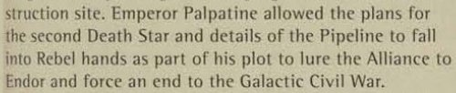

## scan p.43 (scan page 43)

Page contents: Forest Moon of Endor: Bright Tree rulers (Chief Chirpa, Logray, Paploo, Wicket); Salfur's Trading Post; Terak's Keep; hook Blue Period (Tokkat). (hand-read)

- **Wicket W. Warrick** — entry/section: Wicket becomes Bright Tree's chief: "Heroes visiting before The New Jedi Order period will find Bright Tree ruled by Chief Chirpa and the shaman Logray. Logray was banished after the Battle of Endor and replaced by Paploo; a few years later, Chirpa stepped down and Wicket became Bright Tree's chief." Source: *Geonosis and the Outer Rim Worlds* (SWRPG d20 Revised Core), scan p.43
  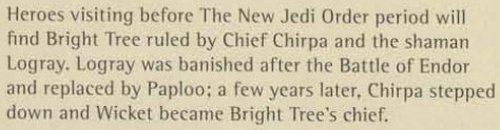

## scan p.44 (scan page 44)

Page contents: Forest Moon of Endor: Blue Period continued (Tu'rsc'yulir, Kintan Gunrunners); hook Yub Yub! Mwah Hah Hah! (Hanging Moss Village); Cobb Salfur biography; Salfur's Trading Post map. (hand-read)

## scan p.45 (scan page 45)

Page contents: Forest Moon of Endor: Cobb Salfur stat block (Male Human Scoundrel 8); King Terak (Male Sanyassan Thug 9; Zakul); Tokkat (Male Ewok Scout 2/Soldier 4); Yuzzum species entry (Joh Yowza of the Max Rebo Band). (hand-read)

- **King Terak** — entry/section: King Terak: "Terak was killed several months before the Battle of Endor, but for a century prior, he was one of the planet's biggest scourges, discussed only in whispers in Ewok villages and Yuzzum burrows alike." Source: *Geonosis and the Outer Rim Worlds* (SWRPG d20 Revised Core), scan p.45
  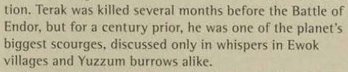

### Stat block notes (game mechanics, not feats)

- Cobb Salfur stat block: Cobb Salfur: Male Human Scoundrel 8; Init +1; Defense 16 (+5 class, +1 Dex); Spd 10 m; VP/WP 41/13; Atk +8/+3 melee (1d6+2, club) or +7/+2 ranged (3d8+3, blaster pistol); SQ Illicit barter, lucky (2/day), precise attack +1; SV Fort +3, Ref +7, Will +3; Cha 11. Challenge Code D. (Source: *Geonosis and the Outer Rim Worlds* (SWRPG d20 Revised Core), scan p.45)
- King Terak stat block: King Terak: Male Sanyassan Thug 9; Init +1; Defense 15 (+3 class, +1 Dex, +1 natural); Spd 10 m; VP/WP 0/12; Atk +11/+6 melee (1d8+2, longsword) or +10/+5 ranged (3d6, blaster pistol); SQ Natural armor; SV Fort +7, Ref +4, Will +4; SZ M; FP 1; DSP 4; Rep +2; Str 15, Dex 13, Con 12, Int 11, Wis 12, Cha 9. Challenge Code C. (Source: *Geonosis and the Outer Rim Worlds* (SWRPG d20 Revised Core), scan p.45)
- Tokkat stat block: Tokkat: Male Ewok Scout 2/Soldier 4; Init +2; m; VP/WP 32/12; Atk +5 melee (2d4-1, vibrodagger) or +8 ranged (3d6, blaster pistol); SQ Trailblaze; SV Fort +7, Ref +4, Will +2; SZ S; FP 0; DSP 0; Rep +1; Str 8, Dex 14, Con 12, Int 10, Wis 9, Cha 11. Challenge Code C. (Source: *Geonosis and the Outer Rim Worlds* (SWRPG d20 Revised Core), scan p.45)

## scan p.46 (scan page 46)

Page contents: Yuzzum species: personality, description, traits and Yuzzum Commoner stats ("Fugitive" Fod). (hand-read)

## scan p.47 (scan page 47)

Page contents: Eriadu: stats and system table; description (polluted factory world; Rimma Trade Route and Hydian Way); history (Quintad; Eriadu Bypass; Clone Wars with Brigadier Gideon Tarkin and Delta-7 starfighters; Wilhuff Tarkin granted the Seswenna Sector; Rebel underground; Peace Brigade). (hand-read)

- **Grand Moff Tarkin** — entry/section: Tarkin granted the Seswenna Sector: "Upon Palpatine’s restructuring of the galactic government, the ambitious Wilhuff Tarkin is granted command of the Seswenna Sector, and Eriadu serves as Governor Tarkin's base of operations." Source: *Geonosis and the Outer Rim Worlds* (SWRPG d20 Revised Core), scan p.47
  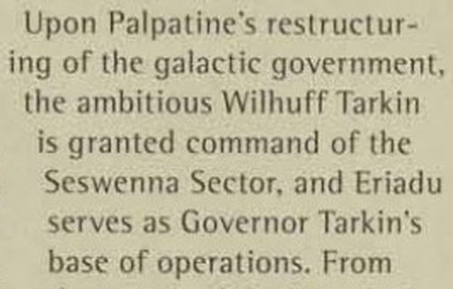

## scan p.48 (scan page 48)

Page contents: Eriadu: people (Wilhuff Tarkin's rise; slave population); Eriadu City (Accutronics, Tarkin Memorial Conference Center); Phelar Port. (hand-read)

- **Grand Moff Tarkin** — entry/section: Tarkin's rise: "The privileged consist of such luminaries as Wilhuff Tarkin (who rises from Lieutenant Governor to Grand Moff between the Battle of Naboo and the Battle of Yavin), as well as several Outer Rim business leaders and high-level bureaucrats." Source: *Geonosis and the Outer Rim Worlds* (SWRPG d20 Revised Core), scan p.48
  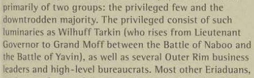

## scan p.49 (scan page 49)

Page contents: Eriadu: Eriadu Manufacturing Shipyards (Valorum family financing); Tarkin Memorial Conference Center map; hooks Yours for the Tarkin (Shella Motti) and The Conference Job begins. (hand-read)

- **Palpatine (Darth Sidious)**: "(During the rule of the Republic, slavery is outlawed, but those laws are not enforced in the Outer Rim; during Palpatine's reign, enslavement of non-Humans is perfectly legal and, in fact, promoted.)" Source: *Geonosis and the Outer Rim Worlds* (SWRPG d20 Revised Core), scan p.49
  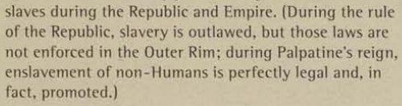

## scan p.50 (scan page 50)

Page contents: Eriadu: The Conference Job continued (Black Sun enforcer); hook Meet the Maker (Peace Brigade, R5 unit); Rivoche Tarkin biography (Biggs Darklighter, General Airen Cracken) and stat block (Female Human Noble 8); Ja field septoid creature begins. (hand-read)

- **Rivoche Tarkin; Biggs Darklighter** — entry/section: Rivoche Tarkin and Biggs Darklighter: "It was at one such function that Rivoche met a dashing young Academy cadet by the name of Biggs Darklighter. Eventually cognizant of Darklighter’s “questionable” ties, Rivoche steeled herself and made the decision to pass Darklighter some sensitive information she was privy to regarding a pending CompForce strike against Duro insurgents. Her hunch about young Darklighter was proven right: The Imperial plans were foiled, thanks to her information. And so it was the young Tarkin passed the point of no return. For the fledgling Rebel Alliance, it was a blessing." Source: *Geonosis and the Outer Rim Worlds* (SWRPG d20 Revised Core), scan p.50
  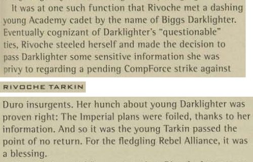

### Stat block notes (game mechanics, not feats)

- Rivoche Tarkin stat block: Rivoche Tarkin: Female Human Noble 8; Init +2; Defense 18 (+6 class, +2 Dex); Spd 10 m; VP/WP 28/14; Atk +8/+3 melee (1d3+2, unarmed strike) or +8/+3 ranged (3d4, hold-out blaster); SQ Bonus class skill (Gather Information), coordinate +2, favor +3, inspire confidence +2, poison resistance; SV Fort +4, Ref +6, Will +9; SZ M; FP 0; DSP 0; Rep +2; Str 14, Dex 14, Con 14, Int 14, Wis 13, Cha 15. Challenge Code D. (Source: *Geonosis and the Outer Rim Worlds* (SWRPG d20 Revised Core), scan p.50)

## scan p.51 (scan page 51)

Page contents: Eriadu: septoid stats; Eriaduan rat creature. Garqi: stats, system table, description. (hand-read)

## scan p.52 (scan page 52)

Page contents: Garqi: history (Cassander Tadrin; Cassandran Worlds; Imperial takeover; independence after Endor; Yuuzhan Vong); people; Pesktda. (hand-read)

## scan p.53 (scan page 53)

Page contents: Garqi: Garqi Agricultural University (Phontos Ojo, Amisus Funti); Pesktda Xenobotanical Garden (bafforr pollen allergy of Yuuzhan Vong armor; Garden burned); Vlassy Nature Preserve. (hand-read)

## scan p.54 (scan page 54)

Page contents: Garqi: hooks Publish and Perish, The Rdava in the Ravine (Chine Gabbard), Extraction of Assets (Rade Dromath); Pesktda map. (hand-read)

## scan p.55 (scan page 55)

Page contents: Garqi: allies and antagonists - Luthus Tadrin (Male Human Expert 3/Diplomat 4/Noble 3), Chine Gabbard (Male Human Expert 2/Diplomat 3/Tech Specialist 5; hafa-vine bioweapon), Rade Dromath biography begins. (hand-read)

### Stat block notes (game mechanics, not feats)

- Luthus Tadrin stat block: Luthus Tadrin: Male Human Expert 3/Diplomat 4/Noble 3; Init +0; Defense 13 (+3 class); Spd 10 m; VP/WP 12/10; Atk +5/+0 melee (1d3-1, unarmed strike) or +6/+1 ranged (3d6, blaster pistol); SQ Favor +4 1/wk, inspire confidence, CHINE GABBARD resource access; SV Fort +3, Ref +4, Will +10; SZ M; FP 0; DSP 0; Rep +7; Str 9, Dex 10, Con 10, Int 13, Wis 10, Cha 15. Challenge Code C. (Source: *Geonosis and the Outer Rim Worlds* (SWRPG d20 Revised Core), scan p.55)
- Chine Gabbard stat block: Chine Gabbard: Male Human Expert 2/Diplomat 3/Tech Specialist 5; Init +0; Defense 13 (+3 class); Spd 10 m; VP/WP 21/12; Atk +5 melee (1d4, unarmed strike) or +5 ranged (3d4+1, blaster pistol); SQ Computer specialist, research; SV Fort +3, Ref +3, Will +9; SZ M; FP 0; DSP 2; Rep +2; Str 11, Dex 11, Con 12, Int 16, Wis 12, Cha 13. Challenge Code C. (Source: *Geonosis and the Outer Rim Worlds* (SWRPG d20 Revised Core), scan p.55)

## scan p.56 (scan page 56)

Page contents: Garqi: Rade Dromath (Dynba Tesc; Male Human Expert 5/Scout 4); new droid Cybot Galactica BigScoop Robo-Harvester. Geonosis: stats and system table; description (Battle of Geonosis starts the Clone Wars). (hand-read)

### Stat block notes (game mechanics, not feats)

- Rade Dromath stat block: Rade Dromath: Male Human Expert 5/Scout 4; Init +5 (+1 Dex, +4 Improved Initiative); Defense 13 (+2 class, +1 Dex); Spd 10 m; VP/WP 17/11; Atk +7/+2 melee (1d4+1, knife) or +7/+2 ranged (348, blaster pistol); SQ Heart +1, trailblaze, uncanny dodge; SV Fort +4, Ref +4, Will +6; SZ M; FP 0; DSP 0; Rep +2; Str 13, Dex 13, Con 11, Int 13, Wis 11, Cha 13. Challenge Code C. (Source: *Geonosis and the Outer Rim Worlds* (SWRPG d20 Revised Core), scan p.56)

## scan p.57 (scan page 57)

Page contents: Geonosis: history (comet impact; spire-hives; petranaki; Baktoid; Darth Sidious funds Poggle the Lesser, who kills Archduke Hadiss the Vaulted; super battle droid; Confederacy; Clone Commandos); people (queens, aristocrats). (hand-read)

- **Palpatine (Darth Sidious); Poggle the Lesser** — entry/section: Darth Sidious funds Poggle the Lesser: "Shortly after the Battle of Naboo, the Sith Lord Darth Sidious set into motion a power play on Geonosis by secretly funding a local rebel named Poggle the Lesser. Poggle, born a low-caste soldier drone, had been struggling to overthrow reigning Archduke Hadiss the Vaulted for years but had nearly exhausted his meager resources. Darth Sidious’s gift of an arsenal of weaponry brought Poggle back from the brink of defeat, and within a year, his revolutionaries had conquered the Stalgasin hive. To complete his triumph, Poggle entered the High Audience Chamber on the Eve of Meckgin, riding on the back of an acklay. The monster tore Hadiss the Vaulted into gory chunks." Source: *Geonosis and the Outer Rim Worlds* (SWRPG d20 Revised Core), scan p.57
  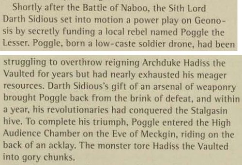
- **Poggle the Lesser** — entry/section: Poggle's super battle droid: "Poggle proved to be even crueler than his predecessor, eliminating all potential challengers by sentencing them to death in the arena. But Poggle’s alliance with Darth Sidious brought about an era of prosperity for Geonosis, thanks to the Sith Lord’s connections with the Trade Federation. Hundreds of thousands of Geonosian-built battle droids were used during the Battle of Naboo. Disgusted with the Trade Federation's disastrous insistence that the droids run on a single master-control signal, Poggle developed combat improvements that resulted in the super battle droid." Source: *Geonosis and the Outer Rim Worlds* (SWRPG d20 Revised Core), scan p.57
  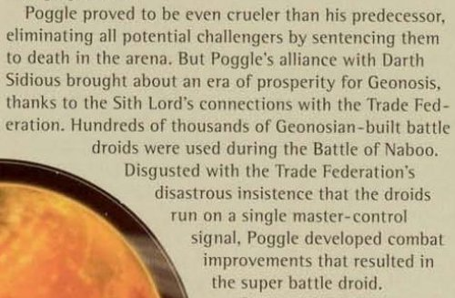

## scan p.58 (scan page 58)

Page contents: Geonosis: drones and subcastes; Golbah uprising destroyed by proton bomb; Stalgasin Hive. (hand-read)

## scan p.59 (scan page 59)

Page contents: Geonosis: droid factories; E'Y-Akh Desert; Marmio Mio's freighter. (hand-read)

## scan p.60 (scan page 60)

Page contents: Geonosis: Golbah's Pit; the Ebon Sea (mutant acklays); execution arena (petranaki); gladiator barracks (Acklay Chopper). (hand-read)

