# Owner Material 037 — Star Wars D20 Drive folder (Core, Revised Core and Saga Edition): Sourcebooks/Geonosis and the Outer Rim Worlds.pdf [Star Wars Roleplaying Game Revised Core (d20, 2002)] (scan pages 61–120)

- **Source:** Wizards of the Coast Star Wars Roleplaying Game books, web enhancements, Living Force campaign modules and articles (2000–2010), from the owner's "Star Wars D20" Drive folder (only the three edition subfolders; "General" was not read, as instructed). Secondary source (licensed Legends reference). Scan OCR'd on the box; the scan stays box-only and is **not** published.
- **Method:** every scanned page was OCR'd and machine-screened sentence by sentence for power-relevant statements (fights, kills, defeats, Force feats, rankings, superweapons) that name a character on our roster; each kept sentence is quoted verbatim from the OCR text and has a crop of the printed passage directly under it. Pages with nothing power-relevant are still listed with what is on them.
- **Citation:** "*Geonosis and the Outer Rim Worlds* (SWRPG d20 Revised Core), p.X" by printed page ("scan p.X" where no printed number applies). **Weight:** Licensed RPG material: a secondary source. Narrative text sums up Legends lore; game statistics are rules for players, not canon power levels, and rank lowest.

## scan p.61 (scan page 61)

Page contents: Geonosis: gladiator barracks map; technology - Geonosian ritual weapons (petranaki array): confessor's whip, picador's spear (OCR of stat tables garbled). (hand-read)

## scan p.62 (scan page 62)

Page contents: Geonosis: petranaki scimitar, caster's net, beastwarden's shield; new vehicle flitknot speeder (Count Dooku's escape at the Battle of Geonosis); hooks Jewel of the Desert (Jabba's caravel, Marmio Mio) and Into the Catacombs (Poggle the Lesser). (hand-read)

- **Count Dooku** — entry/section: Dooku's flitknot escape: "At the Battle of Geonosis, Count Dooku used a flitknot to cover the forty kilometers between the war room and his secret escape hangar." Source: *Geonosis and the Outer Rim Worlds* (SWRPG d20 Revised Core), scan p.62
  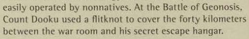

## scan p.63 (scan page 63)

Page contents: Geonosis: Arena! continued (Acklay Chopper); hooks Bug Hunt and Hive Alive (Typtus, Stalgasin vs. Gehenbar); Typtus of the 33rd Egg (Male Geonosian Aristocrat Noble 13); Acklay Chopper biography and stat block (Male Geonosian Expert 2/Soldier 5, continues p64). (hand-read)

### Stat block notes (game mechanics, not feats)

- Typtus stat block: Typtus: Male Geonosian (Aristocrat) Noble 13; Init +0; Defense 19 (+7 class, +2 natural); Spd 10 m, fly 16 m (poor); VP/WP 60/8; Atk +9/+4 melee (1d3, unarmed strike) or +9/+4 ranged; SQ Natural armor, +2 bonus on Fort saves against radiation poisoning, low-light vision, favor +4, inspire confidence, resource access, coordinate +3, inspire greatness; SV Fort +3, Ref +6, Will +13; SZ M; FP 2; DSP 6; Rep +4; Str 10, Dex 10, Con 8, Int 13, Wis 15, Cha 17. Challenge Code F. (Source: *Geonosis and the Outer Rim Worlds* (SWRPG d20 Revised Core), scan p.63)
- Acklay Chopper stat block: Acklay Chopper: Male Geonosian Expert 2/Soldier 5; Init +3 (-1 Dex, +4 Improved Initiative); Defense 18 (+5 class, +1 Dex, +2 natural); Spd 10 m; VP/WP 40/12; Atk +8/+3 melee (2d4+2/19-20, unarmed strike) or +8/+3 melee (1d6+2, sonic staff) or +5/+0 ranged (2d8, sonic staff); SQ: Natural armor, +2 bonus on Fort saves against radiation poisoning, low-light vision; SV Fort +5, Ref +0, Will +5; SZ M; FP 0; DSP 0; Rep +1; Str 14, Dex 8, Con 12, Int 9, Wis 12, Cha 12. Challenge Code D. (Source: *Geonosis and the Outer Rim Worlds* (SWRPG d20 Revised Core), scan p.63)

## scan p.64 (scan page 64)

Page contents: Geonosis: Acklay Chopper stats concluded; Sun Fac (head lieutenant to the archduke; Male Geonosian Aristocrat Diplomat 12); Marmio Mio (spy for competing hives; Female Human Fringer 3/Scout 2); Yubookoo (Wookiee gladiator slave; Male Wookiee Fringer 2/Soldier 6). (hand-read)

### Stat block notes (game mechanics, not feats)

- Sun Fac stat block: Sun Fac: Male Geonosian (Aristocrat) Dip- r lomat 12; Init +1; Defense 17 (+4 class, +1 Dex, +2 natural); Spd 10 m, fly 16 m (poor); VP/ WP 0/8; Atk +6/+1 melee (1d3, unarmed strike) or +7/+2 ranged; SQ Natural armor, +2 bonus on Fort saves against radiation poisoning, low-light vision; SV Fort +3, Ref +5, Will +11; SZM; FP 2; DSP 1; Rep +3; Str 10, Dex 12, Con 8, Int 16, Wis 13, Cha 16. Challenge Code E. (Source: *Geonosis and the Outer Rim Worlds* (SWRPG d20 Revised Core), scan p.64)
- Marmio Mio stat block: Marmio Mio: Female Human Fringer 3/Scout 2; Init +1; Defense 15 (+4 class, +1 Dex); Spd 10 m; VP/WP 22/10; Atk +3 melee (1d3-1, unarmed strike) or +5 ranged (3d8/ 19-20, blaster rifle); SQ Barter, jury-rig +2, trailblazing, heart +1; SV Fort +6, Ref +5, Will +6; SZ M; FP 1; DSP 1; f Rep +0; Str 8, Dex 12, Con 10, Int 12, el oo Wis 17, Cha 10. Challenge Code C. (Source: *Geonosis and the Outer Rim Worlds* (SWRPG d20 Revised Core), scan p.64)
- Yubookoo stat block: Yubookoo: Male Wookiee Fringer 2/Soldier 6; Init +3 (-1 Dex, +4 Improved Initiative); Defense 16 (+7 class, -1 Dex); Spd 10 m; VP/WP 46/12; Atk +10/+5 melee (1d4+3, unarmed strike) or +6/+1 ranged; SQ Rage, extraordinary recuperation, barter, jury-rig +2; SV Fort +9, Ref +3, Will +2; SZ M; FP 2; DSP 0; Rep +2; Str 16, Dex 8, Con 12, Int 10, Wis 10, Cha 12. Challenge Code D. (Source: *Geonosis and the Outer Rim Worlds* (SWRPG d20 Revised Core), scan p.64)

## scan p.65 (scan page 65)

Page contents: Geonosis: Yubookoo skills and feats; new creature merdeth and mip swarm; new creature ur-greedle (stole Jedi lightsabers after the Battle of Geonosis). (hand-read)

## scan p.66 (scan page 66)

Page contents: Geonosis: Swarms sidebar (swarm traits, swarm attack, distraction); ur-greedle stats concluded; new creature mutant acklay. (hand-read)

## scan p.67 (scan page 67)

Page contents: Iego: stats; description (Extrictarium nebula; the Angels); history (legend of the Angels; University of Sanbra); people (Diathim) begins. (hand-read)

## scan p.68 (scan page 68)

Page contents: Iego: Diathim (Angels) and castaways; Maelibi (Demons); the Scatter. (hand-read)

## scan p.69 (scan page 69)

Page contents: Iego: map; Clicksticks Tribe (Darubang Yosa); the Boneyard (star dragon rumor); the Choir Alignment; new vehicle Iego ramshackle. (hand-read)

## scan p.70 (scan page 70)

Page contents: Iego: ramshackle stats; hooks Out of Nowhere and Into the Fire (Coli Carinth). Iego: hook Stranded! (Flax'Supt'ai, Darubang Yosa); Coli Carinth (subverted by the Angels; Female Human Scout 4); Darubang Yosa (Clicksticks leader on Iego over a century; Female Human Soldier 2/Scout 10). (hand-read)

### Stat block notes (game mechanics, not feats)

- Coli Carinth stat block: Coli Carinth: Female Human Scout 4; Init +3; Defense 16 (+3 class, +3 Dex); Spd 10 m; VP/WP 18/10; Atk +3 melee (1d3, unarmed strike) or +3 melee (2d4, vibrodagger) or +6 ranged (3d6, blaster pistol); SQ Trailblazing, heart +1, uncanny dodge (Dex bonus to Defense); SV Fort +2, Ref +5, Will +3; SZ M; FP 1; DSP 2; Rep +1; Str 10, Dex 16, Con 10, Int 9, Wis 13, Cha 11. Challenge Code C. (Source: *Geonosis and the Outer Rim Worlds* (SWRPG d20 Revised Core), scan p.70)
- Darubang Yosa stat block: Darubang Yosa: Female Human Soldier 2/Scout 10; Init +2; Defense 19 (+7 class, +2 Dex); Spd 10 m; VP/WP 59/10; Atk +10/+5 melee (2d4+1/19-20, unarmed strike) or +10/+5 melee (1d6+1, quarterstaff) or +11/+6 ranged (1d8, bow); SQ Trailblazing, heart +1, uncanny dodge (Dex bonus to Defense), uncanny dodge (can’t be flanked), skill mastery (Climb, Jump), extreme effort, evasion; SV Fort +11, Ref +7, Will +6; SZ M; FP 5; DSP 1; Rep +3: Str 12, Dex 15, Con 10, Int 10, Wis 12, Cha 15. Challenge Code E. (Source: *Geonosis and the Outer Rim Worlds* (SWRPG d20 Revised Core), scan p.70)

## scan p.71 (scan page 71)

Page contents: Iego: Darubang Yosa skills/feats; Flax'Supt'ai (blind albino Duinuogwuin star dragon from the Cronese Sweeps era; Female Duinuogwuin Force Adept 16); new species Duinuogwuin begins. (hand-read)

### Stat block notes (game mechanics, not feats)

- Flax'Supt'ai stat block: PARTIAL Flax'Supt'ai: Female Duinuogwuin Force Adept 16; Init +7 (+3 Dex, +4 Improved Initiative); Defense 31 (+9 class, +3 Dex, +17 natural, -8 size); Spd 16 m, fly 20 m (poor); VP/WP 170/200; Atk +12/+7/+2 melee (4d6+12, bite) or +12/+7/+2 melee (2d8+8, 2 front claws) or +7/+2/-3 ranged; SQ Survive in vacuum, breath weapon, Force weapon +2d8, comprehend speech, Force talis- man +4, Improved Heal Another, Improved Heal Self; SV Fort +14, Ref +10, Will +14; SZ C; Face/Reach 18 m by 18 m/6 m; FP 9; DSP 2; Rep +3; Str 26, Dex 16, Con 25, Int 16, Wis 18, Cha 17. (Source: *Geonosis and the Outer Rim Worlds* (SWRPG d20 Revised Core), scan p.71)

## scan p.72 (scan page 72)

Page contents: Duinuogwuin species: physical description, homeworld, language, adventurers (not playable), species traits (variable size, breath weapon, survive in vacuum). (hand-read)

## scan p.73 (scan page 73)

Page contents: Duinuogwuin (Adult) Commoner stats; new creature diathim (Angels); new creature maelibus (Demons). Kamino: stats, system table, description begins. (hand-read)

## scan p.74 (scan page 74)

Page contents: Kamino: description (stilt cities); history (Great Flood; cloning; Darth Tyrannus as Sifo-Dyas contracts the clone army; Obi-Wan Kenobi discovers it; Lama Su; Jango Fett template; Battle of Kamino led by Kenobi with Quinlan Vos and Aayla Secura). (hand-read)

- **Count Dooku; Obi-Wan Kenobi; Padmé Amidala; Jango Fett** — entry/section: Kamino's clone army: "Though some details still remain clouded, it is generally acknowledged that some ten years prior to the Battle of Geonosis, the Kaminoans were contracted by Darth Tyrannus (under the guise of Jedi Knight Sifo-Dyas) to create an army of clones for use by the Republic. When Jedi Obi-Wan Kenobi tracked an assassination attempt on Senator Amidala of Naboo to Kamino, the clone army-in-progress was discovered, and since those events and the onset of the Clone Wars, Kamino has played a largely unseen but key role in galactic affairs. Under the stewardship of Prime Minister Lama Su, the Kaminoans issued their first armies of clone troopers based on the genetic template of the bounty hunter Jango Fett." Source: *Geonosis and the Outer Rim Worlds* (SWRPG d20 Revised Core), scan p.74
  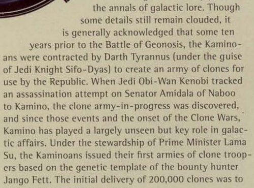

## scan p.75 (scan page 75)

Page contents: Kamino: Battle of Kamino concluded (Master Rancisis); people (Tem Eliss report; Kaminoan society). (hand-read)

## scan p.76 (scan page 76)

Page contents: Kamino: Tipoca City (Kamino Space Control, Planetary Defense; Alderaanian Oversea and Krorral architecture; Battle of Kamino); Military Education Complex (VABS battle simulators; ARC trooper training); Malio Preserve Units begins. (hand-read)

## scan p.77 (scan page 77)

Page contents: Kamino: Malio Preserve Units; Derem City Ruins and map; technology - pocker (Jango Fett makes young Boba turn off the sights). (hand-read)

- **Jango Fett; Boba Fett** — entry/section: Jango trains Boba with a pocker: "(Jango Fett, for example, makes young Boba turn off the sighting mechanisms so that Boba develops his natural instincts and doesn't learn to rely on technology to survive.)" Source: *Geonosis and the Outer Rim Worlds* (SWRPG d20 Revised Core), scan p.77
  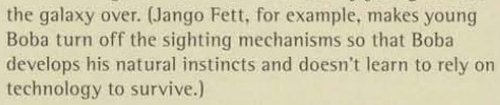

## scan p.78 (scan page 78)

Page contents: Kamino: Merr-Sonn pocker stats; hooks Deep Research - Part II (Qalsneek the Bull holocron in Derem City) and Not Suitable For Cloning (Yuuzhan Vong amphistaff; Kina Ha); Taun We (ministerial assistant to Lama Su; tutors Boba Fett; Female Kaminoan Noble 10); Ko Sai biography begins. (hand-read)

- **Boba Fett; Jango Fett** — entry/section: Taun We tutors Boba: "She serves as the Project Coordinator for the Republic clone army, and she helps rear and tutor young Boba Fett when his father Jango is away on “business.”" Source: *Geonosis and the Outer Rim Worlds* (SWRPG d20 Revised Core), scan p.78
  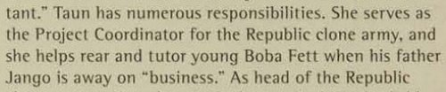

### Stat block notes (game mechanics, not feats)

- Taun We stat block: Taun We: Female Kaminoan Noble 10; Init +2; Defense 18 (+6 class, +2 Dex); Spd 10 m; VP/WP 45/13; Atk +7/+2 melee (1d3, unarmed strike) or +9/+4 ranged (3d6, blaster pistol); SQ Adaptable, favor +5, coordinate +4, inspire confidence +3; SV Fort +4, Ref +7, Will +8; SZ M; FP 0; DSP 0; Rep +3; Str 10, Dex 14, Con 13, Int 15, Wis 12, Cha 12. Challenge Code C. (Source: *Geonosis and the Outer Rim Worlds* (SWRPG d20 Revised Core), scan p.78)

## scan p.79 (scan page 79)

Page contents: Kamino: sidebar What Lies Beneath - rollerfish, aiwha, spike-finned sounder begins; Ko Sai biography continues (mercenary attitude to cloning). (hand-read)

## scan p.80 (scan page 80)

Page contents: Kamino: spike-finned sounder stats; saberjowl creature; Ko Sai (missing after the Separatist attack; Female Kaminoan Tech Specialist 16); Kina Ha biography (Force-using Kaminoan; student of Kras'dohk; vision; Slici Canyon). (hand-read)

### Stat block notes (game mechanics, not feats)

- Ko Sai stat block: Ko Sai: Female Kaminoan Tech Specialist 16; Init +0; Defense 18 (+8 class); Spd 10 m; VP/WP 68/12; Atk +12/ +7/+2 melee (1d3, unarmed strike); SQ Research, instant mastery (Knowledge [clone process]), tech specialty (cloner +2), expert (Knowledge [cloning]), tech specialty (genetic alteration +2), expert (Knowledge [cloning]); SV Fort +8, Ref +7, Will +8; SZ M; FP 0; DSP 0; Rep +8; Str 11, Dex 10, Con 12, Int 19, Wis 12, Cha 10. Challenge Code E. (Source: *Geonosis and the Outer Rim Worlds* (SWRPG d20 Revised Core), scan p.80)

## scan p.81 (scan page 81)

Page contents: Kamino: Kina Ha stat block (Female Kaminoan Jedi Guardian 10); Spar (rogue clone of the first ARC test class; Male Human Thug 8); ARC Trooper description (trained by Jango Fett). (hand-read)

- **Jango Fett** — entry/section: Spar, the rogue clone: "One of the initial one hundred exhibited such independence and free-thinking that he refused the mantle of anonymity and eventually managed to flee the Tipoca City facilities after eight and half years, when he was grown to 17 biological years. The man with whom he shared his genetics, Jango Fett, was off-world, and the Kaminoans were unable to contain him. When he left the planet, he took with him the name he'd heard clone handlers use for him: Spar." Source: *Geonosis and the Outer Rim Worlds* (SWRPG d20 Revised Core), scan p.81
  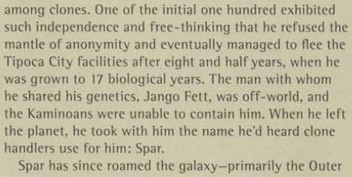
- **Jango Fett** — entry/section: Jango trains the ARC troopers: "Exceptionally capable, the ARC troopers were personally trained by Jango Fett himself for the most critical missions. Because they are somewhat unpredictable, displaying Fett’s personality and independence, the troopers are contained in stasis tubes similar to the Spaarti cylinders encountered by New Republic forces at Mount Tantiss decades later." Source: *Geonosis and the Outer Rim Worlds* (SWRPG d20 Revised Core), scan p.81
  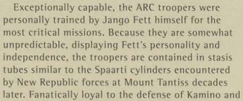
- **Jango Fett**: "Like the standard clonetroopers, the ARC troopers are based on Jango Fett's genetic template but have had their personality dampening lessened relative to the standard trooper, allowing for more independent thinking and enabling the trooper to be capable of more creative crisis resolution and unorthodox means." Source: *Geonosis and the Outer Rim Worlds* (SWRPG d20 Revised Core), scan p.81
  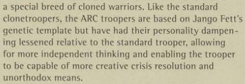

### Stat block notes (game mechanics, not feats)

- Kina Ha stat block: Kina Ha: Female Kaminoan Jedi Guardian 10; Init +3; Defense 20 (+7 class, +3 Dex); Spd 10 m; VP/WP 75/13; Atk +12/+7 melee® (4d8+1/19-20, lightsaber) or +11/+6 (2d4+1/19-20, unarmed strike) or +13/+8 ranged; SQ Deflect (defense +2), deflect (attack -4), deflect (extend defense and attack), block; SV Fort +8, Ref +10, Will +6; SZ M; FP 3; DSP 0; Rep +0 (unknown); Str 12, Dex 17, Con 13, Int 14, Wis 12, Cha 13. Challenge Code D. (Source: *Geonosis and the Outer Rim Worlds* (SWRPG d20 Revised Core), scan p.81)
- Spar stat block: Spar: Male Human Thug 8; Init +1; Defense 15 (+3 class, +2 Dex); DR 5; Spd 10 m; VP/WP 0/12; Atk +9/+4 melee (1d3+1, unarmed strike) or +10/+5 ranged (3d8/ 19-20, sawed-off blaster rifle); SQ Trailblazing, heart +1; SV Fort +7, Ref +3, Will +1; FP 0; DSP 0; Rep +2; Str 12, Dex 13, Con 12, Int 10, Wis 8, Cha 9. Challenge Code C. (Source: *Geonosis and the Outer Rim Worlds* (SWRPG d20 Revised Core), scan p.81)

## scan p.82 (scan page 82)

Page contents: Kamino: ARC trooper armor; first combat alongside Master Ti's forces; ARC Trooper stats (Scout 2/Soldier 6/Elite Trooper 4); KE-8 enforcer ship. Kessel: stats; description (glitterstim). (hand-read)

- **Shaak Ti** — entry/section: ARC troopers fight alongside Master Ti: "The ARC troopers first saw combat during the Separatist attacks on the Kamino cloning facilities at Tipoca City, fighting alongside Master Ti’s forces." Source: *Geonosis and the Outer Rim Worlds* (SWRPG d20 Revised Core), scan p.82
  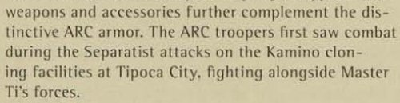

## scan p.83 (scan page 83)

Page contents: Kessel: Maw Cluster; thin air; history (Republic-era medical mining; Imperial prison planet; Garrison moon destroyed by a Death Star prototype; Lando Calrissian's mining droids); people (Republic era). (hand-read)

- **Lando Calrissian** — entry/section: Lando's mining rights on Kessel: "Most recently, Lando Calrissian obtained mining rights and began using mining droids to dig for glitterstim." Source: *Geonosis and the Outer Rim Worlds* (SWRPG d20 Revised Core), scan p.83
  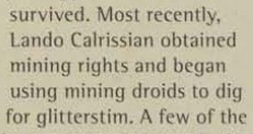

## scan p.84 (scan page 84)

Page contents: Kessel: people (Imperial and later eras); locations - air factories, medical research facilities, Empire garrison, mineshafts (energy spiders, cave-ins). (hand-read)

## scan p.85 (scan page 85)

Page contents: Kessel: hooks The Kessel Run (under 18 parsecs worth bragging rights) and Stick Figures (Chrech Estha of Churruma); Oolea Pimin (Amalgamated Health Systems researcher; Female Human Tech Specialist 9); Jurec Tre (Spiner prisoner; Male Spiner Thug 6). (hand-read)

### Stat block notes (game mechanics, not feats)

- Oolea Pimin stat block: Oolea Pimin: Female Human Tech Specialist 9; Init +0; Defense 15 (+5 class); Spd 10 m; VP/WP 54/14; Atk +5/ +0 melee (143-1, unarmed strike) or +6/+1 ranged (3d6, blaster pistol); SQ Medical specialist +2, research; SV Fort +5, Ref +4, Will +7; SZ M; FP 0; DSP 0; Rep +2; Str 9, Dex 11, Con 14, Int 17, Wis 13, Cha 10. Challenge Code D. (Source: *Geonosis and the Outer Rim Worlds* (SWRPG d20 Revised Core), scan p.85)
- Jurec Tre stat block: Jurec Tre: Male Spiner Thug 6; Init +1; Defense 12 (+2 class); Spd 10 m; VP/WP 0/12; Atk +10/+5 melee (1d3+4, unarmed strike) or +10/+5 melee (1d6+4, vibrodagger) or +3/-2 ranged (2d4, quills) or +7/+2 ranged (3d4, holdout blaster pistol); SQ Quills; SV Fort +6, Ref +3, Will +4; SZ M; FP 0; DSP 2; Rep +1; Str 18, Dex 13, Con 12, Int 8, Wis 13, Cha 8. Challenge Code B. (Source: *Geonosis and the Outer Rim Worlds* (SWRPG d20 Revised Core), scan p.85)

## scan p.86 (scan page 86)

Page contents: Kessel: Jurec Tre equipment/skills/feats; Heyc Nomar (fixer usable in any era; Male Human Fringer 3/Scoundrel 2); new creature energy spider. Kintan: stats. (hand-read)

### Stat block notes (game mechanics, not feats)

- Heye Nomar stat block: Heye Nomar: Male Human Fringer 3/Scoundrel 2; Init +6 (+2 Dex, +4 Improved Initiative); Defense 16 (+4 class, +2 Dex); Spd 10 m; VP/WP 24/12; Atk +3 melee (1d3, unarmed strike) or +3 melee (1d6, club) or +5 ranged; SQ Barter, illicit barter, jury-rig, lucky (1/day); SV Fort +4, Ref +7, Will +2; SZ M; FP. 0; DSP 1; Rep +0; Str 10, Dex 14, Con 12, Int 15, Wis 12, Cha 8. Challenge Code C. (Source: *Geonosis and the Outer Rim Worlds* (SWRPG d20 Revised Core), scan p.86)

## scan p.87 (scan page 87)

Page contents: Kintan: description; history (M'dweshuu nova; Nikto extermination of fauna; Cult of M'dweshuu; Churabba the Hutt; Yuuzhan Vong); people; Gluss'elta Archipelago (Pale Nikto). (hand-read)

## scan p.88 (scan page 88)

Page contents: Kintan: Burning Moon Range and Fire River (Canyon of Despair, Basin of Tortuous Flame); Wannschok sandstorms sidebar; hook A Cult Wind Blows - Part I. (hand-read)

## scan p.89 (scan page 89)

Page contents: Kintan: Part I continued (Ma'kis'shaalas and his Hiitian Padawan); hook The One That Got Away; the Morgukai (Tsyr and Bok; Tsyr felled by Quinlan Vos; Bok survived a duel with Aayla Secura); Morgukai Warrior stats (Red Nikto Soldier 6/Elite Trooper 3). (hand-read)

- **Aayla Secura; Quinlan Vos** — entry/section: Geonosis and the Outer Rim Worlds: "Ultimately, Tsyr was felled by Quinlan Vos at Fortress Kh'aris on Kintan; younger Bok scarcely survived a duel against Aayla Secura." Source: *Geonosis and the Outer Rim Worlds* (SWRPG d20 Revised Core), scan p.89
  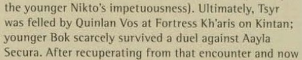
- **Tsyr; Bok (Morgukai); Quinlan Vos; Aayla Secura** — entry/section: Tsyr and Bok: "Ultimately, Tsyr was felled by Quinlan Vos at Fortress Kh'aris on Kintan; younger Bok scarcely survived a duel against Aayla Secura. After recuperating from that encounter and now fitted with a prosthetic right hand, Bok went on a mission to defeat the Jedi." Source: *Geonosis and the Outer Rim Worlds* (SWRPG d20 Revised Core), scan p.89
  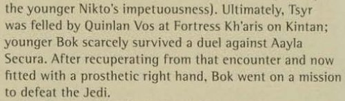

## scan p.90 (scan page 90)

Page contents: Kintan: Ma'kis'shaalas (former Morgukai turned Jedi; known to Yoda, Windu and Tsyr; Male Nikto Soldier 4/Elite Trooper 2/Jedi Guardian 3); new creature Kintan strider (guard beasts of Jabba, Zorba and Durga; dejarik piece). (hand-read)

- **Yoda; Mace Windu; Tsyr** — entry/section: Ma'kis'shaalas's secret history: "Ma’kis’shaalas’s history, however, is another story, one of which only Master Yoda, Master Windu, and a Nikto warrior known as Tsyr are aware." Source: *Geonosis and the Outer Rim Worlds* (SWRPG d20 Revised Core), scan p.90
  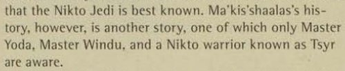
- **Jabba the Hutt** — entry/section: Hutts' Kintan striders: "Hutt lords such as Jabba, Zorba, and Durga have further popularized the creature's use as a guard (and attack) beast." Source: *Geonosis and the Outer Rim Worlds* (SWRPG d20 Revised Core), scan p.90
  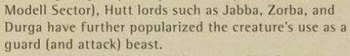

### Stat block notes (game mechanics, not feats)

- Ma'kis'shaalas stat block: Ma’kis’shaalas: Male Nikto Soldier 4/Elite Trooper 2/Jedi Guardian 3; Init +1; Defense 20 (+7 class, +1 Dex, +2 natural); DR 3; Spd 10 m; VP/WP 94/17; Atk +12/+7 melee (3d8/19-20, lightsaber) or +8/+8/+3 melee (1d6+3/ 1d8+3, cortosis staff) or +10/+5 ranged (3d6, blaster pistol); SQ Desert dweller, natural armor, uncanny dodge; SV Fort +13, Ref +7, Will +7; SZ M; FP 2; DSP 0; Rep +4; Str 16, Dex 13, Con 17, Int 11, Wis 14, Cha 9, Challenge Code E. (Source: *Geonosis and the Outer Rim Worlds* (SWRPG d20 Revised Core), scan p.90)

## scan p.91 (scan page 91)

Page contents: Kintan strider stats. Makem Te: stats and system table. (hand-read)

## scan p.92 (scan page 92)

Page contents: Makem Te: history continued (Temple of the Beatific Razor; Clone Wars protection deal with Count Dooku's Separatists; Imperial world for twenty years after Endor; Yuuzhan Vong raid); people (Swokes Swokes physiology, double names, implanted jewelry); the Tract. (hand-read)

## scan p.93 (scan page 93)

Page contents: Makem Te: Thousand Thousand map and description; Mining Machine No. 9; new equipment coiling tack and schinga electropole. (hand-read)

## scan p.94 (scan page 94)

Page contents: Makem Te: hooks A Grave Situation (caliph Azook of Denden), Snake Handlers, War Zone; Woorta Woorta (schinga breeder; Female Swokes Swokes Noble 8); Fabswa the Mutilated (First Glorious Assassin of the Beatific Razor; Male Swokes Swokes Scoundrel 7/Soldier 5). (hand-read)

### Stat block notes (game mechanics, not feats)

- Woorta Woorta stat block: Woorta Woorta: Female Swokes Swokes Noble 8; Init -1; Defense 15 (+5 class, -1 Dex, +1 natural); Spd 10 m; VP/WP 25/14; Atk +6/+1 melee (1d3, unarmed strike) or +5/+0 ranged; SQ Limb regeneration, favor +3, inspire confidence, resource access, coordinate +2; SV Fort +5, Ref +3, Will +7; SZ M; FP 1; DSP 0; Rep +3; Str 10, Dex 8, Con 14, Int 12, Wis 12, Cha 16. Challenge Code C. (Source: *Geonosis and the Outer Rim Worlds* (SWRPG d20 Revised Core), scan p.94)
- Fabswa the Mutilated stat block: Fabswa the Mutilated: Male Swokes Swokes Scoun- drel 7/Soldier 5; Init +6 (+2 Dex, 4 Improved Initiative); Defense 21 (+8 class, +2 Dex, +1 natural); Spd 10 m; VP/WP 55/14; Atk +10/+5 melee (1d3, unarmed strike) or +10/+5 melee (2d4, vibrodagger) or +12/+7 ranged (3d6/ 19-20, blaster pistol) or +12/+7 ranged (DC 15/12 stun, stun grenade); SQ Limb regeneration, illicit barter, lucky (2/day), precise attack +1; SV Fort +9, Ref +8, Will +5; SZ M; FP 0; DSP 0; Rep + tr 10, Dex 15, Con 14, Int 12, Wis 14, Cha 9. Challenge Code D. (Source: *Geonosis and the Outer Rim Worlds* (SWRPG d20 Revised Core), scan p.94)

## scan p.95 (scan page 95)

Page contents: Makem Te: Fabswa feats concluded; Burba of Strekk (flatstender; Male Swokes Swokes Fringer 4); new species Swokes Swokes. (hand-read)

### Stat block notes (game mechanics, not feats)

- Burba of Strekk stat block: Burba of Strekk: Male Swokes Swokes Fringer 4; Init +0; Defense 15 (+4 class, +1 natural); Spd 10 m; VP/WP. 16/14; Atk +4 melee (1d3+1, unarmed strike) or +3 ranged (346, blaster pistol); SQ Limb regeneration, trailblazing, heart +1, uncanny dodge (Dex bonus to Defense); SV Fort +8, Ref +2, Will +3; SZ M; FP 0; DSP 0; Rep +1; Str 12, Dex 10, Con 14, Int 8, Wis 14, Cha 8. Challenge Code C. (Source: *Geonosis and the Outer Rim Worlds* (SWRPG d20 Revised Core), scan p.95)

## scan p.96 (scan page 96)

Page contents: Swokes Swokes species traits and commoner; new creature schinga shikou. Mon Calamari: stats, system table, description; history begins (orbital habitats). (hand-read)

## scan p.97 (scan page 97)

Page contents: Mon Calamari: history (colonies; Republic contact; Count Dooku's Dark Reaper attack; Commander Merai dies at Kamino; Imperial conquest and failure of the shipyards; Obo Rin propaganda; uprising drives the Empire out). (hand-read)

- **Count Dooku** — entry/section: Dooku attacks Mon Calamari with the Dark Reaper: "That began to change with the rise of Count Dooku's Separatist movement. Dooku, a collector of obscure alien starships, visited Mon Calamari during this period and judged the shipyards to be nearly as sophisticated as the Republic yards at Fondor and Gyndine. When the Calamarian Council refused Dooku's offer to join the Confederacy of Independent Systems, Dooku knew he needed to neutralize this potential threat. During the Clone Wars, Dooku attacked Mon Calamari with the Dark Reaper superweapon, killing millions and crippling shipyard production." Source: *Geonosis and the Outer Rim Worlds* (SWRPG d20 Revised Core), scan p.97
  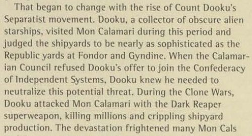

## scan p.98 (scan page 98)

Page contents: Mon Calamari: Ackbar rescued from Tarkin; joins the Rebellion after Yavin; Ackbar at Endor; World Devastators of the reborn Emperor; Admiral Daala destroys Reef Home; New Republic capital at Heurkea under Cal Omas; people (Mon Cals and Quarren; Quarren War). Mon Calamari: sidebar on the name Dac; Dac Extremists; locations - the Floating Cities (Coral City, Foamwander, Heurkea and Kee-Piru damaged by Palpatine's World Devastators; Reef Home destroyed by Daala); the Sunken Cities (Hikahi, Coral Depths, Aquarius). (hand-read)

- **Admiral Ackbar** — entry/section: Ackbar at the Battle of Endor: "Following the Battle of Yavin, the Calamarian Council reversed itself and agreed to become part of the Rebellion. Nearly four years later, Admiral Ackbar led Mon Calamari’s finest warships to victory at the Battle of Endor." Source: *Geonosis and the Outer Rim Worlds* (SWRPG d20 Revised Core), scan p.98
  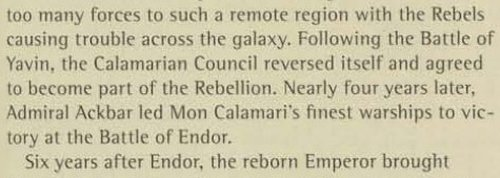
- **Palpatine (Darth Sidious); Admiral Daala** — entry/section: World Devastators and Daala's raid: "Six years after Endor, the reborn Emperor brought destruction to Mon Calamari on a scale not seen since the reprisals that triggered the planet's uprising, as World Devastators slaughtered Mon Cal and Quarren cities. A year later, Admiral Daala raided the world with a small fleet of Star Destroyers, destroying the floating city of Reef Home." Source: *Geonosis and the Outer Rim Worlds* (SWRPG d20 Revised Core), scan p.98
  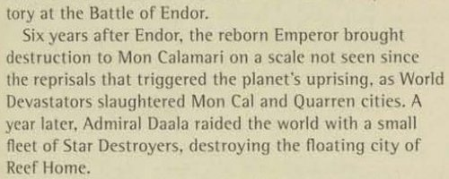
- **Admiral Ackbar; Grand Moff Tarkin**: "Mon Cal warships entered Alliance service, Rebel warships were dispatched to protect the sector, and the legendary Ackbar served as an unofficial member of the Alliance's high command following his rescue from enslavement at the hands of Grand Moff Tarkin." Source: *Geonosis and the Outer Rim Worlds* (SWRPG d20 Revised Core), scan p.98
  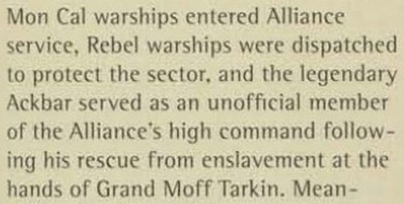
- **Admiral Daala**: "The damage inflicted upon the planet in the post-Endor era (first by the resurrected Emperor's World Devastators, then by Admiral Daala's Imperial fleet) widened the gap between the two populations." Source: *Geonosis and the Outer Rim Worlds* (SWRPG d20 Revised Core), scan p.98
  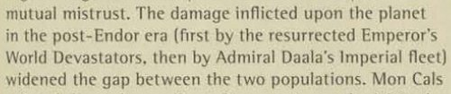

## scan p.99 (scan page 99)

Page contents: Mon Calamari: Alopia Rift; Mkbuto Seatree Preserve (Ackbar's retirement research and memoirs); the Knowledge Bank and using it (DC table); Algae Sward (World Devastator Nullifier-5 wreck) and Seascape; new vehicle Mon Cal submersible. (hand-read)

- **Admiral Ackbar** — entry/section: Ackbar's retreat in the Mkbuto Seatree Preserve: "When Admiral Ackbar retired from New Republic service following the Emperor’s World Devastator attacks, he researched the Mkbuto region's tectonic plate activity from a floating habitat in the Seatree Preserve. Later, during Borsk Fey'lya’s tenure as chief of state, Ackbar returned to his cozy seapod to complete his memoirs." Source: *Geonosis and the Outer Rim Worlds* (SWRPG d20 Revised Core), scan p.99
  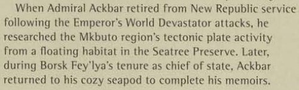

## scan p.100 (scan page 100)

Page contents: Mon Calamari: new vehicle LS Crestrunner; hook Into the Briny Blue (Administrator Seegree; Aquarius whaladon processing). (hand-read)

## scan p.101 (scan page 101)

Page contents: Mon Calamari: hooks Wreck Diving, Depth Charge, Sunken Treasure (fake repulsor chamber; Colonel Guarran, Haum Do, Bringe), Nice Doing Business With You (Malgio); Colonel Guarran (Director of Shipyard Defense, Foamwander Five; Male Mon Calamari Scoundrel 6/Soldier 2); Haum Do (Kaminoan TriNebulon News reporter). (hand-read)

### Stat block notes (game mechanics, not feats)

- Colonel Guarran stat block: Colonel Guarran: Male Mon Calamari Scoundrel 6/ Solider 2; Init +7 (+3 Dex, +4 Improved Initiative); Defense 18 (+5 class, +3 Dex); Spd 10 m, swim 6 m; VP/WP 58/14; Atk +7/+2 melee (1d3+1, unarmed strike) or +9/+4 ranged (3d6, blaster pistol); SQ Breathe under- water, illicit barter, low-light vision, lucky (2/day), precise attack +1; SV Fort +7, Ref +8, Will +1 (dry environments) or +3 (moist or watery environments); SZ M; FP 1; DSP 2; Rep +5; Str 12, Dex 16, Con 14, Int 10, Wis 9, Cha 13. Challenge Code D. (Source: *Geonosis and the Outer Rim Worlds* (SWRPG d20 Revised Core), scan p.101)

## scan p.102 (scan page 102)

Page contents: Mon Calamari: Haum Do stats (Female Kaminoan Expert 4); Bringe (pressure-suited Mon Cal bounty hunter; Scout 4/Scoundrel 2/Bounty Hunter 6); Malgio (Quarren starshipwright; Male Quarren Expert 7). (hand-read)

### Stat block notes (game mechanics, not feats)

- Haum Do stat block: Haum Do: Female Kaminoan Expert 4; Init +0; Defense 11 (+1 class); Spd 10 m; VP/WP 0/12; Atk +3 melee (1d3, unarmed strike) or +3 ranged; SQ Adaptable; SV Fort +2, Ref +1, Will +5; SZ M; FP 0; DSP 0; Rep +1; Str 10, Dex 10, Con 12, Int 14, Wis 12, Cha 18. Challenge Code B. (Source: *Geonosis and the Outer Rim Worlds* (SWRPG d20 Revised Core), scan p.102)
- Malgio stat block: Malgio: Male Quarren Expert 7; Init -1; Defense 11 (+2 class, -1 Dex); Spd 10 m, swim 6 m; VP/WP 0/12; Atk +5 melee (1d3, unarmed strike) or +4 ranged; SQ Amphibious, low-light vision; SV Fort +3, Ref +1, Will +5; BRINGE SZ M; FP 0; DSP 0; Rep +1; Str 10, Dex 8, Con 12, Int 16, Wis 11, Cha 13. Challenge Code D. (Source: *Geonosis and the Outer Rim Worlds* (SWRPG d20 Revised Core), scan p.102)
- Bringe stat block: PARTIAL Bringe: Male Mon Calamari Scout 4/Scoundrel 2/Bounty Hunter 6; Init +5 (+1 Dex, +4 Improved Initiative); Defense 17 (+6 class, +1 Dex); DR 6; Spd 6 m, powered swim 8 m; VP/WP 62/12; Atk +12/+7 melee (1d3+2, unarmed strike) or +12/+7 melee (2d6+2, vibroblade) or +11/+6 ranged (3d8, heavy blaster pistol); SQ Breathe underwater, low-light vision, trailblazing, heart +1, uncanny dodge, illicit barter, lucky (1/day), target bonus +3, sneak attack +3d6, unique physiology; SV Fort +4, Ref +9, Will +6 (dry environments) or +8 (moist or watery environments); SZ M; FP 3; DSP 6; Rep +5; Str 14, Dex 12, Con 8, Int 13, Wis 14, Cha 10. (Source: *Geonosis and the Outer Rim Worlds* (SWRPG d20 Revised Core), scan p.102)

## scan p.103 (scan page 103)

Page contents: Mon Calamari: Malgio skills/feats; Seegree (administrator of Foamwander City; Female Mon Calamari Expert 12); new creature sussimi; blossoming gulper begins. (hand-read)

### Stat block notes (game mechanics, not feats)

- Seegree stat block: Seegree: Female Mon Calamari Expert 12; Init +0; Defense 14 (+4 class); Spd 10 m, swim 6 m; VP/WP 0/8; Atk +8/+3 melee (1d3-1, unarmed strike) or +9/+4 MALGIO ranged (3d4, hold-out blaster); SQ Amphibious, low-light vision; SV Fort +3; Ref +4; Will +9 (dry environments) or +11 (moist or watery environments); SZ M; FP 1; DSP 1; Rep +6; Str 9, Dex 10, Con 8, Int 12, Wis 11, Cha 16. Challenge Code B. (Source: *Geonosis and the Outer Rim Worlds* (SWRPG d20 Revised Core), scan p.103)

## scan p.104 (scan page 104)

Page contents: Mon Calamari: blossoming gulper stats; nano-star; whaladon. Muunilinst: stats and system table. (hand-read)

## scan p.105 (scan page 105)

Page contents: Muunilinst: description (Moneylend; smokers); history (Sartinaynian; IGBC guarantor of the Republic credit; Hailfire Droids; Clone Wars battles; Palpatine keeps Muun backing for the Imperial credit; New Republic credit; Yuuzhan Vong bombardment); people (Muuns, clans). (hand-read)

- **Palpatine (Darth Sidious)** — entry/section: Palpatine and the Imperial credit: "After the fall of the Republic, Muunilinst escaped the full brunt of the Emperor's anti-alien bias: Palpatine knew an Imperial credit not backed by Muun wealth wouldn't be accepted." Source: *Geonosis and the Outer Rim Worlds* (SWRPG d20 Revised Core), scan p.105
  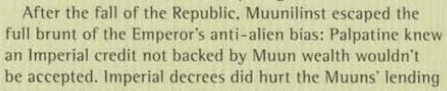

## scan p.106 (scan page 106)

Page contents: Muunilinst: Harnaidan; High Port (Iotran Guard; Imperial monitors; Golan Defense Platforms); Mariunhus vault-spire; High Port map and key. (hand-read)

## scan p.107 (scan page 107)

Page contents: Muunilinst: Iotran Guard and typical guard stats; Iotran rifle-ax; new vehicle SoroSuub AGQ-1 submersi-speeder; hooks High Port Hijinks and Dress Rehearsal. (hand-read)

## scan p.108 (scan page 108)

Page contents: Muunilinst: Dress Rehearsal concluded; hook Murder at 4,000 Meters; Riklon Tost (Iotran Guard captain who helped San Hill escape Geonosis; Male Iotran Soldier 6/Elite Trooper 6). (hand-read)

- **San Hill** — entry/section: Riklon Tost and San Hill: "Tost helped IGBC Chairman San Hill escape the debacle at Geonosis and commanded Hailfire Droids during the Clone Wars—experiences that taught him Muun power was better wielded in the boardroom rather than on the battlefield." Source: *Geonosis and the Outer Rim Worlds* (SWRPG d20 Revised Core), scan p.108
  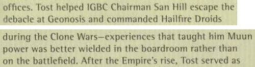

### Stat block notes (game mechanics, not feats)

- Riklon Tost stat block: Riklon Tost: Male lotran Soldier 6/Elite Trooper 6; Init +2; Defense 20 (+8 class, +2 Dex); DR 5; Spd 8 m; VP/WP 89/13; Atk +16/+11/+6 melee (2d10+6, rifle-ax) or +15/+10/+5 ranged (3d6+3, rifle ax); SQ Uncanny dodge (Dex bonus), weapon specialization (lotran rifle-ax); SV Fort +11, Ref +7, Will +5; SZ M; FP 0; DSP 0; Rep +5; Str 14 (16 in armor), Dex 14, Con 13, Int 11, Wis 11, Cha 10. Challenge Code F. (Source: *Geonosis and the Outer Rim Worlds* (SWRPG d20 Revised Core), scan p.108)

## scan p.109 (scan page 109)

Page contents: Muunilinst: Riklon Tost feats; Aemont Sillib (IGBC loan officer; Male Muun Diplomat 6); Esa Parna (NRI agent, aide to Lon Kinnik; Female Human Scoundrel 9). Ossus: stats, system table, description (Cron Drift; figure-eight orbit). (hand-read)

### Stat block notes (game mechanics, not feats)

- Aemont Sillib stat block: Aemont Sillib: Male Muun Diplomat 6; Init -1; Defense 11 (+2 class, -1 Dex); Spd 10 m; VP/WP 0/11; Atk +2 melee (1d3-1, unarmed strike) or +2 ranged (3d4+1, hold-out blaster pistol); SQ None; SV Fort +2, Ref +1, Will +6; SZ M; FP 0; DSP 0; Rep +7; Str 9, Dex 9, Con 11, Int 16, Wis 13, Cha 14, Challenge Code A. (Source: *Geonosis and the Outer Rim Worlds* (SWRPG d20 Revised Core), scan p.109)
- Esa Parna stat block: Esa Parna: Female Human Scoundrel 9; Init +6 (+2 Dex, +4 Improved Initiative); Defense 20 (+6 class, +2 Dex, +2 dodge); Spd 10 m; VP/WP 49/12; Atk +6/+1 melee (1d4, unarmed strike) or +8/+3 ranged (3d8, heavy blaster pistol) or +6/+6/+1 ranged (38, heavy blaster pistol using Rapid Shot); SQ Mlicit barter, lucky 2/day, pre- cise attack +2; SV Fort +4, Ref +8, Will +5; SZ M; FP 0; DSP 0; Rep +2; Str 11, Dex 14, Con 12, Int 15, Wis 14, Cha 14, Challenge Code E. (Source: *Geonosis and the Outer Rim Worlds* (SWRPG d20 Revised Core), scan p.109)

## scan p.110 (scan page 110)

Page contents: Ossus: moons Mim and Nerit; history (Jedi stronghold; Great Sith War - Crado and Aleema with Ulic Qel-Droma and Exar Kun ignite the Cron Cluster; Ysanna descendants met by Luke Skywalker and Kam Solusar; Ood Bnar guards the lightsaber vaults and later aids them against Executor Sedriss; NJO era); people; Knossa Spaceport begins. (hand-read)

- **Crado; Aleema Keto; Ulic Qel-Droma; Exar Kun** — entry/section: The Cron Cluster ignited: "Ossus changed dramatically during the Great Sith War. Former Jedi Crado and Aleema Kato, working with Ulic Qel-Droma and Exar Kun, succeed in igniting the ten stars of the nearby Cron Cluster." Source: *Geonosis and the Outer Rim Worlds* (SWRPG d20 Revised Core), scan p.110
  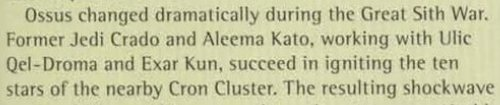
- **Luke Skywalker; Kam Solusar** — entry/section: The Ysanna: "(Their descendants, over the centuries, constitute the Ysanna society that Luke Skywalker and Kam Solusar encounter some years after the Battle of Endor.)" Source: *Geonosis and the Outer Rim Worlds* (SWRPG d20 Revised Core), scan p.110
  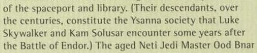
- **Ood Bnar; Exar Kun; Luke Skywalker; Kam Solusar** — entry/section: Ood Bnar stays behind: "The aged Neti Jedi Master Ood Bnar also stayed behind to protect Ossus’ lightsaber vaults from the plundering Sith and Krath looters. Exar Kun and his followers succeeded in stealing some relics and dark side lore, but even they had to flee the pending destruction. Master Bnar, however, survived the intense radiation rained on the world’s surface and, nearly four thousand years later, was still able to assist Skywalker and Solusar in their struggle against Executor Sedriss." Source: *Geonosis and the Outer Rim Worlds* (SWRPG d20 Revised Core), scan p.110
  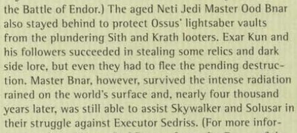

## scan p.111 (scan page 111)

Page contents: Ossus: Knossa Spaceport (Ossus Day; Alliance cruiser Ossus Day); Knossa Security Knight stats; Great Jedi Library (Odan-Urr and Empress Teta; Exar Kun slays Odan-Urr; Exis Station on Teedio; Luke Skywalker and Tionne retrieve records). Ossus: sidebar Archaeological Campaigning begins (Luke Skywalker and Kam Solusar defeat Sedriss; Obroan Institute, Hanna Institute, NRAC, University of Agamar). (hand-read)

- **Exar Kun; Odan-Urr** — entry/section: Geonosis and the Outer Rim Worlds: "While there, he slays Master Odan-Urr and steals a Sith holocron from the Chamber of Antiquities." Source: *Geonosis and the Outer Rim Worlds* (SWRPG d20 Revised Core), scan p.111
  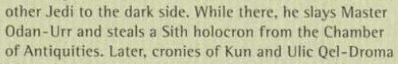
- **Odan-Urr** — entry/section: Odan-Urr founds the Great Jedi Library: "The library's construction was initiated by Odan-Urr shortly after he helped Empress Teta unify the planet Kirrek to her system, and it quickly became a repository for knowledge of all sorts and a training facility for Jedi Knights from across the Republic." Source: *Geonosis and the Outer Rim Worlds* (SWRPG d20 Revised Core), scan p.111
  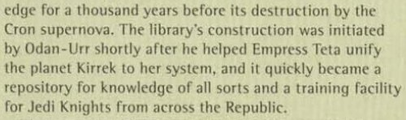
- **Odan-Urr** — entry/section: Access to dark side lore: "A researcher seeking to learn of the dark side must have the permission of both the Jedi Council and Master Odan-Urr himself." Source: *Geonosis and the Outer Rim Worlds* (SWRPG d20 Revised Core), scan p.111
  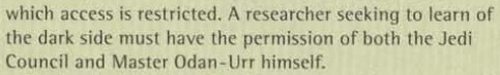
- **Exar Kun; Odan-Urr; Ulic Qel-Droma** — entry/section: Exar Kun slays Odan-Urr: "During the Sith War, Exar Kun comes to Ossus to recruit other Jedi to the dark side. While there, he slays Master Odan-Urr and steals a Sith holocron from the Chamber of Antiquities. Later, cronies of Kun and Ulic Qel-Droma cause the Cron Cluster to go nova." Source: *Geonosis and the Outer Rim Worlds* (SWRPG d20 Revised Core), scan p.111
  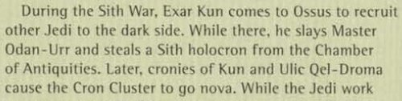
- **Luke Skywalker; Tionne** — entry/section: Luke and Tionne at Exis Station: "It’s not until six years after the Battle of Endor that Luke Skywalker and Tionne retrieve a small number of records before the station is completely consumed by Teedio." Source: *Geonosis and the Outer Rim Worlds* (SWRPG d20 Revised Core), scan p.111
  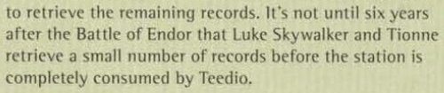
- **Luke Skywalker; Kam Solusar** — entry/section: Ossus after Sedriss: "After Luke Skywalker and Kam Solusar defeat Sedriss and establish relations with the Ysanna, the ruins of Ossus are a key archaeological site for the New Republic and for the new order of Jedi," Source: *Geonosis and the Outer Rim Worlds* (SWRPG d20 Revised Core), scan p.111
  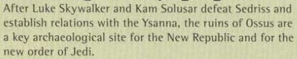

## scan p.112 (scan page 112)

Page contents: Ossus: Archaeological Campaigning concluded (Imperial era - wrath of Darth Vader; Luke Skywalker opens Ossus to the New Republic; Yuuzhan Vong scour Obroa-skai); illustrations Ysanna astride beast and Ysanna nomad. (hand-read)

- **Darth Vader (Anakin Skywalker)** — entry/section: Jedi archaeology under the New Order: "Those interested in researching and locating archaeological treasures relevant to the ancient Jedi Order must exercise extreme discretion or face the wrath of the Empire (perhaps even by the hand of Darth Vader himself)." Source: *Geonosis and the Outer Rim Worlds* (SWRPG d20 Revised Core), scan p.112
  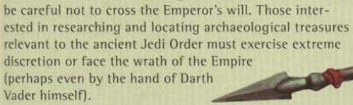
- **Luke Skywalker** — entry/section: Luke opens Ossus: "Once Luke Skywalker opens Ossus to the New Republic, the world is ripe for study as never before." Source: *Geonosis and the Outer Rim Worlds* (SWRPG d20 Revised Core), scan p.112
  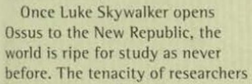

## scan p.113 (scan page 113)

Page contents: Ossus: hooks Deep Research - Part I (Mairan Jedi Master Gar Anstak; relics relocated to Kamino; Obi-Wan Kenobi's encounter) and And None Shall Pass (Yuuzhan Vong); Ysanna Nomads (Jem and Rayf under Luke Skywalker's tutelage); Ysanna Nomad stats. (hand-read)

- **Luke Skywalker** — entry/section: Jem and Rayf: "Two Ysanna, sister and brother Jem and Rayf, are among those taken under Luke Skywalker’s tutelage to learn the ways of the Force." Source: *Geonosis and the Outer Rim Worlds* (SWRPG d20 Revised Core), scan p.113
  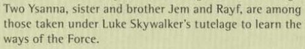

## scan p.114 (scan page 114)

Page contents: Roon: stats, system table, description (Cloak of the Sith; tide-locked; Roonstones); history (Admiral Screed and Governor Koong; Mungo Baobab's Manda-Roon route; Death Wind Corridor). (hand-read)

- **Vice-Admiral Terrinald Screed; Governor Koong** — entry/section: Screed and Koong: "Shortly before the Battle of Yavin, ties were informally renewed when the eccentric Imperial Admiral Screed formed a loose alliance with the Roon system's self-appointed Governor Koong in an effort to locate the source of the fabled Roonstones." Source: *Geonosis and the Outer Rim Worlds* (SWRPG d20 Revised Core), scan p.114
  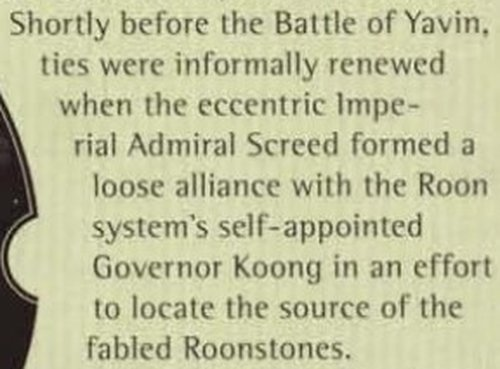
- **Palpatine (Darth Sidious)**: "Empire, the Roon system was still largely unexplored by the outside galaxy, all ties to Republicaligned trading interests having been severed after Palpatine's ascension." Source: *Geonosis and the Outer Rim Worlds* (SWRPG d20 Revised Core), scan p.114
  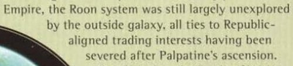

## scan p.115 (scan page 115)

Page contents: Roon: Manda-Roon Merchant Route; NJO era; people (Governor Koong's tyranny; Umboo province); Tawntoom Citadel (Koong vs Mungo Baobab; Admiral Screed reneges; Koong dies of the Rooz germ; Gaff vanishes); Roon lightstations (Noop at Umboo Lightstation). (hand-read)

- **Governor Koong; Mungo Baobab; Vice-Admiral Terrinald Screed; Gaff (Tawntoom)** — entry/section: Fall of the Tawntoom Citadel: "A few years before the Battle of Yavin, Governor Koong’s rivalry with the merchant Mungo Baobab climaxed at the facility. When the Empire's representative, Admiral Screed, reneged on a deal that would have granted Koong an Imperial charter, a legion of stormtroopers, and a Star Destroyer, the governor went into a rage. Already suffering from having inadvertently infected himself with the Rooz germ strain that he'd sprayed over neighboring Umboo province, Koong launched a volley of heavy blaster cannon fire into the caldera’s cache of Roonstones, causing a massive avalanche and crushing icefall. While the Imperial forces and Baobab’s freighter (the Caravel) managed to escape, Koong perished from the Rooz infection and was left with his prized fortress, buried beneath tons of ice and glacier floe." Source: *Geonosis and the Outer Rim Worlds* (SWRPG d20 Revised Core), scan p.115
  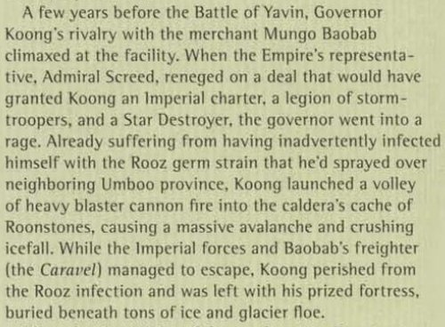

## scan p.116 (scan page 116)

Page contents: Roon: Raroom Waterfront map; Bantha Graveyard (Ogger Baobab); new vehicle Ubrikkian Floater-935. (hand-read)

## scan p.117 (scan page 117)

Page contents: Roon: hooks Spicing Things Up - Part I (Ku'amar clan; Death Wind Corridor) and Opportunity Thaws (Gaff's lightstation control device); Auren Yomm biography (drainsweeper champion; with Mungo Baobab defeats Koong; trains Caldera's Crest). (hand-read)

- **Auren Yomm; Mungo Baobab; Governor Koong** — entry/section: Auren Yomm joins the resistance: "During the Rebellion era, after she and Mungo Baobab defeat Governor Koong, Auren Yomm is an active member of Rebellion-allied resistance groups, inciting animosity toward the Empire through various means (all the while dedicated to her love, the dashing Baobab)." Source: *Geonosis and the Outer Rim Worlds* (SWRPG d20 Revised Core), scan p.117
  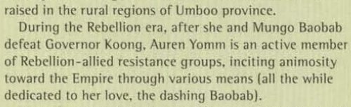

## scan p.118 (scan page 118)

Page contents: Roon: Auren Yomm stats (Female Human Fringer 6); Gaff (Kobok assassin for Koong; Male Kobok Soldier 6/Elite Trooper 2); new species Kobok begins. (hand-read)

- **Gaff (Tawntoom); Mungo Baobab; Governor Koong** — entry/section: Gaff after Koong: "Despite Gaff’s competency, working for Governor Koong was a low point in his career. After the merchant Mungo Baobab and his companions foiled Koong’s plans at the Tawntoom Citadel, Gaff was trapped in the Tawntoom highlands for some time, but he managed to survive and eventually made it back to the port city Nime." Source: *Geonosis and the Outer Rim Worlds* (SWRPG d20 Revised Core), scan p.118
  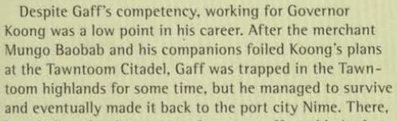

### Stat block notes (game mechanics, not feats)

- Auren Yomm stat block: Auren Yomm: Female Human Fringer 6; Init +2; Defense 17 (+5 class, +2 Dex); Spd 10 m; VP/WP 31/14; Atk +5 melee (1d4+1, knife) or +6 ranged (3d6, blaster pistol); SQ Barter, jury-rig +2, survival +2; SV Fort +7, Ref +5, Will +3; SZ M; FP 2; DSP 0; Rep +1; Str 12, Dex 14, Con 14, Int 14, Wis 12, Cha 13. Challenge Code C. (Source: *Geonosis and the Outer Rim Worlds* (SWRPG d20 Revised Core), scan p.118)
- Gaff stat block: Gaff: Male Kobok Soldier 6/Elite Trooper 2; Init +2; Defense 21 (+7 class, +2 Dex, +2 natural); Spd 10 m; VP/WP 42/10; Atk +9/+4 melee (1d4+1 plus poison, claw) or +11/+6 ranged (3d8/19-20, blaster staff) or +7/+7/ +7/+2 ranged (3d8/19-20, blaster staff with multifire); SQ Poison, radiation resistance, 360° vision; SV Fort +8, Ref +6, Will +5; SZ M; FP 1; DSP 1; Rep +6; Str 12, Dex 15, Con 10, Int 12, Wis 12, Cha 8. Challenge Code C. (Source: *Geonosis and the Outer Rim Worlds* (SWRPG d20 Revised Core), scan p.118)

## scan p.119 (scan page 119)

Page contents: Kobok species: language, names, ages, adventurers, species traits. Roon: Kobok Commoner; new creatures kalak and mogo (mogo stat block partly lost in OCR). Ryloth: stats. (hand-read)

## scan p.120 (scan page 120)

Page contents: Ryloth: system table; description (Bright Lands; city-caves; ryll spice and glitteryll; slavery and dancer contracts); history (early discovery; Clone Wars; the Emperor's grip; playing both sides). (hand-read)

