# Owner Material 037 — Star Wars D20 Drive folder (Core, Revised Core and Saga Edition): Sourcebooks/Geonosis and the Outer Rim Worlds.pdf [Star Wars Roleplaying Game Revised Core (d20, 2002)] (scan pages 121–162)

- **Source:** Wizards of the Coast Star Wars Roleplaying Game books, web enhancements, Living Force campaign modules and articles (2000–2010), from the owner's "Star Wars D20" Drive folder (only the three edition subfolders; "General" was not read, as instructed). Secondary source (licensed Legends reference). Scan OCR'd on the box; the scan stays box-only and is **not** published.
- **Method:** every scanned page was OCR'd and machine-screened sentence by sentence for power-relevant statements (fights, kills, defeats, Force feats, rankings, superweapons) that name a character on our roster; each kept sentence is quoted verbatim from the OCR text and has a crop of the printed passage directly under it. Pages with nothing power-relevant are still listed with what is on them.
- **Citation:** "*Geonosis and the Outer Rim Worlds* (SWRPG d20 Revised Core), p.X" by printed page ("scan p.X" where no printed number applies). **Weight:** Licensed RPG material: a secondary source. Narrative text sums up Legends lore; game statistics are rules for players, not canon power levels, and rank lowest.

## scan p.121 (scan page 121)

Page contents: Ryloth: history concluded (support for the Rebellion; New Republic; Yuuzhan Vong); people (cunning; Bib Fortuna; low technology; Lekku; skin colors; head-clans and Bright Lands exile); Kala'uun begins. (hand-read)

- **Bib Fortuna** — entry/section: Bib Fortuna and the Twi'lek image: "Twi'leks also thrive in the underworld, and some infamous examples such as Bib Fortuna color people’s perception of the species." Source: *Geonosis and the Outer Rim Worlds* (SWRPG d20 Revised Core), scan p.121
  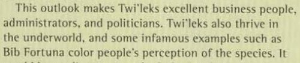

## scan p.122 (scan page 122)

Page contents: Ryloth: Kala'uun levels (Galactic Exotics, SchaumAssociates); Sienar Fleet Systems offices (Dyroma clan); Floating Rock Gardens. (hand-read)

## scan p.123 (scan page 123)

Page contents: Ryloth: Neb Trys Orphanage and Dance School; ryll mines; hooks Faux Pearls Before Swine, Hot Time in the Old Town (Sesh Durgo), Hunters of the Lost Holocron (Hunvar the Hutt), Going Coup Coup begins. (hand-read)

## scan p.124 (scan page 124)

Page contents: Ryloth: Going Coup Coup (Rooshan and Ku'rys clans; Emen, Ged, Pon); Documentary Footage (Kel Dandu); Spicing Things Up - Part II begins; Hunvar's Spire map. (hand-read)

## scan p.125 (scan page 125)

Page contents: Ryloth: Spicing Things Up - Part II (Ku'amar clan's setup); Party Town (Hurrssk's Trandoshans); Reelov Hooth (customs bookie; Male Twi'lek Diplomat 4); Eelie biography. (hand-read)

### Stat block notes (game mechanics, not feats)

- Reelov Hooth stat block: Reelov Hooth: Male Twi'lek Diplomat 4; Init +4 (+4 Improved Initiative); Defense 11 (+1 class); Spd 10 m; VP/WP 0/11; Atk +2 melee (13, unarmed strike) or +2 ranged (3d6, blaster pistol); SQ Lekku, low-light vision; SV Fort +2, Ref +1, Will +3; SZ 0; DSP 0; Rep +1; Str 10, Dex 10, Con 11, Int 14, Wis 8, Cha 15. Challenge Code A. (Source: *Geonosis and the Outer Rim Worlds* (SWRPG d20 Revised Core), scan p.125)

## scan p.126 (scan page 126)

Page contents: Ryloth: Eelie stats (Female Twi'lek Noble 1/Scoundrel 9); Tensh Ly'alu (Bothan Jedi on Ryloth; Male Bothan Jedi Consular 7). Ryloth: Tensh Ly'alu Force skills/feats; Dren Kuu'la (anti-assassination bodyguard; Female Twi'lek Soldier 4/Scoundrel 2). (hand-read)

### Stat block notes (game mechanics, not feats)

- Eelie stat block: Eelie: Female Twi'lek Noble 1/Scoundrel 9; Init +4; Defense 20 (+6 class, +4 Dex); Spd 10 m; VP/WP 37/10; Atk +7/+2 melee (1d3+1, unarmed strike) or +10/+5 ranged; SQ Favor +1, illicit barter, Lekku, low-light vision, lucky (2/day), precise attack +2; SV Fort +4, Ref +11, Will +4; SZ M; FP 2; DSP 0; Rep +6; Str 12, Dex 18, Con 10, Int 14, Wis 8, Cha 17. Challenge Code C. (Source: *Geonosis and the Outer Rim Worlds* (SWRPG d20 Revised Core), scan p.126)
- Tensh Ly’alu stat block: Tensh Ly’alu: Male Bothan Jedi Consular 7; Init +1; Defense 17 (+6 class, +1 Dex); Spd 10 m; VP/WP 49/14; Atk +6 melee (3d8+1/19-20, lightsaber) or +6 ranged; SQ Deflect (defense +1, attack —4, extended); SV Fort +7, Ref +5, Will +8; SZ M; FP 4; DSP 0; Rep +2; Str 12, Dex 13, Con 14, Int 15, Wis 16, Cha 16. Challenge Code C. (Source: *Geonosis and the Outer Rim Worlds* (SWRPG d20 Revised Core), scan p.126)
- Dren Kuu'la stat block: Dren Kuu'la: Female Twi'lek Soldier 4/Scoundrel 2; 4 f Init +3; Defense 17 (+4 class, +3 Dex); Spd 10 m; VP/WP 39/12; Atk +6 melee (2d4+1, unarmed strike) or +8 ranged \ (3d6, blaster pistol); SQ Illicit barter, Lekku, low-light Ty vision, lucky (1/day); SV Fort +6, Ref +7, Will +5; SZ M; FP 0; DSP 0; Rep +1; Str 13, Dex 17, Con 12, Int 12, Wis 14, Cha 10. Challenge Code B. (Source: *Geonosis and the Outer Rim Worlds* (SWRPG d20 Revised Core), scan p.126)

## scan p.127 (scan page 127)

Page contents: Ryloth: Dren Kuu'la skills/feats; Ru'up Benpo (second-tier head-clan member; Wookiee bodyguard Urrooogh; Male Twi'lek Noble 13); new creature lylek. Sriluur: stats. (hand-read)

### Stat block notes (game mechanics, not feats)

- Ru‘up Benpo stat block: Ru‘up Benpo: Male Twi'lek Noble 13; Init -1; Defense 16 (+7 class, -1 Dex); Spd 10 m; VP/WP 48/11; Atk +8/+3 melee (1d3-1, unarmed strike) or +8/+3 ranged (3d6, sporting blaster pistol); SQ Coordinate +3, favor +4, inspire confidence, Lekku, low-light vision, resource access; SV Fort +5, Ref +5, Will +10; SZ M; FP 0; DSP 0; Rep +7; Str 8, Dex 9, Con 11, Int 20, Wis 15, Cha 17. Challenge Code F. (Source: *Geonosis and the Outer Rim Worlds* (SWRPG d20 Revised Core), scan p.127)

## scan p.128 (scan page 128)

Page contents: Sriluur: system table; description (Meirm Sea; Cueva Desert; Houk colonists); history (Palpatine's forces take control; Disac pirates; Houk-Weequay hostilities; Star Destroyers Annihilator and Ruthless). (hand-read)

## scan p.129 (scan page 129)

Page contents: Sriluur: governor Newen Streeg; Captain Barsse Neomen on the Black Sun payroll; Imperial garrisons; Yuuzhan Vong; people (Weequay gods Quay, Am-Shak); Dnalvec (Mos Eisley in a bad mood; Dnalvec militia); Meirm City (Gricul Salvage Yards of Xizor Transport Systems); Ruul (Sora Bulq's betrayal; Bulq clan estate). (hand-read)

- **Sora Bulq** — entry/section: Ruul: "Best known as the site of Master Sora Bulq’s betrayal of the Jedi Knights during the early months of the Clone Wars, Ruul is a lush, green-blue globe still young in its development." Source: *Geonosis and the Outer Rim Worlds* (SWRPG d20 Revised Core), scan p.129
  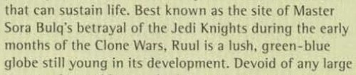
- **Prince Xizor** — entry/section: Gricul Salvage Yards: "The Gricul Salvage Yards is one of the bestknown chop-shop and repair yards in the Outer Rim; it is owned by Xizor Transport Systems (XTS), the massive Black Sun front company." Source: *Geonosis and the Outer Rim Worlds* (SWRPG d20 Revised Core), scan p.129
  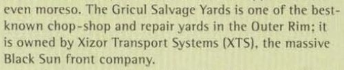

## scan p.130 (scan page 130)

Page contents: Sriluur: hooks A Cult Wind Blows - Part II (Ma'kis'shaalas; Sora Bulq or Kossex) and Drop 'n' Chop (Xizor Transport Systems chop shop); Sora Bulq biography begins (with Master Windu developed Vaapad). (hand-read)

- **Sora Bulq; Mace Windu** — entry/section: Sora Bulq and Vaapad: "Master Bulg is perhaps the best-known of those handful of Weequay Jedi: a fierce combatant (he, along with Master Windu, developed the Vaapad style), a highly regarded trainer, and a thoughtful philosopher." Source: *Geonosis and the Outer Rim Worlds* (SWRPG d20 Revised Core), scan p.130
  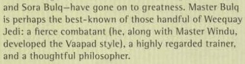

## scan p.131 (scan page 131)

Page contents: Sriluur: Sora Bulq (approached by Count Dooku after Geonosis; plan to frame Mace Windu for Asajj Ventress's killings; duel with Windu on Ruul; Male Weequay Jedi Guardian 9/Jedi Master 3/Jedi Weapon Master 3); Disac Pirates (Stano Hapin killed by Ket Maliss; Black Sun Vigo Sprax; Besadii clan and Vigo Durga the Hutt); Disac Pirate stats; new creature bandigo. (hand-read)

- **Sora Bulq; Mace Windu; Asajj Ventress** — entry/section: Geonosis and the Outer Rim Worlds: "Though the plan he laid out to frame Mace Windu for the deaths of Jedi killed by the assassin Assaj Ventress failed, Sora Bulg survived a fierce lightsaber duel with Master Windu when Windu and the other Jedi were forced to flee Ruul." Source: *Geonosis and the Outer Rim Worlds* (SWRPG d20 Revised Core), scan p.131
  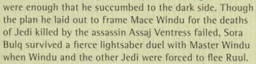
- **Count Dooku; Sora Bulq** — entry/section: Geonosis and the Outer Rim Worlds: "Now a Dark Jedi in league with Count Dooku, Sora Bulq remains a potent adversary: formerly one of the greatest protectors of the Republic, now one of its greatest threats." Source: *Geonosis and the Outer Rim Worlds* (SWRPG d20 Revised Core), scan p.131
  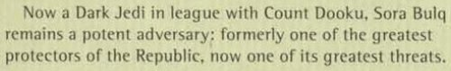
- **Sora Bulq; Count Dooku** — entry/section: Sora Bulq approached by Dooku: "After cheating death at the Battle of Geonosis, as much as it pained him, he became convinced that even the Jedi Council was failing in its duties to the people of the Republic. Approached by Count Dooku after the battle, Sora agreed with Dooku’'s argument that if the Republic were to change, it was up to the Jedi to see that change through." Source: *Geonosis and the Outer Rim Worlds* (SWRPG d20 Revised Core), scan p.131
  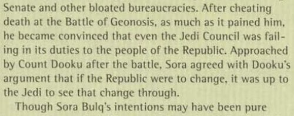
- **Sora Bulq; Mace Windu; Asajj Ventress; Count Dooku** — entry/section: Sora Bulq falls: "Though Sora Bulq’s intentions may have been pure some years previous, his research into the dark side of the Force, compounded by Dooku’s persuasive arguments, were enough that he succumbed to the dark side. Though the plan he laid out to frame Mace Windu for the deaths of Jedi killed by the assassin Assaj Ventress failed, Sora Bulg survived a fierce lightsaber duel with Master Windu when Windu and the other Jedi were forced to flee Ruul." Source: *Geonosis and the Outer Rim Worlds* (SWRPG d20 Revised Core), scan p.131
  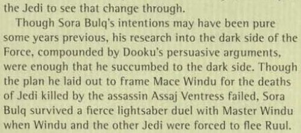

### Stat block notes (game mechanics, not feats)

- Sora Bulg stat block: Sora Bulg: Male Weequay Jedi Guardian 9/Jedi Master 3/Jedi Weapon Master 3; Init +2; Defense 23 (+11 class, +2 Dex); Spd 10 m; VP/WP 111/15; Atk +17/+12/+7 melee (1d4+2, unarmed) or +14/+14/+9/+4" melee (5d8+2/17-20, lightsaber) and +10 melee (5d8+1/17-20, shortened lightsaber) or +17/+12/+7 ranged; SQ Pheromonal commu- nication, Force secret (Force Stealth +1, Force Defense +1), deflect (defense +3), deflect (attack -4), weapon mastery (rapid strike); SV Fort +12, Ref +12, Will +11; SZ M; FP 7; DSP 2; Rep +12; Str 14, Dex 14, Con 15, Int 14, Wis 15, Cha 9. Challenge Code G. (Source: *Geonosis and the Outer Rim Worlds* (SWRPG d20 Revised Core), scan p.131)

## scan p.132 (scan page 132)

Page contents: Sriluur: bandigo stats; new creature dark wolf (raquor'daan). Sullust: stats, system table, description begins. (hand-read)

## scan p.133 (scan page 133)

Page contents: Sullust: underground cities; geothermal shunts; SoroSuub Corporation; history (Rimma Trade Route; Corporate Proclamation 137d; secession to the Alliance; fleet gathers before Endor; New Republic; Yuuzhan Vong); people begins. (hand-read)

## scan p.134 (scan page 134)

Page contents: Sullust: people (families; sense of direction; trust in SoroSuub); locations Piringiisi (mud spa rules), LavaRide Enterprises begins. (hand-read)

## scan p.135 (scan page 135)

Page contents: Sullust: LavaRide sport; SoroSuub Headquarters (Byllurun / SoroSuub Central); Sulon (Sulon Incorporate; starport); SoroSuub R&D (Black Hole team); Fulluusub begins. (hand-read)

## scan p.136 (scan page 136)

Page contents: Sullust: Fulluusub; SoroSuub Droid Design Floor map; hooks Business is Business (Ivis Bibrull) and Tourist Trap (dianoga) begins. (hand-read)

## scan p.137 (scan page 137)

Page contents: Sullust: Tourist Trap concluded; Bad Moon Rising (New Growth sector asteroid); Event Horizon (Anub Byus; Obdulla the Hutt); Flower Power (Prince Geben Arrulis; rurylis). (hand-read)

## scan p.138 (scan page 138)

Page contents: Sullust: Flower Power concluded; Sollos Benmub (fired from SoroSuub; Male Sullustan Noble 3/Scoundrel 3); Anub Byus (Black Hole team subdirector; Male Sullustan Noble 14); Syv Bullnumull begins. (hand-read)

### Stat block notes (game mechanics, not feats)

- Sollos Benmub stat block: Sollos Benmub: Male Sullustan Noble 3/Scoundrel 3; Init +2; Defense 16 (+4 class, +2 Dex); Spd 10 m; VP/WP 17/8; Atk +4 melee (1d3, unarmed strike) or +6 ranged; SO Darkvision, favor +2, illicit barter, inspire confidence, lucky (1/day), precise attack +1, resource access; SV Fort +3, Ref +7, Will +4; SZ M; FP 0; DSP 1; Rep +5; Str 10, Dex 15, Con 8, Int 15, Wis 11, Cha 14. Challenge Code B. (Source: *Geonosis and the Outer Rim Worlds* (SWRPG d20 Revised Core), scan p.138)
- Anub Byus stat block: Anub Byus: Male Sullustan Noble 14; Init +1; Defense 18 (+7 class, +1 Dex); Spd 10 m; VP/WP 51/10; Atk +10/ +5 melee (1d3, unarmed strike) or +11/+6 ranged (3d6, holdout blaster pistol); SQ Coordinate +3, darkvision, favor +4, inspire confidence, inspire greatness, resource access; SV Fort +6, Ref +7, Will +10; SZ M; FP 2; DSP 1; Rep +4; Str 10, Dex 12, Con 10, Int 15, Wis 12, Cha 16. Challenge Code F. (Source: *Geonosis and the Outer Rim Worlds* (SWRPG d20 Revised Core), scan p.138)

## scan p.139 (scan page 139)

Page contents: Sullust: Syv Bullnumull (Rabid Nek Dog mutiny; Female Sullustan Scoundrel 4/Scout 4/Starship Ace 1); Umum Yulluruub (market scout; Female Sullustan Fringer 7/Noble 3; partial block). (hand-read)

### Stat block notes (game mechanics, not feats)

- Syv Bullnumull stat block: Syv Bullnumull: Female Sullustan Scoundrel 4/Scout 4/ Starship Ace 1; Init +7 (+3 Dex, +4 Improved Initiative): Defense 17 (+4 class, +3 Dex); Spd 10 m; VP/WP 47/12; Atk +5/+0 melee (1d3-1, unarmed strike) or +9/+4 ranged (3d6, blaster pistol); SQ Darkvision, heart +1, illicit barter, lucky (1/day), precise attack +1, trailblazing, uncanny dodge; SV Fort +5, Ref +11, Will +5; SZ M; FP 2; DSP 1; Rep +2; Str 8, Dex 16, Con 12, Int 16, Wis 13, Cha 11. Challenge Code D. (Source: *Geonosis and the Outer Rim Worlds* (SWRPG d20 Revised Core), scan p.139)
- Umum Yulluruub stat block: Umum Yulluruub: Female Sullustan Fringer 7/Noble 3; Init +0; Defense 15 (+5 class); Spd 10 m; VP/WP 45/10; Atk +9/+4 melee (1d3+2, unarmed strike) or +7/+2 ranged (3d8/19-20, blaster rifle); SQ Barter, darkvision, favor +2, inspire confidence, jury-rig +4, resource access; SV Fort +7, Ref +6, Will +8; SZ M; FP 1; DSP 0; Rep +2; Str 14, Dex 10, Con 10, Int 16, Wis 17, Cha 15, Challenge Code C. (Source: *Geonosis and the Outer Rim Worlds* (SWRPG d20 Revised Core), scan p.139)

## scan p.140 (scan page 140)

Page contents: Sullust: Ull Murub (Padawan; Yoda's admonition; dark Jedi interest; Male Sullustan Jedi Guardian 4). Thule: stats, system table, description (Sith base; Count Dooku's Separatists; Hurom Sith temple; Force Lightning +4; moon Sivvi). Thule: history begins (Sith stealth regiment; retreat after the Sith incursion about 5,000 years before Yavin). (hand-read)

- **Yoda** — entry/section: Wars make not one great: "Ull hasn't yet learned the truth behind Yoda's admonition, “Wars make not one great.”" Source: *Geonosis and the Outer Rim Worlds* (SWRPG d20 Revised Core), scan p.140
  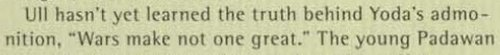
- **Count Dooku** — entry/section: Thule under the Separatists: "It was also occupied by militant Republic Separatists under the sway of Count Dooku during the Rise of the Empire and the site of several skirmishes during the Clone Wars." Source: *Geonosis and the Outer Rim Worlds* (SWRPG d20 Revised Core), scan p.140
  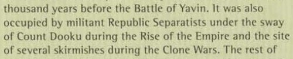

### Stat block notes (game mechanics, not feats)

- Ull Murub stat block: Ull Murub: Male Sullustan Jedi Guardian 4; Init +4; Defense 18 (+4 class, +4 Dex); Spd 10 m; VP/WP 22/11; Atk +8 melee (2d8/19-20, lightsaber) or +8 ranged; SQ Darkvision, deflect (defense +1, attack -4); SV Fort +4, Ref +8, Will +1; SZ M; FP 3; DSP 0; Rep +1; Str 10, Dex 18, Con 11, Int 11, Wis 9, Cha 12. Challenge Code B. (Source: *Geonosis and the Outer Rim Worlds* (SWRPG d20 Revised Core), scan p.140)

## scan p.141 (scan page 141)

Page contents: Thule: history (Darth Bane's Rule of Two; prophecies; Count Dooku's Separatists and the Dark Reaper; Palpatine purges knowledge of Thule; hidden in NJO era); people (militaristic; single general and Sith priests); locations begin. (hand-read)

- **Darth Bane** — entry/section: Thule and the Rule of Two: "When Darth Bane reduced the number of Sith Lords to two, Thule swore allegiance to the lords who remained in the galaxy, believing that they would give the armies and students of the dark side a purpose again." Source: *Geonosis and the Outer Rim Worlds* (SWRPG d20 Revised Core), scan p.141
  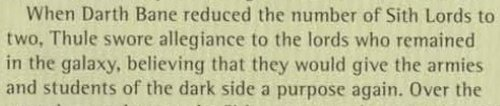
- **Count Dooku** — entry/section: Dooku and the Dark Reaper on Thule: "Just before the Clone Wars, as foretold, millions of Separatists came to Thule under the direction of Count Dooku. Equipment and troops from the Techno Union also began appearing in the skies, and the planet was abuzz with activity and preparation, Count Dooku and the Separatists held pieces of an ancient Sith weapon known as the Dark Reaper, and they were assembling it for use in the coming wars." Source: *Geonosis and the Outer Rim Worlds* (SWRPG d20 Revised Core), scan p.141
  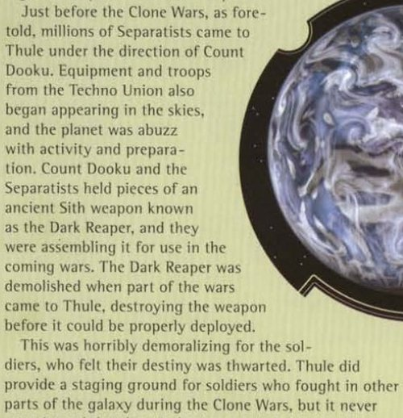
- **Palpatine (Darth Sidious)** — entry/section: Palpatine hides Thule: "Afterward, upon Palpatine’s ascent to Emperor, he purged knowledge of Thule from histories and the few sources that documented its existence. Thule’s role as a hidden planet was to continue as a resource for the Sith, not the Empire." Source: *Geonosis and the Outer Rim Worlds* (SWRPG d20 Revised Core), scan p.141
  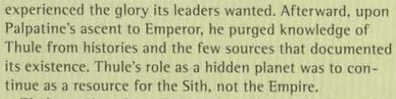

## scan p.142 (scan page 142)

Page contents: Thule: Hurom; Sith Temple (-2 penalty for untainted Force-sensitives); Armory (Dark Reaper assembled); Farms. (hand-read)

## scan p.143 (scan page 143)

Page contents: Thule: hooks Believe the Hype and Suicide Run; Galo Thriven (Separatist commando; Male Human Soldier 6/Elite Trooper 3; partial block); Drevveka Hoctu (Sith Arts Academy headmaster; Female Human Jedi Guardian 12/Scout 4). (hand-read)

### Stat block notes (game mechanics, not feats)

- Galo Thriven stat block: Galo Thriven: Male Human Soldier 6/Elite Trooper 3; Init +7 (+3 Dex, +4 Improved Initiative); Defense 20 (+7 class, +3 Dex); DR 3; Spd 10 m; VP/WP 81/16; Atk +11/+6 melee (2d6+2, vibroblade) or +13/+8 ranged (3d8/19-20, blaster rifle) or +9/+9/+9/+4 ranged (3d8/ 19-20, blaster rifle with multifire); SQ Uncanny dodge; SV Fort +11, Ref +7, Will +5; SZ M; FP 2; DSP 2; Rep +3; Str 14, Dex 17, Con 16, Int 10, Wis 12, Cha 10. Challenge Code E. (Source: *Geonosis and the Outer Rim Worlds* (SWRPG d20 Revised Core), scan p.143)
- Drevveka Hoctu stat block: Drevveka Hoctu: Female Human Jedi Guardian 12/ Scout 4; Init +2; Defense 25 (+9 class, +2 Dex, +4 dodge); Spd 10 m; VP/WP 120/14; Atk +20/+15/+10 melee (4d8+3/17-20, lightsaber) or +17/+12/+7 ranged (3d8, heavy blaster pistol); SQ Deflect (attack -3, defense +2), heart +1, trailblazing, uncanny dodge; SV Fort +12, Ref +12, Will +9; SZ P 1; DSP 8; Rep +4; Str 16, Dex 14, Con 14, Int 13, Wis 13, Cha 8. Challenge Code G. (Source: *Geonosis and the Outer Rim Worlds* (SWRPG d20 Revised Core), scan p.143)

## scan p.144 (scan page 144)

Page contents: Thule: Drevveka Hoctu skills/feats; Captain Hurnoj Arqu'uthun (Arkanian biological warfare officer; Male Arkanian Soldier 4/Noble 4/Officer 5). Vorzyd V: stats. (hand-read)

### Stat block notes (game mechanics, not feats)

- Hurnoj Arqu'uthun stat block: Hurnoj Arqu'uthun: Male Arkanian Soldier 4/Noble 4/ Officer 5; Init +5 (+1 Dex, +4 Improved Initiative); Defense 19 (+8 class, +1 Dex); Spd 10 m; VP/WP 63/11; Atk +11/+6 melee (2d6+1, vibroblade) or +11/+6 ranged (3d6, blaster pistol); SQ Coordinate +1, favor +2, inspire confidence, leadership, requisition supplies, resource access, tactics; SV Fort +9, Ref +7, Will +10; SZ M; FP 4; DSP 1; Rep +9; Str 12, Dex 12, Con 11, Int 18, Wis 15, Cha 14. Challenge Code F. (Source: *Geonosis and the Outer Rim Worlds* (SWRPG d20 Revised Core), scan p.144)

## scan p.145 (scan page 145)

Page contents: Vorzyd V: system table; description (Efavan casinos; the Commonality; Columex); history (Vorzydiaks; Kilmaulsi, Paiguns, Selonians, Hrakians; Greyshade family; Senator Simon Greyshade and the Wheel; Yuuzhan Vong raze Columex); people begins. (hand-read)

## scan p.146 (scan page 146)

Page contents: Vorzyd V: Freelies; Casino Royale; Felana Spaceport; Hu's Emporium begins. (hand-read)

## scan p.147 (scan page 147)

Page contents: Vorzyd V: Hu's Emporium (Kitak Hu); new vehicle Hraki Adventure Motors Flitter; hooks A Royale Mess, The Hrakian Gambit (Moff Diedrich Greyshade), Any Unoccupied Snackquarium (Quaffug the Hutt). (hand-read)

## scan p.148 (scan page 148)

Page contents: Vorzyd V: Simon Greyshade (died aboard the Wheel after Yavin; Male Human Noble 6); Efavan map; Sanglui (Squalris Rebel cell leader; Male Squalris Diplomat 3/Noble 2). (hand-read)

### Stat block notes (game mechanics, not feats)

- Sanglui stat block: Sanglui: Male Squalris Diplomat 3/Noble 2; Init -1; Defense 14 (+4 class, -1 Dex, +1 natural); Spd 10 m; VP/WP. 12/12; Atk +3 melee (1d3+1, unarmed strike) or +1 ranged (3d6, blaster pistol); SQ +2 bonus on Diplomacy and Sense Motive checks, favor +3 (1/week), inspire confidence; SV Fort +2, Ref +2, Will +8; SZ M; FP 0; DSP 0; Rep +4; Str 12, Dex 9, Con 12, Int 14, Wis 15, Cha 15. Challenge Code B. (Source: *Geonosis and the Outer Rim Worlds* (SWRPG d20 Revised Core), scan p.148)
- Simon Greyshade stat block: Simon Greyshade (as of the Battle of Yavin): Male Human Noble 6; Init +0; Defense 14 (+4 class); Spd 10 m; VP/WP 20/10; Atk +4 (143, unarmed strike) or +5 ranged (3d4-1/19-20, hold-out blaster); SQ Favor +4 (3/ week), coordinate +1, inspire confidence, resource access; SV Fort +2, Ref +3, Will +7; SZ M; FP 0; DSP 1; Rep +7; Str 10, Dex 10, Con 10, Int 15, Wis 14, Cha 17. Challenge Code D. (Source: *Geonosis and the Outer Rim Worlds* (SWRPG d20 Revised Core), scan p.148)

## scan p.149 (scan page 149)

Page contents: Vorzyd V: Sanglui equipment/skills/feats; Hathox Greb (Imperial-loyal Hrakian captain of the Nia; Male Hrakian Soldier 4); new species Hrakian (traits, commoner); new species Kilmaulsi begins. (hand-read)

### Stat block notes (game mechanics, not feats)

- Hathox Greb stat block: Hathox Greb: Male Hrakian Soldier 4; Init +5 (+1 Dex, +4 Improved Initiative); Defense 16 (+5 class, +1 Dex); DR 2; Spd 10 m; VP/WP 34/14; Atk +5 (1d4+1, knife) or +5 ranged (3d8, heavy blaster pistol); SQ None; SV Fort +6, Ref +2, Will +1; SZ M; FP 0; DSP 0; Rep +1; Str 13, Dex 13, Con 14, Int 14, Wis 10, Cha 11. Challenge Code C. (Source: *Geonosis and the Outer Rim Worlds* (SWRPG d20 Revised Core), scan p.149)

## scan p.150 (scan page 150)

Page contents: New species Kilmaulsi (battle frenzy; commoner) and Paigun (traits; commoner); new species Squalris begins. (hand-read)

## scan p.151 (scan page 151)

Page contents: New species Squalris (wealthy; commoner); new species Vorzydiak begins. (hand-read)

## scan p.152 (scan page 152)

Page contents: New species Vorzydiak (hidebound; commoner). Yavin: stats and system table. Yavin 4: stats; description begins (Sith temples; first Death Star destroyed by a Jedi orphan; new Jedi order). (hand-read)

## scan p.153 (scan page 153)

Page contents: Yavin 4: flora and fauna (Massassi trees, woolamanders, piranha beetles, runyips); history (Naga Sadow and the Massassi; Freedon Nadd; Exar Kun and the Sith War; Gordian Reach; Corusca rush; Bright Jewel sector under Governor-General Nox Vellam; Rebel base in the Great Temple; Luke Skywalker destroys the Death Star). (hand-read)

- **Naga Sadow** — entry/section: Naga Sadow settles Yavin 4: "Yavin 4 was first settled some five thousand years before the Battle of Yavin by the Sith Lord Naga Sadow and his minions, among them members of the Sith warrior species known as the Massassi. Sadow forced the Massassi to construct great temples and used Sith sorcery to place himself in suspended animation." Source: *Geonosis and the Outer Rim Worlds* (SWRPG d20 Revised Core), scan p.153
  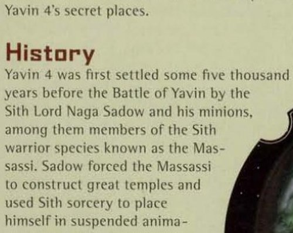
- **Freedon Nadd; Naga Sadow** — entry/section: Freedon Nadd on Yavin 4: "Six centuries later, the Jedi Knight Freedon Nadd discovered Sadow’s resting place, guarded by the Massassi's degenerate descendents, and learned the Sith arts on the jungle moon." Source: *Geonosis and the Outer Rim Worlds* (SWRPG d20 Revised Core), scan p.153
  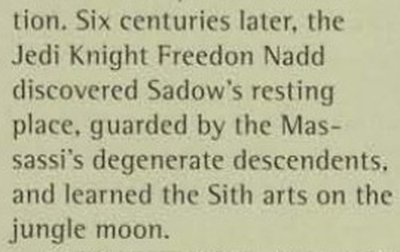
- **Exar Kun; Freedon Nadd** — entry/section: Exar Kun on Yavin 4: "A Jedi named Exar Kun awakened Nadd’s spirit four centuries after that in the Onderon system. Kun was lured to Yavin 4, where the Massassi captured him. Kun fought free, annihilated Nadd, and proclaimed himself Dark Lord of the Sith. He then launched the fury of the Sith War against the galaxy; when the tide turned, the Jedi chased him back to Yavin 4. In a final spasm of Sith magic, Kun drained the Massassi’s life energies in order to preserve his own spirit." Source: *Geonosis and the Outer Rim Worlds* (SWRPG d20 Revised Core), scan p.153
  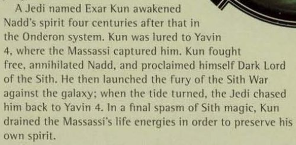
- **Leia Organa Solo; Luke Skywalker**: "The Death Star tracked Princess Leia Organa to Yavin 4, but Luke Skywalker {aided by the Force) destroyed the battle station with a well-placed shot from his snubfighter." Source: *Geonosis and the Outer Rim Worlds* (SWRPG d20 Revised Core), scan p.153
  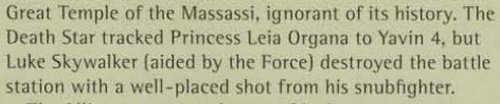

## scan p.154 (scan page 154)

Page contents: Yavin 4: blockade (Darth Vader awaits the Executor; Vellam and House of Tagge infighting); Luke Skywalker's Jedi academy and Exar Kun; Shadow Academy; Yuuzhan Vong (Anakin Solo redeems Vua Rapuung); people (Dr'uun Unnh; Ikrit, Kam Solusar, Tionne); Yavin 8 (Melodies) and Yavin 13 (Slith, Gerbs). Yavin 4: The Great Temple of the Massassi begins (Rebel base layout; Jedi academy). (hand-read)

- **Exar Kun** — entry/section: Geonosis and the Outer Rim Worlds: "The new Jedi Master didn’t know the spirit of a Sith Lord slumbered nearby; when Skywalker’s students awakened Exar Kun, the Dark Lord nearly destroyed the academy before he was himself destroyed." Source: *Geonosis and the Outer Rim Worlds* (SWRPG d20 Revised Core), scan p.154
  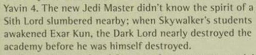
- **Luke Skywalker; Exar Kun** — entry/section: Jedi academy and Exar Kun: "Yavin was left to Corusca fishers and curiosity seekers for more than a decade, until Luke Skywalker returned to establish his Jedi academy on Yavin 4. The new Jedi Master didn’t know the spirit of a Sith Lord slumbered nearby; when Skywalker’s students awakened Exar Kun, the Dark Lord nearly destroyed the academy before he was himself destroyed." Source: *Geonosis and the Outer Rim Worlds* (SWRPG d20 Revised Core), scan p.154
  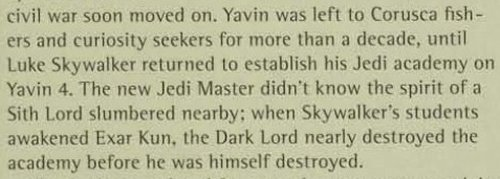
- **Anakin Solo; Vua Rapuung** — entry/section: Vua Rapuung redeemed: "Yet the Force still wasn't done with the jungle moon: Before escaping Yavin 4, Anakin Solo helped redeem Vua Rapuung, one of the Yuuzhan Vong’s Shamed Ones." Source: *Geonosis and the Outer Rim Worlds* (SWRPG d20 Revised Core), scan p.154
  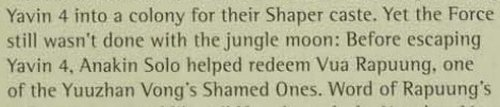
- **Kam Solusar; Tionne** — entry/section: Academy staff: "Years later, the Kushiban Jedi Master Ikrit and the Jedi Knights Kam Solusar and Tionne lived there as three members of the Jedi academy’s small permanent staff." Source: *Geonosis and the Outer Rim Worlds* (SWRPG d20 Revised Core), scan p.154
  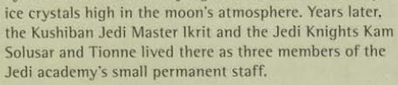
- **Luke Skywalker** — entry/section: Jedi academy in the Great Temple: "When the temple became the Jedi academy, it included far more space than Luke Skywalker needed. Because of this, the Jedi Master never found" Source: *Geonosis and the Outer Rim Worlds* (SWRPG d20 Revised Core), scan p.154
  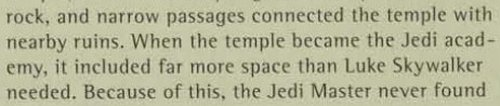
- **Darth Vader (Anakin Skywalker)**: "The Empire maintained the blockade while Darth Vader awaited the completion of the starfleet's first Super Star Destroyer, the Executor, but the blockade's effectiveness was undermined by infighting between forces loyal to Vader, the disgraced Vellam and the House of Tagge." Source: *Geonosis and the Outer Rim Worlds* (SWRPG d20 Revised Core), scan p.154
  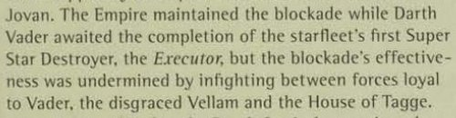

## scan p.155 (scan page 155)

Page contents: Yavin 4: Great Temple's Sith glyphs; Achtnak Turbine Station (Silas, Orman and Ulric Tagge; destroyed by Luke Skywalker); The Dark Temple (Jan Dodonna seals the Blueleaf Cluster temple; Exar Kun's retreat); GemDiver Station (Lando Calrissian); hooks False Fishing, Treasure Hunt, A Lost Lambda begins. (hand-read)

- **Silas Tagge; Orman Tagge; Ulric Tagge; Luke Skywalker** — entry/section: Achtnak Turbine Station: "The scientist Silas Tagge dreamed up a design for a base that would hide in the troposphere of a gas giant and generate a vortex that starfighters could use as a launch corridor, After the Empire dismissed the idea, Baron Orman Tagge committed millions of credits to make his brother's design a reality, naming it after a stealthy forest predator from the Tagge homeworld of Tepasi. Tagge ships towed the station into the Yavin system through a part of the Imperial blockade overseen by a third brother, General Ulric Tagge, and they used the station to harass the Rebels until Luke Skywalker destroyed it in a captured TIE fighter." Source: *Geonosis and the Outer Rim Worlds* (SWRPG d20 Revised Core), scan p.155
  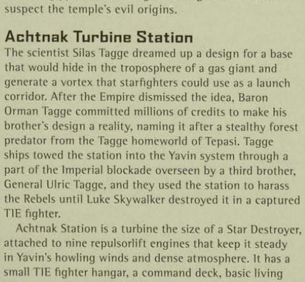
- **Jan Dodonna** — entry/section: Dodonna seals a temple: "General Jan Dodonna ordered the Temple of the Blueleaf Cluster sealed, wary of the crystal pyramid lit with a strange, pulsating cold blue light that stood in its foreboding main chamber," Source: *Geonosis and the Outer Rim Worlds* (SWRPG d20 Revised Core), scan p.155
  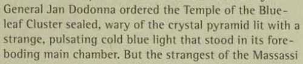
- **Lando Calrissian** — entry/section: GemDiver Station: "On a visit to Yavin 4 after the fall of the Empire, Lando Calrissian hit upon the idea of using technology developed by the Imperial war machine to reinvent Corusca fishing. He refurbished an old space station, christened it GemDiver, and set up shop above Yavin's atmosphere." Source: *Geonosis and the Outer Rim Worlds* (SWRPG d20 Revised Core), scan p.155
  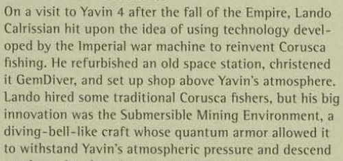
- **Exar Kun**: "The temple was built as a private retreat for Exar Kun; when Skywalker's students discovered the place, they couldn't know that the Sith Lord's spirit still survived." Source: *Geonosis and the Outer Rim Worlds* (SWRPG d20 Revised Core), scan p.155
  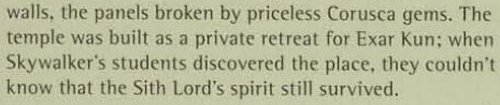

## scan p.156 (scan page 156)

Page contents: Yavin 4: Great Temple map. (hand-read)

## scan p.157 (scan page 157)

Page contents: Yavin 4: sidebar Corusca Fishing (Lando Calrissian; trawlers, skiffs, purse seine; floaters); A Lost Lambda (Death Star shuttle; Grand Moff Tarkin); Sifting Through the Wreckage (Luke Skywalker's torpedo; Ugors; superlaser stations); Dark Riddles; Q-7N begins. (hand-read)

- **Lando Calrissian** — entry/section: Corusca fishing before Lando: "At least until Lando Calrissian tried to revolutionize it, Corusca fishing was a dangerous business requiring daring pilots to work together at the controls of a variety of vessels, adapting ancient fishing methods used on the oceans of countless planets to the atmosphere of a gas giant." Source: *Geonosis and the Outer Rim Worlds* (SWRPG d20 Revised Core), scan p.157
  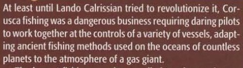
- **Grand Moff Tarkin** — entry/section: The lost shuttle: "Or it could be something or someone that could change the course of" Source: *Geonosis and the Outer Rim Worlds* (SWRPG d20 Revised Core), scan p.157
  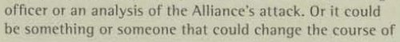
- **Luke Skywalker** — entry/section: Death Star wreckage: "Luke Skywalker’s proton torpedo shattered the Death Star into a vast field of wreckage that Yavin’s immense gravity immediately began to pull into a faint orbital ring." Source: *Geonosis and the Outer Rim Worlds* (SWRPG d20 Revised Core), scan p.157
  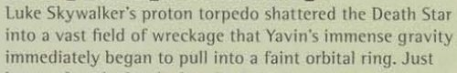

## scan p.158 (scan page 158)

Page contents: Yavin 4: Q-7N (pirate security droid from Malagarr; Hovering Security Droid Scout 4); Bash Fateau (Corusca fisher; Male Human Fringer 3). (hand-read)

### Stat block notes (game mechanics, not feats)

- G-7N stat block: G-7N: Hovering Security Droid Scout 4; Init +2; WP. 22/10; Atk +3 melee (2d6-2, electroshock probe) or +7 ranged (3d4, blaster arm}; SQ Amenable, heart +1, talkative, trailblazing, uncanny dodge; SV Fort +2, Ref +4, Will +2; SZ T; Face/Reach 1 m by 1 m/1 m; FP 0; DSP 0; Rep +1; Str 6, Dex 14, Con 10, Int 10, Wis 10, Cha 10. Challenge Code C. (Source: *Geonosis and the Outer Rim Worlds* (SWRPG d20 Revised Core), scan p.158)
- Bash Fateau stat block: Bash Fateau: Male Human Fringer 3; Init +1; Defense 15 (+4 class, +1 Dex); Spd 10 m; VP/WP 24/15; Atk +2 mel (1d4, knife) or +3 ranged (2d6, blaster pistol); SQ Barter, jury-rig; SV Fort +5, Ref +3, Will +0; SZ M; FP 0; DSP 0; Rep +0; Str 11, Dex 13, Con 15, Int 12, Wis 9, Cha 13. Challenge Code B. (Source: *Geonosis and the Outer Rim Worlds* (SWRPG d20 Revised Core), scan p.158)

## scan p.159 (scan page 159)

Page contents: Yavin 4: Bash Fateau equipment; Amise Griff (Nox Vellam's admiral; under Darth Vader at the blockade; killed microjumping near the Executor; Male Human Noble 6/Officer 2); Kufra Ahara (Female Murachaun Soldier 2/Tech Specialist 4); Ulric Tagge (brothers Orman, Silas, Cassio; sister Domina; Male Human Soldier 2/Noble 3/Officer 2). (hand-read)

- **Darth Vader (Anakin Skywalker)** — entry/section: Amise Griff's last gamble: "Griff's luck seemed to turn when he was reassigned to Darth Vader's command and placed in charge" Source: *Geonosis and the Outer Rim Worlds* (SWRPG d20 Revised Core), scan p.159
  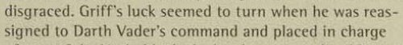
- **Darth Vader (Anakin Skywalker)** — entry/section: Amise Griff's death: "When the Empire finally did attack, he correctly quessed the Rebels’ escape route and tried to beat Vader to the kill with a risky hyperspace microjump. The bet cost him his life: His Star Destroyer emerged from hyperspace just meters from the Executor’s shields." Source: *Geonosis and the Outer Rim Worlds* (SWRPG d20 Revised Core), scan p.159
  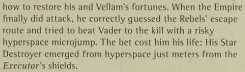
- **Ulric Tagge; Orman Tagge; Silas Tagge; Cassio Tagge** — entry/section: Ulric Tagge's brothers: "Ulric Tagge grew up on the Core World of Tepasi surrounded by his ancient family’s wealth and luxury, and overshadowed by three older brothers: Orman, groomed from birth as the next baron; Silas, a born scientist with no interest in worldly concerns; and Cassio, a cautious, plodding strategist." Source: *Geonosis and the Outer Rim Worlds* (SWRPG d20 Revised Core), scan p.159
  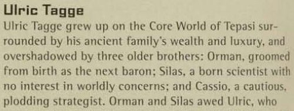
- **Ulric Tagge; Cassio Tagge; Orman Tagge; Palpatine (Darth Sidious)** — entry/section: Ulric Tagge after the Death Star: "But after Cassio died aboard the Death Star, Ulric found himself a pawn in his eldest brother's plots to gain the Emperor's favor." Source: *Geonosis and the Outer Rim Worlds* (SWRPG d20 Revised Core), scan p.159
  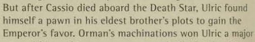

### Stat block notes (game mechanics, not feats)

- Amise Griff stat block: Amise Griff: Male Human Noble 6/Officer 2; Init +0; Defense 16 (+6 class); Spd 10 m; VP/WP 52/12; Atk +5 (1d3, unarmed strike) or +5 ranged (3d6, blaster pistol); SQ Fayor +2 (3/week), coordinate +1, inspire confidence, leadership, requisition supplies; SV Fort +5, Ref +5, Will +11; SZ M; FP 0; DSP 0; Rep +7; Str 10, Dex 11, Con 12, Int 16, Wis 16, Cha 16, Challenge Code D. (Source: *Geonosis and the Outer Rim Worlds* (SWRPG d20 Revised Core), scan p.159)
- Kufra Ahara stat block: Kufra Ahara: Female Murachaun Soldier 2/Tech Specialist 4; Init +0; Defense 14 (+4 class); Spd 10 m; VP/WP 40/14; Atk +6 melee (2d6+1, vibroblade) or +5 ranged (348, heavy blaster pistol); SQ Mechanic specialty research, species bonuses; SV Fort +6, Ref +2, Will +3; SZ M; FP 0; DSP 0; Rep +2; Str 13, Dex 11, Con 14, Int 13. Wis 13, Cha 9. Challenge Code C. (Source: *Geonosis and the Outer Rim Worlds* (SWRPG d20 Revised Core), scan p.159)
- Ulric Tagge stat block: Ulric Tagge: Male Human Soldier 2/Noble 3/Officer 2; Init +1; Defense 17 (+6 class, +1 Dex); Spd 10 m; VP/WP 48/12; Atk +6 melee (1d3+1, unarmed strike) or +6 ranged (3d6+3, blaster pistol); SQ Favor +2 (1/week), inspire con- fidence, leadership, resource access; SV Fort +6, Ref +5, Will +5; SZ M; FP 0; DSP 0; Rep +6; Str 12, Dex 13, Con 12, Int 10, Wis 10, Cha 15. Challenge Code D. (Source: *Geonosis and the Outer Rim Worlds* (SWRPG d20 Revised Core), scan p.159)

## scan p.160 (scan page 160)

Page contents: Yavin 4: Redkihl Rokk (Huralok pirate of the Hungry Ghost; Male Huralok Soldier 4/Scoundrel 9); Arninetoo/R-92 (rogue Columex police droid in the Peace Brigade; Thug 2/Soldier 5); new species Huralok begins. (hand-read)

### Stat block notes (game mechanics, not feats)

- Redkihl Rokk stat block: Redkihl Rokk: Male Huralok Soldier 4/Scoundrel 9; Init +2 (-2 Dex, +4 Improved Initiative); Defense 9 (+4 maximum due to armor, —5 immobile); DR 3; Spd 0 m; VP/WP 71/8; Atk +6/+1 melee (DC 15 stun, elec- troshock probe) or +8/+3 ranged (3d8, heavy blaster pistol); SQ Intimidating, illicit barter, lucky 2/day, precise attack +2; SV Fort +4, Ref +0, Will +6; SZ M; FP 0; DSP 9; Rep +6; Str 3, Dex 6, Con 5, Int 14, Wis 15, Cha 18. Challenge Code F. (Source: *Geonosis and the Outer Rim Worlds* (SWRPG d20 Revised Core), scan p.160)
- R-92 stat block: R-92: Walking R Series Security Droid Thug 2/Soldier 5; Init +6 (+2 Dex, +4 Improved Initiative); Defense 17 (+6 class, +2 Dex, -1 aggressive); DR 7; Spd 6 m; VP/ WP 42/13; Atk +10/+5 melee (2d10+2, integrated vibroax) or +10/+5 ranged (3d8, integrated heavy blaster pistol) or +10/+5 ranged (3d8, integrated heavy blaster rifle) or +10/+5 ranged (3d6, integrated flamethrower); SQ Aggressive; SV Fort +8, Ref +3, Will +0; SZ M; FP 0; DSP 0; Rep +1; Str 15, Dex 14, Con 13, Int 10, Wis 8, Cha 6. Challenge Code D. (Source: *Geonosis and the Outer Rim Worlds* (SWRPG d20 Revised Core), scan p.160)

## scan p.161 (scan page 161)

Page contents: New species Huralok (traits; commoner) and Murachaun (traits; commoner). (hand-read)

## scan p.162 (scan page 162)

Page contents: Back cover: sourcebook blurb (26 Outer Rim planets; Geonosis and Kamino emphasis); credits. (hand-read)

