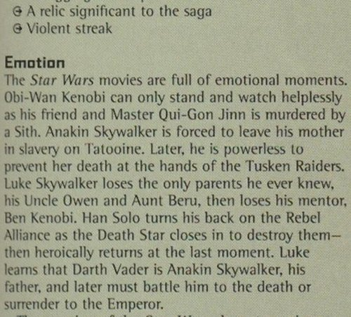
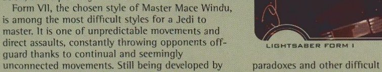

# Owner Material 037 — Star Wars D20 Drive folder (Core, Revised Core and Saga Edition): Sourcebooks/Hero's Guide.pdf [Star Wars Roleplaying Game Revised Core (d20, 2002)] (scan pages 1–60)

- **Source:** Wizards of the Coast Star Wars Roleplaying Game books, web enhancements, Living Force campaign modules and articles (2000–2010), from the owner's "Star Wars D20" Drive folder (only the three edition subfolders; "General" was not read, as instructed). Secondary source (licensed Legends reference). Scan OCR'd on the box; the scan stays box-only and is **not** published.
- **Method:** every scanned page was OCR'd and machine-screened sentence by sentence for power-relevant statements (fights, kills, defeats, Force feats, rankings, superweapons) that name a character on our roster; each kept sentence is quoted verbatim from the OCR text and has a crop of the printed passage directly under it. Pages with nothing power-relevant are still listed with what is on them.
- **Citation:** "*Hero's Guide* (SWRPG d20 Revised Core), p.X" by printed page ("scan p.X" where no printed number applies). **Weight:** Licensed RPG material: a secondary source. Narrative text sums up Legends lore; game statistics are rules for players, not canon power levels, and rank lowest.

## scan p.1 (scan page 1)

Page contents: Cover: Star Wars Roleplaying Game Hero's Guide. (hand-read)

## scan p.2 (scan page 2)

Page contents: Credits (Rodney Thompson, JD Wiker et al., 2003); sources used (D&D, Starships of the Galaxy, Star Wars Gamer "The Sharpshooter" and "The Slicer"). (hand-read)

## scan p.3 (scan page 3)

Page contents: Table of contents: Ch1 Character Creation, Ch2 Character Archetypes, Ch3 Skills and Feats (martial arts and lightsaber form feats), Ch4 Prestige Classes, Ch5 Factions. (hand-read)

## scan p.4 (scan page 4)

Page contents: Table of contents cont.: factions list, Ch6 Equipment, Ch7 Combat, Ch8 The Force (Baran Do, Matukai, Zeison Sha), Ch9 Droids. (hand-read)

## scan p.5 (scan page 5)

Page contents: Introduction: the ultimate player's friend; styles of play; Saga, Depth and Emotion; material drawn from Gamer, the website and Star Wars Galaxies. (hand-read)

## scan p.6 (scan page 6)

Page contents: Chapter One art page (no text). (hand-read)

## scan p.7 (scan page 7)

Page contents: Ch1 Character Creation: Rule Zero (check with your GM); assigning ability scores. (hand-read)

## scan p.8 (scan page 8)

Page contents: Min-maxing and dumping-ground stats; dramatic hooks short form; Saga, Depth and Emotion; Saga (Episode I repercussions to Episode VI). (hand-read)

## scan p.9 (scan page 9)

Page contents: Heroic destinies list (bringing balance to the Force, freeing a trapped Force spirit...); Depth begins (Darth Vader's motivations). (hand-read)

## scan p.10 (scan page 10)

Page contents: Depth: Vader, Luke and Leia's motivations; heroic motivations list. (hand-read)

## scan p.11 (scan page 11)

Page contents: Motivations list cont.; Emotion (Qui-Gon's death, Shmi, Owen and Beru, Han's return, Vader revealed); Other Options (shtick, story meetings). (hand-read)

- **Obi-Wan Kenobi; Qui-Gon Jinn; Darth Vader (Anakin Skywalker); Luke Skywalker; Han Solo** — entry/section: Emotional moments in the films: "The Star Wars movies are full of emotional moments. Obi-Wan Kenobi can only stand and watch helplessly as his friend and Master Qui-Gon Jinn is murdered by a Sith. Anakin Skywalker is forced to leave his mother in slavery on Tatooine. Later, he is powerless to prevent her death at the hands of the Tusken Raiders. Luke Skywalker loses the only parents he ever knew, his Uncle Owen and Aunt Beru, then loses his mentor, Ben Kenobi. Han Solo turns his back on the Rebel Alliance as the Death Star closes in to destroy them— then heroically returns at the last moment. Luke learns that Darth Vader is Anakin Skywalker, his father, and later must battle him to the death or surrender to the Emperor." Source: *Hero's Guide* (SWRPG d20 Revised Core), scan p.11
  

## scan p.12 (scan page 12)

Page contents: Chapter Two art page (no text). (hand-read)

## scan p.13 (scan page 13)

Page contents: Ch2 Character Archetypes: archetypes and variant class features; Demagogue description. (hand-read)

## scan p.14 (scan page 14)

Page contents: Demagogue roleplaying notes; Variant 1 Inspire Sympathy; Table 2-1. (hand-read)

## scan p.15 (scan page 15)

Page contents: Demagogue Variant 2 Inspire Outrage, Variant 3 Demoralize Opponent; Imperial Officer archetype description (cadet to Moff progression). (hand-read)

## scan p.16 (scan page 16)

Page contents: Table 2-2 Imperial Officer (noble/soldier/officer); variants Military Sponsor, War Games, Officer Training. (hand-read)

## scan p.17 (scan page 17)

Page contents: Information Broker archetype description and roleplaying notes; Variant 1 Contacts, Variant 2 Blackmail begins. (hand-read)

## scan p.18 (scan page 18)

Page contents: Table 2-3 Information Broker; Blackmail (Cha check x levels x 30) and Inspire Trust; Jedi Wanderer archetype description. (hand-read)

## scan p.19 (scan page 19)

Page contents: Jedi Wanderer roleplaying notes and Table 2-4 (Jedi consular/scoundrel). (hand-read)

## scan p.20 (scan page 20)

Page contents: Jedi Wanderer variants (Unassuming Appearance, Calming Presence, Bonus Feat list); Outlaw Tech archetype description. (hand-read)

## scan p.21 (scan page 21)

Page contents: Table 2-5 Outlaw Tech (scoundrel/tech specialist); variants Inherent Understanding, Make It Fit, Hold Together. (hand-read)

## scan p.22 (scan page 22)

Page contents: Prowler archetype description and roleplaying notes (calling cards). (hand-read)

## scan p.23 (scan page 23)

Page contents: Table 2-6 Prowler (scoundrel/soldier/infiltrator); variants Advanced Preparations, Confidence, Agile; Rebel Officer description begins. (hand-read)

## scan p.24 (scan page 24)

Page contents: Rebel Officer description, roleplaying notes and Table 2-7 (soldier/noble/officer/elite trooper). (hand-read)

## scan p.25 (scan page 25)

Page contents: Rebel Officer variants (Expanded Bonus Feat List, Rebel Training, Inspire Troops); Scrounger description. (hand-read)

## scan p.26 (scan page 26)

Page contents: Scrounger roleplaying notes, Variant 1 Scrounging (Search check value table) and Table 2-8 (fringer/tech specialist). (hand-read)

## scan p.27 (scan page 27)

Page contents: Scrounger variants Fixer-Upper and Stroke of Genius; Shipjacker description (Rebel and CIS use of shipjackers). (hand-read)

## scan p.28 (scan page 28)

Page contents: Shipjacker cont. and Table 2-9 (soldier/scout). (hand-read)

## scan p.29 (scan page 29)

Page contents: Shipjacker variants Hot Wire, Zero-G Combatant, Marauder; Spirit Adept description and Table 2-10 (Force adept/fringer). (hand-read)

## scan p.30 (scan page 30)

Page contents: Spirit Adept roleplaying notes across eras (Purges, Luke Skywalker's Jedi Academy, Yuuzhan Vong); variants Spellcaster, Second Sight, Spirit Counsel; Urban Adept description. (hand-read)

## scan p.31 (scan page 31)

Page contents: Table 2-11 Urban Adept; roleplaying notes; variants Civilized Adept, Force Target, Vanish. (hand-read)

## scan p.32 (scan page 32)

Page contents: Chapter Three art page. (hand-read)

## scan p.33 (scan page 33)

Page contents: Ch3 Skills and Feats intro; Old Skills, New Tricks; Bluff (Seduction). (hand-read)

## scan p.34 (scan page 34)

Page contents: Bluff (Sending a Secret Message); Climb (Grab My Arm!); Computer Use (Shipboard Security). (hand-read)

## scan p.35 (scan page 35)

Page contents: Computer Use (Communications, Scramble, Cover Tracks, gaining access); Craft (cybernetics); Disguise (Disguise Object time table). (hand-read)

## scan p.36 (scan page 36)

Page contents: Escape Artist (Retrieve); Gather Information (Chain of Command, Table 3-1); Handle Animal (Organic Technology); Hide (Conceal, Tailing). (hand-read)

## scan p.37 (scan page 37)

Page contents: Intimidate (Demoralize); Listen; Move Object (Force Jump, Force Fall, Multi-target, Fine Manipulation, Forcing Locks); Sense Motive (Combat Readiness). (hand-read)

## scan p.38 (scan page 38)

Page contents: Sense Motive (Discern Strategy); Sleight of Hand (Drop, Conceal Weapon); Telepathy (Force Boost); Treat Injury (Diagnose); New Feats: Agile Riposte. (hand-read)

## scan p.39 (scan page 39)

Page contents: Feats: Aristocrat's Honor, Armor Familiarity, Artistic, Blasterslinger, Card Shark, Climate Specialization, Combat Veteran, Consular's Guidance. (hand-read)

## scan p.40 (scan page 40)

Page contents: Feats: Contact, Cosmopolitan, Cybernetic Surgery, Dark Power, Defensive Throw, Diplomatic Immunity. (hand-read)

## scan p.41 (scan page 41)

Page contents: Table 3-2 Diplomatic Immunity; feats Dual Strike, Extended Rage, Extra Lucky, Guardian's Guidance, Gun Crew Chief, Impersonator, Improved Effort, Improved Feint. (hand-read)

## scan p.42 (scan page 42)

Page contents: Feats: Improved Grapple, Improved Overrun, Improvisational Fighting, Inventor, Kinetic Combat (Force feat) begins. (hand-read)

## scan p.43 (scan page 43)

Page contents: Kinetic Combat attacks-per-round table; Kinetic Might; Kit-Bashing (Table 3-3); Lesser Blindsight; Lithe; Merchant Trader. (hand-read)

## scan p.44 (scan page 44)

Page contents: Feats: Mounted Combat, Off-Hand Parry, Peacemaker, Perfect Memory, Political Pull, Powerful Presence. (hand-read)

## scan p.45 (scan page 45)

Page contents: Feats: Primal Sympathy, Ranged Disarm, Redirect Attack, Resist Poison, Ride-By Attack, Rogue Heritage, Self-Sufficient, Shadow, Shady Merchant. (hand-read)

## scan p.46 (scan page 46)

Page contents: Feats: Skeptical, Spellcaster, Spirited Charge, Street Smart, Stunning Strike, Superior Expertise. (hand-read)

## scan p.47 (scan page 47)

Page contents: Feats: Surefooted, Technical Wizard, Trade Route Familiarity, Unbalance Opponent, Up the Walls (example Padawan Ydnen), Weapon Specialization, Worldwise; Martial Arts Feats intro. (hand-read)

## scan p.48 (scan page 48)

Page contents: Using Martial Arts Feats; Echani (Palpatine's Royal Guards' style, from the Sun Guards of Thyrsus) with Expertise/Mastery; K'tara. (hand-read)

## scan p.49 (scan page 49)

Page contents: K'tara Expertise/Mastery; K'thri (Old Republic sport style) with Expertise/Mastery; Stava (Noghri style). (hand-read)

## scan p.50 (scan page 50)

Page contents: Stava Expertise/Mastery; Teras Kasi (Bunduki, Followers of Palawa) with Expertise/Mastery; Wrruushi (Wookiee-only). (hand-read)

## scan p.51 (scan page 51)

Page contents: Wrruushi Expertise/Mastery (killing blow); Lightsaber Form Feats intro (seven forms; very few Jedi master more than one). (hand-read)

## scan p.52 (scan page 52)

Page contents: Lightsaber forms IV-VII described (Form VI the "diplomat's form"); Using Lightsaber Form Feats. (hand-read)

- **Mace Windu** — entry/section: Form VII, Mace Windu's chosen style: "Form VII, the chosen style of Master Mace Windu, is among the most difficult styles for a Jedi to master. It is one of unpredictable movements and direct assaults, constantly throwing opponents off-guard thanks to continual and seemingly unconnected movements." Source: *Hero's Guide* (SWRPG d20 Revised Core), scan p.52
  

## scan p.53 (scan page 53)

Page contents: Form I-VII Mastery Force feats. (hand-read)

## scan p.54 (scan page 54)

Page contents: Chapter Four art page. (hand-read)

## scan p.55 (scan page 55)

Page contents: Ch4 Prestige Classes intro; Chief Engineer description (BlasTech, KDY, Rothana, Baktoid). (hand-read)

## scan p.56 (scan page 56)

Page contents: Chief Engineer (Raith Sienar, Bevel Lemelisk as examples); requirements, class skills, Personal Design. (hand-read)

## scan p.57 (scan page 57)

Page contents: Table 4-1 Chief Engineer; Efficiency, Structural Analysis, Resource Access, Solid Construction; Infiltrator description (Katarn Commandos, Red Moons, Storm Commandos). (hand-read)

## scan p.58 (scan page 58)

Page contents: Infiltrator requirements, class skills, Covert Movement, Skill Mastery, Sneak Attack. (hand-read)

## scan p.59 (scan page 59)

Page contents: Table 4-2 Infiltrator; Ambush, Uncanny Hide; Loyal Protector description and requirements. (hand-read)

## scan p.60 (scan page 60)

Page contents: Loyal Protector class skills; Decoy, Harm's Way, Shielding Strike, Deflect Attack. (hand-read)

